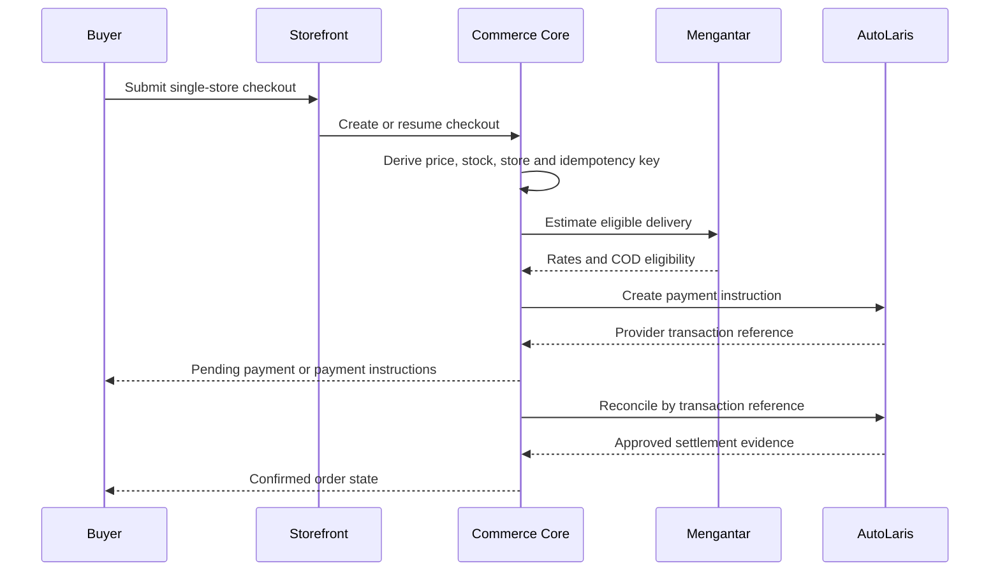

# Bukalaris Technical Design

| Field | Value |
|---|---|
| Status | Draft |
| Owner | Bukalaris architecture owner |
| Scope | Phase 1 boundaries and future-safe seams |

## TD-1 — Canonical commerce core

- Status: Proposed
- Owner: Bukalaris architecture owner
- Decision: Bukalaris owns a canonical commerce model for tenants, stores,
  catalog, orders, checkout, shipping, payment attempts, and marketplace
  listings. An external seller system integrates through a versioned connector
  or import boundary, never direct unrestricted database access.
- Consequence: Marketplace and reporting read consistent platform records;
  connector conflict/deletion policy remains a later decision.

## TD-2 — Shared runtime, explicit tenant context

- Status: Proposed
- Owner: Bukalaris architecture owner
- Decision: One control-plane runtime, Seller CMS runtime, and host-resolved
  storefront runtime serve multiple tenants. Every tenant-scoped operation has
  a server-derived tenant/store context and database enforcement.
- Consequence: No per-seller code fork/deploy is needed; isolation becomes a
  release-critical control.

## TD-3 — Provider orchestration boundary

- Status: Proposed
- Owner: Bukalaris integration owner
- Decision: Create a server-only shipping adapter (Mengantar aggregator) and
  payment adapter (AutoLaris H2H). The order service persists its stable
  reference before calling a provider and records provider references/result
  envelopes separately from the order state. Merchant-facing and shopper-facing
  surfaces never expose raw provider brand names (`Mengantar`, `AutoLaris`); they
  render platform white-label names (`Bukalaris Kirim` and `Bukalaris Bayar`),
  guarded by an automated source check (ADR-0006).
- Constraints: AutoLaris enabled channels must come from its account-specific
  `list_payment`; prepaid checkout bills `order_payable + admin_fee` via
  `/submit` (`alCreateOrder`) while `advice` reconciliation runs observe-only
  until live status codes are verified. Mengantar estimate eligibility controls
  offered courier/COD choices and snapshots platform shipping margin.
- Consequence: No browser call holds a provider secret; unknown transport
  results are reconciled rather than blindly recreated.

## TD-4 — Published content and checkout boundary

- Status: Proposed
- Owner: Bukalaris product owner
- Decision: Seller CMS creates draft/published content. A section-based,
  independently styled landing-page builder is planned after Phase 1 with MCP support
  (PR-9). Landing pages render within the host-resolved storefront and use its
  existing catalog, cart, and checkout; the builder cannot modify checkout
  logic, payment, shipping, or server-derived pricing.
- Proposal: The Seller CMS and MCP adapter use the same content validation and
  authorization boundary, draft records, and publication lifecycle. The MCP
  adapter does not write directly to the database or deploy a separate site.
  Landing-page routes use a dedicated layout and scoped LP styles; they do not
  load the active storefront theme's shell, global styles, or mutable tokens.
  LP design settings belong to the page revision. Commerce components use shared
  store services with LP presentation. Route shape and typed section schemas
  remain design decisions under T-11.
- Consequence: Seller branding is extensible without making the highest-risk
  commerce path arbitrary.

## TD-5 — Marketplace projection

- Status: Proposed
- Owner: Bukalaris product owner
- Decision: Marketplace visibility is a projection of a seller product through
  a separate `marketplace_listing` lifecycle. Phase 1 orders remain store-owned.
- Consequence: Bukalaris can curate product discovery before undertaking
  multi-seller checkout and settlement.

## Critical flow

## Failure policy

| Boundary | Expected rejection | Unknown/timeout | Forbidden shortcut |
|---|---|---|---|
| Cart validation | Explain unavailable/changed item | Refresh authoritative catalog | Trust browser price/stock |
| Mengantar estimate | Hide ineligible method | Allow retry or another method | Offer COD when provider says unsupported |
| AutoLaris creation | Keep checkout/order pending with same reference | Reconcile before retrying creation | Create a second bill automatically |
| Payment reconciliation | Remain pending until policy proves paid | Schedule bounded retry/escalation | Treat shipping status as payment |
| Shipment creation | Keep fulfillment unbooked | Reconcile provider reference | Dispatch solely because payment is paid |

## Engineering principles

Proposal: Use host-based storefront isolation, explicit builder trust
boundaries, and immutable money allocation. Validate the Bukalaris stack,
provider contracts, and legal/finance policy before implementation. Independent
LP composition follows the builder contract below.

## Builder technology research — 2026-09-18

Status: Proposal. Owner: Bukalaris architecture owner. Derived from PR-9,
UI-6, UX-7 and the official sources below. This selects a candidate for a spike,
not an installed dependency or accepted stack decision.

| Candidate | Verified capability | Fit assessment (inference) |
|---|---|---|
| Puck core | React component editor, custom components, MIT core, own data, configurable viewport previews | Preferred if the repository supports React: curated commerce sections and a shared visual/MCP document are a close fit |
| Craft.js | React editor building blocks with drag-and-drop and custom editing UI | Flexible fallback when bespoke interactions justify building more of the editor shell |
| GrapesJS Studio SDK | Embeddable editor with a React renderer; license plans include session/domain/branding conditions | Alternative if a broader visual studio is needed and its commercial model fits; distinguish Studio SDK from the open-source GrapesJS framework |

Official sources inspected on 2026-09-18:

- [Puck introduction](https://puckeditor.com/docs): custom React components,
  MIT core, external data sources, and server-component support.
- [Puck viewports](https://puckeditor.com/docs/integrating-puck/viewports):
  configurable preview widths in a same-origin iframe. This is preview
  isolation, not proof of published-page theme isolation or mobile editor UX.
- [Puck repository](https://github.com/puckeditor/puck): editor data is saved by
  the host application and rendered separately with its component config.
- [Craft.js repository](https://github.com/prevwong/craft.js): editor primitives
  and user-defined React editing interfaces.
- [Studio React renderer](https://app.grapesjs.com/docs-sdk/plugins/custom-renderer/react)
  and [Studio pricing](https://grapesjs.com/sdk/pricing): integration and
  commercial constraints; recheck terms before adoption.
- [MCP server concepts](https://modelcontextprotocol.io/docs/learn/server-concepts):
  schema-defined tools for AI-invoked operations.

Proposal: Evaluate Puck core with composable layout/content components and
saved page data. Prebuilt sections are optional starting points, not the limit
of LP composition. The spike must demonstrate independent layout and styling
around a platform form component whose protected contract survives UI and MCP
edits. If Puck needs excessive restrictions or custom work for this freedom,
reassess the candidates; the earlier curated-section fit is no longer sufficient.
Build a Bukalaris MCP adapter against the same validated content operations;
this recommendation does not assume a built-in Puck MCP server or require
Puck's separate cloud AI product. Version the saved document and validate all
component types, props, product references, and revisions server-side.
Keep editor code out of published buyer pages. Use server rendering where the
chosen stack supports it, hydrating only interactive commerce controls.

Unknown: Pinned versions, touch editing quality,
keyboard reordering, public-page rendering cost, and migration effort. T-11
must prove a product section can be added, edited, reordered, saved, reopened,
changed through MCP, and published without losing state or loading the editor
on the buyer page. Test a physical touch device and keyboard interaction;
viewport simulation alone is insufficient. Do not force a framework migration
solely to adopt this recommendation.

### Puck custom field overrides and shared section registry (adopted from Etalashop `THEME_EDITOR_SPEC.md`, 2026-10-26)

To prevent the Landing Page Builder (`T-11`, building on `T-42`'s typed blocks and immutable `landing_page_revision` table) from shipping bare URL text boxes or drifting between editor preview and storefront rendering:

1. **Single typed section registry:** Keep one canonical section schema and default-props registry shared between the `/seller/landing-pages/[id]` editor preview and the `/s/[store]/lp/[slug]` public server renderer so adding or changing a block type is a compile-time TypeScript contract.
2. **Base-UI field overrides (`@base-ui/react`):** Because Bukalaris's shadcn setup runs on `@base-ui/react` (not Radix; triggers use `render`, not `asChild`, DECISIONS D-1), Puck's `overrides.fieldTypes` swaps default inputs for Bukalaris's Base-UI primitives and adds two rich custom field modals:
   - **Image Picker modal (`type: "custom"`):** Replaces raw image URL inputs with a searchable dialog offering tabs for **Upload baru** (writes to store-scoped `media`), **Galeri toko** (existing store media), **Gambar produk**, **Koleksi**, and **URL eksternal tervalidasi**.
   - **Link Picker modal (`type: "custom"`):** Replaces raw `href`/`ctaHref` text inputs with a searchable dialog for **Produk** (`/products/<slug>`), **Koleksi** (`/collections/<slug>`), **Halaman CMS** (`/pages/<slug>`), or **URL**.
3. **Locked commerce form boundary:** The `order` section inside any landing page binds only to a store-owned `product_id` and renders the platform-controlled variant/quantity selector that hands off to `/checkout`; neither visual Puck edits nor MCP tools can inject custom form fields or bypass server-side checkout pricing.

## Headless and checkout integration correction

Source: PR-16 and ARCH-7. Native themes, LP and external storefronts share
catalog/cart services, then hand off to the platform-owned /checkout surface.
Earlier references to a storefront purchase flow describe the buyer journey,
not ownership of checkout layout or submission. External storefront developers
use scoped private channel tokens and a returned checkout_url. Hosted checkout
session APIs, not storefront tokens, own quoting and final order submission.
See API-8 and openapi.yaml for the current draft transport contract.

## TD-6 — Bukalaris MCP content gateway

- Status: Proposed
- Owner: Bukalaris architecture owner
- Source: PR-17 and the Model Context Protocol server contract reviewed on 2026-09-18.
- Decision: Provide one Bukalaris MCP gateway with capability-filtered resources,
  tools, and prompts. The gateway is an adapter over the same application
  services used by Seller Admin and the versioned HTTP boundary; it is not a
  database proxy, a second content model, or a privileged Owner console channel.
- Acceptance: UI and MCP edits produce the same validation, authorization,
  revision conflict, audit, preview, and publication outcomes. Tool inputs and
  structured outputs use explicit schemas. An MCP connection resolves exactly
  one authenticated actor and allowed store context before resource discovery.
- Constraints: API-9, IAM-12, DATA-6, TEN-1, SEC-9, OBS-5.
- Evidence: Design proposal only; transport and SDK await repository selection.
- Change history: 2026-09-18 — defined the shared MCP catalog/content boundary.

### Capability groups

| Group | Read resources | Draft tools | Controlled action |
|---|---|---|---|
| Catalog | Products, variants, prices, inventory summaries and validation status | Create/edit product or variant draft; assign categories/collections; validate product | Publish/archive requires catalog publication capability and human approval |
| Taxonomy and merchandising | Category tree, collections and product membership | Create/edit/reorder category or collection drafts | Publish navigation-visible changes with explicit approval |
| Editorial | Articles, CMS pages, menus, media metadata and link graph | Create/edit article/page/menu drafts; attach owned media; validate links | Publish/unpublish requires content publication capability |
| Landing pages | LP document, revisions, components, preview validation | Create/edit/reorder LP draft through the shared document service | Publish follows PR-9 form and revision controls |
| Store context | Public profile, theme metadata, domains and channel status | Prepare proposed settings changes | Domain, credentials and checkout settings remain outside content tools |
| Engineering/operations | Page map, OpenAPI, sanitized diagnostics and correlation links | None through seller-content grants | Privileged diagnostic tools require separate Owner console capability |

Resources are passive context and never authorize mutation. Tools call named
application operations with expected revisions and idempotency where needed.
Prompts guide repeatable jobs such as `prepare-product`, `organize-category`,
`draft-article`, `audit-content`, and `prepare-landing-page`; prompts grant no
additional permission. The protocol's human-approval UI is reinforced by
server-side publication capability and audit checks.

### Content workflow

1. Discover the store-scoped resource or search result.
2. Read the current object, revision, validation state, and allowed actions.
3. Create or update a draft with `expected_revision`.
4. Validate slugs, category/collection membership, media ownership, links,
   structured content, required product fields, and protected form nodes.
5. Return structured validation findings and a private preview resource.
6. Publish only through an explicit publication tool when the grant and human
   approval both allow it; failure preserves the previous published version.

Bulk work is a bounded draft job with per-item results, dry-run support, limits,
and resumable identifiers. It is not an arbitrary database batch. Raw HTML,
executable JavaScript, provider secrets, unrestricted file URLs, customer/order
PII, and unbounded SQL/search expressions are excluded from MCP content inputs.

Official basis: MCP servers expose schema-defined tools, passive resources, and
user-invoked prompts; sensitive tools should retain human oversight. See
[server concepts](https://modelcontextprotocol.io/docs/learn/server-concepts)
and [tools](https://modelcontextprotocol.io/specification/2025-06-18/server/tools).

## TD-7 — Surface and package structure

- Status: Accepted as a decision (ADR-0008, owner 2026-10-28; first recorded 2026-10-27);
  T-51 (one app with route groups) and T-70 (per-surface origins) are implemented locally
  and uncommitted, nothing is deployed. TD-6 remains the separate MCP content-gateway contract.
- Owner: Bukalaris architecture owner
- Source: [ADR-0008](ADR-0008-platform-architecture-and-routing.md); DECISIONS
  D-2, D-3, D-4, D-9; ADR-0005, ADR-0010; ARCH-5; PR-7, PR-18, PR-27, PR-28, PR-29.
- Statement: Keep one Next.js App Router app, `apps/web`, with explicit route
  groups for platform/operator, seller, storefront, checkout, affiliate portal,
  affiliate storefront, buyer portal, the public Update Log (`(update-log)`),
  identity, public services and a small public platform group (`(public)`: the
  report page and the referral link). Groups organize layouts, not URLs or
  authorization. `src/proxy.ts` dispatches exact platform hosts before
  affiliate/store hosts: Owner console `owner` → `/admin`, seller `app` →
  `/seller`, affiliate → `/affiliate`, buyer → `/buyer`, logs → `/updates`; `berkah`
  and `bos` are retired/reserved-unused. `/checkout` and `/api` stay un-rewritten. The
  existing `/admin`, `/seller`, `/s/<store>` and checkout URL/layout boundaries
  remain unchanged during T-51; T-70 activates host dispatch and per-surface
  sessions (08 DOM-5, DOM-6). Reserve `owner` (the active Owner console host
  label), `app`, `affiliate`, `buyer`, `logs`, `checkout`, `cname`, the retired
  `berkah` and `bos`, and all existing
  infrastructure labels from store/affiliate claims.
- Decision: Reorganize `packages/db/src` into `platform/`, `billing/`,
  `buyer/`, `seller/commerce/`, `storefront/`, `shipping/`, `payments/`, `affiliate/`,
  `tax/` and `ops/jobs/` (with logs in `ops/`, `worker.ts` and `cleanup.ts` kept as thin root entry points so deployment commands do not move, and minimal root infrastructure). Domain schema
  declarations live beside their services; shared SQL names and migration
  history do not change. Keep one package/database, explicit server-only
  imports and the ADR-0005 owner/app/platform role separation; no generic
  repository, new broker or per-context package is required.
- Decision: The proposed `(buyer-portal)/buyer/` subtree and `buyer/` data context
  own the buyer surface and platform-level buyer identity tables. ADR-0010 and
  PR-7 alone define buyer identity behavior. Buyer, Seller Admin, Owner console
  and Affiliate portal have separate host-only cookie scopes and session
  audiences, never shared sessions or parent-domain session cookies. A buyer
  session grants no admin capability; buyer services do not expose privileged
  pools or bypass store RLS.
- Decision: `logs.bukalaris.com` is the public, read-only product Update Log
  (release notes), rewritten to a proposed `(update-log)/updates/…` route group.
  It is not the internal Log System (`/admin/logs`, PR-11). Its code lives in
  `platform/updates` (platform-owned, no store scope, operator-authored, small;
  no new top-level context). It has no session and no cookies of its own, carries
  no personal data, and is authored only in the Owner console on `owner`.
  Cacheability conflicts with the current per-request nonce CSP and request-id
  cookie in `proxy.ts`: it needs a host-specific proxy profile (static CSP, no
  per-request cookie) owned by T-69, with freshness by time-based staleness or
  the internal handler HTTP-30, and is UNVERIFIED until implemented.
- Decision: Platform-owned affiliate data is not a seller tenant. Affiliate
  discovery uses the outbox-fed `affiliate_catalog` projection of opted-in
  seller products, with `source = bukalaris` only in Phase 1. Seller eligibility
  settings retain store RLS; affiliate-private services scope reads to the
  authenticated affiliate and apply bank/phone masking in the data layer.
  Seller orders/checkout remain store-owned and one store per order (TD-5).
- Acceptance: T-51 inventories the current 47 pages and 17 handlers plus ARCH-5
  background entries, moves existing files/callers/configuration in mechanical
  steps and records a one-to-one after-map with stable IDs and no changed
  routes, behavior, layout inheritance, RLS or job payloads. No duplicate App
  Router paths, schema-change SQL from moves, stale imports or obsolete
  compatibility paths remain. ARCH-5 is regenerated against actual moved files;
  lint, typecheck, test, build and e2e are green in implementation evidence.
- Constraints: D-9 append-only migrations; transaction-local `app.store_id`,
  forced RLS and compound store foreign keys stay intact. The platform pool
  stays behind authorized services/resolvers, never exposed through seller or
  public imports. Moving code does not activate new hosts or deliver affiliate,
  billing or buyer features; T-70 (host dispatch and per-surface auth), T-50,
  T-52 through T-55 and the implementation of ADR-0010/PR-7 own those
  behaviors. Build order is the TASKS.md dependency graph (its header and each
  task's `Dependencies:` line), not restated here.
  External connectors (T-56) and multi-seller settlement (BILL-3) are deferred.
- Consequence: The historical Astro/multi-app recommendation below is not the
  next build target. Refine D-2's old split trigger: multiple apps wait for a
  demonstrated deploy/runtime/security isolation need, while distinct hosts,
  layouts and cookie audiences can be implemented in one app.
- Evidence: Repository source inspection on 2026-10-27; target structure,
  affiliate/buyer routes and new host dispatch are proposals. DNS/TLS, deployed
  origin/session isolation and nested affiliate wildcard support are
  **UNVERIFIED**. ADR-0008 owns the full target trees and move sequence.
- Change history: 2026-10-27 — documentation audit pass: added the `tax/` context,
  the `(update-log)` and `(public)` groups, the T-70 host-activation task and the
  worker/cleanup entry-point rule; the build order now lives only in TASKS.md
  (audit TRC-3, TRC-7, OPS-01, OPS-22, OPS-25).

## Rendering and cache implementation baseline

Status: **Superseded** for the Astro and separate-checkout-app parts of this
section (DECISIONS D-2, ADR-0008, TD-7 and T-51: one Next.js app `apps/web` with route
groups serves every surface, including checkout, and Astro is not the build target;
T-51 is implemented locally and uncommitted). The paragraph below is kept as history.
The cache rules in the paragraph after it still apply.

Historical decision (superseded): Next.js owns the Owner console and Seller Admin. Historical recommendation
(superseded): Astro renders marketing
statically and store content on demand because tenant host, published revisions
and availability vary per request. Use Next.js for the separate checkout app (superseded:
checkout is a route group of the same app on its own origin).
Marketing stays available without a database call. Hydrate only interactive
leaves; keep the future builder/editor out of public storefront bundles.

Proposal: Start authenticated admin, cart and checkout responses with private,
no-store behavior. Public catalog caching must include resolved store, host,
locale and published revision, with invalidation after committed edits. Never
share personalized output or trust cached prices for order submission. Test
cross-host cache isolation against the deployed proxy and adapter.

Evidence: Official documentation retrieved on 2026-09-25 supports these
framework capabilities, not Bukalaris runtime performance:
- [Next.js server/client boundaries](https://nextjs.org/docs/app/getting-started/server-and-client-components)
- [Astro islands](https://docs.astro.build/en/concepts/islands/)
- [Astro on-demand rendering](https://docs.astro.build/en/guides/on-demand-rendering/)
- [shadcn/ui on Next.js](https://ui.shadcn.com/docs/installation/next)
- [Tailwind with Astro](https://tailwindcss.com/docs/installation/framework-guides/astro)

