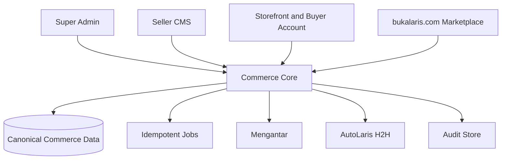
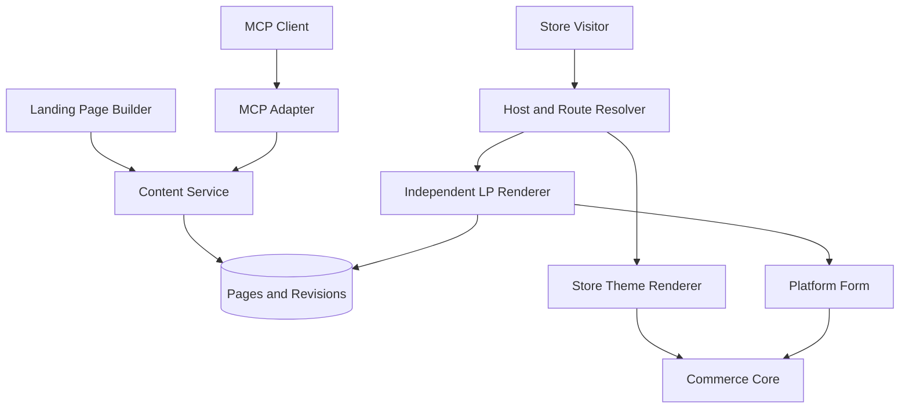
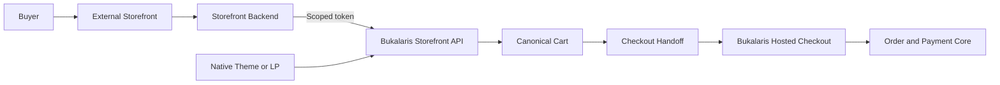

# Bukalaris System Architecture

| ID | Statement | Status | Owner |
|---|---|---|---|
| ARCH-1 | Bukalaris initially delivers Super Admin, Seller Admin (Seller CMS), and Storefront; Buyer Account, Marketplace, and Affiliate surfaces are later scope. | Proposed | Architecture owner |
| ARCH-2 | A trusted commerce core owns authorization, tenant context, catalog/order state, provider orchestration, jobs, and audit records. | Proposed | Architecture owner |
| ARCH-3 | Public hosts resolve to a single store or to the Bukalaris marketplace before content/data access. | Proposed | Platform owner |

## Trust boundaries

| Boundary | Trusted input | Required control |
|---|---|---|
| Browser to application | Request identity, host, cart intent | Validate schema; derive store, price, stock, total, entitlement server-side |
| Storefront host resolution | Host header through known proxy chain | Normalize/allowlist host, resolve exactly once, cache by host and tenant safely |
| Seller CMS | Session and active membership | Server-side membership/capability checks; no client tenant selector trust |
| Provider calls | Server-only credentials and approved response contract | Timeouts, idempotency, redaction, reconciliation, least privilege |
| Jobs/webhooks | Provider/queue event | Authenticate before parse/side effect; deduplicate durable event/reference |
| Admin operations | Operator identity and declared reason | Confirmation where risk warrants; immutable audit record |

## Deliberate boundaries

- A storefront has no ability to query cross-tenant administration.
- A seller cannot configure platform credentials or access another seller's
  buyer/order data.
- Marketplace discovery does not make an approved listing a platform-owned
  product, payment, or settlement obligation.
- A future connector ingests normalized records; it does not receive database
  superuser/network access.

## Stack and application boundaries

Decision, 2026-09-25: Next.js App Router, TypeScript with strict checking,
shadcn/ui, and Tailwind CSS are selected for the admin applications.
Recommendation: Use the following monorepo layout, with one commerce core and
one PostgreSQL database. Paths are proposed locators. What exists on `main`
(2026-10-07) is a single Next.js app `apps/web` serving every surface and one
package `packages/db` (DECISIONS D-2, deliberate ceiling); the worker and the
maintenance command are `packages/db/src/worker.ts` and `cleanup.ts` run from
the same image with a different command. The row-by-row route map is ARCH-5.

| Application | Framework and rendering | Host / role |
|---|---|---|
| `apps/bos` | Next.js; Server Components with small interactive client leaves | `bos.bukalaris.com`; platform operators, own privileged HTTP handlers |
| `apps/app` | Next.js; server-first admin and Route Handlers | `app.bukalaris.com`; tenant admin and central commerce HTTP API |
| `apps/web` | Astro; static marketing pages | `bukalaris.com`; product front door, future marketplace requires its own release |
| `apps/storefront` | Astro on-demand rendering with a Node adapter | Store subdomains/custom domains; one runtime for every tenant |
| `apps/checkout` | Next.js; dynamic, private, platform-owned layout | Recommended `checkout.bukalaris.com`; checkout and confirmation |
| `apps/worker` | Node.js background process; no public browser UI | Durable provider reconciliation and outbox jobs |

Recommendation: Use TypeScript throughout, Tailwind CSS v4 for styling,
PostgreSQL with Drizzle for persistence, and a Node LTS runtime. Pin compatible
versions and the package manager in the first repository baseline; this pack
makes no installed-version claim. Use a single workspace lockfile.

Proposed shared boundaries: `packages/core` owns authorized business operations;
`packages/db` owns Drizzle schema, migrations and tenant-aware transactions;
`packages/contracts` owns reusable validation/types; `packages/ui` owns React
admin primitives; `packages/tokens` owns CSS design tokens. Browser bundles
cannot import database, provider or credential code. Astro uses native semantic
markup and shared tokens; React/shadcn islands are limited to interactions that
need them. A consistent appearance does not require whole-page hydration.

Next.js Server Components/Actions invoke core services directly; they do not
call their own HTTP endpoints. External clients use the versioned HTTP adapter.
First-party Astro server rendering invokes the same scoped core read services;
its minimal same-origin cart adapter invokes the same cart service. No commerce
rules are reimplemented in Astro. External storefront tokens are server-only.
Checkout alone hosts checkout-session handlers and final submission.

Recommendation: Begin with a PostgreSQL outbox and bounded worker retries rather
than a separate broker. Commit business changes and durable job intent together;
claim jobs safely, use idempotent operations, and reconcile uncertain provider
outcomes. Media uses private S3-compatible object storage with validated uploads
and an explicit public-delivery policy. Choose providers before provisioning.

## Remaining deployment choices

Hosting vendor, region, storage vendor, email/auth adapter, observability sink,
package versions and recovery capacity remain to be validated before build and
release. Prefer supported Node deployments initially; do not assume the Next.js
server can run unchanged on an edge runtime. No resources are provisioned here.

## ARCH-4 — Independent landing-page module

- Status: Proposed
- Owner: Bukalaris architecture owner
- Source: PR-9; Paduka Ongki's architecture request on 2026-09-18.
- Statement: Start with the monorepo applications above, bounded commerce modules and one
  canonical database. Landing-page independence is a rendering/content boundary,
  not a requirement for a separate deployment, database, or commerce backend.
  Seller CMS hosts Landing Page Builder. Visual editing and an MCP adapter call
  the same authorized content service. Storefront routing chooses either the
  active store theme renderer or the independent landing-page renderer.
- Acceptance: A theme switch cannot alter an LP revision or its presentation;
  UI and MCP operations enforce the same ownership, revision, and form rules.
  Public rendering reads only the published revision and excludes editor code.
- Constraints: PR-9, TD-4, API-3, UI-6, UX-7, TEN-1, DATA-1.
- Evidence: Architecture proposal; no LP runtime on `main`. T-42 (track
  `landing`, wave 4) implements landing pages v1 with typed blocks, draft and
  published revisions and `/s/[store]/lp/[slug]`; visual builder and MCP stay
  future (T-11, T-20). Module stubs `packages/db/src/landing.ts`,
  `schema-landing.ts` exist and are empty.
- Change history: 2026-09-18 — proposed module ownership and render separation.
  2026-10-07 — T-42 scope noted.

### Module ownership

| Module | Owns | Must not own |
|---|---|---|
| Tenant/host resolution | Trusted store context and domain mapping | Page appearance |
| Store themes | Theme choice and standard catalog/store page presentation | LP layout or LP style defaults at render time |
| Landing pages | Page documents, independent appearance, draft/revision/publish lifecycle | Alternative price, payment, or order truth |
| Visual builder | Canvas, content/layout controls, undo/redo, draft editing | Direct database writes or published-state authority |
| MCP adapter | AI-facing schemas and delegation to content operations | Separate page format or authorization bypass |
| Platform forms | Versioned form contract, validation and allowed configuration | Overall LP composition |
| Commerce core | Catalog, cart, checkout, order and provider behavior | Editor-specific layout data |

### Proposed route and render boundary

Use the current store origin for both page types. A reserved `/lp/<slug>`
namespace is the initial proposal; it avoids collisions with product,
collection, cart, account, and checkout routes. This is not a final route API.
Resolve host and store status before looking up the LP by store and slug.

The LP route loads its own root layout, styles, and document settings. It does
not nest inside the active store theme's layout. Shared infrastructure may
include locale, consent, and commerce context without injecting theme CSS.
The public page is rendered directly; the editor's preview iframe does not
imply a public iframe. LP form submission derives store context server-side.

### Proposed save, publish, and cache boundary

1. Visual editor or MCP submits a validated document with an expected revision.
2. Content service checks membership, capabilities, schema, product/media
   ownership, protected form configuration, and revision conflicts.
3. Save creates a new draft revision; it does not change the published pointer.
4. Publish validates the chosen revision and atomically changes the published
   pointer. Failed publication leaves the previous live revision intact.
5. Public rendering uses the store-scoped published pointer. Unpublish and
   publish invalidate route/pointer caches; use no public HTML caching until
   this freshness behavior is proven. Immutable content can be cached by store,
   page, revision, and renderer version. Private previews are not publicly cached.

Editor and MCP concurrent changes return a conflict and preserve the stored
revision; never silently overwrite. Undo/redo inside the editor and persisted
page revisions are different mechanisms. Dynamic price/stock and submission
validity remain commerce-owned, regardless of cached editorial content.

### Proposed form boundary

A page stores a typed reference to a platform form and allowlisted settings,
not the form's implementation or submission code. The seller controls where
it appears and the surrounding design. Proposed protected properties are
required fields, validation, and submission behavior. Form type (order, lead,
or another purpose), optional fields, styling controls, and whether the form
can be omitted are still product decisions under T-11. Only an order form
would use the order/checkout service; do not route all forms into commerce.

For commerce forms, server validation owns product/variant eligibility,
price, stock, shipping/payment eligibility, and totals. Neither a document
nor an MCP call can override those values. The browser component provides UI
feedback; its apparent lock is not a security boundary.

### Deployment and implementation sequence

Use the proposed application boundaries above once a repository exists;
replace proposed locators with verified repository paths during implementation. Puck remains a React-dependent
editor candidate, not a mandatory rendering architecture. Use its document
shape directly if sufficient; avoid a second intermediate AST without a proven
need. Persist a schema version for controlled upgrades.

Implement in this order once authorized: independent LP route and document
renderer; content draft/revision/publish service; visual editor; defined locked
form integration; MCP adapter over those same operations. Verify theme-switch
invariance, visual/MCP round trips, cross-tenant denial, publication recovery,
and form contract enforcement before claiming this architecture implemented.

## ARCH-5 — Canonical system and page map

- Status: Implemented as documentation; re-checked against `main` on 2026-10-07
  (revision `13f388f`, wave 4 in progress in separate worktrees, not on `main`).
- Owner: Bukalaris architecture owner
- Source: PR-10.
- Statement: This section owns the page implementation index. UX owns behavior,
  data contracts own entities, and TASKS.md owns execution status. Link to those
  owners instead of duplicating their details. Page IDs remain stable when a
  title or route changes; removed pages retain a replacement/retirement note.
- Acceptance: Before any page is marked implemented, its map entry has verified
  repository-relative route/layout/component, service/API, schema/query, test,
  and task links plus a checked code revision. No fabricated code paths.
- Constraints: PR-10, UX-8, DATA-1.
- Evidence: Every row below was checked file by file against
  `apps/web/src/app/**` and `packages/db/src/*.ts` on `main` at `13f388f`
  (`docs-scan`, 2026-10-07). Gates at `0a3cfd8` (STATUS.md): Vitest 137,
  Playwright 72 + 2 skipped, `verify:docker` exit 0.
- Change history: 2026-09-18 — initial page discovery index. 2026-10-06 — M1
  locators. 2026-10-07 — M2 wave 1–3 locators; one consolidated table replaces
  the per-wave locator sections; handlers and jobs get `HTTP-`/`JOB-` ids.

### Map conventions

One row per route or background entry point. **Route** is the path served by
`apps/web` on `main` (one Next.js app, DECISIONS D-2); where the planning pack
proposed a different path it is quoted as "proposed …" and the Page ID is kept.
Storefront routes are `/s/<slug>/…` in path mode and `<slug>.<STORE_ROOT_DOMAIN>/…`
in host mode (`apps/web/src/proxy.ts` rewrites the host form, DOM-1 subset).
**Server operations** are exported symbols of `packages/db/src/<file>.ts`
(verified with grep); Next.js server actions live in the listed `actions.ts`.
**Permission** names the capability from `packages/db/src/scoped.ts`
(`catalog.read|write`, `members.manage`, `orders.read|fulfill`,
`inventory.write`, `integrations.manage`, `shipping.manage`,
`marketing.manage`; owner-only where stated), the platform grant `logs.read`
(`schema-ops.ts`), or "operator" = `platform_operator` row + verified TOTP
(`apps/web/src/lib/context.ts`). Every store-owned query runs inside the
store's RLS context (`packages/db/src/tenant.ts`, ADR-0005). **Tests** are
`packages/db/test/*.test.ts` (Vitest) and `apps/web/e2e/*.spec.ts`
(Playwright). **Status**: Implemented = on `main` with the listed checks;
Pending = owned by a running wave-4 track (AGENTS.md "Parallel tracks") and
absent on `main`; Planned = no code and no track; Retired = replaced, note says by what.

Shared code that is not a page: auth `apps/web/src/lib/auth.ts`; request
context and scopes `apps/web/src/lib/context.ts`; storefront helpers
`apps/web/src/lib/storefront.ts`; media store `apps/web/src/lib/media.ts`;
logging `apps/web/src/lib/log.ts`, `apps/web/src/instrumentation.ts`;
security headers `apps/web/src/lib/security-headers.ts`; host rewrite,
correlation id and CSP `apps/web/src/proxy.ts`; shells and shared components
`apps/web/src/components/**` (`admin-shell.tsx`, `pixels/**`); error pages
`apps/web/src/app/{error,global-error,not-found}.tsx`, `admin/error.tsx`,
`seller/error.tsx`, `s/[store]/not-found.tsx`, `o/[token]/not-found.tsx`;
schema `packages/db/src/schema*.ts`; migrations `packages/db/drizzle/0000…0007`.

### Pages

| Page ID | Route on `main` | Entry files (`apps/web/src/app/…`) | Server operations (`packages/db/src/…`) | Data | Permission | Tests | Task | Status |
|---|---|---|---|---|---|---|---|---|
| AU-01 | `/login` | `login/page.tsx`, `login/login-form.tsx`, `login/actions.ts` (`signOut`) | Better Auth `POST /api/auth/sign-in/email`, `/api/auth/two-factor/verify-totp` (HTTP-01); `lib/auth.ts` (sign-up disabled) | `user`, `session`, `account`, `two_factor` | none; built-in limiter 3 sign-ins / 10 s / IP | `e2e/accounts.spec.ts` (MFA login), sign-in helper in every spec | T-17, T-22 | Implemented |
| AU-02 | `/account/recovery`, `/account/recovery/reset` | `account/layout.tsx`, `account/recovery/page.tsx`, `recovery-form.tsx`, `recovery/reset/page.tsx`, `reset-form.tsx` | Better Auth `request-password-reset` / `reset-password` via `lib/auth-client.ts`; `dbMailer` (`accounts.ts`); `onPasswordReset` audit in `lib/auth.ts` | `verification`, `mail_outbox`, `audit_log` | none; limiter 3 requests / 60 s | `e2e/accounts.spec.ts` (no enumeration, reset via mailed link) | T-22 | Implemented |
| AU-03 | proposed `/select-store` — no page | store switcher in `seller/layout.tsx` → `switchStore` (`seller/actions.ts`) | `sellerContext` (`scoped.ts`; cookie `bl_store` is a membership-checked preference) | `membership`, `store` | active membership | `test/tenant-isolation.test.ts` ("requested store id is honoured only with membership"), `test/lifecycle.test.ts` | T-17 | Retired — header switcher replaces the page |
| AU-04 | `/invite/[token]` | `invite/[token]/page.tsx`, `new-account-form.tsx`, `invite/actions.ts` (`acceptAsCurrentUser`, `acceptAsNewAccount`) | `previewInvitation`, `acceptInvitation` (`accounts.ts`) | `store_invitation`, `user`, `account`, `membership`, `audit_log` | hashed single-use token, e-mail bound, 7-day TTL | `test/accounts.test.ts`, `e2e/accounts.spec.ts` | T-22 | Implemented |
| AU-05 | `/account/security` | `account/security/page.tsx`, `security-enrol.tsx` | Better Auth `two-factor/enable`, `verify-totp`; `currentUser`, `isOperator` (`lib/context.ts`) | `two_factor`, `session` | signed-in user; operators are redirected here until TOTP is enabled | `e2e/accounts.spec.ts` ("operator must enrol TOTP before Super Admin opens") | T-22 | Implemented |
| SA-01 | proposed `/admin` overview | — | — | — | — | — | T-3 | Retired — `/admin` renders the store list (SA-02); a separate overview is not planned |
| SA-02 | `/admin` (proposed `/admin/stores`; there is no `/admin/stores` index route) | `admin/layout.tsx`, `admin/page.tsx`, `admin/actions.ts` (`setStoreStatusAction`) | `listStores`, `setStoreStatus` (`platform.ts`); `operatorScope` on the platform pool | `store`, `platform_operator`, `audit_log` | operator (TOTP enforced in `lib/context.ts`) | `test/lifecycle.test.ts`, `e2e/super-admin.spec.ts`, `e2e/ui.spec.ts` | T-3 | Implemented |
| SA-03 | `/admin/stores/[id]`, `/admin/stores/new` | `admin/stores/[id]/page.tsx`, `admin/stores/new/page.tsx`, `admin/stores/actions.ts` (`createStoreAction`, `setStoreStatusDetailAction`) | `getStoreDetail`, `createStoreForOwnerEmail` (`content.ts`); `setStoreStatus` (`platform.ts`) | `store`, `membership`, `user`, `product`, `order`, `audit_log` | operator | `test/content.test.ts` ("Super Admin store detail and creation"), `e2e/content.spec.ts`, `e2e/ui.spec.ts` | T-26 | Implemented |
| SA-04 | proposed `/admin/marketplace` | — | — | Marketplace Listing (not modelled) | — | — | T-7 | Planned (later scope) |
| SA-05 | `/admin/logs` | `admin/logs/page.tsx`, `admin/logs/loading.tsx`, `admin/logs/shared.tsx` | `listSystemLogs`, `LOG_LEVELS`, `MODULE_MAP`, `requirePlatformCap` (`ops.ts`) | `system_log`, `operator_grant`, `audit_log` (every read audited) | operator + `logs.read` grant | `test/ops.test.ts`, `e2e/ops.spec.ts`, `e2e/ui.spec.ts` | T-23 (T-13) | Implemented |
| SA-06 | `/admin/logs/[id]` | `admin/logs/[id]/page.tsx` | `getSystemLog` (`ops.ts`; related events by request id, page/module mapping) | `system_log`, `audit_log` | operator + `logs.read` | `test/ops.test.ts`, `e2e/ops.spec.ts` | T-23 (T-13) | Implemented |
| SA-07 (added 2026-10-07) | `/admin/shipping` | `admin/shipping/page.tsx`, `admin/shipping/loading.tsx`, `admin/shipping/actions.ts` (`setMarginRuleAction`) | `getMarginRule`, `setMarginRule`, `applyMargin`, `marginRuleAudit`, `ROUND_TO_OPTIONS` (`shipping.ts`) | `shipping_margin_rule`, `audit_log` | operator | `test/shipping.test.ts` ("margin rule and pickup origin"), `e2e/shipping.spec.ts`, `e2e/ui.spec.ts` | T-34 | Implemented |
| SC-01 | `/seller` | `seller/layout.tsx`, `seller/page.tsx` (redirects to `/seller/products`) | `sellerContext` | — | active membership | `e2e/ui.spec.ts` (shell) | T-41 | Pending — dashboard owned by track `dashboard`; `main` has the redirect only |
| SC-02 | `/seller/products` | `seller/products/page.tsx` | `listProducts` (`catalog.ts`) | `product`, `variant` | `catalog.read` | `test/tenant-isolation.test.ts`, `e2e/admin-product.spec.ts`, `e2e/ui.spec.ts` | T-3 | Implemented |
| SC-03 | `/seller/products/[id]` | `seller/products/[id]/page.tsx`, `product-fields.tsx`, `product-history.tsx`, `product-images.tsx`, `seller/actions.ts` (`updateProductAction`, `addVariantAction`, `updateVariantAction`), `seller/products/media-actions.ts` | `getProduct`, `updateProduct`, `addVariant`, `updateVariant`, `listCatalogHistory`, `canonicalSlug` (`catalog.ts`); `listProductMedia`, `addProductMedia`, `updateMediaAlt`, `moveMediaUp`, `removeProductMedia` (`content.ts`) | `product`, `variant`, `product_slug_alias`, `catalog_audit`, `media` | `catalog.write` | `test/tenant-isolation.test.ts`, `test/catalog.test.ts`, `test/content.test.ts` ("product media"), `e2e/catalog.spec.ts`, `e2e/content.spec.ts`, `e2e/ui.spec.ts` | T-14, T-25, T-31 | Implemented |
| SC-04 | `/seller/inventory` | `seller/inventory/page.tsx`, `loading.tsx`, `seller/inventory/actions.ts` (`adjustStockAction`) | `listInventory`, `listStockAdjustments`, `adjustStock` (`orders.ts`) | `variant`, `stock_adjustment` | `catalog.read` to view, `inventory.write` to adjust | `test/orders.test.ts` ("inventory"), `e2e/orders.spec.ts`, `e2e/ui.spec.ts` | T-21 | Implemented |
| SC-05 | `/seller/collections`, `/seller/collections/new` | `seller/collections/page.tsx`, `new/page.tsx`, `collection-fields.tsx`, `seller/collections/actions.ts` (`createCollectionAction`) | `listCollections`, `createCollection` (`content.ts`); `listProducts` | `collection`, `collection_product` | `catalog.read` / `catalog.write` | `test/content.test.ts` ("collections"), `e2e/content.spec.ts`, `e2e/ui.spec.ts` | T-25 | Implemented |
| SC-06 | `/seller/collections/[id]` | `seller/collections/[id]/page.tsx`, `actions.ts` (`updateCollectionAction`) | `getCollection`, `updateCollection` (`content.ts`) | `collection`, `collection_product` | `catalog.write` | `test/content.test.ts` | T-25 | Implemented |
| SC-07 | `/seller/pages`, `/seller/pages/new` | `seller/pages/page.tsx`, `new/page.tsx`, `page-fields.tsx`, `seller/pages/actions.ts` (`createPageAction`) | `listPages`, `createPage`, `RESERVED_PAGE_SLUGS` (`content.ts`) | `page` | `catalog.read` / `catalog.write` | `test/content.test.ts` ("CMS pages"), `e2e/content.spec.ts`, `e2e/ui.spec.ts` | T-25 | Implemented |
| SC-08 | `/seller/pages/[id]` | `seller/pages/[id]/page.tsx`, `actions.ts` (`updatePageAction`) | `getPage`, `updatePage` (`content.ts`) | `page` | `catalog.write` | `test/content.test.ts` | T-25 | Implemented |
| SC-09 | proposed `/seller/menus` | — | storefront navigation is derived from published collections and pages (`s/[store]/_lib.ts`) | no `menu` table | — | — | T-3 | Planned — no menu entity; derived navigation is the ceiling |
| SC-10 | `/seller/settings` | `seller/settings/page.tsx`, `loading.tsx`, `seller/settings/actions.ts` (`updateSettingsAction`) | `getStoreSettings`, `updateStoreSettings` (`content.ts`) | `store` (profile, WhatsApp, `theme`) | owner only (`content.ts:46`) | `test/content.test.ts` ("store settings and theme"), `e2e/content.spec.ts`, `e2e/ui.spec.ts` | T-24 | Implemented |
| SC-11 | proposed `/seller/themes` | theme field inside SC-10; rendering `s/[store]/layout.tsx` (`data-theme`, container queries in `globals.css`) | `updateStoreSettings` (`Theme` = `responsive` \| `mobile`) | `store.theme` | owner only | `e2e/content.spec.ts` (both themes, no overflow at 320px) | T-24 | Retired — merged into SC-10 |
| SC-12 | `/seller/orders` | `seller/orders/page.tsx`, `seller/orders/run.ts`, `seller/orders/status.ts` | `listOrders`, `ORDER_STATUSES` (`orders.ts`) | `order` | `orders.read` | `test/orders.test.ts`, `e2e/orders.spec.ts`, `e2e/ui.spec.ts` | T-21 | Implemented |
| SC-13 | `/seller/orders/[id]` | `seller/orders/[id]/page.tsx`, `seller/orders/actions.ts` (`orderAction`) | `getOrder`, `transitionOrder`, `allowedActions`, `codRiskReasons` (`orders.ts`); hooks `enqueueOrderNotifications` (`notify.ts`), `enqueuePurchase` (`signals.ts`) | `order`, `order_line`, `order_status_history`, `variant` (restock), `job`, `order_notification`, `signal_event` | `orders.read` / `orders.fulfill` | `test/orders.test.ts`, `test/checkout2.test.ts` ("COD confirmation and risk"), `test/notify.test.ts`, `test/signals.test.ts`, `e2e/orders.spec.ts`, `e2e/checkout2.spec.ts`, `e2e/notify.spec.ts` | T-21, T-35, T-36, T-38 | Implemented (shipment booking: Pending, T-39 track `fulfillment`) |
| SC-14 | `/seller/landing-pages` | — (nav entry already in `seller/layout.tsx`; 404 on `main`) | `landing.ts` is an empty stub | `schema-landing.ts` stub | — | — | T-42 | Pending — track `landing` |
| SC-15 | `/seller/landing-pages/[id]` | — | — | — | — | — | T-42 | Pending — track `landing` |
| SC-16 | `/seller/landing-pages/[id]/preview` | — | — | — | — | — | T-42 | Pending — track `landing` (preview scope decided by the track) |
| SC-17 | `/seller/products/new` | `seller/products/new/page.tsx`, `product-fields.tsx`, `seller/actions.ts` (`createProductAction`) | `createProduct` (`catalog.ts`; product + first variant in one transaction, `catalog_id` from `catalog_id_seq`) | `product`, `variant`, `catalog_audit` | `catalog.write` | `e2e/admin-product.spec.ts`, `e2e/ui.spec.ts` (keyboard-only), `test/catalog.test.ts` | T-14 | Implemented |
| SC-18 | proposed `/seller/settings/domains` | — | — | no domain table | — | — | T-15 | Planned (Q-8 provider open) |
| SC-19 | `/seller/members` (proposed `/seller/settings/members`) | `seller/members/page.tsx`, `loading.tsx`, `seller/actions.ts` (`changeMemberAction`, `inviteMemberAction`, `revokeInvitationAction`) | `listMembers`, `changeMember` (`membership.ts`); `listInvitations`, `createInvitation`, `revokeInvitation`, `dbMailer` (`accounts.ts`) | `membership`, `store_invitation`, `mail_outbox`, `audit_log`, `session` (revoked when orphaned) | `members.manage` (owner) | `test/lifecycle.test.ts` (last owner, concurrent removal, staff denied), `test/accounts.test.ts`, `e2e/accounts.spec.ts`, `e2e/ui.spec.ts` | T-17, T-22 | Implemented |
| SC-20 | proposed `/seller/settings/members/:memberId` | — | — | — | — | — | T-17 | Retired — members and invitations are managed inline on SC-19 |
| SC-21 | `/seller/channels` (proposed `/seller/settings/storefront-channels`) | `seller/channels/page.tsx`, `loading.tsx`, `create-channel-form.tsx`, `seller/channels/actions.ts` (`createChannelAction`, `revokeChannelAction`) | `listChannels`, `createChannel`, `revokeChannel` (`channels.ts`) | `storefront_channel` (SHA-256 token hash + prefix) | `integrations.manage` (owner) | `test/channels.test.ts`, `e2e/channels.spec.ts` | T-16, T-19 | Implemented |
| SC-22 (added 2026-10-07) | `/seller/shipping` | `seller/shipping/page.tsx`, `loading.tsx`, `seller/shipping/actions.ts` (`setPickupAreaAction`, `setPickupAddressAction`) | `getPickupArea`, `searchPickupAreas`, `setPickupArea`, `setPickupAddress` (`shipping.ts`); provider via `defaultShippingAdapter` (Mengantar when `MENGANTAR_API_KEY` is set, else `fakeMengantar`) | `store_pickup_area` | `shipping.manage` (owner; staff read-only) | `test/shipping.test.ts`, `e2e/shipping.spec.ts`, `e2e/ui.spec.ts` | T-34 | Implemented |
| SC-23 (added 2026-10-07) | `/seller/marketing` | `seller/marketing/page.tsx`, `seller/marketing/actions.ts` (`saveDestinationAction`, `clearTokenAction`) | `listDestinations`, `saveDestination`, `clearDestinationToken`, `destinationHealth`, `liveMode`, `SIGNAL_PROVIDERS` (`signals.ts`) | `signal_destination` (AES-256-GCM sealed token), `signal_event` | `marketing.manage` (owner) | `test/signals.test.ts` ("destinations"), `e2e/signals.spec.ts` | T-38 | Implemented (feed URLs section: Pending, T-40 track `feeds`) |
| SC-24 (added 2026-10-07) | `/seller/privacy` | — (nav entry already in `seller/layout.tsx`; 404 on `main`) | `privacy.ts` is an empty stub | `schema-privacy.ts` stub | — | — | T-43 | Pending — track `privacy` |
| SF-01 | `/s/[store]` · host mode `/` | `s/[store]/layout.tsx`, `s/[store]/page.tsx`, `s/[store]/_lib.ts` (`storeShell`), `s/[store]/_components/*`, `s/[store]/not-found.tsx` | `storefrontScope` (`scoped.ts`); `getStorefrontStore`, `listPublishedCollections`, `listPublishedPages`, `coverImages` (`content.ts`); `listPublishedProducts` (`storefront.ts`); `slugFromHost` (`host.ts`) | `store`, `product`, `variant`, `media`, `collection`, `page` | active store only; unknown/suspended → 404 | `test/tenant-isolation.test.ts`, `test/lifecycle.test.ts`, `e2e/purchase.spec.ts`, `e2e/content.spec.ts`, `e2e/security-headers.spec.ts` | T-2, T-24 | Implemented |
| SF-02 | `/s/[store]/collections/[slug]` | `s/[store]/collections/[slug]/page.tsx` | `getPublishedCollection`, `coverImages` (`content.ts`) | `collection`, `collection_product`, `product` | published + active only | `test/content.test.ts`, `e2e/content.spec.ts` | T-25 | Implemented |
| SF-03 | `/s/[store]/search?q=` | `s/[store]/search/page.tsx`, `_components/search-form.tsx` | `searchPublishedProducts`, `SEARCH_LIMIT` (`content.ts`; ILIKE, 24 results) | `product`, `variant` | active products of that store | `test/content.test.ts` ("storefront search"), `e2e/content.spec.ts` | T-25 | Implemented |
| SF-04 | `/s/[store]/products/[slug]` (slug or catalog id; legacy db id and aliases 308) | `s/[store]/products/[slug]/page.tsx`, `s/[store]/actions.ts` (`addToCart`) | `getPublishedProduct` (`storefront.ts`), `publishedProductImages` (`content.ts`), `canonicalSlug` (`catalog.ts`), `setCartLine`, `limitCartMutation` (`checkout.ts`) | `product`, `variant`, `product_slug_alias`, `media`, `cart`, `cart_line`, `rate_limit` | public; cart cookie `bl_cart_<storeId>` | `test/catalog.test.ts`, `e2e/purchase.spec.ts`, `e2e/catalog.spec.ts`, `e2e/signals.spec.ts` | T-2, T-14 | Implemented |
| SF-05 | `/s/[store]/pages/[slug]` | `s/[store]/pages/[slug]/page.tsx`, `_components/markdown-lite.tsx` | `getPublishedPage` (`content.ts`) | `page` | published only | `test/content.test.ts`, `e2e/content.spec.ts` | T-25 | Implemented |
| SF-06 | `/s/[store]/cart` | `s/[store]/cart/page.tsx`, `s/[store]/actions.ts` (`updateCart`) | `getCart`, `setCartLine` (`storefront.ts`); `limitCartMutation`, `CART_MAX_LINES` (`checkout.ts`); `coverImages`, `variantCatalogIds` | `cart`, `cart_line`, `rate_limit` | cart cookie = capability (D-6) | `test/tenant-isolation.test.ts`, `test/checkout2.test.ts` ("abuse controls"), `e2e/purchase.spec.ts` | T-2, T-30 | Implemented |
| SF-07 | `/checkout?store=<slug>` | `checkout/layout.tsx` (platform-owned, no theme), `checkout/page.tsx`, `checkout/actions.ts` (`submitCheckout`) | `checkoutSummary`, `searchDestinationAreas`, `checkoutShippingOptions`, `placeOrder`, `enforceLimits` (`checkout.ts`); `shippingOptions`, `quoteWithMargin` (`shipping.ts`); `enqueue` (`jobs.ts`); `enqueueOrderNotifications` (`notify.ts`); `recordOrderSignals` (`signals.ts`); `defaultProviders` (`shipping.ts`: Mengantar adapter or `fakeMengantar`, `fakeAutoLaris` from `providers.ts`) | `cart`, `order`, `order_line`, `variant.stock`, `store_pickup_area`, `shipping_margin_rule`, `rate_limit`, `job`, `order_notification`, `signal_event`, `order_signal_context` | cart cookie; idempotency key + request hash; limits 60/10 min per IP, 5/min per cart, 10/10 min per phone | `test/checkout.test.ts`, `test/checkout2.test.ts`, `e2e/purchase.spec.ts`, `e2e/checkout2.spec.ts`, `e2e/channels.spec.ts` | T-19, T-30, T-34, T-35 | Implemented (providers: Mengantar reads live when keyed, AutoLaris fake) |
| SF-08 | `/checkout/confirmation?order=` | `checkout/confirmation/page.tsx` | `getBuyerOrder` (`checkout.ts`), `channelReturnTarget` (`channels.ts`), `purchaseEventId` (`signals.ts`); `browserMatch`, `signalsFor` (`lib/signals.ts`) | `order`, `order_line`, `checkout_handoff`, `storefront_channel` | checked-out cart cookie `bl_order_cart` | `test/checkout.test.ts`, `e2e/purchase.spec.ts`, `e2e/channels.spec.ts`, `e2e/signals.spec.ts` | T-19, T-38 | Implemented |
| SF-09 | `/s/[store]/lp/[slug]` (proposed `/lp/:slug`) | — | `landing.ts` stub | — | — | — | T-42 | Pending — track `landing` |
| SF-10 (added 2026-10-07) | `/checkout/h/invalid` | `checkout/h/invalid/page.tsx` | — (landing for unknown/expired/used handoff codes from HTTP-12) | — | public | `e2e/channels.spec.ts` (replayed handoff) | T-19 | Implemented |
| SF-11 (added 2026-10-07) | `/o/[token]` | `o/layout.tsx`, `o/[token]/page.tsx`, `o/[token]/not-found.tsx` | `getOrderForLink`, `verifyOrderLink`, `BUYER_STATUS_LABEL` (`notify.ts`) | `order`, `order_line` | HMAC-SHA256 signed link, 30-day TTL (`ORDER_LINK_SECRET`) | `test/notify.test.ts`, `e2e/notify.spec.ts` | T-36 | Implemented (tracking states: Pending, T-39) |
| WEB-01 (added 2026-10-07) | `/` | `page.tsx` (brand placeholder), `layout.tsx` | — | — | public | `e2e/security-headers.spec.ts` (headers only) | — | Implemented as placeholder; marketing site not planned on `apps/web` (D-2) |
| OPS-01 (added 2026-10-07) | `/dev/outbox` | `dev/outbox/page.tsx` | `listOutbox` (`accounts.ts`) | `mail_outbox` | hidden in production unless `DEV_OUTBOX=1` | `e2e/accounts.spec.ts` ("dev outbox is hidden in production"), `e2e/notify.spec.ts` | T-22, T-36 | Implemented (dev tool) |
| BA-01..BA-03 | proposed `/account/orders`, `/account/addresses`, `/account/profile` | — | — | — | — | — | T-8 | Planned (later scope; `/account/*` is used by AU-02/AU-05 today) |
| AF-01 | proposed `/affiliate` | — | — | — | — | — | T-8 | Planned (later scope) |

### HTTP handlers (no browser page)

| ID | Method and route | Entry file | Server operations | Data | Auth / limits | Tests | Task | Status |
|---|---|---|---|---|---|---|---|---|
| HTTP-01 | `GET`/`POST /api/auth/[...all]` | `api/auth/[...all]/route.ts` → `lib/auth.ts` | Better Auth handler (email+password, `twoFactor` TOTP, reset); `dbMailer`; `auditLog` on `password.reset` | `user`, `session`, `account`, `verification`, `two_factor`, `mail_outbox`, `audit_log` | Better Auth built-in limiter: 3 / 10 s on `/sign-in*`, 3 / 60 s on reset requests (in-memory, per process) | `e2e/accounts.spec.ts`; 429 observed (BUILD-LOG) | T-17, T-22 | Implemented |
| HTTP-02 | `GET /api/health` | `api/health/route.ts` | none (liveness, no DB) | — | public | `scripts/verify-docker.sh`, Dockerfile `HEALTHCHECK` | T-18 | Implemented |
| HTTP-03 | `GET /api/ready` | `api/ready/route.ts` | `db().execute("select 1")` with 2 s timeout → 503 | — | public, `no-store` | `e2e/ops.spec.ts` (DB unreachable → 503) | T-23 | Implemented |
| HTTP-04 | `POST /api/signals` | `api/signals/route.ts` | `collectFunnelEvent`, `CLICK_COOKIE` (`signals.ts`), `enforceLimits` (`checkout.ts`), `storefrontScope`; `clientIp` (`lib/storefront.ts`) | `signal_event`, `rate_limit` | anonymous; 8 KB body; 600 / 10 min per IP | `test/signals.test.ts` ("browser funnel events"), `e2e/signals.spec.ts` | T-38 | Implemented |
| HTTP-05 | `GET /api/storefront/v1/products` | `api/storefront/v1/products/route.ts`, `_lib.ts` (`withChannel`, `apiError`, `cartJson`) | `authenticateChannel` (`channels.ts`), `listPublishedProducts` (`storefront.ts`) | `storefront_channel`, `product`, `variant` | bearer channel token (`blsk_…`); no pagination, no rate limit | `test/channels.test.ts`, `e2e/channels.spec.ts` | T-16 | Implemented (`openapi.yaml` `listStorefrontProducts` `x-implemented`) |
| HTTP-06 | `GET /api/storefront/v1/products/[slug]` | `api/storefront/v1/products/[slug]/route.ts` | `getPublishedProduct` | `product`, `variant` | channel token | `test/channels.test.ts` | T-16 | Implemented (`getStorefrontProduct`) |
| HTTP-07 | `POST /api/storefront/v1/carts` | `api/storefront/v1/carts/route.ts` | `createEmptyCart` (`channels.ts`), `setCartLine`, `getCart` | `cart`, `cart_line` | channel token; cart id = capability | `test/channels.test.ts`, `e2e/channels.spec.ts` | T-16 | Implemented (`createCart`) |
| HTTP-08 | `GET /api/storefront/v1/carts/[cartId]` | `api/storefront/v1/carts/[cartId]/route.ts` | `ownsOpenCart`, `getCart` | `cart`, `cart_line` | channel token; foreign/checked-out → 404 | `test/channels.test.ts` | T-16 | Implemented (`getCart`) |
| HTTP-09 | `POST /api/storefront/v1/carts/[cartId]/items` | `…/items/route.ts` | `ownsOpenCart`, `setCartLine`, `getCart` | `cart_line` | channel token; qty ≤ 99 | `test/channels.test.ts` | T-16 | Implemented (`addCartItem`) |
| HTTP-10 | `PATCH /api/storefront/v1/carts/[cartId]/items/[variantId]` | `…/items/[variantId]/route.ts` | `ownsOpenCart`, `setCartLine`, `getCart` | `cart_line` | channel token; qty 0 removes | `test/channels.test.ts` | T-16 | Implemented (`updateCartItem`) |
| HTTP-11 | `POST /api/storefront/v1/carts/[cartId]/checkout-handoffs` | `…/checkout-handoffs/route.ts` | `createHandoff` (`channels.ts`); origin from `CHECKOUT_ORIGIN` → `BETTER_AUTH_URL` → request origin | `checkout_handoff` | channel token; 10-minute one-use code | `test/channels.test.ts`, `e2e/channels.spec.ts` | T-19 | Implemented (`createCheckoutHandoff`) |
| HTTP-12 | `GET /checkout/h/[code]` | `checkout/h/[code]/route.ts` | `exchangeHandoff` (`channels.ts`); sets `bl_cart_<storeId>` and redirects to `/checkout?store=`; failure → SF-10 | `checkout_handoff`, `cart` | one-use code, consumed atomically | `test/channels.test.ts` ("consumed exactly once"), `e2e/channels.spec.ts` | T-19 | Implemented |
| HTTP-13 | `GET /s/[store]/media/[id]` | `s/[store]/media/[id]/route.ts` | `getPublicMedia` (`content.ts`); `readMedia`, `imageResponse` (`lib/media.ts`) | `media` (files under `MEDIA_DIR`) | public for active products of the store; sandboxing CSP, `nosniff` | `test/content.test.ts`, `e2e/security-headers.spec.ts` ("served product image") | T-25 | Implemented |
| HTTP-14 | `GET /seller/products/[id]/media/[mediaId]` | `seller/products/[id]/media/[mediaId]/route.ts` | `sellerContext`, `listProductMedia`, `mediaKey` (`content.ts`); `readMedia` | `media` | active membership (`catalog.read`) | `test/content.test.ts`, `e2e/content.spec.ts` | T-25 | Implemented |
| HTTP-15 | `GET /feeds/…` (Meta / Google Merchant) | — (`apps/web/src/app/feeds/**` absent on `main`) | `feeds.ts` stub | `schema-feeds.ts` stub | feed token (track decision) | — | T-40 | Pending — track `feeds` |

Not implemented as HTTP: every `/seller/*` and `/admin/*` operation in
`openapi.yaml` (server actions and server components only — see
09-API-SPECIFICATION "Implemented versus proposed"), provider callbacks,
`/session`, `/storefront/config`, collections/pages over the Storefront API,
`getOrderOutcome`, hosted-checkout session endpoints.

### Background entry points (`packages/db/src/`)

| ID | Command (repo root) | Entry file | Operations and handlers | Data | Role / env | Tests | Task | Status |
|---|---|---|---|---|---|---|---|---|
| JOB-01 | `pnpm --filter @bukalaris/db worker [-- --once]` | `worker.ts` | `runOnce`, `claimBatch`, `completeJob`, `failJob`, `backoffMs` (`jobs.ts`; `FOR UPDATE SKIP LOCKED`, 60 s lease, 10 attempts, `pg_notify` wake-up); handlers `PAYMENT_INSTRUCTION` (`jobs.ts`), `ORDER_NOTIFY` (`notify.ts`), `SIGNAL_DELIVER` / `signal.*` (`signals.ts`) | `job`, `order`, `order_notification`, `mail_outbox`, `signal_event`, `signal_destination` | `bukalaris_platform` via `PLATFORM_DATABASE_URL`; `WORKER_POLL_MS`, `WORKER_BATCH`, `SIGNALS_LIVE`, `ORDER_LINK_SECRET`, `INTEGRATION_TOKEN_KEY`, `BETTER_AUTH_URL` | `test/jobs.test.ts`, `test/notify.test.ts`, `test/signals.test.ts`, `test/checkout.test.ts`; runs as second `webServer` in `apps/web/playwright.config.ts` | T-32, T-36, T-38 | Implemented; not yet in the deploy plan as a service (DEPLOY-COOLIFY "Worker") |
| JOB-02 | `pnpm --filter @bukalaris/db cleanup` | `cleanup.ts` | `cleanupIdleCarts` (`checkout.ts`; open carts older than `CART_IDLE_HOURS`, default 168, counters older than a day), `purgeSignalContext` (`signals.ts`; 30 days) | `cart`, `cart_line`, `checkout_handoff` (cascade), `rate_limit`, `order_signal_context`, `signal_event` | `bukalaris_platform`; `CART_IDLE_HOURS` | `test/checkout2.test.ts` ("cleanup deletes only open carts…"), `test/signals.test.ts` ("retention") | T-30, T-38 | Implemented; no scheduler wired (cron/Coolify scheduled task pending) |
| JOB-03 | `pnpm db:migrate` | `migrate.ts` | drizzle `migrate()` over `packages/db/drizzle/0000…0007` (`0003` and `0007` hand-written) | whole schema; roles and grants in `0007_rls.sql` | `bukalaris_owner` via `MIGRATION_DATABASE_URL` only (no fallback) | `scripts/verify-docker.sh`, Docker target `migrate`, `scripts/db-restore-rehearsal.sh` | T-18, T-27 | Implemented |
| JOB-04 | `pnpm db:seed` | `seed.ts` | `createStore` (`platform.ts`), `createProduct`, `addVariant` (`catalog.ts`), `setPickupArea`, `setPickupAddress` (`shipping.ts`); operator grant `logs.read` | two stores, operator, owners, staff, `recovery-a@` | `bukalaris_platform`; refuses `NODE_ENV=production`; idempotent | run by `apps/web/e2e/global-setup.ts` each e2e run | T-1 | Implemented (dev only) |
| JOB-05 | `node packages/db/src/local-roles.ts <admin url>` | `local-roles.ts` | `prepareLocalDatabase`, `wipeLocalDatabase`, `localRoleUrl` (placeholder passwords = role names) | `*_test` / `*_e2e` databases only | compose superuser; refuses production | Vitest `test/global-setup.ts`, Playwright `global-setup.ts` | T-27 | Implemented (local/test only) |
| JOB-06 | `pnpm db:seed:demo` | `packages/db/src/demo/**` (absent on `main`) | — | — | — | — | track `demo` | Pending |

### How to keep this map current

1. A task that adds, moves or removes a route under `apps/web/src/app/**` or an
   entry point under `packages/db/src/` edits its row here in the same change
   (AGENTS.md: "Each page-changing task includes map maintenance"). Keep the
   Page ID; update the route and add a "(proposed …)" note when it differs.
2. Verify, do not infer: every file path must exist (`test -e`), every server
   operation must be an exported symbol (`grep -n "^export .* <name>" packages/db/src/*.ts`),
   every test must be a real `describe`/`test` title.
3. New unplanned pages take the next free number of their surface prefix
   (`AU-`, `SA-`, `SC-`, `SF-`); handlers take `HTTP-nn`, background commands
   `JOB-nn`. Never renumber.
4. `Pending` rows name their track; the orchestrator flips them to
   `Implemented` at merge with the test files that landed.
5. Re-run the docs validators after editing (`cd docs && python3 check-spec.py`;
   `check-traceability.py docs`) and note the checked revision in "Evidence".
6. `packages/db/src/ops.ts` `MODULE_MAP` is the runtime subset of this map used
   by the Log System; a new page that should resolve in log detail adds a
   `ROUTE_PREFIXES` entry there and references this table, not a second route list.

Engineering navigation is: page ID or URL → code entry → service → schema/query
→ test/task. Incident navigation is: event/correlation → page/module ID → this
map → actual code at the event's release revision (`RELEASE_REVISION`). No full
source code or local filesystem paths are exposed in the public storefront.

## ARCH-6 — Headless modular application and future seams

- Status: Proposed
- Owner: Bukalaris architecture owner
- Source: PR-14.
- Statement: Start with a modular application and canonical database. HTTP
  handlers, first-party server rendering, and future MCP adapters invoke shared
  application services; domain services do not import frontend components.
  Server-rendered first-party pages may call those services directly rather than
  make a network round trip through their own HTTP API.
- Acceptance: Every module has a data owner and authorized entry boundary;
  API and first-party UI conform to the same business rules. Independent clients
  can use the documented HTTP contract with scoped credentials. Future modules
  integrate through references/projections rather than duplicate transactions.
- Constraints: PR-14, API-7, DATA-1, TEN-1, IAM-1, ARCH-5.
- Evidence: Module boundaries exist on `main` as `packages/db/src/*.ts` service
  files behind scope objects (`scoped.ts`) with RLS (ADR-0005); HTTP adapter
  `apps/web/src/app/api/storefront/v1/**`; first-party pages call the services
  directly (ARCH-5). Future seams (MCP, feeds, marketplace) remain proposals.
- Change history: 2026-09-18 — headless boundaries and deployment shape.
  2026-10-07 — evidence updated to the implemented module layout.

| Module | Authoritative data | Initial interfaces | Later seam |
|---|---|---|---|
| Identity and tenancy | Operator identity, membership, store status | Login/context, seller/admin authorization | Scoped connector/MCP identity |
| Catalog | Product, variant, inventory, collections, media ownership | Seller management, published storefront reads | Feed projection and marketplace eligibility |
| Content | CMS pages, menus, theme configuration | Seller publication, store rendering | Independent LP revisions and builder |
| Domains | Verified store-host binding and primary reference | Seller domain setup, trusted host resolution | More hosts subject to policy |
| Checkout and orders | Cart, quote, order snapshot, stock reservations | Guest cart/checkout and seller order operations | Buyer account linkage after verified ownership |
| Providers | Payment attempts, shipment attempts, references | Server-only adapters and reconciliation jobs | Provider replacement behind accepted contracts |
| Operations | Audit evidence, diagnostic query projection | Super Admin tenant actions and Log System | Correlated incident analysis |

Proposal for repository organization (not existing code): framework route/layout
entry points plus domain folders for the modules above, provider adapters, and
shared validated contracts. Keep one deployable application initially; extract
workers or services only for measured runtime/security/scale needs. No monorepo
packages per module, event bus, or universal provider factory is required.

Runtime jobs may share the codebase but run in a dedicated process/platform job
entry. Use a durable pending-work/outbox record for external side effects when
needed; business writes and intent creation are atomic, remote I/O is outside
transactions, and retries reconcile stable references.

Future readiness is bounded: retain immutable IDs, store ownership, revisioned
content, order snapshots, and documented service interfaces now. Do not create
unused marketplace settlement tables, commission engines, plugin runtimes,
wallets, or cross-seller carts during the initial milestone.

Stack status (2026-10-07): repository established with pinned versions
(DECISIONS D-1: Next.js 16.3.8, React 19.2.8, Drizzle 0.45.3, PostgreSQL 17,
Better Auth 1.7.7); RLS implemented (ADR-0005); jobs via a PostgreSQL outbox
(T-32). No deployment exists (DEPLOY-COOLIFY is a draft). React remains the
editor candidate because Puck requires React (T-42 landing pages v1 does not use it).

## ARCH-7 — External headless channel and hosted checkout

- Status: Proposed
- Owner: Bukalaris architecture owner
- Source: PR-16; supersedes any earlier implication that checkout belongs to a storefront theme.
- Statement: A developer-operated storefront backend calls Bukalaris's central
  Storefront API using a private store/channel token. Its frontend may be hosted
  on Cloudflare or another supported runtime. Bukalaris hosts checkout in a
  separate root layout and session context at a platform-controlled origin.
- Acceptance: All storefront types hand off the same canonical server cart to
  hosted checkout. No storefront-controlled script, theme stylesheet, seller
  API token, or arbitrary redirect origin enters that checkout context.
- Constraints: API-8, IAM-11, DOM-4, SEC-13, UX-12.
- Evidence: Implemented subset on `main` (2026-10-07): channel tokens (hash
  only), Storefront API v1, one-use 10-minute handoff into the platform-owned
  `/checkout` layout, allowlisted return origin; `test/channels.test.ts`,
  `e2e/channels.spec.ts`. Open: revocation of an already-exchanged checkout
  session (IAM-11), API rate limits, separate checkout origin (D-2).
- Change history: 2026-09-18 — incorporated independent checkout requirement.
  2026-10-07 — evidence from the channels track.

Headless storefront and checkout origins are separate configuration values.
An external storefront domain points to its own host, not automatically to the
Bukalaris native theme renderer. Registered channel origin enables allowlisted
return links; it does not become a trusted tenant selector. Native custom-domain
routing under DOM-2 remains a separate capability. Checkout hostname remains
an explicit infrastructure decision; this pack does not invent a deployed host.

Shopify reference, reviewed 2026-09-18: [Storefront API](https://shopify.dev/docs/storefronts/headless/building-with-the-storefront-api)
separates public/private access; [bring your own stack](https://shopify.dev/docs/storefronts/headless/bring-your-own-stack)
uses API tokens; [Oxygen](https://shopify.dev/docs/storefronts/headless/hydrogen/deployments/oxygen-runtime)
is Shopify's worker-based hosting. Bukalaris borrows the responsibility split,
not Shopify APIs, tokens, checkout, plan entitlements, or Hydrogen compatibility.
A Bukalaris-specific SDK/runtime is not required for the first integration.

Page map entries for this requirement live in ARCH-5 only: SC-21
(`/seller/channels`), HTTP-05..HTTP-11 (Storefront API v1), HTTP-12 (handoff
exchange) and SF-10 (invalid handoff). Implemented on `main` 2026-10-07
(T-16/T-19 subset); open items in TASKS.md T-19.

Storefront native custom domains and external channel origins must be distinct
in UI and data. Neither mode changes product/variant advertising identity.

## Storefront evaluation: Astro versus Next.js

Status: Architecture recommendation, reviewed 2026-09-25 against official
framework documentation. Recommend **Astro on-demand rendering** for the native
storefront. This is a fit assessment, not a comparative performance benchmark.

| Bukalaris requirement | Astro | Next.js | Assessment |
|---|---|---|---|
| Product, collection, content and SEO pages | Server-rendered HTML; hydrate selected islands | Server Components with interactive client leaves | Both fit; Astro makes the content-first boundary explicit |
| Tenant host and custom domains | Request middleware and locals on on-demand routes | Request-time server routing and data access | Both require verified host resolution, scoped data and cache keys |
| Cart, variant selection and filters | Small client controls plus same-origin server adapters | Integrated React client state and server mutations | Astro is sufficient for the current bounded interactions |
| Separate hosted checkout | One-use handoff to Next.js checkout | Same handoff contract | Shared core services avoid a commerce-rule fork |
| Two storefront themes | Shared data contract with separate layouts/tokens | Shared data contract with separate React layouts | Neither framework dictates the design or 480px ceiling |
| Future visual/LP builder | Shared typed document; Astro renderer or server-rendered React components | Direct React editor/renderer reuse | Next.js reduces React rendering friction; Astro needs explicit editor/public-render parity tests |
| Complex persistent React UI | Cross-island coordination needs deliberate ownership | A single React tree simplifies rich shared state | Prefer Next.js if this becomes the storefront's dominant workload |
| Maintenance | Two framework toolchains alongside the admin | One primary React framework across surfaces | Astro's bundle boundary must justify this ongoing cost |

Proposal: Keep Astro cart/variant controls small and give each shared interaction
state one owner. Do not connect unrelated islands through ad-hoc global stores.
Future LP renderer fixtures must prove editor-to-published parity; using React
for server rendering does not require hydrating the whole page. If the builder
requires a large hydrated React tree on every public page, reassess Next.js
before committing to that implementation.

Evidence sources inspected on 2026-09-25:
- [Astro islands](https://docs.astro.build/en/concepts/islands/)
- [Astro on-demand rendering](https://docs.astro.build/en/guides/on-demand-rendering/)
- [Astro request middleware](https://docs.astro.build/en/guides/middleware/)
- [Astro endpoints](https://docs.astro.build/en/guides/endpoints/)
- [Astro React integration](https://docs.astro.build/en/guides/integrations-guide/react/)
- [Next.js Server and Client Components](https://nextjs.org/docs/app/getting-started/server-and-client-components)

Implementation acceptance: Measure built production fixtures for home, collection,
product, cart and checkout handoff with representative media and data at mobile
and desktop sizes. Record transferred/hydrated JS, server response time, LCP,
CLS and observed interaction latency under a declared device/network profile.
Separate cold and warm cache results; exercise slow/failed dependencies and
cross-tenant cache isolation. Use real-user p75 LCP <= 2.5s, INP <= 200ms and
CLS <= 0.1 as proposed launch targets, not results from synthetic runs. Build a
matched Next.js fixture only if Astro fails the journey or performance targets,
or React state/rendering complexity changes the maintenance decision. Do not
claim Astro is faster solely from framework choice.

## Development function map

Status: Verified against `main` at `13f388f` on 2026-10-07. This extends ARCH-5:
the OpenAPI `operationId`s are HTTP contract identifiers; the TypeScript symbols
are the functions that exist today in `packages/db/src/*.ts`. Where the two
differ the page is served by a Next.js server component/action, not by the
proposed HTTP route (09-API-SPECIFICATION "Implemented versus proposed").

| Page / job | Application entry on `main` | Contract operations (`openapi.yaml`) | Implemented functions (`packages/db/src/`) | Core owner / data | Permission and proof | Task |
|---|---|---|---|---|---|---|
| SA-02 / SA-03 tenant lifecycle | `/admin`, `/admin/stores/new`, `/admin/stores/[id]` (server actions) | `listAdminStores`, `createStore`, `getAdminStore`, `transitionStore` (proposed) | `listStores`, `setStoreStatus`, `createStore` (`platform.ts`); `createStoreForOwnerEmail`, `getStoreDetail` (`content.ts`) | Tenancy; `store`, `membership`, `audit_log` | operator + TOTP; `test/lifecycle.test.ts`, `test/content.test.ts`, `e2e/super-admin.spec.ts`, `e2e/content.spec.ts` | T-3, T-26 |
| SA-05 / SA-06 diagnostics | `/admin/logs`, `/admin/logs/[id]` | `listSystemLogs`, `getSystemLog` (proposed as HTTP) | `listSystemLogs`, `getSystemLog`, `recordLogEvent`, `sanitizeEvent`, `moduleForRoute` (`ops.ts`); `emit`, `reportRequestError` (`apps/web/src/lib/log.ts`) | Operations; `system_log`, `operator_grant`, read audit in `audit_log` | `logs.read`; 24 h range cap, 50/200 page, denied seller/operator-without-grant, sink failure non-fatal: `test/ops.test.ts`, `e2e/ops.spec.ts` | T-23 |
| SA-07 platform shipping margin | `/admin/shipping` | — (not in OpenAPI) | `getMarginRule`, `setMarginRule`, `applyMargin`, `quoteWithMargin`, `marginRuleAudit` (`shipping.ts`) | Shipping; `shipping_margin_rule`, `audit_log` | operator; `test/shipping.test.ts`, `e2e/shipping.spec.ts` | T-34 |
| SC-02 / SC-03 / SC-17 catalog | `/seller/products, /seller/products/new, /seller/products/[id]` (server actions) | `listSellerProducts`, `createProduct`, `getSellerProduct`, `editProduct`, `createVariant`, `editVariant` (proposed); `changeProductSlug`, `publishProduct`, `archiveProduct`, `duplicateProduct` have no implementation | `listProducts`, `getProduct`, `createProduct`, `updateProduct`, `addVariant`, `updateVariant`, `listCatalogHistory`, `canonicalSlug`, `isCatalogId` (`catalog.ts`); media functions in `content.ts` | Catalog; `product`, `variant`, `product_slug_alias`, `catalog_audit`, `media` | `catalog.read` / `catalog.write`; cross-store denial, immutable `catalog_id`, alias without chains, audit rows: `test/tenant-isolation.test.ts`, `test/catalog.test.ts`, `test/content.test.ts` | T-14, T-25, T-31 |
| SC-04 inventory | `/seller/inventory` | `getInventory`, `adjustInventory` (proposed) | `listInventory`, `listStockAdjustments`, `adjustStock` (`orders.ts`) | Inventory; `variant.stock`, `stock_adjustment` | `inventory.write`; never negative under concurrency: `test/orders.test.ts` | T-21 |
| SC-05..SC-08 content | `/seller/collections/**`, `/seller/pages/**` | `listSellerCollections`, `createCollection`, `getSellerCollection`, `replaceCollection`, `listSellerPages`, `createPage`, `getSellerPage`, `replacePage` (proposed); menus (`*Menu`) have no implementation | `listCollections`, `getCollection`, `createCollection`, `updateCollection`, `listPages`, `getPage`, `createPage`, `updatePage` (`content.ts`) | Content; `collection`, `collection_product`, `page` | `catalog.read` / `catalog.write`; foreign product denied at service and FK level, reserved slugs: `test/content.test.ts` | T-25 |
| SC-10 / SC-11 settings and theme | `/seller/settings` | `getStoreSettings`, `updateStoreSettings`, `getTheme`, `updateTheme` (proposed) | `getStoreSettings`, `updateStoreSettings` (`content.ts`; `Theme` = `responsive` \| `mobile`) | Content; `store` | owner only; `test/content.test.ts`, `e2e/content.spec.ts` (both themes at 320px) | T-24 |
| SC-12 / SC-13 orders | `/seller/orders`, `/seller/orders/[id]` | `listSellerOrders`, `getSellerOrder`, `applyOrderAction` (proposed); `requestShipment` not implemented (T-39) | `listOrders`, `getOrder`, `transitionOrder`, `allowedActions`, `codRiskReasons`, `TRANSITIONS` (`orders.ts`) | Orders; `order`, `order_line`, `order_status_history`, restock on cancel/reject | `orders.read` / `orders.fulfill`; transition matrix, single restock under concurrency, COD states, store-scoped risk: `test/orders.test.ts`, `test/checkout2.test.ts` | T-21, T-35 |
| SC-18 domains | — | `listDomains`, `createDomain`, `getDomain`, `refreshDomain`, `removeDomain`, `getRoutingSettings`, `setPrimaryDomain` (proposed) | none | Routing; no table | — | T-15 (Planned) |
| SC-19 members and invitations | `/seller/members` | `/session` (proposed); no member/invitation operations in OpenAPI | `listMembers`, `changeMember` (`membership.ts`); `createInvitation`, `listInvitations`, `revokeInvitation`, `previewInvitation`, `acceptInvitation`, `revokeSessionsIfOrphaned` (`accounts.ts`) | Identity; `membership`, `store_invitation`, `session` | `members.manage`; last-owner, concurrent removal, single-use invite, orphan session revocation: `test/lifecycle.test.ts`, `test/accounts.test.ts` | T-17, T-22 |
| SC-21 headless channel | `/seller/channels` | `listStorefrontChannels`, `createStorefrontChannel`, `revokeStorefrontChannel` (`x-implemented` as server actions) | `listChannels`, `createChannel`, `revokeChannel`, `authenticateChannel` (`channels.ts`) | IAM; `storefront_channel` | `integrations.manage`; hash-only storage, revoked/expired denied: `test/channels.test.ts`, `e2e/channels.spec.ts` | T-16, T-19 |
| SC-22 seller pickup origin | `/seller/shipping` | — | `getPickupArea`, `searchPickupAreas`, `setPickupArea`, `setPickupAddress` (`shipping.ts`); `MengantarClient` reads (`mengantar/client.ts`) | Shipping; `store_pickup_area` | `shipping.manage`; writes refuse without `MENGANTAR_WRITE_ENABLED=1`: `test/shipping.test.ts` | T-34 |
| SC-23 ad destinations | `/seller/marketing` | — | `listDestinations`, `saveDestination`, `clearDestinationToken`, `destinationHealth`, `sealToken`, `openToken` (`signals.ts`) | Signals; `signal_destination`, `signal_event` | `marketing.manage`; AES-GCM with AAD, staff denied: `test/signals.test.ts` | T-38 |
| SF-01..SF-06 browse/cart (native) | `/s/[store]/**` server components + actions | `getStorefrontConfig`, `listStorefrontCollections`, `getStorefrontPage` (proposed, not over HTTP) | `storefrontScope` (`scoped.ts`); `listPublishedProducts`, `getPublishedProduct`, `setCartLine`, `getCart` (`storefront.ts`); `getStorefrontStore`, `listPublishedCollections`, `getPublishedCollection`, `listPublishedPages`, `getPublishedPage`, `searchPublishedProducts`, `coverImages`, `publishedProductImages`, `getPublicMedia` (`content.ts`); `limitCartMutation`, `assertCartHasRoom` (`checkout.ts`) | Storefront; store-scoped public reads, `cart`, `cart_line` | active store only; cross-tenant denial, cart per store, 30-line cap, 300/10 min per IP: `test/tenant-isolation.test.ts`, `test/content.test.ts`, `test/checkout2.test.ts`, `e2e/purchase.spec.ts`, `e2e/content.spec.ts` | T-2, T-24, T-25, T-30 |
| HTTP-05..HTTP-11 Storefront API v1 | `/api/storefront/v1/**` route handlers | `listStorefrontProducts`, `getStorefrontProduct`, `createCart`, `getCart`, `addCartItem`, `updateCartItem`, `createCheckoutHandoff` (`x-implemented`) | `authenticateChannel`, `createEmptyCart`, `ownsOpenCart`, `createHandoff` (`channels.ts`) + storefront reads above | Channels; `storefront_channel`, `cart`, `checkout_handoff` | bearer channel token; channel A cannot read store B: `test/channels.test.ts`, `e2e/channels.spec.ts` (external backend via `request`) | T-16, T-19 |
| SF-07 / SF-08 / HTTP-12 checkout | `/checkout`, `/checkout/confirmation`, `/checkout/h/[code]` | `quoteCheckout`, `submitCheckout`, `getHostedCheckout`, `getOrderOutcome` (proposed; implemented as server component/action, not as session endpoints) | `checkoutSummary`, `searchDestinationAreas`, `checkoutShippingOptions`, `placeOrder`, `getBuyerOrder`, `enforceLimits`, `LIMITS` (`checkout.ts`); `shippingOptions` (`shipping.ts`); `exchangeHandoff`, `channelReturnTarget` (`channels.ts`) | Checkout; `order`, `order_line`, stock decrement, fee snapshot `CHECK fee = cost + margin` | cart cookie + idempotency key; tampered totals ignored, no oversell (12 parallel on stock 3), whole-order rollback, replay denied, handoff consumed once: `test/checkout.test.ts`, `test/checkout2.test.ts`, `test/channels.test.ts`, `e2e/purchase.spec.ts`, `e2e/checkout2.spec.ts`, `e2e/channels.spec.ts` | T-19, T-30, T-34, T-35 |
| SF-11 buyer order status | `/o/[token]` | — | `signOrderLink`, `verifyOrderLink`, `getOrderForLink` (`notify.ts`) | Notify; `order` projection without address/phone | signed link, 30-day TTL, constant-time check: `test/notify.test.ts`, `e2e/notify.spec.ts` | T-36 |
| JOB-01 outbox worker | `packages/db/src/worker.ts` (no Page ID) | Internal; provider callbacks still require verification | `enqueue`, `claimBatch`, `runOnce`, `completeJob`, `failJob` (`jobs.ts`); handlers `payment.instruction`, `order.notify`, `signal.deliver` | Jobs; `job`, `order_notification`, `mail_outbox`, `signal_event` | platform role; commit-or-rollback with the business write, duplicate claim impossible, lease recovery, backoff to terminal failure: `test/jobs.test.ts`, `test/notify.test.ts`, `test/signals.test.ts` | T-32, T-36, T-38 |
| JOB-02 cleanup | `packages/db/src/cleanup.ts` | — | `cleanupIdleCarts` (`checkout.ts`), `purgeSignalContext` (`signals.ts`) | Checkout/Signals; `cart`, `rate_limit`, `order_signal_context` | platform role; checked-out carts untouched: `test/checkout2.test.ts`, `test/signals.test.ts` | T-30, T-38 |
| Future MCP content | — | API-9; final tool names pending | none | Shared content operations and revisions | IAM-12; human-approved publication, grant revocation | T-20 (Planned) |

Engineering lookup is Page ID -> route on `main` -> function -> core owner ->
data/permission -> test/task. Job operations use a module/operation identity and
nullable Page ID; do not invent a page for them.

Log detail resolves `module` and `page_id` against `MODULE_MAP` in
`packages/db/src/ops.ts` (the runtime subset of this map). Since 2026-10-07 it
covers every `page.tsx`/`route.ts` under `apps/web/src/app` except the marketing
root `/` and the dev-only `/dev/outbox`, including wave 4 routes ahead of merge
(SC-14, SC-24, SF-09, HTTP-15); `test/ops.test.ts` "page/module map covers every
route" walks the app directory and fails on an unmapped route. Seller sub-pages
and handlers resolve to their surface (`/seller/products/[id]/media/[mediaId]`
→ SC-02, `/api/storefront/v1/*` → HTTP-05 as the API module); an unknown mapping
shows "Mapping
unavailable". `release` comes from `RELEASE_REVISION` or `SOURCE_COMMIT`.
Never build source URLs from arbitrary log text, assume the current branch
matches an older release, or read local files based on an event field. Public
storefronts and seller accounts never receive private source links.
