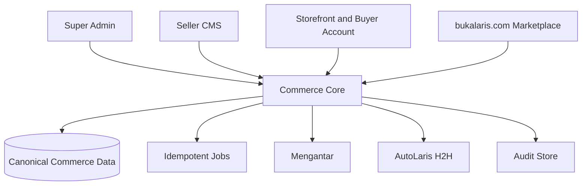
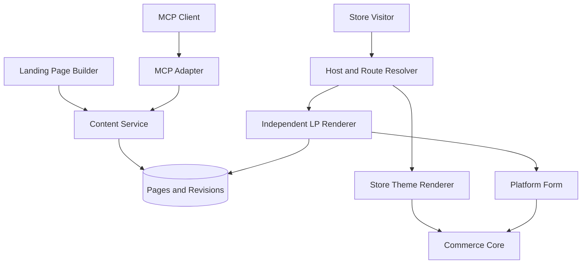
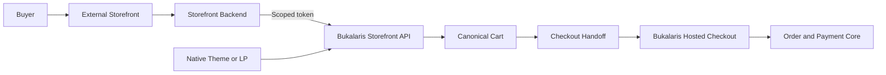

# Bukalaris System Architecture

| ID | Statement | Status | Owner |
|---|---|---|---|
| ARCH-1 | Bukalaris initially delivers Super Admin, Seller Admin (Seller CMS), and Storefront; Buyer Account, Marketplace, and Affiliate surfaces are later scope. | Proposed | Architecture owner |
| ARCH-2 | A trusted commerce core owns authorization, tenant context, catalog/order state, provider orchestration, jobs, and audit records. | Proposed | Architecture owner |
| ARCH-3 | Public hosts resolve to a single store or to the Bukalaris marketplace before content/data access. | Proposed | Platform owner |

## Trust boundaries

| Boundary | Trusted input | Required control |
|---|---|---|
| Browser to application | Request identity, host, cart intent | Validate schema; derive store, price, stock, total, entitlement server-side |
| Storefront host resolution | Host header through known proxy chain | Normalize/allowlist host, resolve exactly once, cache by host and tenant safely |
| Seller CMS | Session and active membership | Server-side membership/capability checks; no client tenant selector trust |
| Provider calls | Server-only credentials and approved response contract | Timeouts, idempotency, redaction, reconciliation, least privilege |
| Jobs/webhooks | Provider/queue event | Authenticate before parse/side effect; deduplicate durable event/reference |
| Admin operations | Operator identity and declared reason | Confirmation where risk warrants; immutable audit record |

## Deliberate boundaries

- A storefront has no ability to query cross-tenant administration.
- A seller cannot configure platform credentials or access another seller's
  buyer/order data.
- Marketplace discovery does not make an approved listing a platform-owned
  product, payment, or settlement obligation.
- A future connector ingests normalized records; it does not receive database
  superuser/network access.

## Stack and application boundaries

Decision, 2026-09-25: Next.js App Router, TypeScript with strict checking,
shadcn/ui, and Tailwind CSS are selected for the admin applications.
Recommendation: Use the following monorepo layout, with one commerce core and
one PostgreSQL database. Paths are proposed locators, not existing code.

| Application | Framework and rendering | Host / role |
|---|---|---|
| `apps/bos` | Next.js; Server Components with small interactive client leaves | `bos.bukalaris.com`; platform operators, own privileged HTTP handlers |
| `apps/app` | Next.js; server-first admin and Route Handlers | `app.bukalaris.com`; tenant admin and central commerce HTTP API |
| `apps/web` | Astro; static marketing pages | `bukalaris.com`; product front door, future marketplace requires its own release |
| `apps/storefront` | Astro on-demand rendering with a Node adapter | Store subdomains/custom domains; one runtime for every tenant |
| `apps/checkout` | Next.js; dynamic, private, platform-owned layout | Recommended `checkout.bukalaris.com`; checkout and confirmation |
| `apps/worker` | Node.js background process; no public browser UI | Durable provider reconciliation and outbox jobs |

Recommendation: Use TypeScript throughout, Tailwind CSS v4 for styling,
PostgreSQL with Drizzle for persistence, and a Node LTS runtime. Pin compatible
versions and the package manager in the first repository baseline; this pack
makes no installed-version claim. Use a single workspace lockfile.

Proposed shared boundaries: `packages/core` owns authorized business operations;
`packages/db` owns Drizzle schema, migrations and tenant-aware transactions;
`packages/contracts` owns reusable validation/types; `packages/ui` owns React
admin primitives; `packages/tokens` owns CSS design tokens. Browser bundles
cannot import database, provider or credential code. Astro uses native semantic
markup and shared tokens; React/shadcn islands are limited to interactions that
need them. A consistent appearance does not require whole-page hydration.

Next.js Server Components/Actions invoke core services directly; they do not
call their own HTTP endpoints. External clients use the versioned HTTP adapter.
First-party Astro server rendering invokes the same scoped core read services;
its minimal same-origin cart adapter invokes the same cart service. No commerce
rules are reimplemented in Astro. External storefront tokens are server-only.
Checkout alone hosts checkout-session handlers and final submission.

Recommendation: Begin with a PostgreSQL outbox and bounded worker retries rather
than a separate broker. Commit business changes and durable job intent together;
claim jobs safely, use idempotent operations, and reconcile uncertain provider
outcomes. Media uses private S3-compatible object storage with validated uploads
and an explicit public-delivery policy. Choose providers before provisioning.

## Remaining deployment choices

Hosting vendor, region, storage vendor, email/auth adapter, observability sink,
package versions and recovery capacity remain to be validated before build and
release. Prefer supported Node deployments initially; do not assume the Next.js
server can run unchanged on an edge runtime. No resources are provisioned here.

## ARCH-4 — Independent landing-page module

- Status: Proposed
- Owner: Bukalaris architecture owner
- Source: PR-9; Paduka Ongki's architecture request on 2026-09-18.
- Statement: Start with the monorepo applications above, bounded commerce modules and one
  canonical database. Landing-page independence is a rendering/content boundary,
  not a requirement for a separate deployment, database, or commerce backend.
  Seller CMS hosts Landing Page Builder. Visual editing and an MCP adapter call
  the same authorized content service. Storefront routing chooses either the
  active store theme renderer or the independent landing-page renderer.
- Acceptance: A theme switch cannot alter an LP revision or its presentation;
  UI and MCP operations enforce the same ownership, revision, and form rules.
  Public rendering reads only the published revision and excludes editor code.
- Constraints: PR-9, TD-4, API-3, UI-6, UX-7, TEN-1, DATA-1.
- Evidence: Architecture proposal only; no application/runtime proof.
- Change history: 2026-09-18 — proposed module ownership and render separation.

### Module ownership

| Module | Owns | Must not own |
|---|---|---|
| Tenant/host resolution | Trusted store context and domain mapping | Page appearance |
| Store themes | Theme choice and standard catalog/store page presentation | LP layout or LP style defaults at render time |
| Landing pages | Page documents, independent appearance, draft/revision/publish lifecycle | Alternative price, payment, or order truth |
| Visual builder | Canvas, content/layout controls, undo/redo, draft editing | Direct database writes or published-state authority |
| MCP adapter | AI-facing schemas and delegation to content operations | Separate page format or authorization bypass |
| Platform forms | Versioned form contract, validation and allowed configuration | Overall LP composition |
| Commerce core | Catalog, cart, checkout, order and provider behavior | Editor-specific layout data |

### Proposed route and render boundary

Use the current store origin for both page types. A reserved `/lp/<slug>`
namespace is the initial proposal; it avoids collisions with product,
collection, cart, account, and checkout routes. This is not a final route API.
Resolve host and store status before looking up the LP by store and slug.

The LP route loads its own root layout, styles, and document settings. It does
not nest inside the active store theme's layout. Shared infrastructure may
include locale, consent, and commerce context without injecting theme CSS.
The public page is rendered directly; the editor's preview iframe does not
imply a public iframe. LP form submission derives store context server-side.

### Proposed save, publish, and cache boundary

1. Visual editor or MCP submits a validated document with an expected revision.
2. Content service checks membership, capabilities, schema, product/media
   ownership, protected form configuration, and revision conflicts.
3. Save creates a new draft revision; it does not change the published pointer.
4. Publish validates the chosen revision and atomically changes the published
   pointer. Failed publication leaves the previous live revision intact.
5. Public rendering uses the store-scoped published pointer. Unpublish and
   publish invalidate route/pointer caches; use no public HTML caching until
   this freshness behavior is proven. Immutable content can be cached by store,
   page, revision, and renderer version. Private previews are not publicly cached.

Editor and MCP concurrent changes return a conflict and preserve the stored
revision; never silently overwrite. Undo/redo inside the editor and persisted
page revisions are different mechanisms. Dynamic price/stock and submission
validity remain commerce-owned, regardless of cached editorial content.

### Proposed form boundary

A page stores a typed reference to a platform form and allowlisted settings,
not the form's implementation or submission code. The seller controls where
it appears and the surrounding design. Proposed protected properties are
required fields, validation, and submission behavior. Form type (order, lead,
or another purpose), optional fields, styling controls, and whether the form
can be omitted are still product decisions under T-11. Only an order form
would use the order/checkout service; do not route all forms into commerce.

For commerce forms, server validation owns product/variant eligibility,
price, stock, shipping/payment eligibility, and totals. Neither a document
nor an MCP call can override those values. The browser component provides UI
feedback; its apparent lock is not a security boundary.

### Deployment and implementation sequence

Use the proposed application boundaries above once a repository exists;
replace proposed locators with verified repository paths during implementation. Puck remains a React-dependent
editor candidate, not a mandatory rendering architecture. Use its document
shape directly if sufficient; avoid a second intermediate AST without a proven
need. Persist a schema version for controlled upgrades.

Implement in this order once authorized: independent LP route and document
renderer; content draft/revision/publish service; visual editor; defined locked
form integration; MCP adapter over those same operations. Verify theme-switch
invariance, visual/MCP round trips, cross-tenant denial, publication recovery,
and form contract enforcement before claiming this architecture implemented.

## ARCH-5 — Canonical system and page map

- Status: Proposed
- Owner: Bukalaris architecture owner
- Source: PR-10.
- Statement: This section owns the page implementation index. UX owns behavior,
  data contracts own entities, and TASKS.md owns execution status. Link to those
  owners instead of duplicating their details. Page IDs remain stable when a
  title or route changes; removed pages retain a replacement/retirement note.
- Acceptance: Before any page is marked implemented, its map entry has verified
  repository-relative route/layout/component, service/API, schema/query, test,
  and task links plus a checked code revision. No fabricated code paths.
- Constraints: PR-10, UX-8, DATA-1.
- Evidence: Planning inventory below; runtime mapping remains pending T-1.
- Change history: 2026-09-18 — initial page discovery index.

### Map conventions

All routes below are **proposals**, relative to their surface; they are not
implemented endpoints. `/admin` and `/seller` describe proposed route groups,
not approved deployment origins. `Code: Pending` applies to every row because
no Bukalaris repository has been found. Logical data names reference the Data
Model; missing entities are proposals, not existing tables. Requirement/task
links identify planning ownership, not completion. No runtime page is claimed.

| Page ID | Surface / page | Proposed route | Module and logical data | Requirement / task | Code |
|---|---|---|---|---|---|
| AU-01 | Operator / sign in | /login | Authentication and session | PR-15 / T-17 | M1 — see [locators](#m1-implementation-locators) |
| AU-02 | Operator / recovery | /account/recovery | Auth recovery contract | PR-15 / T-17 | Pending |
| AU-03 | Seller / context selection | /select-store | Session membership | PR-15 / T-17 | Pending |
| SA-01 | Super Admin / overview | /admin | Platform operations; store/outcome summaries | PR-1 / T-3 | Pending |
| SA-02 | Super Admin / seller list | /admin/stores | Tenancy; Store | PR-1 / T-3 | M1 — see [locators](#m1-implementation-locators) |
| SA-03 | Super Admin / seller detail | /admin/stores/:storeId | Tenancy; Store, membership, audit | PR-1 / T-3 | Pending |
| SA-04 | Super Admin / marketplace review | /admin/marketplace | Marketplace Listing | PR-6 / T-7 | Pending |
| SA-05 | Super Admin / Log System | /admin/logs | Restricted diagnostic sink | PR-11 / T-13 | Pending |
| SA-06 | Super Admin / log detail | /admin/logs/:eventId | Diagnostic event/correlation | PR-11 / T-13 | Pending |
| SC-01 | Seller / overview | /seller | Store commerce summaries | PR-2 / T-3 | Pending |
| SC-02 | Seller / products | /seller/products | Product | PR-2 / T-3 | M1 — see [locators](#m1-implementation-locators) |
| SC-03 | Seller / product editor | /seller/products/:productId | Product, Variant | PR-2 / T-3 | M1 — see [locators](#m1-implementation-locators) |
| SC-04 | Seller / inventory | /seller/inventory | Variant, Inventory | PR-2 / T-3 | Pending |
| SC-05 | Seller / collections | /seller/collections | Collection | PR-2 / T-3 | Pending |
| SC-06 | Seller / collection editor | /seller/collections/:collectionId | Collection, Product | PR-2 / T-3 | Pending |
| SC-07 | Seller / CMS pages | /seller/pages | CMS Page | PR-2 / T-3 | Pending |
| SC-08 | Seller / CMS page editor | /seller/pages/:pageId | CMS Page | PR-2 / T-3 | Pending |
| SC-09 | Seller / menus | /seller/menus | Menu | PR-2 / T-3 | Pending |
| SC-10 | Seller / store settings | /seller/settings | Store, domain, enabled methods | PR-2 / T-3 | Pending |
| SC-11 | Seller / theme selection | /seller/themes | Store theme configuration | PR-8 / T-10 | Pending |
| SC-12 | Seller / orders | /seller/orders | Order | PR-2 / T-3 | Pending |
| SC-13 | Seller / order detail | /seller/orders/:orderId | Order, Payment Attempt, Shipment | PR-2 / T-3 | Pending |
| SC-14 | Seller / Landing Page Builder list | /seller/landing-pages | Landing Page | PR-9 / T-11 | Pending |
| SC-15 | Seller / landing-page editor | /seller/landing-pages/:pageId | Landing Page, Page Revision | PR-9 / T-11 | Pending |
| SC-16 | Seller / private LP preview | /seller/landing-pages/:pageId/preview | Authorized Page Revision | PR-9 / T-11 | Pending |
| SC-17 | Seller / product creation | /seller/products/new | Product, Variant, automatic identity/slug | PR-12 / T-14 | M1 — see [locators](#m1-implementation-locators) |
| SC-18 | Seller / domains | /seller/settings/domains | Store domain lifecycle | PR-13 / T-15 | Pending |
| SC-19 | Seller / members | /seller/settings/members | Membership and capabilities | PR-15 / T-17 | M1 — see [locators](#m1-implementation-locators) |
| SC-20 | Seller / member detail | /seller/settings/members/:memberId | Membership, invitation, audit | PR-15 / T-17 | Pending |
| SF-01 | Storefront / home | / | Store, published catalog/content | PR-3 / T-2 | M1 — see [locators](#m1-implementation-locators) |
| SF-02 | Storefront / collection | /collections/:slug | Collection, Product | PR-3 / T-2 | Pending |
| SF-03 | Storefront / search | /search | Published Product index/query | PR-3 / T-2 | Pending |
| SF-04 | Storefront / product | /products/:slug | Product, Variant | PR-3 / T-2 | M1 — see [locators](#m1-implementation-locators) |
| SF-05 | Storefront / CMS page | /pages/:slug | Published CMS Page | PR-3 / T-2 | Pending |
| SF-06 | Storefront / cart | /cart | Cart, Variant | PR-4 / T-4 | M1 — see [locators](#m1-implementation-locators) |
| SF-07 | Hosted Checkout / checkout (stable ID retained) | /checkout | Checkout Session, quotes | PR-16 / T-19 | M1 — see [locators](#m1-implementation-locators) |
| SF-08 | Hosted Checkout / confirmation | /checkout/confirmation | Authorized order outcome | PR-16 / T-19 | M1 — see [locators](#m1-implementation-locators) |
| SF-09 | Storefront / independent LP | /lp/:slug | Published Page Revision, form reference | PR-9 / T-11 | Pending |
| BA-01 | Buyer Account / orders (later) | /account/orders | Buyer-owned Order projections | PR-7 / T-8 | Pending |
| BA-02 | Buyer Account / addresses (later) | /account/addresses | Buyer, Address | PR-7 / T-8 | Pending |
| BA-03 | Buyer Account / profile (later) | /account/profile | Buyer | PR-7 / T-8 | Pending |
| AF-01 | Affiliate / links and aggregates (later) | /affiliate | Attribution, approved aggregates | PR-7 / T-8 | Pending |

Product creation (SC-17) may reuse the product editor implementation (SC-03)
with explicit create mode. Authentication uses AU-01 through AU-03.
Marketplace buyer screens and further workflow pages must be added when their
contracts are defined; this is the current inventory, not a
claim that unspecified future pages are already designed.

### M1 implementation locators

Checked against the working tree on 2026-10-06 (uncommitted; no commit exists
yet — the owner approves the first commit). Paths are repository-relative.
Shared pieces: scope/data access `packages/db/src/scoped.ts`, schema
`packages/db/src/schema.ts`, migration `packages/db/drizzle/`, auth
`apps/web/src/lib/auth.ts`, request context `apps/web/src/lib/context.ts`,
host rewrite `apps/web/src/proxy.ts`. Integration tests:
`packages/db/test/*.test.ts`; browser tests: `apps/web/e2e/*.spec.ts`.

| Page ID | Implemented route → entry | Server operations | Data / permission | Checks | Task |
|---|---|---|---|---|---|
| AU-01 | `/login` → `apps/web/src/app/login/page.tsx`, `apps/web/src/app/login/login-form.tsx` | Better Auth `POST /api/auth/sign-in/email` (`apps/web/src/app/api/auth/[...all]/route.ts`); `signOut` in `login/actions.ts` | `user`, `session`, `account`; sign-up disabled | e2e login in all specs; rate limit 429 observed (BUILD-LOG) | T-17 |
| SA-02 | `/admin` (proposed `/admin/stores`) → `apps/web/src/app/admin/page.tsx`, `layout.tsx` | `listStores`, `setStoreStatus` (`packages/db/src/platform.ts`) via `admin/actions.ts` | `store`, `audit_log`; `operatorScope` | `test/lifecycle.test.ts`; `e2e/super-admin.spec.ts` | T-3 |
| SC-02 | `/seller/products` → `apps/web/src/app/seller/products/page.tsx` | `listProducts` (`packages/db/src/catalog.ts`) | `product`, `variant`; `catalog.read` | `test/tenant-isolation.test.ts`; `e2e/admin-product.spec.ts` | T-3 |
| SC-03 | `/seller/products/[id]` → `seller/products/[id]/page.tsx` | `getProduct`, `updateProduct`, `addVariant`, `updateVariant` via `seller/actions.ts` | `catalog.write`; compound FKs | `test/tenant-isolation.test.ts`; e2e cross-store 404 | T-14 |
| SC-17 | `/seller/products/new` → `seller/products/new/page.tsx` | `createProduct` (product + first variant, one transaction) | numeric identity, optional slug (canonical = slug ?? id) | `e2e/admin-product.spec.ts` | T-14 |
| SC-19 | `/seller/members` → `seller/members/page.tsx` | `listMembers`, `changeMember` (`packages/db/src/membership.ts`) | `membership`, `audit_log`; `members.manage` (owner) | `test/lifecycle.test.ts` (last owner, concurrent removal, staff denied) | T-17 |
| SF-01 | `/s/[store]` or `<slug>.<STORE_ROOT_DOMAIN>/` → `apps/web/src/app/s/[store]/page.tsx`, `layout.tsx` | `storefrontScope`, `listPublishedProducts` (`packages/db/src/storefront.ts`) | active store only; active products only | `test/tenant-isolation.test.ts`, `test/lifecycle.test.ts`; `e2e/purchase.spec.ts` | T-2 |
| SF-04 | `/s/[store]/products/[slug]` → `s/[store]/products/[slug]/page.tsx` | `getPublishedProduct`, `setCartLine` via `s/[store]/actions.ts` | id-or-slug lookup, 308 to canonical slug | `e2e/purchase.spec.ts` | T-2 |
| SF-06 | `/s/[store]/cart` → `s/[store]/cart/page.tsx` | `getCart`, `setCartLine` | `cart`, `cart_line` (store-bound, cookie capability) | `test/tenant-isolation.test.ts`; `e2e/purchase.spec.ts` | T-2 |
| SF-07 | `/checkout?store=<slug>` → `apps/web/src/app/checkout/page.tsx`, `apps/web/src/app/checkout/layout.tsx`, `apps/web/src/app/checkout/actions.ts` | `checkoutSummary`, `placeOrder` (`packages/db/src/checkout.ts`); fake providers `packages/db/src/providers.ts` | `order`, `order_line`, `variant.stock`; idempotency + request hash | `test/checkout.test.ts`; `e2e/purchase.spec.ts` (tampered hidden total ignored) | T-19 |
| SF-08 | `/checkout/confirmation` → `checkout/confirmation/page.tsx` | `getBuyerOrder` (requires checked-out cart cookie) | order snapshot | `test/checkout.test.ts`; e2e 404 without cookie | T-19 |

Not implemented in M1 (still Pending): AU-02, AU-03 (store switch exists as a
header selector in `seller/layout.tsx`, no dedicated page), SA-01, SA-03..06,
SC-01, SC-04..16, SC-18, SC-20, SC-21, SF-02, SF-03, SF-05, SF-09, BA-*, AF-01.

### Implementation locator and change rule

For each implemented page, extend its row with actual file links or an anchor
here containing: route entry; layout/components; server operations; schema and
query files; permission contract; relevant tests; primary task; checked commit
or working-tree evidence. Every page-changing task includes updating these
links. A route move updates the locator while retaining the Page ID.

Use a simple route-to-page registry in code only when needed for runtime log
attribution; documentation references that registry rather than maintaining a
second route definition. Link backend-only operations and jobs to their module,
service entry, data owner, and tests without inventing a browser Page ID.
Engineering navigation is: page ID or URL → code entry → service → schema/query
→ test/task. Incident navigation is: event/correlation → page/module ID → this
map → actual code at the event's release revision. No full source code or local
filesystem paths are exposed in the public storefront.

## ARCH-6 — Headless modular application and future seams

- Status: Proposed
- Owner: Bukalaris architecture owner
- Source: PR-14.
- Statement: Start with a modular application and canonical database. HTTP
  handlers, first-party server rendering, and future MCP adapters invoke shared
  application services; domain services do not import frontend components.
  Server-rendered first-party pages may call those services directly rather than
  make a network round trip through their own HTTP API.
- Acceptance: Every module has a data owner and authorized entry boundary;
  API and first-party UI conform to the same business rules. Independent clients
  can use the documented HTTP contract with scoped credentials. Future modules
  integrate through references/projections rather than duplicate transactions.
- Constraints: PR-14, API-7, DATA-1, TEN-1, IAM-1, ARCH-5.
- Evidence: Architecture proposal only; no repository/framework selected.
- Change history: 2026-09-18 — headless boundaries and deployment shape.

| Module | Authoritative data | Initial interfaces | Later seam |
|---|---|---|---|
| Identity and tenancy | Operator identity, membership, store status | Login/context, seller/admin authorization | Scoped connector/MCP identity |
| Catalog | Product, variant, inventory, collections, media ownership | Seller management, published storefront reads | Feed projection and marketplace eligibility |
| Content | CMS pages, menus, theme configuration | Seller publication, store rendering | Independent LP revisions and builder |
| Domains | Verified store-host binding and primary reference | Seller domain setup, trusted host resolution | More hosts subject to policy |
| Checkout and orders | Cart, quote, order snapshot, stock reservations | Guest cart/checkout and seller order operations | Buyer account linkage after verified ownership |
| Providers | Payment attempts, shipment attempts, references | Server-only adapters and reconciliation jobs | Provider replacement behind accepted contracts |
| Operations | Audit evidence, diagnostic query projection | Super Admin tenant actions and Log System | Correlated incident analysis |

Proposal for repository organization (not existing code): framework route/layout
entry points plus domain folders for the modules above, provider adapters, and
shared validated contracts. Keep one deployable application initially; extract
workers or services only for measured runtime/security/scale needs. No monorepo
packages per module, event bus, or universal provider factory is required.

Runtime jobs may share the codebase but run in a dedicated process/platform job
entry. Use a durable pending-work/outbox record for external side effects when
needed; business writes and intent creation are atomic, remote I/O is outside
transactions, and retries reconcile stable references.

Future readiness is bounded: retain immutable IDs, store ownership, revisioned
content, order snapshots, and documented service interfaces now. Do not create
unused marketplace settlement tables, commission engines, plugin runtimes,
wallets, or cross-seller carts during the initial milestone.

Stack status: No repository or selected deployment is established. React is a
candidate for the admin/editor surface because Puck requires React; relational
storage is the current data-model direction. Evaluate actual runtime, database
transaction/RLS support, auth integration, SSR/SEO, jobs, and operational cost
before freezing framework versions. No stack claim is implementation evidence.

## ARCH-7 — External headless channel and hosted checkout

- Status: Proposed
- Owner: Bukalaris architecture owner
- Source: PR-16; supersedes any earlier implication that checkout belongs to a storefront theme.
- Statement: A developer-operated storefront backend calls Bukalaris's central
  Storefront API using a private store/channel token. Its frontend may be hosted
  on Cloudflare or another supported runtime. Bukalaris hosts checkout in a
  separate root layout and session context at a platform-controlled origin.
- Acceptance: All storefront types hand off the same canonical server cart to
  hosted checkout. No storefront-controlled script, theme stylesheet, seller
  API token, or arbitrary redirect origin enters that checkout context.
- Constraints: API-8, IAM-11, DOM-4, SEC-13, UX-12.
- Evidence: Planning only; API and token lifecycle require implementation proof.
- Change history: 2026-09-18 — incorporated independent checkout requirement.

Headless storefront and checkout origins are separate configuration values.
An external storefront domain points to its own host, not automatically to the
Bukalaris native theme renderer. Registered channel origin enables allowlisted
return links; it does not become a trusted tenant selector. Native custom-domain
routing under DOM-2 remains a separate capability. Checkout hostname remains
an explicit infrastructure decision; this pack does not invent a deployed host.

Shopify reference, reviewed 2026-09-18: [Storefront API](https://shopify.dev/docs/storefronts/headless/building-with-the-storefront-api)
separates public/private access; [bring your own stack](https://shopify.dev/docs/storefronts/headless/bring-your-own-stack)
uses API tokens; [Oxygen](https://shopify.dev/docs/storefronts/headless/hydrogen/deployments/oxygen-runtime)
is Shopify's worker-based hosting. Bukalaris borrows the responsibility split,
not Shopify APIs, tokens, checkout, plan entitlements, or Hydrogen compatibility.
A Bukalaris-specific SDK/runtime is not required for the first integration.

Additional page map entry:

| Page ID | Surface / page | Proposed route | Module/data | Requirement/task | Code |
|---|---|---|---|---|---|
| SC-21 | Seller / headless channels | /seller/settings/storefront-channels | Scoped grants, channel origins | PR-16 / T-19 | Pending |

Storefront native custom domains and external channel origins must be distinct
in UI and data. Neither mode changes product/variant advertising identity.

## Storefront evaluation: Astro versus Next.js

Status: Architecture recommendation, reviewed 2026-09-25 against official
framework documentation. Recommend **Astro on-demand rendering** for the native
storefront. This is a fit assessment, not a comparative performance benchmark.

| Bukalaris requirement | Astro | Next.js | Assessment |
|---|---|---|---|
| Product, collection, content and SEO pages | Server-rendered HTML; hydrate selected islands | Server Components with interactive client leaves | Both fit; Astro makes the content-first boundary explicit |
| Tenant host and custom domains | Request middleware and locals on on-demand routes | Request-time server routing and data access | Both require verified host resolution, scoped data and cache keys |
| Cart, variant selection and filters | Small client controls plus same-origin server adapters | Integrated React client state and server mutations | Astro is sufficient for the current bounded interactions |
| Separate hosted checkout | One-use handoff to Next.js checkout | Same handoff contract | Shared core services avoid a commerce-rule fork |
| Two storefront themes | Shared data contract with separate layouts/tokens | Shared data contract with separate React layouts | Neither framework dictates the design or 480px ceiling |
| Future visual/LP builder | Shared typed document; Astro renderer or server-rendered React components | Direct React editor/renderer reuse | Next.js reduces React rendering friction; Astro needs explicit editor/public-render parity tests |
| Complex persistent React UI | Cross-island coordination needs deliberate ownership | A single React tree simplifies rich shared state | Prefer Next.js if this becomes the storefront's dominant workload |
| Maintenance | Two framework toolchains alongside the admin | One primary React framework across surfaces | Astro's bundle boundary must justify this ongoing cost |

Proposal: Keep Astro cart/variant controls small and give each shared interaction
state one owner. Do not connect unrelated islands through ad-hoc global stores.
Future LP renderer fixtures must prove editor-to-published parity; using React
for server rendering does not require hydrating the whole page. If the builder
requires a large hydrated React tree on every public page, reassess Next.js
before committing to that implementation.

Evidence sources inspected on 2026-09-25:
- [Astro islands](https://docs.astro.build/en/concepts/islands/)
- [Astro on-demand rendering](https://docs.astro.build/en/guides/on-demand-rendering/)
- [Astro request middleware](https://docs.astro.build/en/guides/middleware/)
- [Astro endpoints](https://docs.astro.build/en/guides/endpoints/)
- [Astro React integration](https://docs.astro.build/en/guides/integrations-guide/react/)
- [Next.js Server and Client Components](https://nextjs.org/docs/app/getting-started/server-and-client-components)

Implementation acceptance: Measure built production fixtures for home, collection,
product, cart and checkout handoff with representative media and data at mobile
and desktop sizes. Record transferred/hydrated JS, server response time, LCP,
CLS and observed interaction latency under a declared device/network profile.
Separate cold and warm cache results; exercise slow/failed dependencies and
cross-tenant cache isolation. Use real-user p75 LCP <= 2.5s, INP <= 200ms and
CLS <= 0.1 as proposed launch targets, not results from synthetic runs. Build a
matched Next.js fixture only if Astro fails the journey or performance targets,
or React state/rendering complexity changes the maintenance decision. Do not
claim Astro is faster solely from framework choice.

## Development function map

Status: Proposed locators, 2026-09-25; no implementation files exist yet.
This extends ARCH-5. The operation IDs below are declared in OpenAPI; they are
HTTP contract identifiers, not claims of existing TypeScript function names.
Core operation implementations will receive exact file/symbol links at delivery.

| Page / job | Application entry | Contract operations | Core owner / data | Permission and proof | Task |
|---|---|---|---|---|---|
| SA-02 / SA-03 tenant lifecycle | Bos `/admin/stores` and detail | `listAdminStores`, `createStore`, `getAdminStore`, `transitionStore` | Tenancy; store, membership, durable audit | Platform capability; denied seller, invalid transition, audited reason | T-3 |
| SA-05 / SA-06 diagnostics | Bos `/admin/logs` and detail | `listSystemLogs`, `getSystemLog` | Operations; sanitized log projection, access audit | `logs.read`; denied direct URL, sink failure, redaction | T-13 |
| SC-02 / SC-03 / SC-17 catalog | Tenant Admin product list/editor/new | `listSellerProducts`, `createProduct`, `editProduct`, `publishProduct` | Catalog; product, variant, media, revision | Store capability; foreign media, stale revision, duplicate slug | T-14 |
| SC-04 inventory | Tenant Admin inventory | `getInventory`, `adjustInventory` | Inventory; variant stock, adjustment | Scoped stock authority; concurrent adjustments and audit | T-3 |
| SC-07 / SC-08 / SC-09 content | Tenant Admin CMS pages and menus | `createPage`, `replacePage`, `replaceMenu` | Content; revision, menu, owned media | Content capability; invalid link, foreign reference, failed publish | T-3 |
| SC-12 / SC-13 orders | Tenant Admin order queue/detail | `listSellerOrders`, `getSellerOrder`, `applyOrderAction`, `requestShipment` | Orders; payment/shipment attempt, outbox | Scoped order authority; duplicate request, uncertain provider result | T-6 |
| SC-18 domains | Tenant Admin domain settings | `createDomain`, `refreshDomain`, `setPrimaryDomain`, `removeDomain` | Routing; domain, primary relation, outbox | Domain capability; ownership/TLS pending, reassignment race | T-15 |
| SC-21 headless channel | Tenant Admin channel settings | `createStorefrontChannel`, `revokeStorefrontChannel` | IAM; scoped grant | Channel authority; one-time token, revoked access | T-19 |
| SF-01 through SF-06 browse/cart | Astro store host | `getStorefrontConfig`, `listStorefrontProducts`, `getStorefrontProduct`, `createCart`, `addCartItem`, `updateCartItem` | Store-scoped public reads and cart | Verified host/cart capability; tenant cache separation and stale stock | T-2 |
| SF-07 / SF-08 checkout | Next.js checkout origin | `createCheckoutHandoff`, `getHostedCheckout`, `quoteCheckout`, `submitCheckout` | Checkout; order, quote, payment intent | Channel-to-session handoff; replay, last unit, duplicate submit | T-19 |
| Provider reconciliation | Worker, no browser Page ID | Internal operation; callback paths still require provider verification | Provider adapter; attempt, outbox, audit | Worker service authority; bounded retry, no duplicate booking/payment | T-6 |
| Future MCP content | Tenant Admin grant/review and MCP adapter | API-9; final tool names pending | Shared content operations and revisions | IAM-12; human-approved publication, grant revocation | T-20 |

Engineering lookup is Page ID -> surface route -> operation ID -> core owner ->
data/permission -> task/test. A delivered implementation adds route, function,
schema and test file links at the checked release revision. Job operations use
a module/operation identity and nullable Page ID; do not invent a page for them.

Log detail resolves `module`, `operation_id`, `page_id` and `release_revision`
against this map and the eventual versioned implementation registry. An unknown
mapping shows "Mapping unavailable". Never build source URLs from arbitrary
log text, assume the current branch matches an older release, or read local
files based on an event field. Authorized engineering links use an allowlisted
repository origin and known revision/path from the registry. Public storefronts
and seller accounts never receive private source links.

