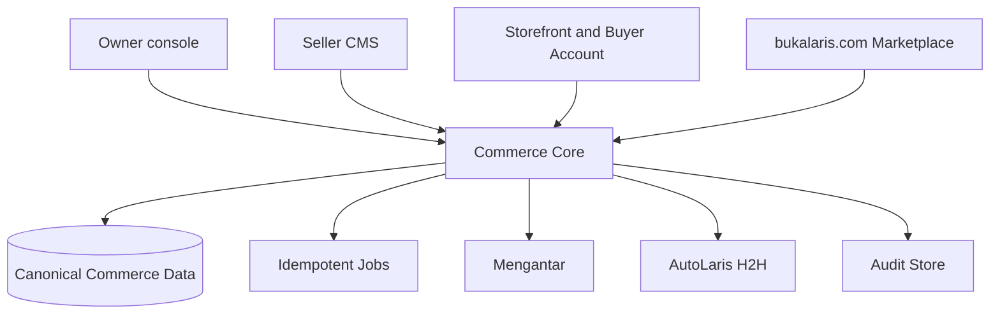
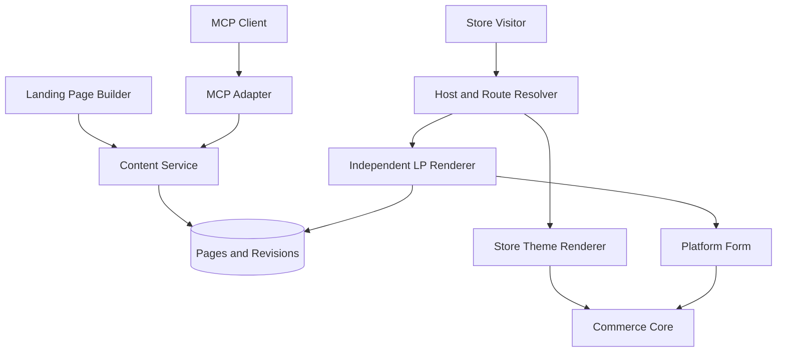
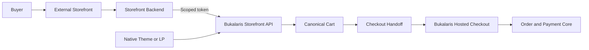

# Bukalaris System Architecture

| ID | Statement | Status | Owner | Review owner |
|---|---|---|---|---|
| ARCH-1 | Bukalaris initially delivers the Owner console, Seller Admin (Seller CMS), and Storefront; Buyer Account, Marketplace, and Affiliate surfaces are later scope. | Superseded (2026-10-27) by ADR-0008, PR-7, PR-28 | Architecture owner | Architecture owner; self-review by the author on 2026-10-28 against ADR-0008 and the repository, no independent reviewer yet; runtime and diagram approval not claimed |
| ARCH-2 | A trusted commerce core owns authorization, tenant context, catalog/order state, provider orchestration, jobs, and audit records. | Proposed | Architecture owner | Architecture owner; self-review 2026-10-28, no independent reviewer yet |
| ARCH-3 | Public hosts resolve to a single store or to the Bukalaris marketplace before content/data access. | Superseded (2026-10-27) by ADR-0008 section 3 and 08 DOM-5 | Platform owner | Architecture owner; self-review 2026-10-28, no independent reviewer yet |

ARCH-1 and ARCH-3 above, the first diagram and the "Stack and application
boundaries" section below are **historical** (the 2026-09 recommendation, kept
for traceability). The current target is one Next.js application with surface
routing (ADR-0008, TD-7, D-2 as refined, D-12): Owner console `owner`, Seller
Admin `app`, Affiliate portal and storefront, Buyer portal, checkout, Update Log
and seller storefronts, all in `apps/web`, with the worker as a second process of
the same image. There is no marketplace host: Bukalaris is an online-store
platform, not a marketplace (D-12). `apps/bos`, `apps/app`, `apps/storefront`,
`apps/checkout` and `apps/worker` as separate applications and the Astro
rendering recommendation are superseded; the three-role database isolation
(ADR-0005) is implemented. ARCH-2 still holds.

## Trust boundaries

| Boundary | Trusted input | Required control |
|---|---|---|
| Browser to application | Request identity, host, cart intent | Validate schema; derive store, price, stock, total, entitlement server-side |
| Storefront host resolution | Host header through known proxy chain | Normalize/allowlist host, resolve exactly once, cache by host and tenant safely |
| Seller CMS | Session and active membership | Server-side membership/capability checks; no client tenant selector trust |
| Provider calls | Server-only credentials and approved response contract | Timeouts, idempotency, redaction, reconciliation, least privilege |
| Jobs/webhooks | Provider/queue event | Authenticate before parse/side effect; deduplicate durable event/reference |
| Admin operations | Operator identity and declared reason | Confirmation where risk warrants; immutable audit record |

## Deliberate boundaries

- A storefront has no ability to query cross-tenant administration.
- A seller cannot configure platform credentials or access another seller's
  buyer/order data.
- Marketplace discovery does not make an approved listing a platform-owned
  product, payment, or settlement obligation.
- A future connector ingests normalized records; it does not receive database
  superuser/network access.

## Stack and application boundaries

Status: **Historical**, superseded 2026-10-27 by ADR-0008 and TD-7; not the build
target. Kept for traceability.

Decision, 2026-09-25: Next.js App Router, TypeScript with strict checking,
shadcn/ui, and Tailwind CSS are selected for the admin applications.
Recommendation: Use the following monorepo layout, with one commerce core and
one PostgreSQL database. Paths are proposed locators. What exists on `main`
(2026-10-07) is a single Next.js app `apps/web` serving every surface and one
package `packages/db` (DECISIONS D-2, deliberate ceiling); the worker and the
maintenance command are `packages/db/src/worker.ts` and `cleanup.ts` run from
the same image with a different command. The row-by-row route map is ARCH-5.

**Superseded (history kept):** the multi-application table below (`apps/bos`,
`apps/app`, the Astro `apps/web` and `apps/storefront`, `apps/checkout`,
`apps/worker`) is superseded by DECISIONS D-2, ADR-0008 and T-51: one Next.js app
`apps/web` with route groups serves every surface, the worker runs from
`packages/db` (T-51 is implemented locally and uncommitted; nothing is deployed).
No Astro application exists and none is planned; the rows remain as the original
rationale only.

| Application | Framework and rendering | Host / role |
|---|---|---|
| `apps/bos` (superseded) | Next.js; Server Components with small interactive client leaves | Owner console (formerly Super Admin / Bos), `owner.bukalaris.com` (the interim `berkah` and `bos` labels are retired); platform operators, own privileged HTTP handlers |
| `apps/app` (superseded) | Next.js; server-first admin and Route Handlers | `app.bukalaris.com`; Seller Admin and central commerce HTTP API |
| `apps/web` (Astro, superseded; the real `apps/web` is the single Next.js app) | Astro; static marketing pages | `bukalaris.com`; product front door, future marketplace requires its own release |
| `apps/storefront` (superseded) | Astro on-demand rendering with a Node adapter | Store subdomains/custom domains; one runtime for every tenant |
| `apps/checkout` (superseded) | Next.js; dynamic, private, platform-owned layout | Recommended `checkout.bukalaris.com`; checkout and confirmation |
| `apps/worker` (superseded; now `packages/db/src/worker.ts`) | Node.js background process; no public browser UI | Durable provider reconciliation and outbox jobs |

Recommendation: Use TypeScript throughout, Tailwind CSS v4 for styling,
PostgreSQL with Drizzle for persistence, and a Node LTS runtime. Pin compatible
versions and the package manager in the first repository baseline; this pack
makes no installed-version claim. Use a single workspace lockfile.

Proposed shared boundaries: `packages/core` owns authorized business operations;
`packages/db` owns Drizzle schema, migrations and tenant-aware transactions;
`packages/contracts` owns reusable validation/types; `packages/ui` owns React
admin primitives; `packages/tokens` owns CSS design tokens. Browser bundles
cannot import database, provider or credential code. Astro uses native semantic
markup and shared tokens; React/shadcn islands are limited to interactions that
need them. A consistent appearance does not require whole-page hydration.

Next.js Server Components/Actions invoke core services directly; they do not
call their own HTTP endpoints. External clients use the versioned HTTP adapter.
First-party Astro server rendering invokes the same scoped core read services;
its minimal same-origin cart adapter invokes the same cart service. No commerce
rules are reimplemented in Astro. External storefront tokens are server-only.
Checkout alone hosts checkout-session handlers and final submission.

Recommendation: Begin with a PostgreSQL outbox and bounded worker retries rather
than a separate broker. Commit business changes and durable job intent together;
claim jobs safely, use idempotent operations, and reconcile uncertain provider
outcomes. Media uses private S3-compatible object storage with validated uploads
and an explicit public-delivery policy. Choose providers before provisioning.

## Remaining deployment choices

Hosting vendor, region, storage vendor, email/auth adapter, observability sink,
package versions and recovery capacity remain to be validated before build and
release. Prefer supported Node deployments initially; do not assume the Next.js
server can run unchanged on an edge runtime. No resources are provisioned here.

## ARCH-4 — Independent landing-page module

- Status: Proposed
- Owner: Bukalaris architecture owner
- Source: PR-9; Paduka Ongki's architecture request on 2026-09-18.
- Statement: Start with the monorepo applications above, bounded commerce modules and one
  canonical database. Landing-page independence is a rendering/content boundary,
  not a requirement for a separate deployment, database, or commerce backend.
  Seller CMS hosts Landing Page Builder. Visual editing and an MCP adapter call
  the same authorized content service. Storefront routing chooses either the
  active store theme renderer or the independent landing-page renderer.
- Acceptance: A theme switch cannot alter an LP revision or its presentation;
  UI and MCP operations enforce the same ownership, revision, and form rules.
  Public rendering reads only the published revision and excludes editor code.
- Constraints: PR-9, TD-4, API-3, UI-6, UX-7, TEN-1, DATA-1.
- Evidence: Landing pages v1 merged on `main` 2026-10-07 (T-42, `c0816b6`):
  `packages/db/src/storefront/landing.ts` (versioned typed-block document, immutable
  `landing_page_revision` rows, draft/published pointers enforced by FKs in
  `0009_wave4_rls.sql`), Seller builder SC-14..SC-16 and the independent public
  renderer SF-09 at `/s/[store]/lp/[slug]`, which sits outside the storefront
  shell (storefront routes moved into the `s/[store]/(shop)/` route group).
  `e2e/landing.spec.ts` proves the LP is unchanged when the store theme is
  switched and that the order section hands off to hosted checkout. Not done:
  visual/drag-and-drop editor, locked-form contract beyond the v1 order block,
  and the MCP adapter (T-11, T-20), so the Status stays Proposed.
- Change history: 2026-09-18 — proposed module ownership and render separation.
  2026-10-07 — T-42 scope noted; landing pages v1 merged (`c0816b6`).

### Module ownership

| Module | Owns | Must not own |
|---|---|---|
| Tenant/host resolution | Trusted store context and domain mapping | Page appearance |
| Store themes | Theme choice and standard catalog/store page presentation | LP layout or LP style defaults at render time |
| Landing pages | Page documents, independent appearance, draft/revision/publish lifecycle | Alternative price, payment, or order truth |
| Visual builder | Canvas, content/layout controls, undo/redo, draft editing | Direct database writes or published-state authority |
| MCP adapter | AI-facing schemas and delegation to content operations | Separate page format or authorization bypass |
| Platform forms | Versioned form contract, validation and allowed configuration | Overall LP composition |
| Commerce core | Catalog, cart, checkout, order and provider behavior | Editor-specific layout data |

### Proposed route and render boundary

Use the current store origin for both page types. A reserved `/lp/<slug>`
namespace is the initial proposal; it avoids collisions with product,
collection, cart, account, and checkout routes. This is not a final route API.
Resolve host and store status before looking up the LP by store and slug.

The LP route loads its own root layout, styles, and document settings. It does
not nest inside the active store theme's layout. Shared infrastructure may
include locale, consent, and commerce context without injecting theme CSS.
The public page is rendered directly; the editor's preview iframe does not
imply a public iframe. LP form submission derives store context server-side.

### Proposed save, publish, and cache boundary

1. Visual editor or MCP submits a validated document with an expected revision.
2. Content service checks membership, capabilities, schema, product/media
   ownership, protected form configuration, and revision conflicts.
3. Save creates a new draft revision; it does not change the published pointer.
4. Publish validates the chosen revision and atomically changes the published
   pointer. Failed publication leaves the previous live revision intact.
5. Public rendering uses the store-scoped published pointer. Unpublish and
   publish invalidate route/pointer caches; use no public HTML caching until
   this freshness behavior is proven. Immutable content can be cached by store,
   page, revision, and renderer version. Private previews are not publicly cached.

Editor and MCP concurrent changes return a conflict and preserve the stored
revision; never silently overwrite. Undo/redo inside the editor and persisted
page revisions are different mechanisms. Dynamic price/stock and submission
validity remain commerce-owned, regardless of cached editorial content.

### Proposed form boundary

A page stores a typed reference to a platform form and allowlisted settings,
not the form's implementation or submission code. The seller controls where
it appears and the surrounding design. Proposed protected properties are
required fields, validation, and submission behavior. Form type (order, lead,
or another purpose), optional fields, styling controls, and whether the form
can be omitted are still product decisions under T-11. Only an order form
would use the order/checkout service; do not route all forms into commerce.

For commerce forms, server validation owns product/variant eligibility,
price, stock, shipping/payment eligibility, and totals. Neither a document
nor an MCP call can override those values. The browser component provides UI
feedback; its apparent lock is not a security boundary.

### Deployment and implementation sequence

Use the proposed application boundaries above once a repository exists;
replace proposed locators with verified repository paths during implementation. Puck remains a React-dependent
editor candidate, not a mandatory rendering architecture. Use its document
shape directly if sufficient; avoid a second intermediate AST without a proven
need. Persist a schema version for controlled upgrades.

Implement in this order once authorized: independent LP route and document
renderer; content draft/revision/publish service; visual editor; defined locked
form integration; MCP adapter over those same operations. Verify theme-switch
invariance, visual/MCP round trips, cross-tenant denial, publication recovery,
and form contract enforcement before claiming this architecture implemented.

## ARCH-5 — Canonical system and page map

- Status: Implemented as documentation; re-checked against `main` on 2026-10-07
  (revision `c1adf27`, after the M2 wave 4 merges).
- Owner: Bukalaris architecture owner
- Source: PR-10.
- Statement: This section owns the page implementation index. UX owns behavior,
  data contracts own entities, and TASKS.md owns execution status. Link to those
  owners instead of duplicating their details. Page IDs remain stable when a
  title or route changes; removed pages retain a replacement/retirement note.
- Acceptance: Before any page is marked implemented, its map entry has verified
  repository-relative route/layout/component, service/API, schema/query, test,
  and task links plus a checked code revision. No fabricated code paths.
- Constraints: PR-10, UX-8, DATA-1.
- Evidence: Every row below was checked file by file against
  `apps/web/src/app/**` and `packages/db/src/*.ts` on `main` at `13f388f`
  (`docs-scan`, 2026-10-07); wave 4 rows (SC-01, SC-13 booking, SC-14..SC-16,
  SC-23 feeds, SC-24, SF-09, SF-11 tracking, HTTP-15, HTTP-16, JOB-02 retention,
  JOB-06, JOB-07) and the `(shop)` storefront paths re-checked at `c1adf27`.
  Gates after wave 4: see STATUS.md (orchestrator `pnpm verify`).
- Change history: 2026-09-18 — initial page discovery index. 2026-10-06 — M1
  locators. 2026-10-07 — M2 wave 1–3 locators; one consolidated table replaces
  the per-wave locator sections; handlers and jobs get `HTTP-`/`JOB-` ids.
  2026-10-07 — wave 4 merged: Pending rows flipped to Implemented, storefront
  paths moved under `s/[store]/(shop)/`, HTTP-16 and JOB-07 added.
  2026-10-27 — documentation audit pass on the Planned register: owners
  corrected (BA rows, AF-01, JOB-15 to JOB-18, SA-19), `(update-log)` and
  `platform/updates` aligned with ADR-0008, new ids AF-10, AF-11, SC-31, HTTP-26 to
  HTTP-30 and JOB-20 to JOB-23 (audit TRC-5/6/7/11/12/14, OPS-06/07/11/21/22).
  2026-10-27 — T-51 move-only restructure applied: `apps/web/src/app` routes
  moved into surface route groups (`(platform)`, `(operator)`, `(seller)`,
  `(storefront)`, `(checkout)`, `(identity)`, `(public-services)`) and
  `packages/db/src` organized into bounded contexts (`platform/`,
  `seller/commerce/`, `storefront/`, `shipping/`, `payments/`, `ops/`, `ops/jobs/`).

### Map conventions

One row per route or background entry point. **Route** is the path served by
`apps/web` on `main` (one Next.js app, DECISIONS D-2); where the planning pack
proposed a different path it is quoted as "proposed …" and the Page ID is kept.
Storefront routes are `/s/<slug>/…` in path mode and `<slug>.<STORE_ROOT_DOMAIN>/…`
in host mode (`apps/web/src/proxy.ts` rewrites the host form, DOM-1 subset).
**Server operations** are exported symbols of `packages/db/src/<context>/<file>.ts`
(verified with grep); Next.js server actions live in the listed `actions.ts`.
**Permission** names the capability from `packages/db/src/platform/scoped.ts`
(`catalog.read|write`, `members.manage`, `orders.read|fulfill`,
`inventory.write`, `integrations.manage`, `shipping.manage`,
`marketing.manage`, `privacy.manage`; owner-only where stated), the platform grant `logs.read`
(`ops/schema-ops.ts`), or "operator" = `platform_operator` row + verified TOTP
(`apps/web/src/lib/context.ts`). Every store-owned query runs inside the
store's RLS context (`packages/db/src/platform/tenant.ts`, ADR-0005). **Tests** are
`packages/db/test/*.test.ts` (Vitest) and `apps/web/e2e/*.spec.ts`
(Playwright). **Status**: Implemented = on `main` with the listed checks;
Pending = owned by a running parallel track (AGENTS.md "Parallel tracks") and
absent on `main` (none since the wave 4 merge); Planned = no code and no track; Retired = replaced, note says by what.

Shared code that is not a page: auth `apps/web/src/lib/auth.ts`; request
context and scopes `apps/web/src/lib/context.ts`; storefront helpers
`apps/web/src/lib/storefront.ts`; media store `apps/web/src/lib/media.ts`;
logging `apps/web/src/lib/log.ts`, `apps/web/src/instrumentation.ts`;
security headers `apps/web/src/lib/security-headers.ts`; host rewrite,
correlation id and CSP `apps/web/src/proxy.ts`; shells and shared components
`apps/web/src/components/**` (`admin-shell.tsx`, `pixels/**`); error pages
`apps/web/src/app/{error,global-error,not-found}.tsx`, `(operator)/admin/error.tsx`,
`(seller)/seller/error.tsx`, `(storefront)/s/[store]/(shop)/not-found.tsx`, `(public-services)/o/[token]/not-found.tsx`;
schema `packages/db/src/schema.ts` and `packages/db/src/**/schema-*.ts`; migrations `packages/db/drizzle/0000…0009`.
Storefront pages live in the route group `apps/web/src/app/(storefront)/s/[store]/(shop)/`
(URLs unchanged); only `(storefront)/s/[store]/lp/**` (SF-09) and the media handler
`(storefront)/s/[store]/media/[id]` sit outside `(shop)`, so the LP renders without the store
shell. New storefront routes go under `(shop)`.

### Pages

| Page ID | Route on `main` | Entry files (`apps/web/src/app/…`) | Server operations (`packages/db/src/…`) | Data | Permission | Tests | Task | Status |
|---|---|---|---|---|---|---|---|---|
| AU-01 | `/login` | `(identity)/login/page.tsx`, `(identity)/login/login-form.tsx`, `(identity)/login/actions.ts` (`signOut`) | Better Auth `POST /api/auth/sign-in/email`, `/api/auth/two-factor/verify-totp` (HTTP-01); `lib/auth.ts` (sign-up disabled) | `user`, `session`, `account`, `two_factor` | none; built-in limiter 3 sign-ins / 10 s / IP | `e2e/accounts.spec.ts` (MFA login), sign-in helper in every spec | T-17, T-22 | Implemented |
| AU-02 | `/account/recovery`, `/account/recovery/reset` | `(identity)/account/layout.tsx`, `(identity)/account/recovery/page.tsx`, `recovery-form.tsx`, `recovery/reset/page.tsx`, `reset-form.tsx` | Better Auth `request-password-reset` / `reset-password` via `lib/auth-client.ts`; `dbMailer` (`platform/accounts.ts`); `onPasswordReset` audit in `lib/auth.ts` | `verification`, `mail_outbox`, `audit_log` | none; limiter 3 requests / 60 s | `e2e/accounts.spec.ts` (no enumeration, reset via mailed link) | T-22 | Implemented |
| AU-03 | proposed `/select-store` — no page | store switcher in `(seller)/seller/layout.tsx` → `switchStore` (`(seller)/seller/actions.ts`) | `sellerContext` (`platform/scoped.ts`; cookie `bl_store` is a membership-checked preference) | `membership`, `store` | active membership | `test/tenant-isolation.test.ts` ("requested store id is honoured only with membership"), `test/lifecycle.test.ts` | T-17 | Retired — header switcher replaces the page |
| AU-04 | `/invite/[token]` | `(identity)/invite/[token]/page.tsx`, `new-account-form.tsx`, `(identity)/invite/actions.ts` (`acceptAsCurrentUser`, `acceptAsNewAccount`) | `previewInvitation`, `acceptInvitation` (`platform/accounts.ts`) | `store_invitation`, `user`, `account`, `membership`, `audit_log` | hashed single-use token, e-mail bound, 7-day TTL | `test/accounts.test.ts`, `e2e/accounts.spec.ts` | T-22 | Implemented |
| AU-05 | `/account/security` | `(identity)/account/security/page.tsx`, `security-enrol.tsx` | Better Auth `two-factor/enable`, `verify-totp`; `currentUser`, `isOperator` (`lib/context.ts`) | `two_factor`, `session` | signed-in user; operators are redirected here until TOTP is enabled | `e2e/accounts.spec.ts` ("operator must enrol TOTP before Super Admin opens") | T-22 | Implemented |
| AU-06 | `/account/support-recovery/[token]`, `/account/support-recovery/invalid` | `(identity)/account/support-recovery/[token]/page.tsx`, `(identity)/account/support-recovery/[token]/actions.ts`, `(identity)/account/support-recovery/invalid/page.tsx` | `redeemSupportRecovery` (`ops/accounts-governance-support.ts`) through `support_recovery_redeem()`; Better Auth reset token minted through the surface auth context | `support_recovery_link`, `verification` | single-use hashed token sent to the contact on file; opening the page consumes nothing | One redemption under concurrency, expiry, suspended and staff identities refused (`test/t63-accounts.test.ts`) | T-63 | Implemented |
| SA-01 | proposed `/admin` overview | — | — | — | — | — | T-3 | Retired — `/admin` renders the store list (SA-02); the overview is now SA-14 (T-62) |
| SA-02 | `/admin/stores` (moved from `/admin` by T-62) | `(operator)/admin/layout.tsx`, `(operator)/admin/stores/page.tsx`, `(operator)/admin/stores/actions.ts` (`setStoreStatusAction`) | `listStores`, `setStoreStatus` (`platform/platform.ts`); `operatorScope` on the platform pool | `store`, `platform_operator`, `audit_log` | operator (TOTP enforced in `lib/context.ts`); capability `tenants.read` through the console gate (`lib/console-gate.ts`) | `test/lifecycle.test.ts`, `e2e/super-admin.spec.ts`, `e2e/ui.spec.ts` | T-3, T-62 | Implemented |
| SA-03 | `/admin/stores/[id]`, `/admin/stores/new` | `(operator)/admin/stores/[id]/page.tsx`, `(operator)/admin/stores/new/page.tsx`, `(operator)/admin/stores/actions.ts` (`createStoreAction`, `setStoreStatusDetailAction`) | `getStoreDetail`, `createStoreForOwnerEmail` (`storefront/content.ts`); `setStoreStatus` (`platform/platform.ts`) | `store`, `membership`, `user`, `product`, `order`, `audit_log` | operator | `test/content.test.ts` ("Super Admin store detail and creation"), `e2e/content.spec.ts`, `e2e/ui.spec.ts` | T-26 | Implemented |
| SA-14 | `/admin` (takes over the overview; SA-02 moved to `/admin/stores`) | `(operator)/admin/page.tsx` | `ops/console.ts` `consoleDashboard` | DATA-7, DATA-10, DATA-11, DATA-14 | `dashboard.read`; each card gated by its own capability (the open-issues-per-page card needs `ops.issues.manage`) | Store slices sum to total, a failing source is its own error card, planned cards read "Belum tersedia" never 0, no personal data | T-62, T-68, UX-22 | Implemented (partial: store, approval, job and open-issue cards; subscription, float, queue, case and risk cards wait for their sources) |
| SA-28 | `/admin/approvals` | `(operator)/admin/approvals/page.tsx`, `(operator)/admin/approvals/actions.ts` | `ops/console-approvals.ts` | DATA-14 `approval_request` | Any four-eyes capability; approver differs from requester | Requester cannot approve, step-up proof consumed with the decision, bank snapshot view logged as an access event, exact canonical payload shown, expired never waiting, JOB-12 sweeper | T-62, UX-22; IAM-15 | Implemented |
| SA-34 | `/admin/settings` | `(operator)/admin/settings/page.tsx` | `ops/console.ts` `consoleSettings` | DATA-14, DOM-3, TD-7 | `settings.manage` | Read-only: reserved labels list, effective rate-limit policy, host status; no feature-flag screen, nothing is saved here | T-62, UX-22 | Implemented (partial: read-only; audited reserved-label additions are later) |
| SA-35 | `/admin/settings/providers` | `(operator)/admin/settings/providers/page.tsx` | `ops/console.ts` `consoleProviderHealth` | DATA-9, OBS-5 | `providers.read` | No secret in HTML, RSC, JSON or logs; last sanitized result from Log System events, "unknown" without events; credentials are not read | T-62, T-48, UX-22 | Implemented (partial: last result and read-only live gates; per-account health arrives with T-48) |
| SA-36 | `/admin/ops` | `(operator)/admin/ops/page.tsx`, `(operator)/admin/ops/actions.ts` | `ops/console.ts` `consoleJobHealth`; `ops/console-issue-health.ts` `consoleFunctionHealth` | JOB-01, OBS-5, DR-1, DATA-14 `issue_report`, `system_log` | `ops.read`; function-health table additionally `ops.issues.manage`; requeue and resolve `ops.jobs.manage`, replay history `audit.read` | Source failure never zero; per-page open severity, oldest age, 7-day count and 24-hour mapped-module errors with prefiltered queue links | T-62, T-68, T-74, UX-22 | Implemented (partial: webhook, backup and provider-balance sources not yet reported) |
| SA-37 | `/admin/audit` (no `[id]` detail route in T-62) | `(operator)/admin/audit/page.tsx` | `ops/console.ts` `consoleAudit`, `consoleAccessEvents` | DATA-14 audit extension, `personal_data_access_event` | `audit.read`; export `audit.export` (P2) | Per-action redaction allowlist, bounded range, cursor paging, own reads audited, `no-store`, no edit or delete | T-62, T-63, UX-22 | Implemented (partial: list viewer; detail and export are later) |
| SA-09 | `/admin/billing` | `(operator)/admin/billing/page.tsx`, `(operator)/admin/billing/actions.ts` | `billing/console.ts` `billingOverview`, `createInvoiceAsOperator`, `requestCompApproval` / `grantComp`, `requestPlanPriceApproval` / `changePlanPrice`, `changePlanDays`, `setPpnSwitch`, `setBillingControls` | DATA-10 `subscription_plan`, `store_subscription`, `subscription_invoice`, `billing_control`, `audit_log`, `approval_request` | `billing.read` to view; `billing.manage` to change (comp and price are four-eyes); the PPN switch needs `tax.manage` (not four-eyes, no PKP gate) | `test/t50-console.test.ts`, `test/t50-invoices.test.ts`, `e2e/t50.spec.ts` | T-50, UX-17 | Implemented |
| SA-08 | `/admin/payouts`, `/admin/payouts/[kind]/[id]` | `(operator)/admin/payouts/page.tsx`, `(operator)/admin/payouts/actions.ts` (`setFreezeAction`), `(operator)/admin/payouts/[kind]/[id]/page.tsx`, `(operator)/admin/payouts/[kind]/[id]/actions.ts` | `ledger/payouts.ts` `transferQueue` (last four digits, access event `masked`), `transferDetail` (bank snapshot and approval text, one `full` access event through `withPersonalDataAccess`); `ledger/transfer.ts` `requestTransferApproval`, `approveForTransfer`, `claimTransfer`, `recordTransferUnknown`, `completeTransfer`, `requestRejectApproval`, `rejectTransfer`; `ledger/refunds.ts` `reopenFailedRefund`; `ledger/control.ts` `payoutFreeze`, `setPayoutFreeze` | DATA-7 `payout`, `refund`, `payout_control`, `transfer_evidence_*`, `approval_request`, `personal_data_access_event` | `payouts.process` (payouts) / `refunds.process` (refunds) through the console gate; approve-for-transfer, rejection from `processing` and refund failure are four-eyes; bank values only through `withPersonalDataAccess` | `test/t37-payouts.test.ts`, `test/t37b-review.test.ts`, `test/t37b-money.test.ts`, `e2e/t37.spec.ts` | T-37, UX-14, IAM-15 | Implemented |
| SA-17 | `/admin/stores/[id]/ledger` | `(operator)/admin/stores/[id]/ledger/page.tsx`; link on `(operator)/admin/stores/[id]/page.tsx` | `ledger/console.ts` `storeLedger` (keyset-paged `ledger_entry` plus `ledgerBalance`) | DATA-7 `ledger_entry` | `finance.read`; no bank values; no write control | `test/t37b-money.test.ts`, `e2e/t37.spec.ts` | T-63, T-37, UX-22 | Implemented |
| SA-26 | `/admin/money` | `(operator)/admin/money/page.tsx`, `(operator)/admin/money/actions.ts` (`requestAdjustmentAction`, `applyAdjustmentAction`) | `ledger/console.ts` `consoleMoneyPosition` (`platform_money_position`), `unknownTransfers`, `latePaymentObligations`, `requestLedgerAdjustment`, `applyLedgerAdjustment` | DATA-7 `platform_money_position` view, `payout`, `refund`, `late_payment_obligation`, `ledger_entry` | `finance.read` to view; `ledger.adjust` (four-eyes) for an adjustment | `test/t37b-money.test.ts`, `e2e/t37.spec.ts` | T-37, T-62, UX-22 | Implemented (partial: no provider balance freshness yet, source unreported) |
| SA-53 | `/admin/money/cod-reconciliation`, `/admin/money/cod-reconciliation/[batchId]` | `(operator)/admin/money/cod-reconciliation/page.tsx`, `actions.ts`, `(operator)/admin/money/cod-reconciliation/[batchId]/page.tsx`, `actions.ts` | `ledger/console.ts` `codAwaitingReconciliation`, `reconciliationBatches`, `reconciliationBatchDetail`, `manualCompletionCandidates`; `ledger/reconciliation.ts` `prepareReconciliationBatch`, `submitReconciliationBatch`, `applyReconciliationBatch`, `voidReconciliationItem`, `voidReconciliationBatch`, `requestManualCompletion`, `applyManualCompletion` | DATA-7 `reconciliation_batch`, `reconciliation_batch_item`, `approval_request` | `payouts.reconcile` (batch, four-eyes `cod.reconcile_release`); `payouts.process` for `cod.manual_complete` | `test/t37-ledger.test.ts`, `e2e/t37.spec.ts` | T-37, UX-22 | Implemented (partial: HTTP-31 export not built) |
| SC-25 | `/seller/finance` | `(seller)/seller/finance/page.tsx`, `(seller)/seller/finance/actions.ts` (`setDestinationAction`, `requestPayoutAction`); nav in `(seller)/seller/layout.tsx`; `lib/step-up.ts` | `ledger/payouts.ts` `sellerFinance`, `ledgerStatement`, `setPayoutDestination`, `requestPayout`; `ledger/stepup.ts` | DATA-7 `ledger_entry`, `payout`, `payout_destination`, `refund`, `store_step_up_proof`, `payout_control` | verified store member; `finance.read` and `finance.payout` are owner-only (staff see a denied note); payouts also need a paid subscription (T-50) | `test/t37-payouts.test.ts`, `test/t37b-review.test.ts`, `e2e/t37.spec.ts` | T-37, UX-14 | Implemented |
| SA-10 | `/admin/billing/invoices/[id]` | `(operator)/admin/billing/invoices/[id]/page.tsx`, `(operator)/admin/billing/invoices/[id]/actions.ts` | `billing/console.ts` `billingInvoiceDetail`, `requestMarkPaidApproval` / `markInvoicePaidBookkeeping` (bookkeeping only, no coverage), `voidInvoiceAsOperator`, `failUnknownAttemptAsOperator` | `subscription_invoice`, `subscription_payment_attempt`, `subscription_event` | `billing.read`; changes `billing.manage` (mark-paid is four-eyes) | `test/t50-console.test.ts`, `e2e/t50.spec.ts` | T-50, UX-17 | Implemented |
| SA-50 | `/admin/issues`, `/admin/issues/[id]` | `(operator)/admin/issues/page.tsx`, `(operator)/admin/issues/[id]/page.tsx`, `(operator)/admin/issues/actions.ts` | `ops/console-issues.ts` `consoleIssues`, `transitionIssue`, `assignIssue`; shell control `reportIssueAction` | DATA-14 `issue_report`, `issue_report_event`, `issue_notification`; no attachment table (D-18) | `ops.issues.report` to file, `ops.issues.manage` queue, assignment and transition; log links only `logs.read` | Bounded parameterised filters, status counts, CAS exact matrix, duplicate graph refusal, event history, masked access evidence and audit, inert text, keyboard/320px | T-62, T-68, UX-22 | Implemented |
| HTTP-23 | `GET /admin/issues/export` | `(operator)/admin/issues/export/route.ts` | `ops/console-issues.ts` `exportIssues` | DATA-14 `issue_report`, `issue_report_event`, `audit_log` | `ops.issues.manage`, T-62 gate | Current filters, allowlisted CSV/JSON, named row bound, formula neutralisation, no-store, audited filter and row count | T-68, UX-22 | Implemented |
| SA-16 | `/admin/stores/[id]/verification` | `(operator)/admin/stores/[id]/verification/page.tsx`, `(operator)/admin/stores/[id]/verification/actions.ts` | `ops/accounts-governance-stores.ts` (`submitVerification`, `reviewVerification`, `listVerifications`, `revealVerificationField`, `activeVerificationReveals`) | DATA-14 `account_verification`, `personal_data_access_event` | `tenants.verify`; field reveal needs `accounts.reveal`, an open case and purpose `verification_review` | Optional record never blocks create, approve, activation or payout (no foreign key references it); versions immutable; masked contact in every DTO; reveal evidence before the value (`test/t63-governance.test.ts`) | T-63, UX-22 | Implemented |
| SA-18 | `/admin/risk` | `(operator)/admin/risk/page.tsx`, `(operator)/admin/risk/actions.ts` | `ops/accounts-governance-stores.ts` (`riskQueue`, `acknowledgeRisk`) | DATA-14 `store_risk_ack`; derived from `shipment`, `payment_attempt`, `late_payment_obligation` | `tenants.read`; acknowledge needs `tenants.manage` | Flags derived at read time, sources that do not exist yet (subscription, shipping account, payout age, affiliate counters) listed as unavailable, never 0; acknowledge hides until its expiry (`test/t63-governance.test.ts`) | T-63, UX-22 | Implemented (partial: four rules over existing sources; the others wait for T-50, T-48, T-37, T-52) |
| SA-20 | `/admin/cases`, `/admin/cases/[id]` | `(operator)/admin/cases/page.tsx`, `(operator)/admin/cases/[id]/page.tsx`, `(operator)/admin/cases/actions.ts` | `ops/accounts-governance-cases.ts` | DATA-14 `support_case`, `support_case_note` | `cases.read` / `cases.write` | Append-only notes scrubbed of contact, URL and number shapes; legal status moves as a compare-and-swap; closed never changes (`test/t63-governance.test.ts`) | T-63, UX-22 | Implemented |
| SA-23 | `/admin/accounts` | `(operator)/admin/accounts/page.tsx` | `ops/accounts-governance-accounts.ts` (`searchAccounts`, `ACCOUNT_PROJECTIONS`) | DATA-4, DATA-14 `personal_data_access_event` | `accounts.read`; masked hits only | Canonical e-mail and id match, raw query never logged (keyed fingerprint), RL-ACCT-SEARCH per staff, staff never listed, buyer note (`test/t63-accounts.test.ts`) | T-63 (seller team kind), T-72 (affiliate and buyer kinds), UX-22 | Implemented (partial: seller team kind) |
| SA-24 | `/admin/accounts/[kind]/[id]` | `(operator)/admin/accounts/[kind]/[id]/page.tsx`, `(operator)/admin/accounts/actions.ts` | `ops/accounts-governance-accounts.ts` (`accountDiagnostics`), `ops/accounts-governance-support.ts`, `ops/accounts-governance-reveal.ts` | DATA-14 `support_action`, `account_status_event`, `support_recovery_link`, `personal_data_access_event` | `accounts.read`, `accounts.support`, `accounts.suspend`, `accounts.reveal` | Case and reason required, idempotent, outcome as written; no password, link or token shown; suspend ends sessions and the seller scope refuses the identity; four-eyes MFA reset for store owners; reveal expires (`test/t63-accounts.test.ts`) | T-63 (seller team kind), T-72 (affiliate and buyer kinds), UX-22; IAM-15, PRIV-9 | Implemented (partial: seller team kind; resend verification waits for an e-mail verification flow) |
| SA-38 | `/admin/staff`, `/admin/staff/[id]`, `/admin/staff/break-glass` | `(operator)/admin/staff/page.tsx`, `(operator)/admin/staff/[id]/page.tsx`, `(operator)/admin/staff/break-glass/page.tsx`, `(operator)/admin/staff/actions.ts`, `(operator)/admin/staff/break-glass/actions.ts` | `ops/accounts-governance-staff.ts`, `ops/accounts-governance-reveal.ts` (break-glass), `ops/capabilities-grants.ts` | `platform_operator`, `operator_grant`, DATA-14 `break_glass_grant`, `support_action` | `staff.read` / `staff.manage`; sensitive grants and staff MFA reset four-eyes; `break_glass.approve` for the elevation | Last holder protected, self-change refused, deactivation revokes grants, requests and sessions atomically, break-glass allowlisted and expiring (`test/t63-staff.test.ts`, `test/t63-accounts.test.ts`) | T-60, T-62, T-63, UX-22; IAM-15 | Implemented (partial: staff invitation and account creation wait for T-59b) |
| SA-39 | `/admin/staff/access-reviews` | `(operator)/admin/staff/access-reviews/page.tsx`, `(operator)/admin/staff/access-reviews/actions.ts` | `ops/accounts-governance-staff.ts` (`accessReviewList`, `reviewGrant`) | `operator_grant.last_used_at`, DATA-14 `access_review_decision`, `break_glass_grant` | `access.review`; revoke also needs `staff.manage` | Each grant with its real last use, confirm or revoke audited, reviewer never reviews their own access (`test/t63-staff.test.ts`) | T-62, T-63, UX-22 | Implemented |
| SA-04 | proposed `/admin/marketplace` | — | — | Marketplace Listing (not modelled) | — | — | T-7 | Planned (later scope) |
| SA-05 | `/admin/logs` | `(operator)/admin/logs/page.tsx`, `(operator)/admin/logs/loading.tsx`, `(operator)/admin/logs/shared.tsx` | `listSystemLogs`, `LOG_LEVELS`, `MODULE_MAP`, `requirePlatformCap` (`ops/ops.ts`) | `system_log`, `operator_grant`, `audit_log` (every read audited) | operator + `logs.read` grant | `test/ops.test.ts`, `e2e/ops.spec.ts`, `e2e/ui.spec.ts` | T-23 (T-13) | Implemented |
| SA-06 | `/admin/logs/[id]` | `(operator)/admin/logs/[id]/page.tsx` | `getSystemLog` (`ops/ops.ts`; related events by request id, page/module mapping) | `system_log`, `audit_log` | operator + `logs.read` | `test/ops.test.ts`, `e2e/ops.spec.ts` | T-23 (T-13) | Implemented |
| SA-07 (added 2026-10-07, extended T-48) | `/admin/shipping` | `(operator)/admin/shipping/page.tsx`, `(operator)/admin/shipping/loading.tsx`, `(operator)/admin/shipping/actions.ts` (`requestMarginAction`, `applyMarginAction`, `requestSettingsAction`, `applySettingsAction`, `saveCashbackRuleAction`, `setCourierPolicyAction`, `recoverAccountAction`) | `shipping/shipping.ts` (`getMarginRule`, `setMarginRule`, `applyMargin`, `marginRuleAudit`); `shipping/policy.ts` (`shippingPolicyOverview`, `requestShippingSettings`, `applyShippingSettings`, `requestMarginRule`, `applyApprovedMargin`, `saveCashbackRule`, `setCourierPolicy`, `applyShippingDiscount`); `shipping/accounts.ts` (`shippingAccountHealth`, `queueShippingAccountRecovery`, JOB-08 `syncShippingAccounts`, `sweepPendingAccounts`, JOB-23 `resealShippingCredentials`); `shipping/mengantar/gate.ts` | DATA-9 `store_shipping_account` (no sealed column is ever selected by a view), `shipping_control`, `cashback_rule`, `courier_service_policy`, `shipping_margin_rule`, `shipping_partner_budget`, `audit_log` | `shipping.manage`; margin, discount and routing changes are four-eyes (`shipping.margin`: request, second operator approves in SA-28, requester applies) | `test/t48-accounts.test.ts`, `test/t48-orders.test.ts`, `test/shipping.test.ts`, `e2e/t48.spec.ts`, `e2e/shipping.spec.ts` | T-34, T-48 | Implemented (fake adapter only: the entry gate keeps every provider call locked until the Partner Secret rotation is recorded; cashback is drafted but never effective, OPEN-F9) |
| SC-01 | `/seller` | `(seller)/seller/layout.tsx`, `(seller)/seller/page.tsx`, `seller/_dashboard/{kpi,bar,period-switcher}.tsx`; `components/nav-link.tsx` (exact match for `/seller`) | `sellerDashboard`, `periodRange`, `startOfJakartaDay`, `PERIODS` (`seller/commerce/dashboard.ts`; today / 7d / 30d in Asia/Jakarta) | `order`, `order_line`, `variant`, `product`, `signal_event`, `signal_destination` | `orders.read` (owner + staff) | `test/dashboard.test.ts`, `e2e/dashboard.spec.ts`, `e2e/ui.spec.ts` (shell) | T-41 | Implemented |
| SC-02 | `/seller/products` | `(seller)/seller/products/page.tsx` | `listProducts` (`seller/commerce/catalog.ts`) | `product`, `variant` | `catalog.read` | `test/tenant-isolation.test.ts`, `e2e/admin-product.spec.ts`, `e2e/ui.spec.ts` | T-3 | Implemented |
| SC-03 | `/seller/products/[id]` | `(seller)/seller/products/[id]/page.tsx`, `product-fields.tsx`, `product-history.tsx`, `product-images.tsx`, `(seller)/seller/actions.ts` (`updateProductAction`, `addVariantAction`, `updateVariantAction`), `(seller)/seller/products/media-actions.ts` | `getProduct`, `updateProduct`, `addVariant`, `updateVariant`, `listCatalogHistory`, `canonicalSlug` (`seller/commerce/catalog.ts`); `listProductMedia`, `addProductMedia`, `updateMediaAlt`, `moveMediaUp`, `removeProductMedia` (`storefront/content.ts`) | `product`, `variant`, `product_slug_alias`, `catalog_audit`, `media` | `catalog.write` | `test/tenant-isolation.test.ts`, `test/catalog.test.ts`, `test/content.test.ts` ("product media"), `e2e/catalog.spec.ts`, `e2e/content.spec.ts`, `e2e/ui.spec.ts` | T-14, T-25, T-31 | Implemented |
| SC-04 | `/seller/inventory` | `(seller)/seller/inventory/page.tsx`, `loading.tsx`, `(seller)/seller/inventory/actions.ts` (`adjustStockAction`) | `listInventory`, `listStockAdjustments`, `adjustStock` (`seller/commerce/orders.ts`) | `variant`, `stock_adjustment` | `catalog.read` to view, `inventory.write` to adjust | `test/orders.test.ts` ("inventory"), `e2e/orders.spec.ts`, `e2e/ui.spec.ts` | T-21 | Implemented |
| SC-05 | `/seller/collections`, `/seller/collections/new` | `(seller)/seller/collections/page.tsx`, `new/page.tsx`, `collection-fields.tsx`, `(seller)/seller/collections/actions.ts` (`createCollectionAction`) | `listCollections`, `createCollection` (`storefront/content.ts`); `listProducts` | `collection`, `collection_product` | `catalog.read` / `catalog.write` | `test/content.test.ts` ("collections"), `e2e/content.spec.ts`, `e2e/ui.spec.ts` | T-25 | Implemented |
| SC-06 | `/seller/collections/[id]` | `(seller)/seller/collections/[id]/page.tsx`, `actions.ts` (`updateCollectionAction`) | `getCollection`, `updateCollection` (`storefront/content.ts`) | `collection`, `collection_product` | `catalog.write` | `test/content.test.ts` | T-25 | Implemented |
| SC-07 | `/seller/pages`, `/seller/pages/new` | `(seller)/seller/pages/page.tsx`, `new/page.tsx`, `page-fields.tsx`, `(seller)/seller/pages/actions.ts` (`createPageAction`) | `listPages`, `createPage`, `RESERVED_PAGE_SLUGS` (`storefront/content.ts`) | `page` | `catalog.read` / `catalog.write` | `test/content.test.ts` ("CMS pages"), `e2e/content.spec.ts`, `e2e/ui.spec.ts` | T-25 | Implemented |
| SC-08 | `/seller/pages/[id]` | `(seller)/seller/pages/[id]/page.tsx`, `actions.ts` (`updatePageAction`) | `getPage`, `updatePage` (`storefront/content.ts`) | `page` | `catalog.write` | `test/content.test.ts` | T-25 | Implemented |
| SC-09 | proposed `/seller/menus` | — | storefront navigation is derived from published collections and pages (`(storefront)/s/[store]/(shop)/_lib.ts`) | no `menu` table | — | — | T-3 | Planned — no menu entity; derived navigation is the ceiling |
| SC-10 | `/seller/settings` | `(seller)/seller/settings/page.tsx`, `loading.tsx`, `(seller)/seller/settings/actions.ts` (`updateSettingsAction`) | `getStoreSettings`, `updateStoreSettings` (`storefront/content.ts`) | `store` (profile, WhatsApp, `theme`) | owner only (`content.ts:46`) | `test/content.test.ts` ("store settings and theme"), `e2e/content.spec.ts`, `e2e/ui.spec.ts` | T-24 | Implemented |
| SC-11 | proposed `/seller/themes` | theme field inside SC-10; rendering `(storefront)/s/[store]/(shop)/layout.tsx` (`data-theme`, container queries in `globals.css`) | `updateStoreSettings` (`Theme` = `responsive` \| `mobile`) | `store.theme` | owner only | `e2e/content.spec.ts` (both themes, no overflow at 320px) | T-24 | Retired — merged into SC-10 |
| SC-12 | `/seller/orders` | `(seller)/seller/orders/page.tsx`, `(seller)/seller/orders/run.ts`, `(seller)/seller/orders/status.ts` | `listOrders`, `ORDER_STATUSES` (`seller/commerce/orders.ts`) | `order` | `orders.read` | `test/orders.test.ts`, `e2e/orders.spec.ts`, `e2e/ui.spec.ts` | T-21 | Implemented |
| SC-13 | `/seller/orders/[id]` | `(seller)/seller/orders/[id]/page.tsx`, `(seller)/seller/orders/actions.ts` (`orderAction`), `(seller)/seller/orders/[id]/actions.ts` (`bookShipmentAction`, `refreshTrackingAction`) | `getOrder`, `transitionOrder`, `allowedActions`, `codRiskReasons` (`seller/commerce/orders.ts`); `bookShipment`, `refreshTracking`, `getShipment`, `shipmentTimeline`, `codBookingAllowed`, `BOOKABLE`, `RETRYABLE` (`shipping/fulfillment.ts`); hooks `enqueueOrderNotifications` (`ops/jobs/notify.ts`), `enqueuePurchase` (`storefront/signals.ts`) | `order`, `order_line`, `order_status_history`, `variant` (restock), `job`, `order_notification`, `signal_event`, `shipment` | `orders.read` / `orders.fulfill`; COD booking refused unless `ALLOW_COD_BOOKING=1` (Q-17) | `test/orders.test.ts`, `test/checkout2.test.ts` ("COD confirmation and risk"), `test/notify.test.ts`, `test/signals.test.ts`, `test/fulfillment.test.ts`, `e2e/orders.spec.ts`, `e2e/checkout2.spec.ts`, `e2e/notify.spec.ts`, `e2e/fulfillment.spec.ts` | T-21, T-35, T-36, T-38, T-39 | Implemented (Mengantar booking runs on the fake adapter; writes locked until `MENGANTAR_WRITE_ENABLED=1` is approved) |
| SC-14 | `/seller/landing-pages`, `/seller/landing-pages/new` | `(seller)/seller/landing-pages/page.tsx`, `new/page.tsx`, `labels.ts`, `(seller)/seller/landing-pages/actions.ts` (`createLandingPageAction`) | `listLandingPages`, `createLandingPage` (`storefront/landing.ts`; revision 1 as draft, reserved slugs `RESERVED_LANDING_SLUGS`) | `landing_page`, `landing_page_revision` | `catalog.read` / `catalog.write` | `test/landing.test.ts`, `e2e/landing.spec.ts` | T-42 | Implemented |
| SC-15 | `/seller/landing-pages/[id]` | `(seller)/seller/landing-pages/[id]/page.tsx`, `block-editor.tsx`, `actions.ts` (`updateSettingsAction`, `addBlockAction`, `moveBlockAction`, `removeBlockAction`, `saveBlockAction`, `publishAction`, `unpublishAction`) | `getLandingPage`, `updateLandingPageMeta`, `saveDraft` (compare-and-set → `stale_revision`), `publishLandingPage`, `unpublishLandingPage`, `listStoreMedia`, `listOrderableProducts`, `landingDocument`, `moveBlock`, `appendBlock`, `removeBlock`, `replaceBlock` (`storefront/landing.ts`) | `landing_page`, `landing_page_revision` (immutable), `media`, `product`, `variant`, `audit_log` | `catalog.write` | `test/landing.test.ts`, `e2e/landing.spec.ts` | T-42 | Implemented (up/down buttons, no drag-and-drop or MCP — T-11, T-20) |
| SC-16 | `/seller/landing-pages/[id]/preview` | `(seller)/seller/landing-pages/[id]/preview/page.tsx` (reuses `(storefront)/s/[store]/lp/_components/landing-renderer.tsx`, order form disabled) | `getDraftLandingPage` (`storefront/landing.ts`) | `landing_page_revision` (draft), `media`, `product`, `variant` | `catalog.read` | `e2e/landing.spec.ts` | T-42 | Implemented |
| SC-17 | `/seller/products/new` | `(seller)/seller/products/new/page.tsx`, `product-fields.tsx`, `(seller)/seller/actions.ts` (`createProductAction`) | `createProduct` (`seller/commerce/catalog.ts`; product + first variant in one transaction, `catalog_id` from `catalog_id_seq`) | `product`, `variant`, `catalog_audit` | `catalog.write` | `e2e/admin-product.spec.ts`, `e2e/ui.spec.ts` (keyboard-only), `test/catalog.test.ts` | T-14 | Implemented |
| SC-18 | proposed `/seller/settings/domains` | — | — | no domain table | — | — | T-15 | Planned (Q-8 provider open) |
| SC-19 | `/seller/members` (proposed `/seller/settings/members`) | `(seller)/seller/members/page.tsx`, `loading.tsx`, `(seller)/seller/actions.ts` (`changeMemberAction`, `inviteMemberAction`, `revokeInvitationAction`) | `listMembers`, `changeMember` (`platform/membership.ts`); `listInvitations`, `createInvitation`, `revokeInvitation`, `dbMailer` (`platform/accounts.ts`) | `membership`, `store_invitation`, `mail_outbox`, `audit_log`, `session` (revoked when orphaned) | `members.manage` (owner) | `test/lifecycle.test.ts` (last owner, concurrent removal, staff denied), `test/accounts.test.ts`, `e2e/accounts.spec.ts`, `e2e/ui.spec.ts` | T-17, T-22 | Implemented |
| SC-20 | proposed `/seller/settings/members/:memberId` | — | — | — | — | — | T-17 | Retired — members and invitations are managed inline on SC-19 |
| SC-21 | `/seller/channels` (proposed `/seller/settings/storefront-channels`) | `(seller)/seller/channels/page.tsx`, `loading.tsx`, `create-channel-form.tsx`, `(seller)/seller/channels/actions.ts` (`createChannelAction`, `revokeChannelAction`) | `listChannels`, `createChannel`, `revokeChannel` (`storefront/channels.ts`) | `storefront_channel` (SHA-256 token hash + prefix) | `integrations.manage` (owner) | `test/channels.test.ts`, `e2e/channels.spec.ts` | T-16, T-19 | Implemented |
| SC-22 (added 2026-10-07, extended T-48) | `/seller/shipping` | `(seller)/seller/shipping/page.tsx`, `loading.tsx`, `(seller)/seller/shipping/actions.ts` (`setPickupAreaAction`, `setPickupAddressAction`) | `getPickupArea`, `searchPickupAreas`, `setPickupArea`, `setPickupAddress` (`shipping/shipping.ts`); `sellerShippingAccounts` (`shipping/accounts.ts`: which Bukalaris Kirim account the store uses, status only); provider via `defaultShippingAdapter` | `store_pickup_area`, `store_shipping_account` (column grant without any credential column) | `shipping.read` (owner and staff) to view; `shipping.manage` (owner) to change the pickup | `test/shipping.test.ts`, `test/t48-orders.test.ts`, `e2e/shipping.spec.ts`, `e2e/t48.spec.ts` | T-34, T-48 | Implemented |
| SC-23 (added 2026-10-07) | `/seller/marketing` | `(seller)/seller/marketing/page.tsx`, `feed-token-form.tsx`, `(seller)/seller/marketing/actions.ts` (`saveDestinationAction`, `clearTokenAction`, `createFeedTokenAction`, `revokeFeedTokenAction`) | `listDestinations`, `saveDestination`, `clearDestinationToken`, `destinationHealth`, `liveMode`, `SIGNAL_PROVIDERS` (`storefront/signals.ts`); `feedSettings`, `createFeedToken`, `revokeFeedToken`, `feedUrls` (`storefront/feeds.ts`) | `signal_destination` (AES-256-GCM sealed token), `signal_event`, `feed_token` (SHA-256 hash + prefix), `audit_log` | `marketing.manage` (owner) | `test/signals.test.ts` ("destinations"), `test/feeds.test.ts` ("feed tokens"), `e2e/signals.spec.ts`, `e2e/feeds.spec.ts` | T-38, T-40 | Implemented |
| SC-24 (added 2026-10-07) | `/seller/privacy` | `(seller)/seller/privacy/page.tsx`, `loading.tsx`, `(seller)/seller/privacy/actions.ts` (`redactAction`, `redactSessionsAction`); export handler HTTP-16 | `findBuyerOrders`, `exportBuyerData`, `redactOrders`, `redactCheckoutSessions`, `normalizeBuyerKey`, `BUYER_DATA_INVENTORY`, `REDACTED` (`seller/commerce/privacy.ts`) | `order`, `order_line`, `order_status_history`, `order_signal_context`, `signal_event`, `order_notification`, `mail_outbox`, `shipment` (T-47), `checkout_session` (T-45), `order_redaction`, `audit_log` | `privacy.manage` (owner; staff see a read-only notice) | `test/privacy.test.ts`, `test/t47-shipment-privacy.test.ts`, `test/t45-abandoned.test.ts`, `e2e/privacy.spec.ts` | T-43, T-45, T-47 | Implemented |
| SC-26 | `/seller/customers/carts` | `(seller)/seller/customers/carts/page.tsx`, `(seller)/seller/customers/carts/actions.ts` (`openWhatsApp`); nav in `(seller)/seller/layout.tsx` | `seller/commerce/abandoned.ts` `getAbandonedCarts`, `openWhatsAppRecovery`, `abandonRates`, `rankAbandoned`, `signResumeToken` | DATA-8 `checkout_session`, `cart_line`, `variant`, `product`, `order` (count only) | `carts.read` (owner, staff; stays open while the subscription is unpaid); `carts.recover` (owner, staff; refused while unpaid); store RLS: another store's session id is not found | `test/t45-abandoned.test.ts`, `e2e/t45.spec.ts` | T-45, UX-15 | Implemented |
| SC-28 | `/seller/billing` | `(seller)/seller/billing/page.tsx`, `(seller)/seller/billing/actions.ts` (`payAction`), `(seller)/seller/billing/_payment.tsx`; banner and nav in `(seller)/seller/layout.tsx` | `billing/attempts.ts` `paySubscription`, `subscriptionChannels`; `billing/invoices.ts` `ensureSubscriptionInvoice`, `listInvoices`; `SellerScope.billing` from `billing/access.ts` | DATA-10 `store_subscription`, `subscription_invoice`, `subscription_payment_attempt`, `subscription_plan` | Active store membership (`billing.read`); Pay needs `billing.pay` (owner) and stays usable while Seller Admin is read-only | `test/t50-access.test.ts`, `test/t50-payments.test.ts`, `e2e/t50.spec.ts` | T-50, UX-18 | Implemented |
| SC-29 | `/seller/billing/invoices/[id]` | `(seller)/seller/billing/invoices/[id]/page.tsx` | `billing/invoices.ts` `getInvoice`; `billing/attempts.ts` `invoiceAttempts`, `paymentView` | `subscription_invoice`, `subscription_payment_attempt` | Invoice store derived from the scope and re-checked (another store's id is not found) | `test/t50-invoices.test.ts`, `e2e/t50.spec.ts` | T-50, UX-18 | Implemented |
| SC-27 | `/seller/promotions` | `(seller)/seller/promotions/page.tsx`, `(seller)/seller/promotions/actions.ts` (`savePromotionAction`), `(seller)/seller/promotions/editor.tsx`; nav in `(seller)/seller/layout.tsx` | `promotions/manage.ts` `saveVoucher`, `saveFlashSale`, `savePromoHub`, `sellerPromotions`, `jakartaInstant` | DATA-8 `discount`, `discount_buyer_usage`, `discount_redemption`, `flash_sale`, `flash_sale_item`, `flash_sale_redemption`, `promo_hub`, `promo_hub_collection` | `promotions.read` (owner, staff); `promotions.manage` (owner only, refused while the subscription is unpaid) | `test/t46-promotions.test.ts`, `test/t46-allocation.test.ts`, `e2e/t46.spec.ts` | T-46, UX-16 | Implemented |
| SF-12 | `/s/[store]/promo` | `(storefront)/s/[store]/(shop)/promo/page.tsx`; link in `(storefront)/s/[store]/(shop)/layout.tsx` | `promotions/storefront.ts` `storefrontPromotions`, `promoHubTitle`; `coverImages` (`storefront/content.ts`) | `promo_hub`, `discount`, `flash_sale`, `flash_sale_item`, `collection` | Public active store; only live, usable, public offers; disabled hub is not found | `test/t46-promotions.test.ts` ("storefront projection"), `e2e/t46.spec.ts` | T-46, UX-16 | Implemented |
| SF-01 | `/s/[store]` · host mode `/` | `(storefront)/s/[store]/(shop)/layout.tsx`, `(storefront)/s/[store]/(shop)/page.tsx`, `(storefront)/s/[store]/(shop)/_lib.ts` (`storeShell`), `s/[store]/(shop)/_components/*`, `(storefront)/s/[store]/(shop)/not-found.tsx` | `storefrontScope` (`platform/scoped.ts`); `getStorefrontStore`, `listPublishedCollections`, `listPublishedPages`, `coverImages` (`storefront/content.ts`); `listPublishedProducts` (`storefront/storefront.ts`); `slugFromHost` (`platform/host.ts`) | `store`, `product`, `variant`, `media`, `collection`, `page` | active store only; unknown/suspended → 404 | `test/tenant-isolation.test.ts`, `test/lifecycle.test.ts`, `e2e/purchase.spec.ts`, `e2e/content.spec.ts`, `e2e/security-headers.spec.ts` | T-2, T-24 | Implemented |
| SF-02 | `/s/[store]/collections/[slug]` | `(storefront)/s/[store]/(shop)/collections/[slug]/page.tsx` | `getPublishedCollection`, `coverImages` (`storefront/content.ts`) | `collection`, `collection_product`, `product` | published + active only | `test/content.test.ts`, `e2e/content.spec.ts` | T-25 | Implemented |
| SF-03 | `/s/[store]/search?q=` | `(storefront)/s/[store]/(shop)/search/page.tsx`, `_components/search-form.tsx` | `searchPublishedProducts`, `SEARCH_LIMIT` (`storefront/content.ts`; ILIKE, 24 results) | `product`, `variant` | active products of that store | `test/content.test.ts` ("storefront search"), `e2e/content.spec.ts` | T-25 | Implemented |
| SF-04 | `/s/[store]/products/[slug]` (slug or catalog id; legacy db id and aliases 308) | `(storefront)/s/[store]/(shop)/products/[slug]/page.tsx`, `(storefront)/s/[store]/(shop)/actions.ts` (`addToCart`) | `getPublishedProduct` (`storefront/storefront.ts`), `publishedProductImages` (`storefront/content.ts`), `canonicalSlug` (`seller/commerce/catalog.ts`), `setCartLine`, `limitCartMutation` (`seller/commerce/checkout.ts`) | `product`, `variant`, `product_slug_alias`, `media`, `cart`, `cart_line`, `rate_limit` | public; cart cookie `bl_cart_<storeId>` | `test/catalog.test.ts`, `e2e/purchase.spec.ts`, `e2e/catalog.spec.ts`, `e2e/signals.spec.ts` | T-2, T-14 | Implemented |
| SF-05 | `/s/[store]/pages/[slug]` | `(storefront)/s/[store]/(shop)/pages/[slug]/page.tsx`, `_components/markdown-lite.tsx` | `getPublishedPage` (`storefront/content.ts`) | `page` | published only | `test/content.test.ts`, `e2e/content.spec.ts` | T-25 | Implemented |
| SF-06 | `/s/[store]/cart` | `(storefront)/s/[store]/(shop)/cart/page.tsx`, `(storefront)/s/[store]/(shop)/actions.ts` (`updateCart`) | `getCart`, `setCartLine` (`storefront/storefront.ts`); `limitCartMutation`, `CART_MAX_LINES` (`seller/commerce/checkout.ts`); `coverImages`, `variantCatalogIds` | `cart`, `cart_line`, `rate_limit` | cart cookie = capability (D-6) | `test/tenant-isolation.test.ts`, `test/checkout2.test.ts` ("abuse controls"), `e2e/purchase.spec.ts` | T-2, T-30 | Implemented |
| SF-07 | `/checkout?store=<slug>` | `(checkout)/checkout/layout.tsx` (platform-owned, no theme), `(checkout)/checkout/page.tsx`, `(checkout)/checkout/actions.ts` (`submitCheckout`) | `checkoutSummary`, `searchDestinationAreas`, `checkoutShippingOptions`, `placeOrder`, `enforceLimits` (`seller/commerce/checkout.ts`); `shippingOptions`, `quoteWithMargin` (`shipping/shipping.ts`); `enqueue` (`ops/jobs/jobs.ts`); `enqueueOrderNotifications` (`ops/jobs/notify.ts`); `recordOrderSignals` (`storefront/signals.ts`); `defaultProviders` (`shipping/shipping.ts`: Mengantar adapter or `fakeMengantar`, `fakeAutoLaris` from `payments/providers.ts`) | `cart`, `order`, `order_line`, `variant.stock`, `store_pickup_area`, `shipping_margin_rule`, `rate_limit`, `job`, `order_notification`, `signal_event`, `order_signal_context` | cart cookie; idempotency key + request hash; limits 60/10 min per IP, 5/min per cart, 10/10 min per phone | `test/checkout.test.ts`, `test/checkout2.test.ts`, `e2e/purchase.spec.ts`, `e2e/checkout2.spec.ts`, `e2e/channels.spec.ts` | T-19, T-30, T-34, T-35 | Implemented (providers: Mengantar reads live when keyed, AutoLaris fake) |
| SF-08 | `/checkout/confirmation?order=` | `(checkout)/checkout/confirmation/page.tsx` | `getBuyerOrder` (`seller/commerce/checkout.ts`), `channelReturnTarget` (`storefront/channels.ts`), `purchaseEventId` (`storefront/signals.ts`); `browserMatch`, `signalsFor` (`lib/signals.ts`) | `order`, `order_line`, `checkout_handoff`, `storefront_channel` | checked-out cart cookie `bl_order_cart` | `test/checkout.test.ts`, `e2e/purchase.spec.ts`, `e2e/channels.spec.ts`, `e2e/signals.spec.ts` | T-19, T-38 | Implemented |
| SF-09 | `/s/[store]/lp/[slug]` (proposed `/lp/:slug`) | `(storefront)/s/[store]/lp/[slug]/page.tsx`, `lp/_components/landing-renderer.tsx`, `lp/_components/order-form.tsx`, `lp/lp.css`, `(storefront)/s/[store]/lp/actions.ts` (`orderFromLanding` → `/checkout?store=<slug>`); outside the `(shop)` shell; pixels via `components/pixels/**` | `storefrontScope` (`platform/scoped.ts`); `getPublishedLandingPage` (`storefront/landing.ts`; published pointer only); `setCartLine` (`storefront/storefront.ts`), `limitCartMutation` (`seller/commerce/checkout.ts`) | `landing_page`, `landing_page_revision`, `product`, `variant`, `media`, `cart`, `cart_line`, `rate_limit` | public; active store, published page only, else 404; cart cookie `bl_cart_<storeId>` | `test/landing.test.ts`, `e2e/landing.spec.ts` (theme switch leaves the LP unchanged; hand-off to hosted checkout) | T-42 | Implemented |
| SF-10 (added 2026-10-07) | `/checkout/h/invalid` | `(checkout)/checkout/h/invalid/page.tsx` | — (landing for unknown/expired/used handoff codes from HTTP-12) | — | public | `e2e/channels.spec.ts` (replayed handoff) | T-19 | Implemented |
| SF-11 (added 2026-10-07) | `/o/[token]` | `(public-services)/o/layout.tsx`, `(public-services)/o/[token]/page.tsx`, `(public-services)/o/[token]/actions.ts` (`submitRefundDestinationAction`, T-37), `(public-services)/o/[token]/not-found.tsx` | `getOrderForLink`, `getRefundForLink`, `submitRefundDestination` (`ledger/refunds.ts`, T-37: the buyer supplies the refund destination on the signed page), `verifyOrderLink`, `BUYER_STATUS_LABEL` (`ops/jobs/notify.ts`); `getShipmentForLink`, `shipmentTimeline`, `providerStatusLabel` (`shipping/fulfillment.ts`; status, resi and courier timeline only) | `order`, `order_line`, `shipment` | HMAC-SHA256 signed link, 30-day TTL (`ORDER_LINK_SECRET`) | `test/notify.test.ts`, `test/fulfillment.test.ts` ("signed buyer link"), `e2e/notify.spec.ts`, `e2e/fulfillment.spec.ts` | T-36, T-39 | Implemented |
| WEB-01 (added 2026-10-07) | `/` | `(platform)/page.tsx` (brand placeholder), `layout.tsx` | — | — | public | `e2e/security-headers.spec.ts` (headers only) | — | Implemented as placeholder; marketing site not planned on `apps/web` (D-2) |
| OPS-01 (added 2026-10-07) | `/dev/outbox` | `(public-services)/dev/outbox/page.tsx` | `listOutbox` (`platform/accounts.ts`) | `mail_outbox` | hidden in production unless `DEV_OUTBOX=1` | `e2e/accounts.spec.ts` ("dev outbox is hidden in production"), `e2e/notify.spec.ts` | T-22, T-36 | Implemented (dev tool) |

### HTTP handlers (no browser page)

| ID | Method and route | Entry file | Server operations | Data | Auth / limits | Tests | Task | Status |
|---|---|---|---|---|---|---|---|---|
| HTTP-01 | `GET`/`POST /api/auth/[...all]` | `api/auth/[...all]/route.ts` → `lib/auth.ts` | Better Auth handler (email+password, `twoFactor` TOTP, reset); `dbMailer`; `auditLog` on `password.reset` | `user`, `session`, `account`, `verification`, `two_factor`, `mail_outbox`, `audit_log` | Better Auth built-in limiter: 3 / 10 s on `/sign-in*`, 3 / 60 s on reset requests (in-memory, per process) | `e2e/accounts.spec.ts`; 429 observed (BUILD-LOG) | T-17, T-22 | Implemented |
| HTTP-02 | `GET /api/health` | `api/health/route.ts` | none (liveness, no DB) | — | public | `scripts/verify-docker.sh`, Dockerfile `HEALTHCHECK` | T-18 | Implemented |
| HTTP-03 | `GET /api/ready` | `api/ready/route.ts` | `db().execute("select 1")` with 2 s timeout → 503 | — | public, `no-store` | `e2e/ops.spec.ts` (DB unreachable → 503) | T-23 | Implemented |
| HTTP-04 | `POST /api/signals` | `api/signals/route.ts` | `collectFunnelEvent`, `CLICK_COOKIE` (`storefront/signals.ts`), `enforceLimits` (`seller/commerce/checkout.ts`), `storefrontScope`; `clientIp` (`lib/storefront.ts`) | `signal_event`, `rate_limit` | anonymous; 8 KB body; 600 / 10 min per IP | `test/signals.test.ts` ("browser funnel events"), `e2e/signals.spec.ts` | T-38 | Implemented |
| HTTP-05 | `GET /api/storefront/v1/products` | `api/storefront/v1/products/route.ts`, `_lib.ts` (`withChannel`, `apiError`, `cartJson`) | `authenticateChannel` (`storefront/channels.ts`), `listPublishedProducts` (`storefront/storefront.ts`) | `storefront_channel`, `product`, `variant` | bearer channel token (`blsk_…`); no pagination, no rate limit | `test/channels.test.ts`, `e2e/channels.spec.ts` | T-16 | Implemented (`openapi.yaml` `listStorefrontProducts` `x-implemented`) |
| HTTP-06 | `GET /api/storefront/v1/products/[slug]` | `api/storefront/v1/products/[slug]/route.ts` | `getPublishedProduct` | `product`, `variant` | channel token | `test/channels.test.ts` | T-16 | Implemented (`getStorefrontProduct`) |
| HTTP-07 | `POST /api/storefront/v1/carts` | `api/storefront/v1/carts/route.ts` | `createEmptyCart` (`storefront/channels.ts`), `setCartLine`, `getCart` | `cart`, `cart_line` | channel token; cart id = capability | `test/channels.test.ts`, `e2e/channels.spec.ts` | T-16 | Implemented (`createCart`) |
| HTTP-08 | `GET /api/storefront/v1/carts/[cartId]` | `api/storefront/v1/carts/[cartId]/route.ts` | `ownsOpenCart`, `getCart` | `cart`, `cart_line` | channel token; foreign/checked-out → 404 | `test/channels.test.ts` | T-16 | Implemented (`getCart`) |
| HTTP-09 | `POST /api/storefront/v1/carts/[cartId]/items` | `…/items/route.ts` | `ownsOpenCart`, `setCartLine`, `getCart` | `cart_line` | channel token; qty ≤ 99 | `test/channels.test.ts` | T-16 | Implemented (`addCartItem`) |
| HTTP-10 | `PATCH /api/storefront/v1/carts/[cartId]/items/[variantId]` | `…/items/[variantId]/route.ts` | `ownsOpenCart`, `setCartLine`, `getCart` | `cart_line` | channel token; qty 0 removes | `test/channels.test.ts` | T-16 | Implemented (`updateCartItem`) |
| HTTP-11 | `POST /api/storefront/v1/carts/[cartId]/checkout-handoffs` | `…/checkout-handoffs/route.ts` | `createHandoff` (`storefront/channels.ts`); origin from `CHECKOUT_ORIGIN` → `BETTER_AUTH_URL` → request origin | `checkout_handoff` | channel token; 10-minute one-use code | `test/channels.test.ts`, `e2e/channels.spec.ts` | T-19 | Implemented (`createCheckoutHandoff`) |
| HTTP-12 | `GET /checkout/h/[code]` | `(checkout)/checkout/h/[code]/route.ts` | `exchangeHandoff` (`storefront/channels.ts`); sets `bl_cart_<storeId>` and redirects to `/checkout?store=`; failure → SF-10 | `checkout_handoff`, `cart` | one-use code, consumed atomically | `test/channels.test.ts` ("consumed exactly once"), `e2e/channels.spec.ts` | T-19 | Implemented |
| HTTP-32 | `GET /checkout/r/[token]` (WhatsApp recovery resume link) | `(checkout)/checkout/r/[token]/route.ts` | `resumeCheckout`, `verifyResumeToken` (`seller/commerce/abandoned.ts`); sets `bl_cart_<storeId>` and redirects to `/checkout?store=`; every failure → SF-10 | `checkout_session`, `cart`, `cart_line`, `store`, `rate_limit` | HMAC token `v1.<key_id>.<store_id>.<public_id>.<expiry>.<mac>` under `KEYRING_CHECKOUT_RESUME` (constant-time; bound to the store and one session; 7 days; dead once the session is recovered); 60 / IP / 10 min; carries no buyer data and never the session's primary key | `test/t45-abandoned.test.ts` ("signed resume link"), `e2e/t45.spec.ts` | T-45 | Implemented |
| HTTP-13 | `GET /s/[store]/media/[id]` | `(storefront)/s/[store]/media/[id]/route.ts` | `getPublicMedia` (`storefront/content.ts`); `readMedia`, `imageResponse` (`lib/media.ts`) | `media` (files under `MEDIA_DIR`) | public for active products of the store; sandboxing CSP, `nosniff` | `test/content.test.ts`, `e2e/security-headers.spec.ts` ("served product image") | T-25 | Implemented |
| HTTP-14 | `GET /seller/products/[id]/media/[mediaId]` | `(seller)/seller/products/[id]/media/[mediaId]/route.ts` | `sellerContext`, `listProductMedia`, `mediaKey` (`storefront/content.ts`); `readMedia` | `media` | active membership (`catalog.read`) | `test/content.test.ts`, `e2e/content.spec.ts` | T-25 | Implemented |
| HTTP-15 | `GET /feeds/[token]/meta.csv`, `GET /feeds/[token]/google.xml` (Meta CSV / Google Merchant RSS 2.0) | `(public-services)/feeds/[token]/meta.csv/route.ts`, `(public-services)/feeds/[token]/google.xml/route.ts`, `(public-services)/feeds/_response.ts` (`feedResponse`) | `resolveFeedToken`, `limitFeedFetch`, `FEED_FETCH_LIMIT`, `feedItems`, `renderMetaCsv`, `renderGoogleRss`, `storeBaseUrl` (`storefront/feeds.ts`) | `feed_token`, `product`, `variant`, `media`, `store`, `rate_limit` | feed token in the URL (`blfd_…`, hash + constant-time compare, one active per store); 404 for unknown/revoked/suspended; 60 fetches / store / hour → 429 | `test/feeds.test.ts`, `e2e/feeds.spec.ts` | T-40 | Implemented (no upload to Meta/Google; acceptance unverified) |
| HTTP-16 (added 2026-10-07) | `GET /seller/privacy/export?q=<phone or e-mail>` | `(seller)/seller/privacy/export/route.ts` | `sellerScope` (`lib/context.ts`); `exportBuyerData`, `normalizeBuyerKey` (`seller/commerce/privacy.ts`; audited `privacy.export` with a hashed key prefix) | `order`, `order_line`, `order_status_history`, `order_notification`, `audit_log` | `privacy.manage` (owner; others 403); invalid key 400; `Content-Disposition: attachment`, `no-store` | `test/privacy.test.ts` ("export"), `e2e/privacy.spec.ts` | T-43 | Implemented |
| HTTP-17 | `POST /api/payments/autolaris/callback` | `(public-services)/api/payments/autolaris/callback/route.ts` | `acceptPaymentCallback`, `callbackBodyShape` (`payments/callback.ts`), `verifyCallbackToken` (`payments/signature.ts`), `resolvePaymentAttemptStore` (`platform/resolvers.ts`), `enforceLimits`; the route only maps `PaymentContractError.code` to a status | `payment_attempt`, `payment_callback`, `order`, `job`, `rate_limit` | domain-tagged HMAC reference `?cb=<reff>.<hmac128>` bound to the attempt (constant-time compare; no signing secret → 503); 16 KB body; 120 / min per IP; a trigger only: records the body digest and enqueues the `payment.verify` inquiry, never changes a payment, an order or money | `test/t49-payments.test.ts`, `e2e/t49.spec.ts` | T-49 | Implemented (fake adapter only; live settlement stays operator-confirmed until the vendor codes are observed) |
| HTTP-27 | `GET /r/[token]` (referral link and click capture; `HEAD` redirects and never captures) | `(public-services)/r/[token]/route.ts` | `captureReferralClick` (`affiliate/click.ts`; DB function `affiliate_capture_click`), `classifyClickRequest`, `addReferralClick` (`affiliate/code.ts`), `storeBaseUrl` (`storefront/feeds.ts`), `clientIp` | `affiliate_link`, `affiliate_click`, `affiliate_counter`, `rate_limit` | public on the apex host (DOM-5, GET only); destination from the link record, never a parameter; click only for a top-level navigation (Sec-Fetch-Mode navigate and Dest document, no prefetch); RL-CLICK 120 / 10 min per IP and 600 / 10 min per link, over the limit redirects without a click; unknown, revoked, expired, blocked and suspended answer one identical not-found; cookie `bl_click` (`__Host-bl_click` in production), HttpOnly, SameSite=Lax, host-only | `test/t52-click.test.ts`, `test/t52-policy.test.ts`, `e2e/t52.spec.ts` | T-52 | Implemented locally 2026-10-28 (same-origin continuity; the cross-origin handoff is deferred, `docs/tracks/t52.md`) |

Not implemented as HTTP: every `/seller/*` and `/admin/*` operation in
`openapi.yaml` (server actions and server components only — see
09-API-SPECIFICATION "Implemented versus proposed"), provider callbacks,
`/session`, `/storefront/config`, collections/pages over the Storefront API,
`getOrderOutcome`, hosted-checkout session endpoints.

### Background entry points (`packages/db/src/`)

| ID | Command (repo root) | Entry file | Operations and handlers | Data | Role / env | Tests | Task | Status |
|---|---|---|---|---|---|---|---|---|
| JOB-01 | `pnpm --filter @bukalaris/db worker [-- --once]` | `worker.ts` | `runOnce`, `claimBatch`, `completeJob`, `failJob`, `backoffMs` (`ops/jobs/jobs.ts`; `FOR UPDATE SKIP LOCKED`, 60 s lease, 10 attempts, `pg_notify` wake-up); handlers `PAYMENT_INSTRUCTION` (`ops/jobs/jobs.ts`), `ORDER_NOTIFY` (`ops/jobs/notify.ts`), `SIGNAL_DELIVER` / `signal.*` (`storefront/signals.ts`), `shipment.*` (`shipping/fulfillment.ts`, see JOB-07) | `job`, `order`, `order_notification`, `mail_outbox`, `signal_event`, `signal_destination`, `shipment` | `bukalaris_platform` via `PLATFORM_DATABASE_URL`; `WORKER_POLL_MS`, `WORKER_BATCH`, `SIGNALS_LIVE`, `ORDER_LINK_SECRET`, `INTEGRATION_TOKEN_KEY`, per-surface origins `OWNER_ORIGIN`, `APP_ORIGIN`, `CHECKOUT_ORIGIN` for links (`BETTER_AUTH_URL` is only the local one-host and development fallback) | `test/jobs.test.ts`, `test/notify.test.ts`, `test/signals.test.ts`, `test/checkout.test.ts`, `test/fulfillment.test.ts`; runs as second `webServer` in `apps/web/playwright.config.ts` | T-32, T-36, T-38, T-39 | Implemented; not yet in the deploy plan as a service (DEPLOY-COOLIFY "Worker") |
| JOB-02 | `pnpm --filter @bukalaris/db cleanup` | `cleanup.ts` | `cleanupIdleCarts` (`seller/commerce/checkout.ts`; open carts older than `CART_IDLE_HOURS`, default 168, counters older than a day), `purgeSignalContext` (`storefront/signals.ts`; 30 days), buyer-data retention `retentionDays`, `redactStaleOrders` (`seller/commerce/privacy.ts`; closed orders older than the window, actor `system:retention`, max 1000 per run) — **off unless `BUYER_DATA_RETENTION_DAYS` is set** (Q-11) | `cart`, `cart_line`, `checkout_handoff` (cascade), `rate_limit`, `order_signal_context`, `signal_event`; with retention on: `order`, `order_notification`, `mail_outbox`, `order_redaction`, `audit_log` | `bukalaris_platform`; `CART_IDLE_HOURS`, `BUYER_DATA_RETENTION_DAYS` | `test/checkout2.test.ts` ("cleanup deletes only open carts…"), `test/signals.test.ts` ("retention"), `test/privacy.test.ts` ("retention job") | T-30, T-38, T-43 | Implemented; no scheduler wired (cron/Coolify scheduled task pending); retention disabled by default |
| JOB-03 | `pnpm db:migrate` | `migrate.ts` | drizzle `migrate()` over `packages/db/drizzle/0000…0009` (`0003`, `0007` and `0009_wave4_rls.sql` hand-written) | whole schema; roles and grants in `0007_rls.sql`, wave 4 RLS/grants in `0009_wave4_rls.sql` | `bukalaris_owner` via `MIGRATION_DATABASE_URL` only (no fallback) | `scripts/verify-docker.sh`, Docker target `migrate`, `scripts/db-restore-rehearsal.sh` | T-18, T-27 | Implemented |
| JOB-04 | `pnpm db:seed` | `seed.ts` | `createStore` (`platform/platform.ts`), `createProduct`, `addVariant` (`seller/commerce/catalog.ts`), `setPickupArea`, `setPickupAddress` (`shipping/shipping.ts`); operator grant `logs.read` | two stores, operator, owners, staff, `recovery-a@` | `bukalaris_platform`; refuses `NODE_ENV=production`; idempotent | run by `apps/web/e2e/global-setup.ts` each e2e run | T-1 | Implemented (dev only) |
| JOB-05 | `node packages/db/src/local-roles.ts <admin url>` | `local-roles.ts` | `prepareLocalDatabase`, `wipeLocalDatabase`, `localRoleUrl` (placeholder passwords = role names) | `*_test` / `*_e2e` databases only | compose superuser; refuses production | Vitest `test/global-setup.ts`, Playwright `global-setup.ts` | T-27 | Implemented (local/test only) |
| JOB-06 | `pnpm db:seed:demo [-- --reset]` | `demo/seed-demo.ts`, `demo/data.ts`, `demo/png.ts` (generated placeholder PNGs, `node:zlib` only) | `seedDemo` (stores via `createStore`, catalog via `seller/commerce/catalog.ts`/`addProductMedia`, orders via cart → `placeOrder` → `transitionOrder`, outbox settled with `runOnce`) | four fictional stores, owners/staff, demo operator, products, variants, media files under `MEDIA_DIR`, collections, pages, orders, jobs, signal events, mails | `bukalaris_platform`; refuses `NODE_ENV=production`, non-loopback hosts and `*_e2e` databases; skips when complete | `test/demo.test.ts` | — (owner direction, track `demo`; `docs/DEMO.md`) | Implemented (local only) |
| JOB-07 (added 2026-10-07) | worker handlers `shipment.book`, `shipment.track` (run inside JOB-01) | `shipping/fulfillment.ts`, `shipping/mengantar/booking.ts` (`mengantarBookingFromEnv`, `fakeMengantarBooking` in `shipping/fulfillment.ts`) | `SHIPMENT_BOOK`, `SHIPMENT_TRACK`, `isRetryableBookingError` (only 409/429 retry; timeout/5xx fail closed), `mapProviderStatus`, `trackDelayMs` (15 min doubling to 6 h, `MAX_TRACK_POLLS` 60); order shipped/completed through `applyTransition` (`seller/commerce/orders.ts`); provider writes serialised with `pg_advisory_xact_lock` | `shipment`, `order`, `order_status_history`, `order_notification`, `job` | platform role, results written in `withStore`; real adapter only with `MENGANTAR_API_KEY` + `MENGANTAR_PICKUP_ADDRESS_ID` (optional `MENGANTAR_PICKUP_TIME_ID`), every write refused unless `MENGANTAR_WRITE_ENABLED=1`; COD refused unless `ALLOW_COD_BOOKING=1` | `test/fulfillment.test.ts`, `e2e/fulfillment.spec.ts` | T-39 | Implemented on the fake adapter; provider shapes UNVERIFIED until an approved write test |

### How to keep this map current

1. A task that adds, moves or removes a route under `apps/web/src/app/**` or an
   entry point under `packages/db/src/` edits its row here in the same change
   (AGENTS.md: "Each page-changing task includes map maintenance"). Keep the
   Page ID; update the route and add a "(proposed …)" note when it differs.
2. Verify, do not infer: every file path must exist (`test -e`), every server
   operation must be an exported symbol (`grep -n "^export .* <name>" packages/db/src/*.ts`),
   every test must be a real `describe`/`test` title.
3. New unplanned pages take the next free number of their surface prefix
   (`AU-`, `SA-`, `SC-`, `SF-`); handlers take `HTTP-nn`, background commands
   `JOB-nn`. Never renumber.
4. `Pending` rows name their track; the orchestrator flips them to
   `Implemented` at merge with the test files that landed.
5. Re-run the docs validators after editing (`cd docs && python3 check-spec.py`;
   `check-traceability.py docs`) and note the checked revision in "Evidence".
   Run `pnpm map:check` (`scripts/check-system-map.mjs`): it fails when a
   `page.tsx`/`route.ts` has no row here or an Implemented row names an entry
   file that does not exist; it is part of `pnpm verify`.
6. `packages/db/src/ops/ops.ts` `MODULE_MAP` is the runtime subset of this map used
   by the Log System; a new page that should resolve in log detail adds a
   `ROUTE_PREFIXES` entry there and references this table, not a second route list.

Engineering navigation is: page ID or URL → code entry → service → schema/query
→ test/task. Incident navigation is: event/correlation → page/module ID → this
map → actual code at the event's release revision (`RELEASE_REVISION`). No full
source code or local filesystem paths are exposed in the public storefront.

## Planned surfaces (not implemented)

- Status: Proposed — owner direction recorded on 2026-10-27; this is not part
  of the implemented ARCH-5 route rows above.
- Owner: Bukalaris architecture owner
- Source: PR-7, PR-18, PR-27, PR-28, PR-29; [ADR-0008](ADR-0008-platform-architecture-and-routing.md);
  ADR-0010; TD-7; DOM-1 through DOM-6.
- Statement: Keep one Next.js application, `apps/web`, with route groups per
  surface and host dispatch in `src/proxy.ts`. This is the current target,
  refining D-2's old split trigger and replacing the historical multi-app/Astro
  recommendation as the next build plan; independent apps wait for demonstrated
  deploy/runtime/security isolation needs. Existing route rows remain unchanged
  until implementation moves their real entry points and regenerates ARCH-5.
- Acceptance: T-51 records a one-to-one before/after route and background-entry
  inventory, unchanged URLs/layout/auth behavior and green implementation gates.
  New affiliate/subscription/buyer pages get actual locators only in their feature task.
- Constraints: D-2, D-3, D-9, ADR-0005, TD-5, TD-7, BILL-3, IAM-3, PRIV-2.

| Planned surface | Proposed host / internal route | Delivery boundary |
|---|---|---|
| Platform front door | `bukalaris.com` → `/`, `/r/<token>`, `/report` | Existing WEB-01 plus HTTP-27 (referral link and click capture, T-52) and SF-13 (public report page, dormant); also hosts the provider callbacks HTTP-17 and HTTP-26 and the public report intake HTTP-20. No session surface; apex path mode (`/admin`, `/seller`, `/s/<store>`) is retired by T-70 |
| Owner console (formerly Super Admin / Bos) | `owner.bukalaris.com` → `/admin/…` | Existing surface; the interim `berkah` and `bos` labels are retired/reserved-unused; the UI brand becomes "Owner" (PR-30, ADR-0011, UX-22); subscription, Partner Mengantar shipping, affiliate and account administration extend it. Not the store-level role `owner` |
| Seller Admin | `app.bukalaris.com` → `/seller/…` | Existing surface; subscription screens and seller affiliate opt-in settings extend it |
| Seller Storefront | `<store-slug>.bukalaris.com` or verified custom host → `/s/<store>/…` | Existing surface; host/custom-domain activation remains separately gated |
| Checkout | Configured platform origin, recommended `checkout.bukalaris.com`, unchanged `/checkout/…` | One store per order; never wrapped in a seller or affiliate storefront layout |
| Affiliate portal | `affiliate.bukalaris.com` → `/affiliate/…` | New, separate affiliate account/login/role; T-54 |
| Buyer account portal | `buyer.bukalaris.com` → `/buyer/…` | New platform-level buyer identity surface; identity behavior belongs to ADR-0010 and PR-7 |
| Affiliate Storefront | `<handle>.affiliate.bukalaris.com` → `/a/<handle>/…` | New platform-owned discovery; seller checkout handoff with attribution; T-55 |
| Update Log (public changelog, optional Phase 1.5) | `logs.bukalaris.com` → `/updates/…` (proposed; host owned by ADR-0008) | Read-only, cookie-free, published entries only; not the internal Log System; T-69, UL-01, UL-02, HTTP-25 |

All new host dispatch, origin/session isolation and nested affiliate DNS/TLS are
**UNVERIFIED**, not implemented behavior. `/checkout` and `/api` are never
surface-prefixed; which host serves which path is the 08 DOM-5 matrix, activated
by T-70. Store slugs and affiliate handles occupy separate namespaces; reserved
platform labels and exact-host precedence are specified in Domain Routing and
ADR-0008.

Reserve `owner` (active Owner console label), `app`, `affiliate`, `buyer`, `checkout`, `logs` and `cname`, plus the retired `berkah` and `bos`, in addition
to the existing infrastructure reservations; none is claimable as a store slug
or affiliate handle. Buyer, seller-admin, Owner console and affiliate-portal
sessions use separate host-only cookie scopes and audiences with `__Host-` cookie
names (08 DOM-6), never a shared parent-domain session. A buyer session grants no admin capability. The proposed
`(buyer-portal)/buyer/` route group and `packages/db/src/buyer/` context own the
buyer surface and platform-level buyer identity tables; ADR-0010 and PR-7 own
identity behavior. T-51 documents these future boundaries without scaffolding
or implementing buyer behavior.

Build order follows the TASKS.md dependency graph (its header and each task's
`Dependencies:` line), not a sequence restated here. Chain A (T-51, then T-70 host
activation and per-surface auth, T-50, T-48/T-49; T-37 is planned separately)
precedes Chain B (T-52 → T-53 → T-54 → T-55); T-56 external connectors are
deferred. Affiliate account/catalog/attribution/wallet data belongs to the
platform; affiliate discovery uses the outbox-fed `affiliate_catalog` projection,
not a seller-RLS bypass. Product eligibility settings remain store-scoped.
See ADR-0008 for the two-chain diagram, target route/context trees, three-role
access boundary and move-only migration plan.

### Proposed page register — stable ARCH-5 IDs

All rows here are **Planned**, not executable route or file evidence. Paths and
entry locators are proposed under `apps/web/src/app/`; service folders refer to
the ADR-0008 target under `packages/db/src/`. No function, test file or table
implementation is asserted by a target locator. Before a row becomes Implemented,
replace intended locators with real files/exports/tests and a checked revision.
Review findings and implementation tasks cite these IDs rather than create a
second screen inventory.

The former Planned `BA-01..BA-03` and `AF-01` summary rows are relocated here,
not allocated again. Buyer route intent changes from `/account/{orders,addresses,profile}`
to `/buyer/{orders,addresses,profile}` under ADR-0010/PR-7; implemented AU-02/AU-05
keep their existing `/account/*` routes. Existing finance/promotion IDs from
UX-14 through UX-16 are registered without implying implementation.

| Page ID | Proposed internal route | Target entry / service context | Data contract | Permission boundary | Required proof (not existing tests) | Task / contract | Status |
|---|---|---|---|---|---|---|---|
| SA-11 | `/admin/affiliates`, `/admin/affiliates/[id]` | `(operator)/admin/affiliates/…`; `affiliate/` | DATA-11, ADR-0009 | Operator affiliate-review capability | Reasoned approval/suspension, denied direct calls, no buyer PII | T-54, UX-20 | Planned |
| SA-12 | `/admin/affiliates/settings` | `(operator)/admin/affiliates/settings/page.tsx`; `affiliate/` | DATA-11, BILL-8 | Operator policy capability; tax-policy version confirmation only under the `tax.*` family when withholding is enabled (policy-controlled, ADR-0012) | Rate bounds and versioned policy audit; OPEN fields never invented | T-54, UX-20 | Planned |
| SA-13 | `/admin/affiliates/payouts`, `/admin/affiliates/payouts/[id]` | `(operator)/admin/affiliates/payouts/…`; `affiliate/` | DATA-11, BILL-8, DATA-15 | Operator payout capability (`affiliate.payout.process`; tax capabilities per `tax.*`, IAM-15); data-layer masking | Immutable gross/tax/net/destination snapshots (tax 0 while withholding is OFF), tax-policy-controlled blocked reasons only when the T-65 flags are ON, paid-return flag review | T-53, T-54, UX-20 | Planned |
| SA-15 | `/admin/verification` | `(operator)/admin/verification/page.tsx`; `platform/` | DATA-14 `account_verification` | `tenants.verify`; Compliance center active | Queue, overdue marker, reasoned decision, absent before activation | T-64, UX-22 | Planned (P2, dormant) |
| SA-19 | `/admin/domains` | `(operator)/admin/domains/page.tsx`; domain services | DOM-2, DATA-14 | `tenants.manage`; Compliance center active (ADR-0011 section 3) | Later, with the T-15 domain data; ownership and TLS states honest | T-64 (screen), T-15 (data and provider); T-62 reserves only the menu slot | Planned (P2, dormant) |
| SA-21 | `/admin/affiliates/disputes`, `/admin/affiliates/disputes/[id]` | `(operator)/admin/affiliates/disputes/…`; `affiliate/` | DATA-11, DATA-14 | `affiliate.disputes.manage` | Reasoned decision, no buyer PII, earned money untouched on suspension | T-64, UX-22 | Planned (P2) |
| SA-22 | `/admin/affiliates/offers` | `(operator)/admin/affiliates/offers/page.tsx`; `affiliate/` read | DATA-11 | `affiliate.accounts.read` | Read-only; no seller-table bypass; projection only | T-64, UX-22 | Planned (P2) |
| SA-25 | `/admin/accounts/merge-requests`, `…/[id]` | `(operator)/admin/accounts/merge-requests/…`; `buyer/` restricted recovery service | DATA-12, DATA-14 | `accounts.identifiers.review`; execution four-eyes | Proof of both identifiers; no automatic merge; second approver required | T-72, T-58, UX-22; ADR-0010 | Planned (P1) |
| SA-27 | `/admin/money/reconciliation` | `(operator)/admin/money/reconciliation/page.tsx`; `payments/`, `shipping/` | BILL-2, BILL-4, DATA-7 | `finance.read` | Breaks never auto-closed; late payment and COD gap listed | T-37, T-49, UX-22 | Planned (P1) |
| SA-54 | — | — | — | — | — | T-37, T-48, UX-22 | Retired — folded into SA-07 (`/admin/shipping`, Partner Mengantar provisioning, shipping discounts, margin, and cashback rules) when the owner deleted `own_key` and the System A / System B split in favour of one unified Bukalaris-managed system (ADR-0007, D-15) |
| SA-29 | `/admin/moderation`, `/admin/moderation/[id]` | `(operator)/admin/moderation/…`; `platform/` | DATA-14 `takedown_item` | `moderation.manage` | Reasoned action via owning service, seller response path, overdue by injected clock | T-64, UX-22 | Planned (P2, dormant) |
| SA-30 | `/admin/complaints`, `/admin/complaints/[id]` | `(operator)/admin/complaints/…`; `platform/` | DATA-14 `complaint` | `complaints.manage` | Due date from policy, decision required to close | T-64, UX-22 | Planned (P2, dormant) |
| SA-31 | `/admin/compliance/privacy`, `…/[id]` | `(operator)/admin/compliance/privacy/…`; `platform/` | DATA-14 `privacy_request`, PRIV-4, PRIV-8 | `privacy.requests.manage`; export `privacy.export.approve` | Verified subject, second approver for export, single-use no-store output | T-64, UX-22; PRIV-9 | Planned (P2, dormant) |
| SA-32 | `/admin/compliance/incidents`, `…/[id]` | `(operator)/admin/compliance/incidents/…`; `platform/` | DATA-14 `incident` | `incidents.manage` | Countdown from recorded awareness time and configured period (UNVERIFIED), overdue visible, drafts only | T-64, UX-22 | Planned (P2, dormant) |
| SA-33 | `/admin/compliance/registrations` | `(operator)/admin/compliance/registrations/page.tsx`; `platform/` | DATA-14 `platform_registration` | `compliance.read` | Owner-supplied values only; unknown shown as not supplied | T-64, UX-22 | Planned (P2, dormant) |
| SA-40 | `/admin/tax` | `(operator)/admin/tax/page.tsx`; `tax/` | DATA-15, ADR-0012 | `tax.read`; group hidden without a `tax.*` capability | TX-01 overview and settings; startup subset per UX-23; dormant children not routable | T-62, T-66, UX-23 | Planned (startup subset) |
| SA-41 | `/admin/tax/statements` | `(operator)/admin/tax/statements/page.tsx`; `tax/` | DATA-15 | `tax.read` | TX-02 earnings statements; scope per UX-23 | T-71, T-66, UX-23 | Planned (startup subset) |
| SA-42 | `/admin/tax/identities` | `(operator)/admin/tax/identities/page.tsx`; `tax/` | DATA-15, PRIV-10 | `tax.read`; review `tax.identity.review`; full value only by PRIV-9 break-glass | TX-03 voluntary identity list; review dormant | T-65, T-66, UX-23 | Planned (list startup; review P2) |
| SA-43 | `/admin/tax/policy` | `(operator)/admin/tax/policy/page.tsx`; `tax/` | DATA-15 | `tax.manage`; activation `tax.approve` four-eyes | TX-04 dormant | T-67, UX-23 | Planned (P2, dormant) |
| SA-44 | `/admin/tax/withholding` | `(operator)/admin/tax/withholding/page.tsx`; `tax/` | DATA-15 | `tax.read` | TX-05 dormant | T-67, UX-23 | Planned (P2, dormant) |
| SA-45 | `/admin/tax/liabilities` | `(operator)/admin/tax/liabilities/page.tsx`; `tax/` | DATA-15 | `tax.read` | TX-06 dormant | T-67, UX-23 | Planned (P2, dormant) |
| SA-46 | `/admin/tax/remittance` | `(operator)/admin/tax/remittance/page.tsx`; `tax/` | DATA-15 | `tax.remit`; approval `tax.approve` | TX-07 dormant | T-67, UX-23 | Planned (P2, dormant) |
| SA-47 | `/admin/tax/documents` | `(operator)/admin/tax/documents/page.tsx`; `tax/` | DATA-15 | `tax.documents.issue` | TX-08 dormant | T-67, UX-23 | Planned (P2, dormant) |
| SA-48 | `/admin/tax/filings` | `(operator)/admin/tax/filings/page.tsx`; `tax/` | DATA-15 | `tax.read` | TX-09 dormant | T-67, UX-23 | Planned (P2, dormant) |
| SA-49 | `/admin/tax/periods` | `(operator)/admin/tax/periods/page.tsx`; `tax/` | DATA-15 | `tax.period.close`; reopen `tax.approve` | TX-10 dormant | T-67, UX-23 | Planned (P2, dormant) |
| SA-51 | `/admin/updates` | `(operator)/admin/updates/page.tsx`; `platform/updates` | DATA-14 `update_log_entry` | `updates.write` / `updates.publish` | List by state; draft and scheduled visible to staff only | T-69, UX-22 | Planned (P1.5, optional) |
| SA-52 | `/admin/updates/new`, `/admin/updates/[id]` | `(operator)/admin/updates/…`; `platform/updates` | DATA-14 `update_log_entry`, `update_log_revision`, `update_log_public` | `updates.write` drafts; `updates.publish` schedule, publish, publish update, unpublish; optional four-eyes | Revision per edit; live revision unchanged until publish update; sanitised preview; self-approval refused when four-eyes is on | T-69, UX-22 | Planned (P1.5, optional) |
| HTTP-31 | `GET /admin/money/cod-reconciliation/[batchId]/export` | `(operator)/admin/money/cod-reconciliation/[batchId]/export/route.ts`; `payments/` | One COD reconciliation batch (SA-53), read-only; masked identifiers only (order reference, store, amounts, no buyer data) | Capability `finance.read`; bounded to one batch; no-store; export audited | Refused without `finance.read`; one batch only; CSV cells starting with `=`, `+`, `-` or `@` neutralised; no buyer data in the file; the export is audited (proof to be written by T-37) | T-37; SA-53 | Planned (P1) |
| UL-01 | `logs.bukalaris.com` `/` → proposed internal `(update-log)/updates/page.tsx` | `platform/updates` public read of `update_log_public` | DATA-14 `update_log_public` | Public, read-only, no cookies, no personal data | Only published entries, filters by audience and category without JavaScript, 320px and keyboard, same not-found for unpublished | T-69, UX-22; ADR-0008 (host) | Planned (P1.5, optional) |
| UL-02 | `logs.bukalaris.com` `/[slug]` → proposed `(update-log)/updates/[slug]/page.tsx` | `platform/updates` public read | DATA-14 `update_log_public` | Public, read-only, no cookies | Draft, scheduled and unpublished slugs give one identical not-found; HTML sanitised | T-69, UX-22; ADR-0008 (host) | Planned (P1.5, optional) |
| SC-30 | `/seller/affiliate` | `(seller)/seller/affiliate/page.tsx`; store-scoped `affiliate/` services | DATA-11, BILL-8 | Seller owner and store RLS | Closed-by-default opt-in, bounded basis points, affiliate block, outbox withdrawal | T-54, UX-20 | Planned |
| SC-31 | `/seller/billing/export` | `(seller)/seller/billing/export/page.tsx`; `billing/` | DATA-10, BILL-7 | Active store membership with the billing view capability; own store only | Date-range form; CSV equals the stored invoice snapshots; another store's invoices never appear; download is HTTP-29 | T-71 (export service), T-66 (screen); UX-18, UX-23 (TX-P3) | Planned (startup subset) |
| SF-13 | `/report` on the platform origin (reachable from storefront and affiliate-storefront footers) | `(public)/report/page.tsx`; HTTP-20 | DATA-14 `takedown_item`, `complaint` | Public; no authentication; not routable before the Compliance center is activated | Uniform acknowledgement, rate limit, body cap, no personal-data echo, 320px and keyboard rendering | T-64, UX-22 | Planned (P2, dormant) |
| AF-01 | `/affiliate` | `(affiliate-portal)/affiliate/page.tsx`; `affiliate/` | DATA-11, ADR-0009 | Authenticated affiliate's own approval state and aggregate outcomes | Pending/rejected/suspended states, independent audience, no buyer PII | T-54; UX-19 | Planned |
| AF-02 | `/affiliate/catalog`, `/affiliate/catalog/[id]` | `(affiliate-portal)/affiliate/catalog/…`; authorized projection reads | `affiliate_catalog`, DATA-11 | Approved affiliate; platform projection only | Multi-store offers, stale/withdrawn/blocked offer handling, source limited to Bukalaris | T-52, T-54, UX-19 | Planned |
| AF-03 | `/affiliate/links` | `(affiliate-portal)/affiliate/links/page.tsx`; `affiliate/` | DATA-11 attribution/link contract | Approved affiliate; own links only | Server-issued link/code, foreign-link denial, aggregate outcomes without buyer PII | T-52, T-54, UX-19 | Planned |
| AF-04 | `/affiliate/wallet` | `(affiliate-portal)/affiliate/wallet/page.tsx`; `affiliate/` | DATA-11, BILL-8 | Authenticated affiliate; own append-only statement | Pending versus released money, eligibility derivation, no fabricated available balance | T-53, T-54, UX-19 | Planned |
| AF-05 | `/affiliate/payouts`, `/affiliate/payouts/[id]` | `(affiliate-portal)/affiliate/payouts/…`; `affiliate/` | DATA-11, BILL-8, DATA-15 | Authenticated affiliate; own payout snapshots | Tax treatment policy-controlled (default: tax 0, no identity required; identity and policy blocked reasons only when the T-65 flags are ON), concurrent request safety, uncertain transfer not blind resend | T-53, T-54, T-65, UX-19 | Planned |
| AF-06 | `/affiliate/profile` | `(affiliate-portal)/affiliate/profile/page.tsx`; `affiliate/` | DATA-11, BILL-8, DATA-15 | Authenticated affiliate; own bank/tax data; masking in data layer | Cross-account denial, masked DTOs, voluntary tax identity (TX-P2); identity is required before payout only when the policy flag `tax_identity_required_for_payout` is ON (default OFF) | T-53, T-54, T-65, UX-19 | Planned |
| AF-07 | `/affiliate/storefront`, `/affiliate/storefront/preview` | `(affiliate-portal)/affiliate/storefront/…`; `affiliate/` | DATA-11 storefront/revision contract | Authenticated affiliate; own draft and private preview | Add/remove/reorder, explicit publish, failed publish retains live revision | T-55, UX-20 | Planned |
| AF-08 | `/a/[handle]` · proposed affiliate-host `/` | `(affiliate-storefront)/a/[handle]/page.tsx`; public affiliate projection reads | DATA-11; PR-29 | Public approved/published profile and offers only | Two sellers yield separate single-store checkouts; attribution retained; no portal cookies or buyer PII | T-55, UX-20 | Planned |
| AF-09 | `/affiliate/login` | `(affiliate-portal)/affiliate/login/page.tsx`; authorized affiliate identity boundary | ADR-0009, IAM-13 | Separate affiliate account/login/audience, not seller membership | Seller/buyer/operator session cannot silently become affiliate session | T-54, UX-19 | Planned |
| AF-10 | `/affiliate/statements`, `/affiliate/statements/[id]` | `(affiliate-portal)/affiliate/statements/…`; `tax/` | DATA-15, ADR-0012 | Authenticated affiliate; own statements only | Figures equal the ledger query, months sum to the year, another affiliate's id is not-found, no buyer data or order id, revision labelled; download is HTTP-28 | T-71 (service), T-66 (screen); UX-23 (TX-P1) | Planned (startup subset) |
| AF-11 | `/affiliate/apply` | `(affiliate-portal)/affiliate/apply/page.tsx`; `affiliate/` application service | DATA-11, ADR-0009 | Public form on the affiliate host; creates a pending application and an affiliate-audience account; seller, buyer and Owner sessions are never reused | Uniform acknowledgement without account enumeration, body cap, limit RL-AFF-SIGNUP (16-OBSERVABILITY-RATE-LIMITING), submission grants nothing, canonical phone normalised once | T-54; UX-19 | Planned |
| BA-01 | `/buyer/orders`, `/buyer/orders/[id]` | `(buyer-portal)/buyer/orders/…`; `buyer/` authorized read boundary | ADR-0010, PR-7 | Buyer authorization as defined by ADR-0010; not admin membership | Foreign-buyer denial and order-read proof defined by ADR-0010; preserve store isolation | T-58 (T-57 data), UX-21 | Planned |
| BA-02 | `/buyer/addresses` | `(buyer-portal)/buyer/addresses/page.tsx`; `buyer/` | ADR-0010, PR-7 | Buyer-owned access under ADR-0010 | Other buyer denied; session and data-layer privacy proof | T-58 (T-57 data), UX-21 | Planned |
| BA-03 | `/buyer/profile` | `(buyer-portal)/buyer/profile/page.tsx`; `buyer/` | ADR-0010, PR-7 | Buyer-owned access under ADR-0010 | Unauthorized edit denied; no buyer session grants admin capability | T-58 (T-57 data), UX-21 | Planned |
| BA-04 | `/buyer/login` | `(buyer-portal)/buyer/login/page.tsx`; `buyer/` identity boundary | ADR-0010, PR-7 | Separate buyer login/session/audience | Authentication and ownership-proof cases specified only by ADR-0010 | T-58 (T-57 data), UX-21 | Planned |
| BA-05 | `/buyer` | `(buyer-portal)/buyer/page.tsx`; `buyer/` | ADR-0010, PR-7 | Authenticated buyer; no admin/affiliate session sharing | Host-only audience, direct role-denial and authorized navigation | T-58 (T-57 data), UX-21 | Planned |
| BA-06 | `/buyer/privacy` | `(buyer-portal)/buyer/privacy/page.tsx`; `buyer/` | ADR-0010, PR-7 | Verified own-account access; fresh authorization for export/delete-request actions | No cross-buyer/store disclosure, no-store export, deletion policy remains OPEN under ADR-0010; T-43 store redaction stays separate | T-58 (T-57 data), UX-21 | Planned |

Existing IDs with **planned feature extensions**, not new implemented coverage:
SA-07/SC-22 gain Partner Mengantar account provisioning and status in T-48 (UX-17);
SF-07/SF-08 gain subscription-independent checkout guards, affiliate attribution
and buyer integration only in the owning feature tasks. JOB-07 (`shipment.book`)
is reworked by T-37 and T-48: the provider call moves outside any open
transaction or lock and the single-key advisory lock gives way to the two-key lock
order of ADR-0006 decision 4. After T-70, which host serves each existing route
(for example `/o/[token]` on the checkout host and `/feeds/…` on the Seller Admin
host) is the 08 DOM-5 matrix; the rows' internal routes do not change. Their
implemented rows above continue to describe the current baseline, not these
proposed deltas. T-51 relocates existing entries without changing any page ID.

SA-14 through SA-39, SA-50 through SA-52 and the money rows SA-53 and SA-54 are specified by UX-22 and IAM-15; SA-40 through SA-49 by
UX-23 (the row detail there prevails; `TX-nn` ids map to these rows). Route
changes to implemented rows (SA-02 `/admin` → `/admin/stores`) take effect and
update the implemented rows only when T-62 lands. P2 rows are absent from the
menu and return not-found until the Compliance center or tax workflows are
activated (ADR-0011 §3). P1.5 rows (SA-51, SA-52, UL-01, UL-02) are optional
and ship only with T-69. The `logs` host label is reserved for the public Update
Log, which is not the internal Log System (SA-05); the host dispatch is owned by
ADR-0008 and Domain Routing.

### Proposed handler and job register

These are intended entry contracts, not existing route handlers or exported
worker functions. Extend the actual worker registry/ARCH-5 evidence only when
the implementation and its checks land.

| ID | Proposed entry | Target owner / data | Authorization and required proof | Task / source | Status |
|---|---|---|---|---|---|
| JOB-08 | Bounded partner `sellers/list` reconciliation in JOB-01 | `shipping/` handler; DATA-9 account state and consent references | Platform worker only; shared partner budget, bounded pagination, disabled/key lifecycle, sanitized output and duplicate-safe reconciliation | T-48; ADR-0007, UX-17 | Planned |
| JOB-09 | Subscription invoice scheduler and billing-state evaluator in the platform worker | `billing/`; subscription/invoice state, one shared invoice creator | Platform worker only; enqueued once per store and billing period by the JOB-21 enqueuer; duplicate cron/operator/seller creation returns one invoice; no storefront deletion or operator-suspension lift | T-50; BILL-7, UX-18 | Planned |
| JOB-10 | `buyer.resolve` ID-only outbox handler in the platform worker | `buyer/`; `(store_id, order_id)` intent after the store-scoped order transaction | Platform-targeted canonical identity/link resolution; replay-safe, no generic seller bypass, order stays valid if sync lags; behavior owned by ADR-0010/T-57 | T-57; ADR-0010, PR-7 | Planned |
| HTTP-18 | `GET /admin/compliance/privacy/[id]/export` | `(operator)/admin/compliance/privacy/[id]/export/route.ts`; `platform/` | Capability `privacy.export.approve` with an executed four-eyes approval; single-use, no-store, short-lived, audited without contact values; not routable before activation | T-64; PRIV-9, SA-31 | Planned (P2) |
| HTTP-19 | `GET /admin/audit/export` | `(operator)/admin/audit/export/route.ts`; `ops/` | Capability `audit.export` with an executed four-eyes approval; masked fields; bounded range; export itself audited | T-64; SA-37, IAM-15 | Planned (P2) |
| HTTP-20 | `POST /api/public/reports` | `api/public/reports/route.ts`; `platform/`; public page SF-13 proposed `/report` on the platform origin | Unauthenticated, rate-limited, body-capped; returns a uniform acknowledgement with no echo of personal data or case existence; not routable before activation | T-64; SA-29, SA-30 | Planned (P2) |
| HTTP-21 | `GET /admin/tax/filings/[id]/export` | `(operator)/admin/tax/filings/[id]/export/route.ts`; `tax/` | Dormant filing export; capability and approval per UX-23; no-store, audited | T-67; UX-23, SA-48 | Planned (P2, dormant) |
| HTTP-22 | `GET /admin/tax/statements/[id]/export` | `(operator)/admin/tax/statements/[id]/export/route.ts`; `tax/` | Earnings-statement download for staff under `tax.read`; masked identity fields; no-store, audited. Affiliate and seller downloads are HTTP-28 and HTTP-29 | T-71, T-66; UX-23, SA-41 | Planned (startup subset) |
| JOB-11 | Compliance clock sweeper in the platform worker | `platform/` handler; DATA-14 `takedown_item`, `complaint`, `privacy_request`, `incident` | Platform worker only; enqueued per period by JOB-21; marks overdue and raises console alerts from the injected clock and configured periods; never closes, sends or deletes; absent before activation | T-64; SA-29 to SA-32 | Planned (P2) |
| JOB-12 | Approval and temporary-grant expiry sweeper in the platform worker | `platform/` handler; DATA-14 `approval_request`, break-glass and reveal grants | Platform worker only; enqueued per period by JOB-21; expires pending approvals and temporary elevations idempotently, audited; never executes an action | T-62, T-63; IAM-15, PRIV-9 | Planned (P1) |
| JOB-14 | `tax.statement.generate` monthly earnings statements | `tax/` handler | Platform worker only; enqueued per period by JOB-21; idempotent per period and subject; behavior owned by UX-23 and ADR-0012 | T-71; DATA-15 | Planned (startup subset) |
| JOB-15 to JOB-18 | `tax.period.open`, `tax.reconcile`, `tax.document.issue`, `tax.deadline.alert` | `tax/` handlers | Dormant until tax workflows are activated; enqueued per period by JOB-21 only when active; owned by UX-23 and ADR-0012 | T-67; DATA-15 | Planned (P2, dormant) |
| HTTP-23 | `GET /admin/issues/export?format=csv\|json` | `(operator)/admin/issues/export/route.ts`; `ops/console-issues.ts` | Capability `ops.issues.manage`; named row cap; allowlisted columns, no attachments; formula cells neutralised; no-store; audited filter and row count | T-68; SA-50, UX-22 | Implemented |
| HTTP-24 | `GET /admin/issues/[id]/attachments/[attachmentId]` | `(operator)/admin/issues/[id]/attachments/[attachmentId]/route.ts`; `ops/` | Capability `ops.issues.attachments`, a separate Phase 2 grant, dormant: issue-report attachments (screenshots) are not accepted in Phase 1 (owner decision D7 recommended, not decided), so this route returns not-found until the owner enables attachments; then authenticated only; `nosniff`, download disposition, images re-encoded to strip metadata; read audited | T-68; SA-50, UX-22 | Planned (P2, dormant) |
| HTTP-25 | `GET logs.bukalaris.com/feed.json` → proposed `(update-log)/updates/feed.json/route.ts` (JSON Feed 1.1) | `platform/updates` public read of `update_log_public` | Public, no cookies; published entries only (never a draft, scheduled or unpublished entry); optional `audience` and `category` filters; no author, e-mail, revision, release-revision or issue fields; validators; freshness after publish and unpublish by time-based staleness or HTTP-30 | T-69; UL-01, UX-22 | Planned (P1.5, optional) |
| JOB-13 | Daily `retention.issue_report` in the platform worker | `ops/jobs/retention.ts`; owner-side `retention_purge_issue_report` wrapper | Registered retention class and sweep; no policy period seeded (OFF); anonymises context and report text, keeps counts and immutable decision/audit evidence; idempotent | T-68; PRIV-9 | Implemented (period awaits privacy owner) |
| JOB-19 | Update Log scheduler in the platform worker | `platform/updates` handler; DATA-14 `update_log_entry`, `update_log_public` | Platform worker only; the JOB-21 enqueuer runs it each minute (key = the due minute) and it publishes `scheduled` entries whose time is due exactly once, audited as the system actor, refreshes the projection and requests revalidation (HTTP-30 or time-based staleness); never publishes an entry that is not `scheduled` | T-69; UL-01, SA-52 | Planned (P1.5, optional) |
| HTTP-26 | `POST /api/shipping/mengantar/webhook` | `api/shipping/mengantar/webhook/route.ts`; `shipping/` | The webhook is registered for the `platform_master` account; whether `partner_managed` accounts can deliver webhooks is UNVERIFIED (`OPEN-F9`), and their shipments are polled until it is observed (ADR-0007, D-15). Capture the raw bytes, verify `x-signature` (HMAC-SHA256 of `{x-timestamp}.{raw body}` with the platform account's webhook secret) in constant time inside the five-minute window before parsing; no source-IP allow-list (none is published); acknowledge any 2xx within five seconds after durable acceptance, then process idempotently through the single status writer; refuse sandbox events as production mutations; unauthenticated, stale or replayed calls cannot advance an order or money; bounded body; limit RL-MENGANTAR-WH; served on the platform origin only (DOM-5). Provider contract UNVERIFIED until observed | T-48; ADR-0006 decision 8, ADR-0007 | Planned |
| HTTP-28 | `GET /affiliate/statements/[id]/export?format=pdf\|csv` | `(affiliate-portal)/affiliate/statements/[id]/export/route.ts`; `tax/` | Authenticated affiliate's own statement only (another affiliate's id is not-found); rendered from the stored statement payload; no buyer data, order id or full tax identifier; no-store, attachment disposition, download audited | T-71 (service), T-66 (screen); UX-23 (TX-P1), AF-10 | Planned (startup subset) |
| HTTP-29 | `GET /seller/billing/invoices/export?from=&to=` | `(seller)/seller/billing/invoices/export/route.ts`; `billing/` | Active store member with the billing view capability; own store's invoices only, from stored snapshots, bounded date range; CSV cells starting with `=`, `+`, `-` or `@` neutralised; no other store data; no-store, attachment, audited | T-71 (export service), T-66 (screen); T-50 data; UX-23 (TX-P3), SC-31, UX-18 | Planned (startup subset) |
| HTTP-30 | `POST /api/internal/updates/revalidate` | `api/internal/updates/revalidate/route.ts`; `platform/updates` | Optional alternative to time-based staleness. Served only on the internal service host and 404 on every public host (DOM-5); authenticated by a purpose-separated secret compared in constant time; carries no content, only a path allowlist limited to Update Log paths; idempotent; called after commit by the publish and unpublish actions and by the JOB-19 worker run (the worker cannot revalidate by itself) | T-69; ADR-0008 section 6 | Planned (P1.5, optional) |
| JOB-20 | `affiliate.catalog.project` outbox handler in JOB-01 | `affiliate/` handler; `affiliate_catalog` projection | Platform worker only; ID-only payload; idempotent upsert and withdrawal of an offer after a seller opt-in, product, price or stock change; a terminally failed job raises an alert and cannot leave a withdrawn or blocked offer trusted (checkout rechecks eligibility, ADR-0009); replayable through the JOB-22 rebuild command; lag measured per kind (OBS-7) | T-52; ADR-0009, DATA-11 | Planned |
| JOB-21 | Periodic enqueuer (scheduler tick) in the platform worker | `ops/jobs`; `job`, `scheduler_heartbeat` | One loop in the worker process. Inserts one job per kind and period using the existing `UNIQUE (kind, key)` index with the period (for example the Asia/Jakarta date or month) as `key`, so a restart, a second replica or a repeated tick cannot create a second job for a period; catches up missed periods in order after downtime; upserts its `scheduler_heartbeat` row (DATA-16) on every tick and raises an alert on a missed tick (OBS-6, OBS-7). The "exactly once" claims of JOB-09, JOB-11 to JOB-14, JOB-19, JOB-24 to JOB-26 and the retention jobs rest on this unique key plus an idempotent handler. JOB-02 cleanup stays a one-shot scheduled outside the worker (DEPLOY-COOLIFY) and records its last success in the same heartbeat table | T-74; consumed by T-37, T-49, T-50, T-53, T-64, T-67, T-68, T-69 | Planned |
| JOB-22 | Job-system hardening in JOB-01 | `ops/jobs`; `job` | Per-kind lease length and heartbeat (lease extension for a handler that legitimately runs longer than 60 s); priority classes money > identity > bulk, so a bulk catalog publish cannot starve payment or shipment jobs; a terminal `dead` state shown as a dead-letter queue with an audited requeue under capability `ops.jobs.manage` for replay-safe kinds only (actor and reason recorded; a non-idempotent handler is refused); a full-rebuild command for the `affiliate_catalog` projection (JOB-20); per-kind lag and failed-count metrics feeding the OBS-7 alerts of 16-OBSERVABILITY-RATE-LIMITING | T-74 (rebuild command with T-52) | Planned |
| JOB-23 | `integration.reseal` key re-seal in JOB-01 | `shipping/`, `storefront/`, `tax/` handlers; sealed credential columns | Platform worker only; one re-seal run per keyring (`shipping_credentials`, `integration_tokens`, `tax_identity`): when a new key id leads the ring (DEPLOY-COOLIFY "Key ring and rotation"), re-seals every envelope of that purpose under the current key id, one row per transaction, idempotent, AAD preserved; the old key stays configured until no row carries its id; never logs plaintext | T-48 (shipping and integration rings), T-65 (tax ring); ADR-0007, ADR-0012, SEC-5 | Planned |
| JOB-24 | `ledger.release` in JOB-01 | `payments/` handler; `ledger_entry`, `reconciliation_batch_item` | Platform worker only; releases seller money by the final rule of ADR-0006 decision 4 (seller money is `available` only for parcels that are delivered and reconciled): (a) a COD `sale` (and any `cashback` entry) with an applied reconciliation item (DATA-7 `reconciliation_item_id`, set by an applied batch, SA-53, approval `cod.reconcile_release`) and (b) a prepaid `sale` at delivered. Each is moved from `pending` to `available` once, under the row lock, `WHERE status = 'pending' AND NOT EXISTS (a return_reversal for the store and order)` and the basis condition holds, stamping `released_at` and `release_basis` (`reconciliation` or `delivery`). There is no timer: `release_after`, `cod_release_delay_hours` and the H+1 delay no longer exist, and delivery alone never releases a COD sale. Cannot race a return because both take the same lock order (order row, store lock, ledger rows, affiliate lock); no provider call inside; enqueued per period by JOB-21 | T-37; ADR-0006 decision 4, DATA-7, BILL-5 | Planned |
| JOB-25 | AutoLaris Advice observation poll in JOB-01 | `payments/` handler | Platform worker only; observe-only reconciliation poll: records the `advice` response in the log and never mutates payment state until the vendor codes are verified live; bounded per run; enqueued per period by JOB-21 | T-49; BILL-2, ADR-0006 | Planned |
| JOB-26 | `affiliate.commission.release` in JOB-01 | `affiliate/` handler; `affiliate_attribution`, `affiliate_ledger_entry` | Platform worker only; for any opted-in order (prepaid or COD) that is delivered AND whose seller sale is released (by JOB-24; reconciled where applicable), then once `eligible_at` (that instant plus the snapshotted `affiliate_hold_days`, default 3 days) has passed, inserts one available `commission_credit` and moves the attribution to credited atomically; duplicate jobs or deliveries cannot move it twice; never releases at shipped, in transit or before the hold; takes the order row then affiliate lock; enqueued per period by JOB-21 | T-53; ADR-0009, BILL-8 | Planned |
| JOB-27 | `retention.affiliate_click` | `affiliate/` handler; `affiliate_click` | One bounded batch per run, idempotent, through a named platform function: anonymises or deletes expired raw clicks (`expires_at`) or detaches whole monthly partitions, never a row-by-row `DELETE` on an append-only table; financial evidence is untouched and a clock-controlled test proves ledger and withholding reconciliation unchanged; the period is OPEN (PRIV-7), so the job stays off until it is recorded; enqueued by JOB-21 | T-52 (activation gated on PRIV-7); DATA-16 | Planned |
| JOB-28 | `retention.signal_event` | `storefront/` handler; `signal_event` | As JOB-27 for `signal_event` (monthly partitions by `created_at`); period OPEN (privacy owner) | T-74 (framework); DATA-16 | Planned (activation gated on an OPEN period) |
| JOB-29 | `retention.system_log` | `ops/` handler; `system_log` | As JOB-27 for `system_log`; period OPEN (privacy owner; external sink OPEN, 16-OBSERVABILITY) | T-74 (framework); DATA-16 | Planned (activation gated on an OPEN period) |
| JOB-30 | `retention.audit_log` | `ops/` handler; `audit_log` | As JOB-27 for `audit_log`; never shorter than the financial evidence it explains; period OPEN | T-74 (framework); DATA-16 | Planned (activation gated on an OPEN period) |
| JOB-31 | `retention.access_event` | `ops/` handler; `personal_data_access_event` | As JOB-27; follows the `audit_log` period (JOB-30) | T-74 (framework); DATA-16, PRIV-9 | Planned (activation gated on an OPEN period) |
| JOB-32 | `retention.job` | `ops/jobs`; `job` | Purges terminal jobs by status (monthly partitions once past 5 million rows); recommended, not decided: succeeded 14 days, failed 90 days; never touches a pending or running row | T-74 (framework); DATA-16 | Planned (activation gated on an OPEN period) |
| JOB-33 | `cod.reconciliation.poll` in JOB-01 | `shipping/` handler; `shipment`, `order`; `reconciliation_batch`, `reconciliation_batch_item` (DATA-7) | Platform worker only; reads reconciliation evidence for delivered COD orders from Mengantar through the Public API read endpoints of the account that carried the shipment (`platform_master` or `partner_managed`) (order `isReconciliated`, invoices of `typeReconciliation`, `DELIVERED_PENDING` and `DELIVERED_COMPLETED` filters), bounded pages, under its own rate budget (the Partner API budget `partner:mengantar` is a different limit; the Public API limits are UNVERIFIED). There is no seller-owned account class (D-15); which account kind sweeps COD cash to Bukalaris is the `OPEN-F9` gate. Runs only when the platform setting `provider_reconciliation_enabled` is true (default `false`, OPEN-F8, the field semantics are UNVERIFIED); then it writes a `reconciliation_batch` with `source = provider` and items through the same reconciliation service function as the Owner console batch (the only writer; no other path marks a COD sale reconcilable). While the setting is `false` the job stays off and the only release path is the Owner console batch (SA-53). HTTP 200 with a failure body is a provider error, not "no data". Idempotent on (account, evidence reference); enqueued per period by JOB-21 | T-48 (poll), T-37 (service and mark); ADR-0006 decisions 4 and 8 | Planned (live use gated on UNVERIFIED provider semantics) |

## ARCH-6 — Headless modular application and future seams

- Status: Proposed
- Owner: Bukalaris architecture owner
- Source: PR-14.
- Statement: Start with a modular application and canonical database. HTTP
  handlers, first-party server rendering, and future MCP adapters invoke shared
  application services; domain services do not import frontend components.
  Server-rendered first-party pages may call those services directly rather than
  make a network round trip through their own HTTP API.
- Acceptance: Every module has a data owner and authorized entry boundary;
  API and first-party UI conform to the same business rules. Independent clients
  can use the documented HTTP contract with scoped credentials. Future modules
  integrate through references/projections rather than duplicate transactions.
- Constraints: PR-14, API-7, DATA-1, TEN-1, IAM-1, ARCH-5.
- Evidence: Module boundaries exist on `main` as `packages/db/src/*.ts` service
  files behind scope objects (`platform/scoped.ts`) with RLS (ADR-0005); HTTP adapter
  `apps/web/src/app/api/storefront/v1/**`; first-party pages call the services
  directly (ARCH-5). Future seams (MCP, feeds, marketplace) remain proposals.
- Change history: 2026-09-18 — headless boundaries and deployment shape.
  2026-10-07 — evidence updated to the implemented module layout.

| Module | Authoritative data | Initial interfaces | Later seam |
|---|---|---|---|
| Identity and tenancy | Operator identity, membership, store status | Login/context, seller/admin authorization | Scoped connector/MCP identity |
| Catalog | Product, variant, inventory, collections, media ownership | Seller management, published storefront reads | Feed projection and marketplace eligibility |
| Content | CMS pages, menus, theme configuration | Seller publication, store rendering | Independent LP revisions and builder |
| Domains | Verified store-host binding and primary reference | Seller domain setup, trusted host resolution | More hosts subject to policy |
| Checkout and orders | Cart, quote, order snapshot, stock reservations | Guest cart/checkout and seller order operations | Buyer account linkage after verified ownership |
| Providers | Payment attempts, shipment attempts, references | Server-only adapters and reconciliation jobs | Provider replacement behind accepted contracts |
| Operations | Audit evidence, diagnostic query projection | Owner console tenant actions and Log System | Correlated incident analysis |

Proposal for repository organization (not existing code): framework route/layout
entry points plus domain folders for the modules above, provider adapters, and
shared validated contracts. Keep one deployable application initially; extract
workers or services only for measured runtime/security/scale needs. No monorepo
packages per module, event bus, or universal provider factory is required.

Runtime jobs may share the codebase but run in a dedicated process/platform job
entry. Use a durable pending-work/outbox record for external side effects when
needed; business writes and intent creation are atomic, remote I/O is outside
transactions, and retries reconcile stable references.

Future readiness is bounded: retain immutable IDs, store ownership, revisioned
content, order snapshots, and documented service interfaces now. Do not create
unused marketplace settlement tables, commission engines, plugin runtimes,
wallets, or cross-seller carts during the initial milestone.

Stack status (2026-10-07): repository established with pinned versions
(DECISIONS D-1: Next.js 16.3.8, React 19.2.8, Drizzle 0.45.3, PostgreSQL 17,
Better Auth 1.7.7); RLS implemented (ADR-0005); jobs via a PostgreSQL outbox
(T-32). No deployment exists (DEPLOY-COOLIFY is a draft). React remains the
editor candidate because Puck requires React (T-42 landing pages v1 does not use it).

## ARCH-7 — External headless channel and hosted checkout

- Status: Proposed
- Owner: Bukalaris architecture owner
- Source: PR-16; supersedes any earlier implication that checkout belongs to a storefront theme.
- Statement: A developer-operated storefront backend calls Bukalaris's central
  Storefront API using a private store/channel token. Its frontend may be hosted
  on Cloudflare or another supported runtime. Bukalaris hosts checkout in a
  separate root layout and session context at a platform-controlled origin.
- Acceptance: All storefront types hand off the same canonical server cart to
  hosted checkout. No storefront-controlled script, theme stylesheet, seller
  API token, or arbitrary redirect origin enters that checkout context.
- Constraints: API-8, IAM-11, DOM-4, SEC-13, UX-12.
- Evidence: Implemented subset on `main` (2026-10-07): channel tokens (hash
  only), Storefront API v1, one-use 10-minute handoff into the platform-owned
  `/checkout` layout, allowlisted return origin; `test/channels.test.ts`,
  `e2e/channels.spec.ts`. Open: revocation of an already-exchanged checkout
  session (IAM-11), API rate limits, separate checkout origin (D-2).
- Change history: 2026-09-18 — incorporated independent checkout requirement.
  2026-10-07 — evidence from the channels track.

Headless storefront and checkout origins are separate configuration values.
An external storefront domain points to its own host, not automatically to the
Bukalaris native theme renderer. Registered channel origin enables allowlisted
return links; it does not become a trusted tenant selector. Native custom-domain
routing under DOM-2 remains a separate capability. Checkout hostname remains
an explicit infrastructure decision; this pack does not invent a deployed host.

Shopify reference, reviewed 2026-09-18: [Storefront API](https://shopify.dev/docs/storefronts/headless/building-with-the-storefront-api)
separates public/private access; [bring your own stack](https://shopify.dev/docs/storefronts/headless/bring-your-own-stack)
uses API tokens; [Oxygen](https://shopify.dev/docs/storefronts/headless/hydrogen/deployments/oxygen-runtime)
is Shopify's worker-based hosting. Bukalaris borrows the responsibility split,
not Shopify APIs, tokens, checkout, plan entitlements, or Hydrogen compatibility.
A Bukalaris-specific SDK/runtime is not required for the first integration.

Page map entries for this requirement live in ARCH-5 only: SC-21
(`/seller/channels`), HTTP-05..HTTP-11 (Storefront API v1), HTTP-12 (handoff
exchange) and SF-10 (invalid handoff). Implemented on `main` 2026-10-07
(T-16/T-19 subset); open items in TASKS.md T-19.

Storefront native custom domains and external channel origins must be distinct
in UI and data. Neither mode changes product/variant advertising identity.

## Storefront evaluation: Astro versus Next.js

Status: **Historical, superseded 2026-10-27** by ADR-0008 and D-2 (one Next.js application; Astro is not the build target). Kept for traceability: architecture recommendation, reviewed 2026-09-25 against official
framework documentation. Recommend **Astro on-demand rendering** for the native
storefront. This is a fit assessment, not a comparative performance benchmark.

| Bukalaris requirement | Astro | Next.js | Assessment |
|---|---|---|---|
| Product, collection, content and SEO pages | Server-rendered HTML; hydrate selected islands | Server Components with interactive client leaves | Both fit; Astro makes the content-first boundary explicit |
| Tenant host and custom domains | Request middleware and locals on on-demand routes | Request-time server routing and data access | Both require verified host resolution, scoped data and cache keys |
| Cart, variant selection and filters | Small client controls plus same-origin server adapters | Integrated React client state and server mutations | Astro is sufficient for the current bounded interactions |
| Separate hosted checkout | One-use handoff to Next.js checkout | Same handoff contract | Shared core services avoid a commerce-rule fork |
| Two storefront themes | Shared data contract with separate layouts/tokens | Shared data contract with separate React layouts | Neither framework dictates the design or 480px ceiling |
| Future visual/LP builder | Shared typed document; Astro renderer or server-rendered React components | Direct React editor/renderer reuse | Next.js reduces React rendering friction; Astro needs explicit editor/public-render parity tests |
| Complex persistent React UI | Cross-island coordination needs deliberate ownership | A single React tree simplifies rich shared state | Prefer Next.js if this becomes the storefront's dominant workload |
| Maintenance | Two framework toolchains alongside the admin | One primary React framework across surfaces | Astro's bundle boundary must justify this ongoing cost |

Proposal: Keep Astro cart/variant controls small and give each shared interaction
state one owner. Do not connect unrelated islands through ad-hoc global stores.
Future LP renderer fixtures must prove editor-to-published parity; using React
for server rendering does not require hydrating the whole page. If the builder
requires a large hydrated React tree on every public page, reassess Next.js
before committing to that implementation.

Evidence sources inspected on 2026-09-25:
- [Astro islands](https://docs.astro.build/en/concepts/islands/)
- [Astro on-demand rendering](https://docs.astro.build/en/guides/on-demand-rendering/)
- [Astro request middleware](https://docs.astro.build/en/guides/middleware/)
- [Astro endpoints](https://docs.astro.build/en/guides/endpoints/)
- [Astro React integration](https://docs.astro.build/en/guides/integrations-guide/react/)
- [Next.js Server and Client Components](https://nextjs.org/docs/app/getting-started/server-and-client-components)

Implementation acceptance: Measure built production fixtures for home, collection,
product, cart and checkout handoff with representative media and data at mobile
and desktop sizes. Record transferred/hydrated JS, server response time, LCP,
CLS and observed interaction latency under a declared device/network profile.
Separate cold and warm cache results; exercise slow/failed dependencies and
cross-tenant cache isolation. Use real-user p75 LCP <= 2.5s, INP <= 200ms and
CLS <= 0.1 as proposed launch targets, not results from synthetic runs. Build a
matched Next.js fixture only if Astro fails the journey or performance targets,
or React state/rendering complexity changes the maintenance decision. Do not
claim Astro is faster solely from framework choice.

## Development function map

Status: Verified against `main` at `13f388f` on 2026-10-07; wave 4 rows re-checked at `c1adf27`. This extends ARCH-5:
the OpenAPI `operationId`s are HTTP contract identifiers; the TypeScript symbols
are the functions that exist today in `packages/db/src/*.ts`. Where the two
differ the page is served by a Next.js server component/action, not by the
proposed HTTP route (09-API-SPECIFICATION "Implemented versus proposed").

| Page / job | Application entry on `main` | Contract operations (`openapi.yaml`) | Implemented functions (`packages/db/src/`) | Core owner / data | Permission and proof | Task |
|---|---|---|---|---|---|---|
| SA-02 / SA-03 tenant lifecycle | `/admin`, `/admin/stores/new`, `/admin/stores/[id]` (server actions) | `listAdminStores`, `createStore`, `getAdminStore`, `transitionStore` (proposed) | `listStores`, `setStoreStatus`, `createStore` (`platform/platform.ts`); `createStoreForOwnerEmail`, `getStoreDetail` (`storefront/content.ts`) | Tenancy; `store`, `membership`, `audit_log` | operator + TOTP; `test/lifecycle.test.ts`, `test/content.test.ts`, `e2e/super-admin.spec.ts`, `e2e/content.spec.ts` | T-3, T-26 |
| SA-05 / SA-06 diagnostics | `/admin/logs`, `/admin/logs/[id]` | `listSystemLogs`, `getSystemLog` (proposed as HTTP) | `listSystemLogs`, `getSystemLog`, `recordLogEvent`, `sanitizeEvent`, `moduleForRoute` (`ops/ops.ts`); `emit`, `reportRequestError` (`apps/web/src/lib/log.ts`) | Operations; `system_log`, `operator_grant`, read audit in `audit_log` | `logs.read`; 24 h range cap, 50/200 page, denied seller/operator-without-grant, sink failure non-fatal: `test/ops.test.ts`, `e2e/ops.spec.ts` | T-23 |
| SA-07 platform shipping margin | `/admin/shipping` | — (not in OpenAPI) | `getMarginRule`, `setMarginRule`, `applyMargin`, `quoteWithMargin`, `marginRuleAudit` (`shipping/shipping.ts`) | Shipping; `shipping_margin_rule`, `audit_log` | operator; `test/shipping.test.ts`, `e2e/shipping.spec.ts` | T-34 |
| SC-02 / SC-03 / SC-17 catalog | `/seller/products, /seller/products/new, /seller/products/[id]` (server actions) | `listSellerProducts`, `createProduct`, `getSellerProduct`, `editProduct`, `createVariant`, `editVariant` (proposed); `changeProductSlug`, `publishProduct`, `archiveProduct`, `duplicateProduct` have no implementation | `listProducts`, `getProduct`, `createProduct`, `updateProduct`, `addVariant`, `updateVariant`, `listCatalogHistory`, `canonicalSlug`, `isCatalogId` (`seller/commerce/catalog.ts`); media functions in `storefront/content.ts` | Catalog; `product`, `variant`, `product_slug_alias`, `catalog_audit`, `media` | `catalog.read` / `catalog.write`; cross-store denial, immutable `catalog_id`, alias without chains, audit rows: `test/tenant-isolation.test.ts`, `test/catalog.test.ts`, `test/content.test.ts` | T-14, T-25, T-31 |
| SC-04 inventory | `/seller/inventory` | `getInventory`, `adjustInventory` (proposed) | `listInventory`, `listStockAdjustments`, `adjustStock` (`seller/commerce/orders.ts`) | Inventory; `variant.stock`, `stock_adjustment` | `inventory.write`; never negative under concurrency: `test/orders.test.ts` | T-21 |
| SC-05..SC-08 content | `/seller/collections/**`, `/seller/pages/**` | `listSellerCollections`, `createCollection`, `getSellerCollection`, `replaceCollection`, `listSellerPages`, `createPage`, `getSellerPage`, `replacePage` (proposed); menus (`*Menu`) have no implementation | `listCollections`, `getCollection`, `createCollection`, `updateCollection`, `listPages`, `getPage`, `createPage`, `updatePage` (`storefront/content.ts`) | Content; `collection`, `collection_product`, `page` | `catalog.read` / `catalog.write`; foreign product denied at service and FK level, reserved slugs: `test/content.test.ts` | T-25 |
| SC-10 / SC-11 settings and theme | `/seller/settings` | `getStoreSettings`, `updateStoreSettings`, `getTheme`, `updateTheme` (proposed) | `getStoreSettings`, `updateStoreSettings` (`storefront/content.ts`; `Theme` = `responsive` \| `mobile`) | Content; `store` | owner only; `test/content.test.ts`, `e2e/content.spec.ts` (both themes at 320px) | T-24 |
| SC-12 / SC-13 orders | `/seller/orders`, `/seller/orders/[id]` | `listSellerOrders`, `getSellerOrder`, `applyOrderAction` (proposed); `requestShipment` (proposed; implemented as server action `bookShipmentAction`) | `listOrders`, `getOrder`, `transitionOrder`, `applyTransition`, `allowedActions`, `codRiskReasons`, `TRANSITIONS` (`seller/commerce/orders.ts`); `bookShipment`, `refreshTracking`, `getShipment` (`shipping/fulfillment.ts`) | Orders/Fulfillment; `order`, `order_line`, `order_status_history`, `shipment`, restock on cancel/reject | `orders.read` / `orders.fulfill`; transition matrix, single restock under concurrency, COD states, store-scoped risk, exactly-once booking under duplicate clicks and retries: `test/orders.test.ts`, `test/checkout2.test.ts`, `test/fulfillment.test.ts` | T-21, T-35, T-39 |
| SC-01 dashboard | `/seller` | — (not in OpenAPI) | `sellerDashboard`, `periodRange`, `startOfJakartaDay` (`seller/commerce/dashboard.ts`) | Orders/Signals; read-only aggregates over `order`, `order_line`, `signal_event` | `orders.read`; KPIs reconciled with raw order rows, WIB boundaries, RLS isolation: `test/dashboard.test.ts`, `e2e/dashboard.spec.ts` | T-41 |
| SC-14..SC-16 / SF-09 landing pages | `/seller/landing-pages/**`, `/s/[store]/lp/[slug]` | — (not in OpenAPI) | `listLandingPages`, `getLandingPage`, `createLandingPage`, `updateLandingPageMeta`, `saveDraft`, `publishLandingPage`, `unpublishLandingPage`, `getDraftLandingPage`, `getPublishedLandingPage` (`storefront/landing.ts`) | Content; `landing_page`, `landing_page_revision` | `catalog.read` / `catalog.write`; immutable revisions, stale-draft rejection, pointer FKs, cross-store denial, theme independence: `test/landing.test.ts`, `e2e/landing.spec.ts` | T-42 |
| SC-24 / HTTP-16 buyer data | `/seller/privacy`, `/seller/privacy/export` | — (not in OpenAPI) | `findBuyerOrders`, `exportBuyerData`, `redactOrders`, `redactStaleOrders`, `retentionDays` (`seller/commerce/privacy.ts`) | Privacy; `order_redaction`, redacted fields on `order`, `order_notification`, `mail_outbox`, `signal_event` | `privacy.manage` (owner); money and lines intact, idempotent, override needs a reason, audited: `test/privacy.test.ts`, `e2e/privacy.spec.ts` | T-43 |
| SC-18 domains | — | `listDomains`, `createDomain`, `getDomain`, `refreshDomain`, `removeDomain`, `getRoutingSettings`, `setPrimaryDomain` (proposed) | none | Routing; no table | — | T-15 (Planned) |
| SC-19 members and invitations | `/seller/members` | `/session` (proposed); no member/invitation operations in OpenAPI | `listMembers`, `changeMember` (`platform/membership.ts`); `createInvitation`, `listInvitations`, `revokeInvitation`, `previewInvitation`, `acceptInvitation`, `revokeSessionsIfOrphaned` (`platform/accounts.ts`) | Identity; `membership`, `store_invitation`, `session` | `members.manage`; last-owner, concurrent removal, single-use invite, orphan session revocation: `test/lifecycle.test.ts`, `test/accounts.test.ts` | T-17, T-22 |
| SC-21 headless channel | `/seller/channels` | `listStorefrontChannels`, `createStorefrontChannel`, `revokeStorefrontChannel` (`x-implemented` as server actions) | `listChannels`, `createChannel`, `revokeChannel`, `authenticateChannel` (`storefront/channels.ts`) | IAM; `storefront_channel` | `integrations.manage`; hash-only storage, revoked/expired denied: `test/channels.test.ts`, `e2e/channels.spec.ts` | T-16, T-19 |
| SC-22 seller pickup origin | `/seller/shipping` | — | `getPickupArea`, `searchPickupAreas`, `setPickupArea`, `setPickupAddress` (`shipping/shipping.ts`); `MengantarClient` reads (`shipping/mengantar/client.ts`) | Shipping; `store_pickup_area` | `shipping.manage`; writes refuse without `MENGANTAR_WRITE_ENABLED=1`: `test/shipping.test.ts` | T-34 |
| SC-23 ad destinations and feeds | `/seller/marketing`, `/feeds/[token]/{meta.csv,google.xml}` | — | `listDestinations`, `saveDestination`, `clearDestinationToken`, `destinationHealth`, `sealToken`, `openToken` (`storefront/signals.ts`); `createFeedToken`, `revokeFeedToken`, `resolveFeedToken`, `feedItems`, `renderMetaCsv`, `renderGoogleRss` (`storefront/feeds.ts`) | Signals/Catalog; `signal_destination`, `signal_event`, `feed_token` | `marketing.manage`; AES-GCM with AAD, staff denied, variant item id / product group id, token revocation, per-store fetch budget: `test/signals.test.ts`, `test/feeds.test.ts`, `e2e/feeds.spec.ts` | T-38, T-40 |
| SF-01..SF-06 browse/cart (native) | `/s/[store]/**` server components + actions | `getStorefrontConfig`, `listStorefrontCollections`, `getStorefrontPage` (proposed, not over HTTP) | `storefrontScope` (`platform/scoped.ts`); `listPublishedProducts`, `getPublishedProduct`, `setCartLine`, `getCart` (`storefront/storefront.ts`); `getStorefrontStore`, `listPublishedCollections`, `getPublishedCollection`, `listPublishedPages`, `getPublishedPage`, `searchPublishedProducts`, `coverImages`, `publishedProductImages`, `getPublicMedia` (`storefront/content.ts`); `limitCartMutation`, `assertCartHasRoom` (`seller/commerce/checkout.ts`) | Storefront; store-scoped public reads, `cart`, `cart_line` | active store only; cross-tenant denial, cart per store, 30-line cap, 300/10 min per IP: `test/tenant-isolation.test.ts`, `test/content.test.ts`, `test/checkout2.test.ts`, `e2e/purchase.spec.ts`, `e2e/content.spec.ts` | T-2, T-24, T-25, T-30 |
| HTTP-05..HTTP-11 Storefront API v1 | `/api/storefront/v1/**` route handlers | `listStorefrontProducts`, `getStorefrontProduct`, `createCart`, `getCart`, `addCartItem`, `updateCartItem`, `createCheckoutHandoff` (`x-implemented`) | `authenticateChannel`, `createEmptyCart`, `ownsOpenCart`, `createHandoff` (`storefront/channels.ts`) + storefront reads above | Channels; `storefront_channel`, `cart`, `checkout_handoff` | bearer channel token; channel A cannot read store B: `test/channels.test.ts`, `e2e/channels.spec.ts` (external backend via `request`) | T-16, T-19 |
| SF-07 / SF-08 / HTTP-12 checkout | `/checkout`, `/checkout/confirmation`, `/checkout/h/[code]` | `quoteCheckout`, `submitCheckout`, `getHostedCheckout`, `getOrderOutcome` (proposed; implemented as server component/action, not as session endpoints) | `checkoutSummary`, `searchDestinationAreas`, `checkoutShippingOptions`, `placeOrder`, `getBuyerOrder`, `enforceLimits`, `LIMITS` (`seller/commerce/checkout.ts`); `shippingOptions` (`shipping/shipping.ts`); `exchangeHandoff`, `channelReturnTarget` (`storefront/channels.ts`) | Checkout; `order`, `order_line`, stock decrement, fee snapshot `CHECK fee = cost + margin` | cart cookie + idempotency key; tampered totals ignored, no oversell (12 parallel on stock 3), whole-order rollback, replay denied, handoff consumed once: `test/checkout.test.ts`, `test/checkout2.test.ts`, `test/channels.test.ts`, `e2e/purchase.spec.ts`, `e2e/checkout2.spec.ts`, `e2e/channels.spec.ts` | T-19, T-30, T-34, T-35 |
| SF-11 buyer order status | `/o/[token]` | — | `signOrderLink`, `verifyOrderLink`, `getOrderForLink` (`ops/jobs/notify.ts`); `getShipmentForLink`, `shipmentTimeline` (`shipping/fulfillment.ts`) | Notify/Fulfillment; `order` projection without address/phone, `shipment` status/resi/timeline | signed link, 30-day TTL, constant-time check: `test/notify.test.ts`, `test/fulfillment.test.ts`, `e2e/notify.spec.ts`, `e2e/fulfillment.spec.ts` | T-36, T-39 |
| JOB-01 / JOB-07 outbox worker | `packages/db/src/worker.ts` (no Page ID) | Internal; provider callbacks still require verification | `enqueue` (optional `runAt`), `claimBatch`, `runOnce`, `completeJob`, `failJob` (`ops/jobs/jobs.ts`); handlers `payment.instruction`, `order.notify`, `signal.deliver`, `shipment.book`, `shipment.track` | Jobs; `job`, `order_notification`, `mail_outbox`, `signal_event`, `shipment` | platform role; commit-or-rollback with the business write, duplicate claim impossible, lease recovery, backoff to terminal failure, booking fails closed on uncertain provider results: `test/jobs.test.ts`, `test/notify.test.ts`, `test/signals.test.ts`, `test/fulfillment.test.ts` | T-32, T-36, T-38, T-39 |
| JOB-02 cleanup | `packages/db/src/cleanup.ts` | — | `cleanupIdleCarts` (`seller/commerce/checkout.ts`), `purgeSignalContext` (`storefront/signals.ts`), `redactStaleOrders` (`seller/commerce/privacy.ts`, only with `BUYER_DATA_RETENTION_DAYS`) | Checkout/Signals/Privacy; `cart`, `rate_limit`, `order_signal_context`, `order_redaction` | platform role; checked-out carts untouched, retention off by default: `test/checkout2.test.ts`, `test/signals.test.ts`, `test/privacy.test.ts` | T-30, T-38, T-43 |
| JOB-06 demo seed | `packages/db/src/demo/seed-demo.ts` | — | `seedDemo` | Local demo data through the owning services | local-only guards: `test/demo.test.ts` | — (`docs/DEMO.md`) |
| Future MCP content | — | API-9; final tool names pending | none | Shared content operations and revisions | IAM-12; human-approved publication, grant revocation | T-20 (Planned) |

Engineering lookup is Page ID -> route on `main` -> function -> core owner ->
data/permission -> test/task. Job operations use a module/operation identity and
nullable Page ID; do not invent a page for them.

Log detail resolves `module` and `page_id` against `MODULE_MAP` in
`packages/db/src/ops/ops.ts` (the runtime subset of this map). Since 2026-10-07 it
covers every `page.tsx`/`route.ts` under `apps/web/src/app` except the marketing
root `/` and the dev-only `/dev/outbox`, including the wave 4 routes (SC-14,
SC-24, SF-09, HTTP-15); `moduleForRoute` strips route groups such as `(shop)`
before matching (`test/landing.test.ts`); `test/ops.test.ts` "page/module map covers every
route" walks the app directory and fails on an unmapped route. Seller sub-pages
and handlers resolve to their surface (`/seller/products/[id]/media/[mediaId]`
→ SC-02, `/api/storefront/v1/*` → HTTP-05 as the API module); an unknown mapping
shows "Mapping
unavailable". `release` comes from `RELEASE_REVISION` or `SOURCE_COMMIT`.
Never build source URLs from arbitrary log text, assume the current branch
matches an older release, or read local files based on an event field. Public
storefronts and seller accounts never receive private source links.
