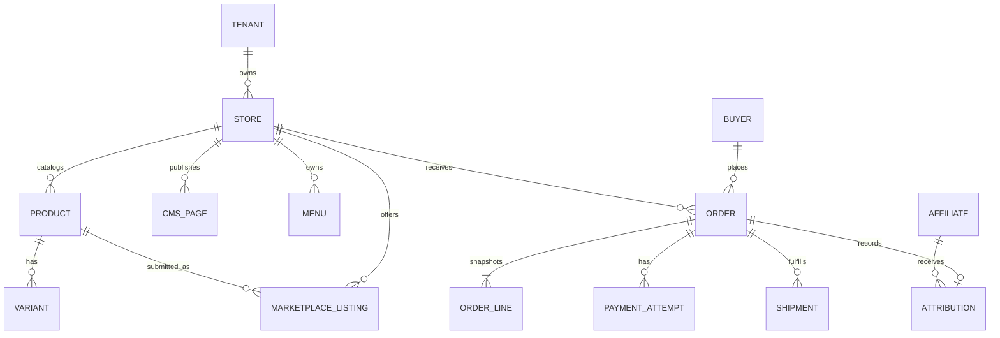

# Bukalaris Canonical Data Model

| ID | Invariant | Status | Owner |
|---|---|---|---|
| DATA-1 | Seller-owned commerce rows carry an immutable tenant/store ownership key. | Proposed | Data owner |
| DATA-2 | An order snapshots commercial decisions; later catalog edits do not rewrite it. | Proposed | Finance owner |
| DATA-3 | Marketplace publication is a separate reversible listing lifecycle. | Proposed | Product owner |
| DATA-4 | Buyer identity is global, while customer/order projections remain scoped to store access. | Proposed | IAM owner |

## Entity contract

| Entity | Ownership/lifecycle | Required notes |
|---|---|---|
| Tenant, Store | Platform creates; seller is a member of a store | Store status gates selling and host resolution |
| Product, Variant, Inventory | Seller-owned draft → active → archived | Variant price/inventory authoritative at checkout |
| Category, Collection, Article, CMS Page, Menu | Seller-owned draft → published → archived | Published content is host-scoped; taxonomy, merchandising and editorial roles remain distinct |
| Landing Page (future CMS content type), Page Revision | Store-owned draft → published → unpublished/archived | Own slug, versioned section document, LP design settings, and published revision reference; no active storefront theme dependency; see PR-9 and TD-4 |
| Buyer, Address | Global identity; address use is order-scoped | Retention and account-linking policy pending PRIV-2 |
| Cart, Checkout Session | Store-bound, expiring, idempotent | Never accepts client price/total as truth |
| Order, Order Line, Allocation | Immutable commercial snapshot | Order line retains seller/store identity |
| Payment Attempt | One local reference, provider transaction reference, lifecycle | Provider envelope is not raw public telemetry |
| Shipment, Shipment Quote | Store/order-bound quote → booking → tracking/cancel state | Quote source and selected service are recorded |
| Marketplace Listing | Submission → review → approved/rejected/disabled | Review reason and actor retained |
| Attribution | Short-lived click/reference linked only under approved policy | No buyer PII readable by affiliate |
| Audit Record | Append-only action/result evidence | Separate from sampled diagnostic logs |

## Database constraints

- A store slug and normalized custom host are unique platform-wide.
- A cart/order has one `store_id` in Phase 1; order lines cannot cross it.
- Money is integer IDR, with explicit rounding rule before implementation.
- `payment_attempt.local_reference` and each accepted provider transaction
  reference are unique at their provider boundary.
- One active marketplace listing per seller product/channel is allowed unless a
  later channel model explicitly changes this.
- Soft/archived deletion must not destroy historical orders, audit records, or
  financial evidence.

## Migration rule

No schema is authorized by this planning pack. Migration ordering, row-level
security implementation, backfill, compatibility reads, and rollback evidence
must be designed from the actual repository/schema and traced to a task.

## Proposed landing-page records

Source: PR-9 and ARCH-4. These are logical records, not an authorized migration.

| Record | Minimum fields | Invariant |
|---|---|---|
| Landing Page | id, store_id, slug, title, draft_revision_id, published_revision_id | Unique store/slug; both pointers reference revisions belonging to this page/store; unpublished pages have no published pointer |
| Page Revision | id, store_id, page_id, revision_number, schema_version, document, created_by, created_at | Immutable saved snapshot of layout, content, LP design settings, and form references; no active store theme dependency |
| Document form node | form_type, contract_version, allowed configuration | References platform implementation; cannot contain arbitrary submission code or override protected behavior |

Product and media references remain store-scoped and validated. Do not persist
an alternative authoritative price/stock/order model in the page document.
Draft and publication operations use expected-revision checks and audit events.
Assets reuse the store media system when present; this proposal does not create
a separate LP asset service or form-submission database before form scope exists.

## DATA-5 — Product identity, slug, and catalog mapping

- Status: Proposed
- Owner: Bukalaris data owner
- Source: PR-12.
- Statement: Prefer a database-generated globally unique positive integer for
  product identity in a new schema. Transport it as a decimal string through
  JSON, URLs, and advertising payloads to avoid numeric precision loss. If the
  discovered repository already has a stable opaque primary key, retain it and
  add a unique numeric public identity rather than rewrite foreign keys.
- Acceptance: Concurrent creates receive distinct IDs, archived/deleted IDs
  are never reused, and retries use the same logical creation result. There is
  no fixed digit count, zero padding, random short-code collision, or MAX+1
  allocator. Server-side store scope applies to every lookup regardless of ID.
- Constraints: PR-12, DATA-1, API-4, UX-10.
- Evidence: Schema and concurrency tests await implementation.
- Change history: 2026-09-18 — proposed numeric product identity.

Proposal: Default the product slug to its numeric ID, for example `1042`;
allow a seller to replace it with a readable slug such as `kemeja-linen`.
The canonical path is `/products/<slug>`; numeric and readable slugs use the
same lookup, not an ambiguous ID-first fallback. Reserve numeric-only slugs
for the owning product's generated ID. Slugs and historical aliases are unique
within a store. Renaming creates a redirect from the old slug without changing
product identity; title changes do not silently regenerate a published slug.
Resolve aliases to the current canonical URL without redirect chains. Duplication
creates a new ID and slug; never reuses advertising identity.

Proposal: For a product-level catalog, expose the same immutable product ID
string as the catalog item ID and Pixel/CAPI content identity. If a catalog
exports variants, each item instead uses its immutable variant ID string;
product ID is its group identity. Select and freeze feed granularity before
first export; never send product IDs as item IDs for a variant feed by accident.
Keep product and variant mapping explicit even if both contain numeric values.
Do not use mutable SKU, slug, LP page ID, or domain as advertising identity.
No mapping changes automatically when a store changes domain or theme.

## Proposed product-route and domain persistence

Source: DATA-5, API-5, API-6. Logical model only; names are not existing tables.

- Product route claims: one unique `(store_id, slug)` namespace for current and
  historical product slugs. Each claim points directly to a product. A canonical
  marker or reference distinguishes its current slug; alias resolution redirects
  directly to that current route. Foreign-key ownership includes the store.
  Deleted-product aliases remain reserved and cannot be stolen by another item.
- Product creation result: store/actor/operation/key uniqueness plus input
  fingerprint and resulting product ID, written with draft creation. Reuse the
  application's existing idempotency store if available.
- Domain record: ID, store ID, normalized hostname, provider reference, desired
  state, observed ownership/TLS/routing states, observation time, intent generation,
  safe failure code, and cleanup state. Active/pending claims share a global
  unique normalized hostname constraint.
- Primary domain: prefer one nullable Store primary-domain reference, constrained
  to a domain owned by that Store. Null means the platform subdomain. This is the
  canonical primary choice; do not also persist competing primary flags.
- Domain eligibility is a server-derived predicate over the independent states,
  not a single status whose meaning alternates between DNS and certificate state.
  Provider reconciliation updates observations without changing ownership.

## Phase 1 relational ownership and transaction plan

Status: Proposal. Owner: Bukalaris data owner. Source: PR-1 through PR-5,
PR-12 through PR-15 and ARCH-6. This is a logical schema contract, not SQL.

| Aggregate | Required relationships and constraints | Main query/index target |
|---|---|---|
| Tenant / Store / Membership | Store belongs to tenant; user/store membership unique; root rows included in tenant policy | Membership by actor/store; store by status; unique store slug |
| Product / Variant | Variant belongs to product and same store; immutable numeric identity; unique option combination per product | Published product by store/slug; variants by store/product |
| Inventory | Policy and stock tracked per variant; atomic adjustment/reservation; reason/audit for manual changes | Store/variant uniqueness; reservation expiry work |
| Collection / Collection Product | Membership links only same-store products; ordering belongs to collection | Store/collection and stable rank plus ID |
| Media | Store owner, validated type/size, object key, lifecycle and reference ownership | Store/media ID; unreferenced retention cleanup |
| CMS Page / Menu / Theme Config | Draft/publication boundary; route/menu targets validated; theme config schema bounded | Store/slug/publication; menu location; one active theme config |
| Cart / Cart Line | Store-bound capability; line refers to same-store variant; client supplies quantity, not trusted money | Cart owner capability; cart/variant unique line |
| Checkout / Order / Order Line | One store; immutable commercial snapshot; one order per committed checkout | Unique checkout-order link; store/order time plus ID |
| Payment / Shipment attempt | Stable local reference; provider/account-scoped reference uniqueness; explicit pending/unknown outcome | Reconciliation by state/next-attempt; order references |
| Domain / Route Claim | Unique host claim; store ownership; current/alias slug constraints under DATA-5 | Host lookup; unique store/product slug |
| Idempotency / Pending Work / Audit | Operation-scope key uniqueness, atomic intent, immutable audit where required | Pending jobs by due time; audit by store/time/actor |

Prefer scalar relational columns for ownership, status, money, references and
query predicates; use versioned validated JSON only for flexible content or
bounded provider metadata. Currency is integer IDR, timestamps represent UTC
instants, and clients format locally. Exact SQL type/driver decisions depend
on the selected database. Add compound ownership foreign keys and database
policies where supported; an application convention alone is not proof.

Proposed stock flow: carts do not reserve stock. Checkout submission atomically
checks/reserves available quantity and snapshots totals before scheduling a
provider action. Fulfillment consumes, expiry/cancel releases exactly once.
Reservation expiry, backorder policy, and late paid orders require Q-10. A late
payment must not silently recreate stock or mark an unavailable order fulfilled.
Two concurrent last-unit checkouts must have one accepted reservation.

Transaction boundaries: product+slug+idempotency result; order+lines+reservation+
payment intent; local domain intent; primary-domain switch; LP publication
pointer; and security/business mutation+required audit. External calls occur
after commit. Recovery jobs reconcile incomplete intents rather than repeat
business creation. Lock order and retry policy must be tested on the actual DB.

Cursor listings use store scope, filters and a stable unique tie-breaker. Queries
select only the fields exposed by their permission contract. Index proposals
must be checked against real predicates and representative plans; no speculative
index per column. Store context must be cleared between pooled connections.

## Proposed headless channel and checkout-session records

Source: PR-16, ARCH-7, IAM-11, API-8. Logical records, not deployed schema.

| Record | Ownership / fields | Invariant |
|---|---|---|
| Storefront Channel | Store, name, registered origin/return paths, status, expiry, revision | One store; fixed storefront scopes; never grants Seller/Admin capability |
| Channel Credential | Channel, token hash, prefix, issue/expiry/revocation time | Secret returned once; plaintext not recoverable; rotation uses replacement grant |
| Checkout Handoff | Store, cart, channel/native context, cart revision, code hash, expiry, consumed timestamp, return target | One-use atomic exchange; no PII or long-lived credential in URL |
| Checkout Session | Store, cart, channel/native context, session hash, expiry, state, order binding | Same store as cart and order; private checkout-origin capability |

A native-theme handoff has explicit native context rather than a fabricated
external channel. Handoff expiry does not delete the cart; checkout resume is
possible only through a valid session or a new authorized handoff. Code exchange
and session creation are atomic. Store/channel revocation is checked on sensitive
transitions. Order uniqueness survives token/session expiration and retries.

## DATA-6 — Seller catalog and content model for MCP

- Status: Proposed
- Owner: Bukalaris data owner
- Source: PR-17 and TD-6.
- Statement: MCP and Seller Admin operate on the same store-owned records and
  draft/publication lifecycle. Category, Collection, Article, CMS Page, Menu,
  Product, Variant, Media and Landing Page identities are stable and never
  inferred from an AI-generated title or URL.
- Acceptance: Every reference is validated for the same store; stale revisions
  cannot overwrite newer work; failed validation or publication leaves the
  current published version unchanged. MCP does not persist a parallel content
  copy or bypass relational ownership constraints.
- Constraints: DATA-1, DATA-5, TEN-1, IAM-12.
- Evidence: Logical contract only; no authorized migration exists.
- Change history: 2026-09-18 — added taxonomy/editorial records and shared MCP ownership.

| Record | Purpose and minimum contract | Relationship rule |
|---|---|---|
| Category | Hierarchical store classification with stable ID, name, slug, parent, status and revision | Parent belongs to same store; cycles forbidden; products may belong to several categories with at most one primary category |
| Collection | Seller-curated merchandising group with title, slug, description, media, ordered product memberships and publication state | Membership products belong to same store; collection order does not change category taxonomy |
| Article | Editorial/blog content with title, slug, excerpt, versioned body, cover media, author display, SEO fields and publication timestamps | Media and links remain store-owned; author display is content, not authorization identity |
| CMS Page | Static informational content with title, slug, versioned body, SEO fields and publication state | Reserved commerce/platform routes cannot be claimed |
| Menu | Ordered links to current store-owned routes or validated external URLs | Broken, foreign-store and unsafe-scheme links fail validation |
| Media | Store ownership, safe type/size metadata, object reference, alternative text and lifecycle | MCP receives metadata/approved references, not storage credentials or arbitrary server file paths |
| Content Revision | Object type/ID, store, revision number, schema version, draft document, actor and timestamp | Immutable revision; published pointer references a validated revision of the same object/store |

Product commercial fields remain typed records rather than arbitrary article or
page JSON. Article/Page bodies and LP documents may use versioned structured
blocks. Category paths and slugs have store-scoped uniqueness plus retained
aliases if public URLs can change. Deleting content is archive/unpublish by
default; referenced live content and historical order snapshots are preserved.

## Persistence recommendation — 2026-09-25

Proposal: Use PostgreSQL with Drizzle schema and reviewed SQL migrations.
Represent IDR as exact integer values; define JSON serialization for values
outside JavaScript safe integers. Enforce store ownership with compound foreign
keys and PostgreSQL RLS; runtime roles cannot bypass tenant policy. Use explicit
scoped transactions and bounded pools across applications and workers. Migration
credentials are separate from runtime credentials. Pin versions and prove
last-unit stock races, duplicate checkout, tenant isolation and outbox atomicity
before accepting the implementation.

