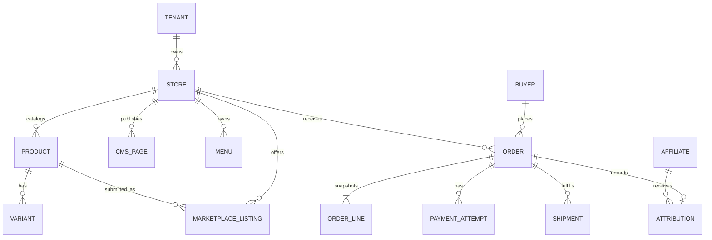

# Bukalaris Canonical Data Model

| ID | Invariant | Status | Owner |
|---|---|---|---|
| DATA-1 | Seller-owned commerce rows carry an immutable tenant/store ownership key. | Proposed | Data owner |
| DATA-2 | An order snapshots commercial decisions; later catalog edits do not rewrite it. | Proposed | Finance owner |
| DATA-3 | Marketplace publication is a separate reversible listing lifecycle. | Proposed | Product owner |
| DATA-4 | One platform-owned buyer identity spans sellers; checkout resolves/creates it by canonical phone/WA first, then email, without registration. Phone wins conflicting accounts without merge; association never authenticates or exposes historical PII. Store orders stay store-owned (DATA-12, ADR-0010). | Proposed | IAM owner |

## Entity contract

| Entity | Ownership/lifecycle | Required notes |
|---|---|---|
| Tenant, Store | Platform creates; seller is a member of a store | Store status gates selling and host resolution |
| Product, Variant, Inventory | Seller-owned draft → active → archived | Variant price/inventory authoritative at checkout |
| Category, Collection, Article, CMS Page, Menu | Seller-owned draft → published → archived | Published content is host-scoped; taxonomy, merchandising and editorial roles remain distinct |
| Landing Page (future CMS content type), Page Revision | Store-owned draft → published → unpublished/archived | Own slug, versioned section document, LP design settings, and published revision reference; no active storefront theme dependency; see PR-9 and TD-4 |
| Buyer, Buyer Identifier, Buyer Order Link, Buyer Address | Platform-owned cross-seller identity and buyer-authorized profile/address book; server checkout association is not a verified session | DATA-12/ADR-0010 require proof of possession before portal reads, no anonymous prefill, no automatic merge; historical store-owned recipient/address snapshots remain unchanged |
| Cart, Checkout Session | Store-bound, expiring, idempotent | Never accepts client price/total as truth |
| Order, Order Line, Allocation | Immutable commercial snapshot | Order line retains seller/store identity |
| Payment Attempt | One local reference, provider transaction reference, lifecycle | Provider envelope is not raw public telemetry |
| Shipment, Shipment Quote | Store/order-bound quote → booking → tracking/cancel state | Quote source and selected service are recorded |
| Marketplace Listing | Submission → review → approved/rejected/disabled | Review reason and actor retained |
| Attribution | Short-lived click/reference linked only under approved policy | No buyer PII readable by affiliate |
| Audit Record | Append-only action/result evidence | Separate from sampled diagnostic logs |

## Database constraints

- A store slug and normalized custom host are unique platform-wide.
- A cart/order has one `store_id` in Phase 1; order lines cannot cross it.
- Money is integer IDR, with explicit rounding rule before implementation.
- `payment_attempt.local_reference` and each accepted provider transaction
  reference are unique at their provider boundary.
- One active marketplace listing per seller product/channel is allowed unless a
  later channel model explicitly changes this.
- Soft/archived deletion must not destroy historical orders, audit records, or
  financial evidence.

## Migration rule

No schema is authorized by this planning pack. Migration ordering, row-level
security implementation, backfill, compatibility reads, and rollback evidence
must be designed from the actual repository/schema and traced to a task.

## Proposed landing-page records

Source: PR-9 and ARCH-4. These are logical records, not an authorized migration.

| Record | Minimum fields | Invariant |
|---|---|---|
| Landing Page | id, store_id, slug, title, draft_revision_id, published_revision_id | Unique store/slug; both pointers reference revisions belonging to this page/store; unpublished pages have no published pointer |
| Page Revision | id, store_id, page_id, revision_number, schema_version, document, created_by, created_at | Immutable saved snapshot of layout, content, LP design settings, and form references; no active store theme dependency |
| Document form node | form_type, contract_version, allowed configuration | References platform implementation; cannot contain arbitrary submission code or override protected behavior |

Product and media references remain store-scoped and validated. Do not persist
an alternative authoritative price/stock/order model in the page document.
Draft and publication operations use expected-revision checks and audit events.
Assets reuse the store media system when present; this proposal does not create
a separate LP asset service or form-submission database before form scope exists.

## DATA-5 — Product identity, slug, and catalog mapping

- Status: Proposed
- Owner: Bukalaris data owner
- Source: PR-12.
- Statement: Prefer a database-generated globally unique positive integer for
  product identity in a new schema. Transport it as a decimal string through
  JSON, URLs, and advertising payloads to avoid numeric precision loss. If the
  discovered repository already has a stable opaque primary key, retain it and
  add a unique numeric public identity rather than rewrite foreign keys.
- Acceptance: Concurrent creates receive distinct IDs, archived/deleted IDs
  are never reused, and retries use the same logical creation result. There is
  no fixed digit count, zero padding, random short-code collision, or MAX+1
  allocator. Server-side store scope applies to every lookup regardless of ID.
- Constraints: PR-12, DATA-1, API-4, UX-10.
- Evidence: Schema and concurrency tests await implementation.
- Change history: 2026-09-18 — proposed numeric product identity.

Proposal: Default the product slug to its numeric ID, for example `1042`;
allow a seller to replace it with a readable slug such as `kemeja-linen`.
The canonical path is `/products/<slug>`; numeric and readable slugs use the
same lookup, not an ambiguous ID-first fallback. Reserve numeric-only slugs
for the owning product's generated ID. Slugs and historical aliases are unique
within a store. Renaming creates a redirect from the old slug without changing
product identity; title changes do not silently regenerate a published slug.
Resolve aliases to the current canonical URL without redirect chains. Duplication
creates a new ID and slug; never reuses advertising identity.

Proposal: For a product-level catalog, expose the same immutable product ID
string as the catalog item ID and Pixel/CAPI content identity. If a catalog
exports variants, each item instead uses its immutable variant ID string;
product ID is its group identity. Select and freeze feed granularity before
first export; never send product IDs as item IDs for a variant feed by accident.
Keep product and variant mapping explicit even if both contain numeric values.
Do not use mutable SKU, slug, LP page ID, or domain as advertising identity.
No mapping changes automatically when a store changes domain or theme.

## Proposed product-route and domain persistence

Source: DATA-5, API-5, API-6. Logical model only; names are not existing tables.

- Product route claims: one unique `(store_id, slug)` namespace for current and
  historical product slugs. Each claim points directly to a product. A canonical
  marker or reference distinguishes its current slug; alias resolution redirects
  directly to that current route. Foreign-key ownership includes the store.
  Deleted-product aliases remain reserved and cannot be stolen by another item.
- Product creation result: store/actor/operation/key uniqueness plus input
  fingerprint and resulting product ID, written with draft creation. Reuse the
  application's existing idempotency store if available.
- Domain record: ID, store ID, normalized hostname, provider reference, desired
  state, observed ownership/TLS/routing states, observation time, intent generation,
  safe failure code, and cleanup state. Active/pending claims share a global
  unique normalized hostname constraint.
- Primary domain: prefer one nullable Store primary-domain reference, constrained
  to a domain owned by that Store. Null means the platform subdomain. This is the
  canonical primary choice; do not also persist competing primary flags.
- Domain eligibility is a server-derived predicate over the independent states,
  not a single status whose meaning alternates between DNS and certificate state.
  Provider reconciliation updates observations without changing ownership.

## Phase 1 relational ownership and transaction plan

Status: Proposal. Owner: Bukalaris data owner. Source: PR-1 through PR-5,
PR-12 through PR-15 and ARCH-6. This is a logical schema contract, not SQL.

| Aggregate | Required relationships and constraints | Main query/index target |
|---|---|---|
| Tenant / Store / Membership | Store belongs to tenant; user/store membership unique; root rows included in tenant policy | Membership by actor/store; store by status; unique store slug |
| Product / Variant | Variant belongs to product and same store; immutable numeric identity; unique option combination per product | Published product by store/slug; variants by store/product |
| Inventory | Policy and stock tracked per variant; atomic adjustment/reservation; reason/audit for manual changes | Store/variant uniqueness; reservation expiry work |
| Collection / Collection Product | Membership links only same-store products; ordering belongs to collection | Store/collection and stable rank plus ID |
| Media | Store owner, validated type/size, object key, lifecycle and reference ownership | Store/media ID; unreferenced retention cleanup |
| CMS Page / Menu / Theme Config | Draft/publication boundary; route/menu targets validated; theme config schema bounded | Store/slug/publication; menu location; one active theme config |
| Cart / Cart Line | Store-bound capability; line refers to same-store variant; client supplies quantity, not trusted money | Cart owner capability; cart/variant unique line |
| Checkout / Order / Order Line | One store; immutable commercial snapshot; one order per committed checkout | Unique checkout-order link; store/order time plus ID |
| Payment / Shipment attempt | Stable local reference; provider/account-scoped reference uniqueness; explicit pending/unknown outcome | Reconciliation by state/next-attempt; order references |
| Domain / Route Claim | Unique host claim; store ownership; current/alias slug constraints under DATA-5 | Host lookup; unique store/product slug |
| Idempotency / Pending Work / Audit | Operation-scope key uniqueness, atomic intent, immutable audit where required | Pending jobs by due time; audit by store/time/actor |

Prefer scalar relational columns for ownership, status, money, references and
query predicates; use versioned validated JSON only for flexible content or
bounded provider metadata. Currency is integer IDR, timestamps represent UTC
instants, and clients format locally. Exact SQL type/driver decisions depend
on the selected database. Add compound ownership foreign keys and database
policies where supported; an application convention alone is not proof.

Accepted catalog stock boundary (T-80, D-24): product/variant creation accepts initial stock. Subsequent `updateVariant` writes only metadata (title, SKU, price and weight); a legacy stock field is validated but ignored, never copied over a checkout decrement. Manual inventory changes use the existing signed-delta `adjustStock` transaction with `inventory.write`, a reason, a non-negative guard and `stock_adjustment` audit. Catalog audit snapshots retain the stock observed under the row lock; they do not claim a manual adjustment. This does not settle reservation expiry or general metadata revision conflicts.

Proposed stock flow: carts do not reserve stock. Checkout submission atomically
checks/reserves available quantity and snapshots totals before scheduling a
provider action. Fulfillment consumes, expiry/cancel releases exactly once.
Reservation expiry, backorder policy, and late paid orders require Q-10. A late
payment must not silently recreate stock or mark an unavailable order fulfilled.
Two concurrent last-unit checkouts must have one accepted reservation.

Transaction boundaries: product+slug+idempotency result; order+lines+reservation+
payment intent; local domain intent; primary-domain switch; LP publication
pointer; and security/business mutation+required audit. External calls occur
after commit. Recovery jobs reconcile incomplete intents rather than repeat
business creation. Lock order and retry policy must be tested on the actual DB.

Cursor listings use store scope, filters and a stable unique tie-breaker. Queries
select only the fields exposed by their permission contract. Index proposals
must be checked against real predicates and representative plans; no speculative
index per column. Store context must be cleared between pooled connections.

## Proposed headless channel and checkout-session records

Source: PR-16, ARCH-7, IAM-11, API-8. Logical records, not deployed schema.

| Record | Ownership / fields | Invariant |
|---|---|---|
| Storefront Channel | Store, name, registered origin/return paths, status, expiry, revision | One store; fixed storefront scopes; never grants Seller/Admin capability |
| Channel Credential | Channel, token hash, prefix, issue/expiry/revocation time | Secret returned once; plaintext not recoverable; rotation uses replacement grant |
| Checkout Handoff | Store, cart, channel/native context, cart revision, code hash, expiry, consumed timestamp, return target | One-use atomic exchange; no PII or long-lived credential in URL |
| Checkout Session | Store, cart, channel/native context, session hash, expiry, state, order binding | Same store as cart and order; private checkout-origin capability |

A native-theme handoff has explicit native context rather than a fabricated
external channel. Handoff expiry does not delete the cart; checkout resume is
possible only through a valid session or a new authorized handoff. Code exchange
and session creation are atomic. Store/channel revocation is checked on sensitive
transitions. Order uniqueness survives token/session expiration and retries.

## DATA-6 — Seller catalog and content model for MCP

- Status: Proposed
- Owner: Bukalaris data owner
- Source: PR-17 and TD-6.
- Statement: MCP and Seller Admin operate on the same store-owned records and
  draft/publication lifecycle. Category, Collection, Article, CMS Page, Menu,
  Product, Variant, Media and Landing Page identities are stable and never
  inferred from an AI-generated title or URL.
- Acceptance: Every reference is validated for the same store; stale revisions
  cannot overwrite newer work; failed validation or publication leaves the
  current published version unchanged. MCP does not persist a parallel content
  copy or bypass relational ownership constraints.
- Constraints: DATA-1, DATA-5, TEN-1, IAM-12.
- Evidence: Logical contract only; no authorized migration exists.
- Change history: 2026-09-18 — added taxonomy/editorial records and shared MCP ownership.

| Record | Purpose and minimum contract | Relationship rule |
|---|---|---|
| Category | Hierarchical store classification with stable ID, name, slug, parent, status and revision | Parent belongs to same store; cycles forbidden; products may belong to several categories with at most one primary category |
| Collection | Seller-curated merchandising group with title, slug, description, media, ordered product memberships and publication state | Membership products belong to same store; collection order does not change category taxonomy |
| Article | Editorial/blog content with title, slug, excerpt, versioned body, cover media, author display, SEO fields and publication timestamps | Media and links remain store-owned; author display is content, not authorization identity |
| CMS Page | Static informational content with title, slug, versioned body, SEO fields and publication state | Reserved commerce/platform routes cannot be claimed |
| Menu | Ordered links to current store-owned routes or validated external URLs | Broken, foreign-store and unsafe-scheme links fail validation |
| Media | Store ownership, safe type/size metadata, object reference, alternative text and lifecycle | MCP receives metadata/approved references, not storage credentials or arbitrary server file paths |
| Content Revision | Object type/ID, store, revision number, schema version, draft document, actor and timestamp | Immutable revision; published pointer references a validated revision of the same object/store |

Product commercial fields remain typed records rather than arbitrary article or
page JSON. Article/Page bodies and LP documents may use versioned structured
blocks. Category paths and slugs have store-scoped uniqueness plus retained
aliases if public URLs can change. Deleting content is archive/unpublish by
default; referenced live content and historical order snapshots are preserved.

## Persistence recommendation — 2026-09-25

Proposal: Use PostgreSQL with Drizzle schema and reviewed SQL migrations.
Represent IDR as exact integer values; define JSON serialization for values
outside JavaScript safe integers. Enforce store ownership with compound foreign
keys and PostgreSQL RLS; runtime roles cannot bypass tenant policy. Use explicit
scoped transactions and bounded pools across applications and workers. Migration
credentials are separate from runtime credentials. Pin versions and prove
last-unit stock races, duplicate checkout, tenant isolation and outbox atomicity
before accepting the implementation.

## DATA-7 — Financial snapshot, append-only ledger, payouts, and refunds

- Status: Proposed (2026-10-26, revised 2026-10-27, ADR-0006)
- Owner: Bukalaris data owner
- Source: PR-23, BILL-4, BILL-5, ADR-0006.
- Statement: Order financial allocations, seller ledger entries, payout requests,
  and buyer non-COD refunds shall be persisted in dedicated store-scoped tables
  under `FORCE ROW LEVEL SECURITY` with database-enforced idempotency and
  append-only invariants.
- Acceptance: `order_financials` and `order_line_financials` are written once at order creation and never updated (no UPDATE grant, trigger backstop); the actual Mengantar booking cost, delta, debit, margin, and reconciled cashback are written once in `shipment_cost`, so booking never mutates the checkout snapshot; `ledger_entry` forbids in-place amount edits and prevents duplicate sale, cashback, return, shipping-debit, payout and payout-reversal entries and duplicate adjustment references via partial unique indexes; a pending-to-available release only ever changes `status`, `released_at`, `release_basis` and `reconciliation_item_id`, and a COD `sale` or `cashback` entry can reach `available` only through an applied reconciliation item; seller money is never `available` for an undelivered or unreconciled parcel, so `available` cannot go negative by construction; `payout` carries a unique request key, snapshots its destination under the per-store advisory lock and reaches `processing` only with an approved four-eyes `approval_request`; `refund` enforces one open refund per non-COD payment and one non-failed refund per order; no balance query joins `order`; the seller entitlement is derived, never a column.
- Acceptance (ledger consistency invariants; canonical statement, owner decision D-21, ADR-0006 decision 3; a contract to be built by T-37, not existing code): the ledger stays single-entry and append-only. Balances are always derived by `SUM(amount_idr)` over `ledger_entry`, never a stored counter. A read-only verification, `pnpm verify:ledger`, and an automated test must recompute per store and prove: exactly one `sale` per order that has met the booking condition (never zero, never two); at most one `return_reversal` per order; `available` never negative; every `payout` and `payout_reversal` entry pairs with a `payout` row; every released entry has `released_at` and `release_basis`; and no query path joins `order` to compute a balance. BILL-5 links here and does not restate it.
- Constraints: DATA-1, DATA-2, BILL-4, BILL-5, TEN-1, TEN-3, NFR-2, ADR-0006.

| Record | Key columns (integer IDR as `bigint`) | Database constraints & RLS |
|---|---|---|
| `order_financials` | `order_id` (PK), `store_id`, `shipping_account_id`, `shipping_account_kind` (`partner_managed`, `platform_master`), `subtotal_idr`, `goods_discount_idr`, `shipping_discount_idr`, `included_sales_tax_idr`, `added_sales_tax_idr`, `goods_proceeds_idr`, `shipping_charged_idr`, `shipping_cashback_gross_idr`, `platform_cashback_idr`, `seller_cashback_idr`, `affiliate_commission_idr` (DATA-11), `cod_fee_idr`, `cod_fee_vat_idr`, `cod_fee_vat_rate_bps` and `cod_fee_vat_policy_version_id` (NULL when the VAT is 0), `payable_idr`, `sale_amount_idr`, `expected_gateway_fee_idr` | Compound FKs `(store_id, order_id) -> order` and `(store_id, shipping_account_id) -> store_shipping_account`; written once, never updated; CHECK non-negative amounts; CHECK `shipping_cashback_gross_idr = platform_cashback_idr + seller_cashback_idr`; CHECK the allocation identity below; CHECK `cod_fee_vat_idr = 0` when the policy version is NULL; no booked-cost, debit, margin or entitlement column (those live in `shipment_cost` and the derived view); `FORCE ROW LEVEL SECURITY` |
| `order_line_financials` | `order_id`, `line_no`, `store_id`, `order_line_id`, `line_gross_idr`, `discount_alloc_idr`, `net_goods_idr`, `included_tax_idr`, `added_tax_idr`, `commission_base_idr`, nullable `commission_rate_bps` (the applied line rate snapshot, DATA-11) | PK `(order_id, line_no)`; compound same-store FKs to `order_financials` and `order_line`; written once with the order from the BILL-4 per-line allocation; CHECK `net_goods_idr = line_gross_idr - discount_alloc_idr`, `0 <= included_tax_idr <= net_goods_idr`, `commission_base_idr = net_goods_idr - included_tax_idr`; the line sums equal the `order_financials` totals (deferred constraint trigger in the checkout transaction and the ledger verification command); `FORCE ROW LEVEL SECURITY` |
| `shipment_cost` | `order_id` (PK, one per order: rebooking is unsupported), `store_id`, `shipping_account_id`, `shipping_account_kind`, `booked_shipping_idr`, `shipping_charged_idr` (copied from `order_financials` for the CHECK), `seller_shipping_debit_idr`, `platform_shipping_margin_idr`, `provider_cod_fee_idr` (booking-basis COD fee), `cod_amount_sent_idr` (COD only), `shipping_debit_entry_id` (nullable FK to the `shipping_debit` ledger entry), `created_at` | Append-once (no UPDATE grant); compound FK `(store_id, order_id) -> order_financials`; CHECK `shipping_charged_idr + seller_shipping_debit_idr = booked_shipping_idr + platform_shipping_margin_idr`; CHECK at most one of debit and margin is positive; CHECK `cod_amount_sent_idr = payable_idr` for COD (via the order's payment method); inserted in the booking transaction under the order-row then per-store locks (ADR-0006 decisions 4 and 7), before any provider write; a provider-confirmed void is a `shipping_debit_reversal` ledger entry, never an edit; `FORCE ROW LEVEL SECURITY` |
| `ledger_entry` | `id`, `store_id`, `order_id` (nullable; NULL for `payout`, `payout_reversal` and `adjustment`), `payout_id` (nullable), `kind` (`sale`, `cashback`, `shipping_debit`, `shipping_debit_reversal`, `return_reversal`, `payout`, `payout_reversal`, `adjustment`), `status` (`pending`, `available`), `amount_idr` (signed `bigint`), `business_ref` (nullable; required and immutable for `adjustment`), `approval_request_id` (nullable; required for `adjustment`), `note`, `created_at`, `released_at`, `release_basis` (`delivery` or `reconciliation`; NULL while `pending`), `reconciliation_item_id` (nullable FK to `reconciliation_batch_item`) | Partial unique `ledger_one_sale_per_order`, `ledger_one_cashback_per_order`, `ledger_one_return_per_order`, `ledger_one_shipping_debit_per_order`, `ledger_one_shipping_reversal_per_order`, each on `(store_id, order_id) WHERE kind = <kind>`; `ledger_one_payout_per_payout` and `ledger_one_payout_reversal_per_payout` on `(store_id, payout_id) WHERE kind = <kind>`; `ledger_adjustment_business_ref` unique on `(store_id, business_ref) WHERE kind = 'adjustment'`; CHECK sign by kind (`sale`, `cashback`, `shipping_debit_reversal`, `payout_reversal` positive; `shipping_debit`, `return_reversal`, `payout` negative), `order_id` set for the order kinds, `payout_id` set for the payout kinds, and `adjustment` implies `business_ref` and `approval_request_id` set; a `return_reversal` is always `pending` and reverses a `pending` sale only (a released sale is never reversed automatically; post-delivery claims are four-eyes `adjustment`); `status = 'available'` on a `sale` or `cashback` implies `release_basis` set, `release_basis = 'reconciliation'` implies `reconciliation_item_id` of an applied item, and a COD `sale` or `cashback` can only use `reconciliation`; a prepaid `sale` uses `delivery`; a `shipping_debit` may be `pending` only while its own order's `sale` is `pending` and moves with that sale (ADR-0006 decision 7); the `sale` amount equals `order_financials.sale_amount_idr` and `cashback` equals `order_financials.seller_cashback_idr`; indexes `(store_id, status) INCLUDE (amount_idr)` for balances, `(store_id, created_at)`, and partial `(store_id) WHERE kind IN ('sale','cashback') AND status = 'pending'` for the release job; `FORCE ROW LEVEL SECURITY` |
| `payout_destination` | `id`, `store_id`, `bank_code`, `account_number` (protected, class `bank`), `account_holder_name`, `holder_name_check` (`match`, `mismatch`, `unchecked`), `status` (`held`, `active`, `superseded`), `hold_until`, `created_by_user_id`, `step_up_ref` (opaque reference to the fresh-proof event), `previous_contact_notified_at`, `created_at`, `superseded_at` | Replaces any bank columns kept on the store; partial unique `(store_id) WHERE status = 'active'` and `(store_id) WHERE status = 'held'` (a newer change supersedes the held one); CHECK `held` implies `hold_until` set; a payout may reference only an `active` destination whose `hold_until <= now()` (re-checked under the payout lock); creation requires a step-up, notifies the previous contact, and sets a **72-hour hold** (default 72 hours, Owner-configurable, D-19); masked in the data layer; `FORCE ROW LEVEL SECURITY` |
| `payout` | `id`, `store_id`, `requested_by_user_id`, `request_key`, `amount_idr`, `status` (`requested`, `processing`, `paid`, `rejected`), `destination_id`, snapshotted `bank_code`, `bank_account_number`, `bank_account_holder` and `holder_name_check`, `approval_request_id`, `approved_at`, `claimed_by_user_id`, `claim_expires_at` (30-min operator claim lease), `transfer_evidence_ref` (unique across paid payouts), `evidence_artifact_id` (unique non-reusable receipt upload, SHA-256 verified), `processed_by_user_id`, `rejection_reason`, `created_at`, `processed_at` | Serialized at creation with the per-store two-key lock `pg_advisory_xact_lock(hashtext('bukalaris.payout.store'), hashtext(store_id::text))` (ADR-0006 decision 4); unique `(store_id, request_key)`; unique `transfer_evidence_ref` and `evidence_artifact_id` where not null; CHECK `amount_idr >= min_payout_idr`; CHECK `processing` or `paid` implies `approval_request_id` set (four-eyes approve-for-transfer) and `paid` implies `transfer_evidence_ref` and `evidence_artifact_id` set; `rejected` from `processing` requires a recorded no-transfer evidence reference; an unknown transfer outcome leaves `processing` untouched; `FORCE ROW LEVEL SECURITY` |
| `refund` | `id`, `store_id`, `order_id`, `payment_attempt_id`, `goods_refund_idr`, `shipping_refund_idr`, `fee_refund_idr`, `amount_idr`, `status` (`pending`, `processing`, `completed`, `failed`), `reason`, `destination_ref` (opaque; the destination the buyer supplies on the signed order-status page, D-20 closes OPEN-F4), `approval_request_id`, `claimed_by_user_id`, `claim_expires_at`, `transfer_evidence_ref`, `evidence_artifact_id`, `processed_by_user_id`, `created_at`, `updated_at` | Partial unique `refund_one_open_per_payment` on `(payment_attempt_id) WHERE status IN ('pending', 'processing')` and `refund_one_per_order` on `(store_id, order_id) WHERE status <> 'failed'` (partial refunds are unsupported in M3); CHECK `amount_idr = goods_refund_idr + shipping_refund_idr + fee_refund_idr` and `amount_idr <= payment_attempt.total_idr` (BILL-5 composition); CHECK `processing`, `completed` imply `approval_request_id` set and `completed` implies `transfer_evidence_ref`; never credits/debits seller ledger (buyer refund is separate from seller claw-back); `FORCE ROW LEVEL SECURITY` |
| `payment_attempt` additions & `autolaris_callback` | `payment_attempt`: `request_key`, `request_state` (`in_progress`, `accepted`, `failed`), `revision` (monotonic), `provider_fee_idr`, `provider_fee_source`, `provider_fee_recorded_at`; `autolaris_callback`: `id`, `reff_id`, `trx_id`, `content_type`, `raw_body` (redacted after 30 days), `body_sha256`, `received_at` | Two-phase attempt coordination outside DB locks; callback row binding (`boundRef === attempt.reff_id`), forward-only monotonicity (`status <> 'paid'`), and 30-day raw payload redaction (99ribu/Tokophi pattern). A callback row is only a trigger (verify-by-pull, ADR-0006 decision 6, D-21): it records the body digest and enqueues the provider-inquiry verification job and never settles a payment by itself |
| `platform_money_position` (read-only view) | Across the single unified Bukalaris financial system by liability/revenue class: seller `pending` and `available` (from `ledger_entry`), affiliate `available` and pending commission obligations (from `affiliate_ledger_entry` and attributions), payouts `requested`/`processing`, open `refund` obligations, and platform revenue lines (platform shipping margin from `shipment_cost`, platform shipping cashback, payment-fee margin, COD fee and its VAT from `order_financials`) | A view over existing append-only tables, not a second ledger; no balance sum joins `order`; classes are computed per class so that the seller classes sum to the seller ledger total on a fixture (SA-26) |
| `reconciliation_batch` | `id`, `status` (`draft`, `pending_approval`, `applied`, `void`), `source` (`owner_batch`, `provider`), `evidence_ref` (opaque reference to the carrier invoice or statement), `evidence_total_idr`, `item_count`, `payload_sha256`, `prepared_by_user_id` (NULL for a system `provider` batch), `approval_request_id`, `applied_at`, `created_at` | Platform class; written through the reconciliation service function; transitions `draft -> pending_approval -> applied` or `void`; `applied` requires an approved `cod.reconcile_release` `approval_request` (capability `payouts.reconcile`) whose `payload_sha256` equals the batch hash and whose `decided_by <> prepared_by_user_id`; a `provider` batch exists only while the platform setting `provider_reconciliation_enabled` is true (default false, OPEN-F8); an applied batch is immutable; `FORCE ROW LEVEL SECURITY` is not applicable (no store column), access is by function and `payouts.reconcile` / `finance.read` capability |
| `reconciliation_batch_item` | `batch_id`, `order_id`, `store_id`, `cod_amount_idr` (the order `payable_idr`), `evidence_line_ref`, `evidence_amount_idr`, `evidence_date`, `reconciled_at` (set when the batch is applied), `reconciliation_source` (`owner_batch`, `provider`), `voided_at` | PK `(batch_id, order_id)`; partial unique `(order_id) WHERE voided_at IS NULL` (an order is reconciled once); compound FK `(store_id, order_id) -> order_financials` with a trigger requiring a COD order and a delivered status; a batch can be applied only when every item has `evidence_amount_idr = cod_amount_idr` (a mismatch is a break, resolved or removed before approval, never auto-released); `ledger.release` releases a COD `sale` (and `cashback`) only through an item of an `applied` batch; store-scoped RLS for seller reads of their own items (`reconciled_at`, source, evidence date only) |

**Allocation identity** (CHECK at checkout; ADR-0006 decision 2, BILL-4):

- `payable_idr = goods_proceeds_idr + included_sales_tax_idr + added_sales_tax_idr + shipping_charged_idr + cod_fee_idr + cod_fee_vat_idr` (equals `order.total`; the gateway admin fee is separate).
- `sale_amount_idr = goods_proceeds_idr + included_sales_tax_idr + added_sales_tax_idr - affiliate_commission_idr`.
- Distribution: `payable_idr = sale_amount_idr + affiliate_commission_idr + shipping_charged_idr + cod_fee_idr + cod_fee_vat_idr`.
- At booking (`shipment_cost`): `shipping_charged_idr + seller_shipping_debit_idr = booked_shipping_idr + platform_shipping_margin_idr`.
- The seller entitlement of an order is derived by the read-only view `seller_order_entitlement`: `sale_amount_idr + seller_cashback_idr + SUM(shipping_debit amounts) + SUM(shipping_debit_reversal amounts)` over that order's ledger entries (debits are negative). It is never stored, so `order_financials` stays immutable and shipping is never deducted twice.

**Table classes (ADR-0005 amendment, T-59).** `order_financials`, `order_line_financials`, `shipment_cost`, `ledger_entry` and `refund` are class `tenant` (store RLS). `payout` and `payout_destination` (seller payouts, bank snapshots and destinations) are class `restricted`: owned by the NOLOGIN role `bukalaris_restricted`, with no table privilege for the platform login, reached only through SECURITY DEFINER functions (payout request, approve-for-transfer, mark-paid, destination change, rejection); the store-scoped seller read goes through the same functions. `reconciliation_batch` and `reconciliation_batch_item` are class `platform` (written only through the reconciliation service function; the item table also carries a store-scoped seller read of the seller's own items). The views `seller_order_entitlement` and `platform_money_position` read only through those grants.

## DATA-8 — Standard product taxonomy, abandoned checkout sessions, and promotions

- Status: Proposed (2026-10-26)
- Owner: Bukalaris data owner
- Source: PR-24, PR-25, PR-26.
- Statement: Standard Google Product Taxonomy reference rows shall live in a
  global read-only table, while product taxonomy bindings, abandoned checkout
  sessions, discount vouchers, flash sales, and promo-hub configurations shall
  be store-scoped under `FORCE ROW LEVEL SECURITY`.
- Acceptance: `product_taxonomy` is readable by `bukalaris_app` without RLS
  while all store tables enforce `tenant_isolation`; `checkout_session` tracks
  `abandoned_at` and `recovered_at` distinctly and is registered in
  `BUYER_DATA_INVENTORY`; `discount` and `flash_sale` enforce same-store
  product/collection foreign keys and atomic usage counters.
- Constraints: DATA-1, DATA-2, DATA-5, PRIV-1, TEN-1, TEN-3.

| Record | Key columns & lifecycle | Invariant & RLS |
|---|---|---|
| `product_taxonomy` | `id` (Google numeric ID, PK), `path`, `name`, `parent_id`, `is_leaf` | Global reference table (no `store_id`, no RLS; `SELECT` granted to `bukalaris_app`), seeded idempotently from Google Product Taxonomy |
| `product` taxonomy & feed columns | `google_category_id` (FK -> `product_taxonomy.id`), `google_category_path`, `brand`, `gtin`, `mpn`, `gender`, `age_group` | Optional nullable columns on `product`; feeds emit `g:identifier_exists = no` when `gtin` and `mpn` are both null |
| `checkout_session` | `id`, `store_id`, `cart_id`, `status` (`active`, `abandoned`, `recovered`), `buyer_name`, `buyer_phone`, `buyer_email`, `shipping_address`, `subtotal_idr`, `abandoned_at`, `recovered_at`, `wa_opened_at`, `updated_at` | Debounced upsert during checkout typing; swept `active -> abandoned` after 60 min idle; `recovered` sets `recovered_at` without erasing `abandoned_at`; `FORCE ROW LEVEL SECURITY` + `PRIV-1` redaction |
| `discount` | `id`, `store_id`, `code`, `kind` (`percent`, `fixed`, `free_shipping`), `scope` (`all`, `collection`, `product`), `collection_id`, `product_id`, `value`, `min_purchase_idr`, `max_discount_idr`, `usage_limit`, `used_count`, `starts_at`, `ends_at`, `status` | Unique `(store_id, UPPER(code))`; conditional `UPDATE ... WHERE used_count < usage_limit` at checkout; `FORCE ROW LEVEL SECURITY` |
| `flash_sale` & `flash_sale_item` | `flash_sale`: `id`, `store_id`, `title`, `starts_at`, `ends_at`, `status`; `flash_sale_item`: `id`, `store_id`, `flash_sale_id`, `product_id`, `variant_id`, `sale_price_idr`, `stock_cap`, `sold_count` | Compound FKs include `store_id`; server overrides variant price only when `now() BETWEEN starts_at AND ends_at` and `sold_count < stock_cap`; `FORCE ROW LEVEL SECURITY` |
| `promo_hub` | `store_id` (PK), `enabled`, `slug` (default `'promo'`), `title`, `subtitle`, `banner_media_id`, `banner_cta_label`, `banner_cta_href`, `featured_collection_ids`, `free_ship_enabled`, `free_ship_threshold_idr` | One row per store; `FORCE ROW LEVEL SECURITY` |
| `store_tax_setting` | `store_id` (PK), `price_mode` (`tax_included`, `tax_added`), `sales_tax_rate_bps` (0 to 10000; 0 means no goods sales tax) | Store-bound RLS; seller-configured goods sales tax is the seller's own responsibility (ADR-0012 section 6); integer basis points only; no platform-shipped rate default; edits are prospective because each order snapshots its allocation per line in `order_line_financials` (DATA-7). The lines of a `discount` scope (all, collection, product) are the lines of the BILL-4 largest-remainder allocation |

## DATA-9 — Partner Mengantar shipping accounts, cashback rules, and service policy

- Status: Proposed (2026-10-27; revised to unified Bukalaris-managed Partner model)
- Owner: Bukalaris data owner
- Source: PR-27, BILL-6, UX-17, [ADR-0007](ADR-0007-hybrid-mengantar-shipping-accounts.md).
- Statement: Bukalaris-provisioned Partner Mengantar seller accounts (`partner_managed`), the platform master account fallback (`platform_master`), shipping discount/margin rules, and shipping cashback rules (`cashback_rule`) shall be explicit records controlled by the Owner console (`SA-07`). Sellers never supply external API keys (`own_key` removed).
- Acceptance: Each store has at most one active `partner_managed` binding provisioned via `POST /api/partner/v1/sellers` (`externalUserId = 'store:' || store.id`); foreign-store account/key mutations are denied; every quote/order/financial snapshot identifies its account (`partner_managed` | `platform_master`) and booking cannot silently replace it. Sealed Partner API keys never appear in any read DTO, log or export.
- Constraints: DATA-1, DATA-2, DATA-7, BILL-6, TEN-1, TEN-3, ADR-0007.

| Record | Key columns / lifecycle | Constraints and access |
|---|---|---|
| `store_shipping_account` | `id` PK, `store_id`, `kind` (`partner_managed`, `platform_master`), `status` (`pending`, `active`, `needs_key`, `disabled`), `mengantar_seller_id` (nullable, from Partner API), `registered_email` (store owner email or Bukalaris routing email), `sealed_key` (`partner_managed` only) with `key_id` (sealing key version, keyring `shipping_credentials`) and `sealed_at`, `external_user_id` (`store:<id>`), health timestamps, `consent_id` (nullable), created/updated timestamps | Unique `(store_id, id)` for compound references; partial unique `(store_id) WHERE kind = 'partner_managed' AND status <> 'disabled'`; `platform_master` references platform secret configuration, never copies a secret into a row; `key_id` is NOT NULL whenever `sealed_key` is set, and decryption selects the key by `key_id`. `FORCE ROW LEVEL SECURITY`; writes through worker/Owner console services only |
| `shipping_account_consent` | `id` PK, `store_id`, `user_id`, `accepted_at`, terms/privacy versions and links shown, `email_shown`, registration purpose | Immutable onboarding evidence recorded when Mengantar Partner terms require seller notice; same-store FK from account |
| `cashback_rule` | `id` PK, `courier_code` (nullable = all couriers), `service_code` (nullable = all services), `seller_share_bps` (0 to 10000; default 0 until `OPEN-F9` is verified), `fixed_seller_bonus_idr` (default 0), `status` (`active`, `disabled`), `updated_by`, `updated_at` | Platform class, managed in the Owner console (`SA-07`, `shipping.manage`, audited); computes `seller_cashback_idr` and `platform_cashback_idr` from verified shipping cashback |
| Shipping quote | `shipping_account_id` FK, `shipping_account_kind` snapshot, authoritative route/service/cost, discount/cashback preview, and expiry | Quote account belongs to the resolved store (`partner_managed` when active and `OPEN-F9` enabled, else `platform_master`); COD is quoted only for services allowed by `courier_service_policy` |
| `order` and `order_financials` additions | `order.shipping_account_id` (FK) and immutable `shipping_account_kind` (`partner_managed` \| `platform_master`) on both `order` and `order_financials`; `shipping_cashback_gross_idr`, `platform_cashback_idr`, `seller_cashback_idr` on `order_financials` | Compound account FK `(store_id, shipping_account_id)`; snapshots agree in the checkout transaction |
| `courier_service_policy` | `id`, `courier_code`, `service_code`, `cod_allowed` (boolean), `return_free` (boolean), `return_free_evidence_ref` (nullable opaque reference; the free-return belief is UNVERIFIED until Mengantar/SPX terms are recorded, ADR-0006 OPEN-F7), `status` (`active`, `disabled`), `updated_by`, `updated_at` | Platform class, managed in the Owner console (`shipping.manage`, audited); unique `(courier_code, service_code)`; the allow-list is data, never a code constant, and currently only SPX qualifies by owner decision; checkout and booking offer COD only where `cod_allowed AND return_free` and `status = 'active'`; a change affects new orders only |

Provisioned `partner_managed` keys use the sealed-token pattern (AES-256-GCM, store/kind-bound AAD) with a
purpose-separated keyring `shipping_credentials` that is never shared with
integration tokens or sessions; each envelope stores its `key_id`, so a rotation
decrypts with the old key, re-seals under the current one (re-seal job) and never
strands a store, and missing key material fails closed in production (ADR-0007
decision 6). The platform Partner Secret stays outside the database. Credentials in provider URL
paths are redacted before logs/traces.

## DATA-10 — Store subscription and platform invoices

- Status: Proposed (2026-10-27)
- Owner: Bukalaris data owner
- Source: PR-18, BILL-7, UX-18.
- Statement: Platform-owned subscription/configuration/invoice records shall be
  distinct from buyer `order`, buyer `payment_attempt`, seller `ledger_entry`
  and seller proceeds; store membership provides narrowly scoped billing reads
  and authorized payment actions, not invoice/configuration write access.
- Acceptance: Simultaneous cron, seller-pay and operator-create calls for the
  same period return one invoice ID, one stable provider payment reference,
  and no duplicate charge instruction. Store A cannot read/pay store B's invoice.
  Payment and comp cannot clear `store.suspended_at`; operator reinstatement
  cannot alter debt or invoice settlement. Amount snapshots survive config edits.
- Constraints: DATA-1, PR-18, BILL-7, IAM-5, TEN-1, TEN-3, NFR-2.

| Record | Key columns / lifecycle | Database invariant and role placement |
|---|---|---|
| `subscription_plan` / versioned billing configuration | `id`, version/effective instant, all-feature entitlements, `monthly_dpp_idr` default 175000, `trial_days` default 3, `grace_days` default 3, global `ppn_enabled` default false; no stored PPN rate (the rate comes from the effective `vat_output` `tax_policy_version`, DATA-15) | Platform-managed; positive/valid ranges and unique version. No assumed PPN rate and no rate default: `ppn_enabled = true` is accepted only while an effective `vat_output` version exists for the `subscription` line, whose rate is entered with an effective date when PPN is switched ON (BILL-9 W7). There is no PKP requirement (owner decision, OPEN-T19 closed); the switch needs `tax.manage`, a confirmation and a reason and is prospective. Annual plan and first-month promo absent until decided |
| `store_subscription` | `store_id` PK/FK, plan/config version, `status` (`trial`, `active`, `past_due`, `suspended`), `trial_ends_at`, `billing_anchor_date` (Asia/Jakarta date of `trial_ends_at`; immutable), `current_period_start`, `current_period_end`, `past_due_at`, `grace_ends_at`, timestamps | One per store; period start < end; lock subscription row when calculating period/transition; `billing_anchor_date` is never updated and all periods follow the BILL-7 formula (calendar months from the anchor, day clamped). Platform writes; store-scoped authorized read with no seller direct mutation |
| `subscription_invoice` | `id` PK, `store_id`, `period_index` (>= 0), `period_start`, `period_end` (exclusive), `kind` (`subscription`, `comp`), `status` (`pending`, `paid`, `void`), `dpp_idr`, `ppn_enabled`, `ppn_rate_bps` and `tax_policy_version_id` snapshot (NULL when PPN is off), `ppn_idr`, `total_idr`, due/created/paid timestamps, creator/reason, settlement source/evidence reference, unique local payment reference | Unique regular invoice `(store_id, period_index) WHERE kind='subscription' AND status<>'void'` and `(store_id, period_start, period_end) WHERE kind='subscription' AND status<>'void'`, so a voided wrong-amount invoice can be re-issued for the same period; partial unique pending invoice `(store_id, period_start, period_end) WHERE status='pending'` backs pending reuse, never check-then-insert alone. CHECK `period_start` and `period_end` equal the BILL-7 formula for `(billing_anchor_date, period_index)`. Amounts non-negative, total=DPP+PPN, `kind='comp'` implies all amounts 0; comp grant request key unique. `tax_policy_version_id` references a `vat_output` version whose type/category match. Platform writes; scoped billing DTO reads only |
| `subscription_payment_attempt` | `id`, `invoice_id` FK, unique local reference (`SUB-<ts9><hex3>` entropy), channel (`VABCA`, `VABNI`, `VABRI`, `VAMANDIRI`, `VAPERMATA`, `QRIS` — never bare `"BCA"`), provider reference, instruction/expiry, status, `amount_idr` (the invoice total), `admin_fee_idr` (0 unless a gateway fee is added to this attempt; bearer OPEN), `total_idr` (`amount_idr + admin_fee_idr`), nullable `provider_fee_idr` | Separate from buyer attempts; unique provider reference at account boundary. Settlement compares the provider amount with `total_idr` (never with the invoice total alone) and extends `store_subscription.current_period_end` under `SELECT ... FOR UPDATE` using `max(now, current_period_end)` + month-end clamping; invoice coverage uses the invoice `total_idr`. One live/uncertain attempt per invoice enforced by partial unique index; expired instructions can be replaced without cloning the invoice. Provider creation follows committed outbox intent |
| `store.suspended_at` | Nullable independent operator timestamp, reason/actor in audit | Not the subscription state. Only operator action sets/clears it; checkout checks it independently; billing jobs/payment cannot mutate it |

Comp creation and coverage use the same invoice service with an audited grant
request key. The transaction voids a conflicting unpaid invoice before creating
the comp for that period; paid history is not rewritten. Existing debt outside
the grant's explicit coverage remains. Manual mark-paid changes bookkeeping
only, never coverage; settled financial evidence and entitlement application
are tracked separately so callback replay cannot extend coverage twice.
Invoice reads exclude provider secrets; seller billing/payment controls remain
usable in read-only billing state.

## DATA-11 — Platform-owned affiliate domain

- Status: Proposed (2026-10-27)
- Owner: Bukalaris data owner
- Source: PR-7, PR-28, PR-29, BILL-8, [ADR-0009](ADR-0009-platform-owned-affiliate-programme.md).
- Statement: The platform shall own affiliate identity, discovery projections,
  attributions, wallet and payouts. Seller-owned opt-in settings remain scoped
  to their store. Names and minimum fields below align with ADR-0009; both are
  logical contracts, not existing schema or authorized migrations.
- Acceptance: Database uniqueness permits only one attribution/commission per
  order and one credit/void per attribution; duplicated outbox delivery never
  duplicates a catalog item or wallet credit. Seller A cannot read/mutate seller
  B offers/blocks; affiliate A cannot read affiliate B wallet/tax/bank data or
  buyer PII. Eligible commission is not a stored `ready_to_pay` flag.
- Constraints: DATA-1, DATA-2, DATA-7, PR-28, PR-29, BILL-8, IAM-3, PRIV-2,
  TEN-1, TEN-3, ADR-0009.

| Record | Keys and required columns | Ownership, constraints and lifecycle |
|---|---|---|
| `affiliate` | `id` PK, unique affiliate-account identity reference, status (`pending`, `active`, `rejected`, `suspended`, `closed`), canonical phone (protected), payout destinations in `affiliate_payout_destination` (below), approval actor/reason/times | Platform-owned, separate affiliate login/account type and own role, never owning `store_id` or store membership. Owner console approval required; only active accounts create new promotion/attribution. Private fields read through authorized data-layer projections |
| `affiliate_seller_policy` | `store_id` PK, participation state, `default_commission_rate_bps`, policy revision; platform config min/max rate, attribution-window/hold policy versions | Store-scoped RLS; CHECK `0 <= rate_bps <= 10000` plus platform bounds enforced by authoritative writes. Window and hold defaults OPEN, no silent fallback |
| `affiliate_offer` | `id` PK, `store_id`, `source` (`bukalaris` only), `product_id`, opted-in status, nullable `commission_rate_bps` override, timestamps | Unique `(store_id, source, product_id)`; compound FK to seller product. Seller owns opt-in, not affiliate account. Store-scoped `FORCE ROW LEVEL SECURITY`; no opt-in by default |
| `affiliate_block` | `store_id`, `affiliate_id`, reason, actor/time | Composite PK `(store_id, affiliate_id)`; store-scoped RLS; an individual block overrides open access to that store's opted-in offers |
| `affiliate_catalog` | `source`, `offer_id`, `store_id`, `product_id`, seller/product public identity, public price/availability/media, effective rate, active flag, source revision | Platform-owned read model with unique `(source, store_id, product_id)` and unique `(source, offer_id)` for offer references; source `bukalaris` only. Idempotent version-aware outbox fills/withdraws rows; stale events cannot undo withdrawal. No cross-store raw seller reads or buyer/secret columns |
| `affiliate_storefront` | `id` PK, `affiliate_id`, unique normalized `handle`, presentation fields, status (`draft`, `published`, `unpublished`), revision | Platform-owned; affiliate may edit only its own storefront under separate account scope; unique handle in affiliate namespace |
| `affiliate_storefront_item` | `storefront_id`, `source`, `offer_id`, rank | PK `(storefront_id, source, offer_id)`; FK to catalog key and parent storefront; catalog withdrawal makes the item unpurchasable without deleting attribution history |
| `affiliate_link` / `affiliate_code` | `id` PK, `affiliate_id`, target `store_id`/optional offer, source, unique public token or globally unique normalized code, active/revoked/expiry metadata | Platform-owned selectors, not authentication authority. Seller target and eligibility checked server-side; only own link management reads |
| `affiliate_click` | `id` PK (opaque), link/affiliate references, target store/offer, server capture/expiry timestamps, minimal continuity reference | Trusted capture writes; aggregate affiliate reads only. No buyer identity/raw referrer/default fingerprint; handoff binds target and server time, no shared admin cookie |
| `affiliate_attribution` | `id` PK, `order_id` UNIQUE, `store_id`, `affiliate_id`, source, optional click ID, winning method (`code`, `link`), base/rate-line/commission and policy/window snapshots (including `hold_days`), status (`pending`, `credited`, `paid_out`, `void`), `eligible_at`, credit reference, void reason | Platform-owned; same-store FK to order; source `bukalaris` only. Created for all eligible opted-in orders (both prepaid and COD, since all orders settle through Bukalaris's unified system). Valid code wins; invalid selector may fall back to last eligible click. Chosen phone self-referral suppresses attribution without another-affiliate fallback. `eligible_at` is set once, when the order is delivered and its seller sale is released (the later event), plus the snapshotted hold (`affiliate_hold_days`, default 3 days); pending commission is outside the wallet. `void` only from `pending` (in-transit return, refused COD, cancellation before delivery) and never after credit |
| `order_financials` additions | `affiliate_id` nullable, attribution reference, `affiliate_commission_idr` non-negative default 0, commission base and per-line net-goods/rate snapshot, policy version | Frozen during checkout across all opted-in orders (prepaid and COD). One order commission total: `floor(sum(commission_base_i x rate_bps_i / 10000))` once, where `commission_base_i = net_goods_i - included_tax_i` is read from `order_line_financials` (the BILL-4 largest-remainder allocation, DATA-7). Do not impose one rate on differently rated products |
| `affiliate_ledger_entry` | `id` PK, `affiliate_id`, nullable `attribution_id`, nullable `payout_id`, kind (`commission_credit`, `payout`, `payout_reversal`, restricted `adjustment`), signed `amount_idr`, status (`pending`, `available`), original-entry reference, `eligible_at`, audit timestamps/reason | Immutable amount/owner/references; partial unique `(affiliate_id, attribution_id) WHERE kind = 'commission_credit'` and `(affiliate_id, payout_id)` per payout/reversal kind; adjustment business reference unique (four-eyes); matching-affiliate FKs. There is no automatic void entry: a void is an attribution state before any credit. Credit starts available only after delivery, seller-sale release and the hold. Balance is ledger sum without inner-joining orders |
| `affiliate_payout` | `id` PK, `affiliate_id`, `request_key`, status (`requested`, `processing`, `paid`, `rejected`), `gross_idr`, `tax_idr`, `net_idr`, `destination_id`, bank snapshot with `holder_name_check`, `tax_setting_version_id` (always snapshotted), nullable `tax_computation_id`, `approval_request_id`, `transfer_evidence_ref`, request/decision actor/times/reason | Per-affiliate two-key transaction lock `pg_advisory_xact_lock(hashtext('bukalaris.payout.affiliate'), hashtext(affiliate_id::text))` prevents concurrent overspend (global lock order in ADR-0006 decision 4); unique `(affiliate_id, request_key)`; payout debit/reservation and allocations atomic. CHECK `processing` or `paid` implies `approval_request_id` set (the four-eyes approve-for-transfer step that shows the bank snapshot) and `paid` implies `transfer_evidence_ref`. Composite FK `(tax_computation_id, affiliate_id, gross_idr, tax_idr, net_idr)` to `tax_computation` makes the amounts equal the one authoritative snapshot; with no computation CHECK `tax_idr = 0 AND net_idr = gross_idr`; always gross = tax + net. Bank/phone masked by role in data layer. A reviewed tax identity is required only when `tax_identity_required_for_payout` is ON (default OFF; DATA-15, ADR-0012) |
| `affiliate_payout_allocation` | `payout_id`, `attribution_id`, gross amount | Composite PK; matching affiliate enforced, total allocation cannot exceed unpaid commission under the same lock. Supports partial payout |
| `affiliate_payout_destination` | `id` PK, `affiliate_id`, `bank_code`, `account_number` (protected, class `bank`), `account_holder_name`, `holder_name_check` (`match`, `mismatch`, `unchecked`), `status` (`held`, `active`, `superseded`), `hold_until`, `step_up_ref`, `previous_contact_notified_at`, `created_at`, `superseded_at` | Same rules as seller `payout_destination` (DATA-7): partial unique `(affiliate_id) WHERE status = 'active'` and `WHERE status = 'held'`, CHECK `held` implies `hold_until`, a payout may reference only an `active` destination whose **72-hour hold** elapsed (default 72 hours, Owner-configurable, D-19), creation needs a step-up and notifies the previous contact; own-affiliate RLS, masked in the data layer |
| Tax identity and tax policy | Not tables of this section: `tax_identity` (`subject_kind = affiliate`), `tax_policy_version`, `tax_setting` and `tax_computation` are defined once in DATA-15 | Replaces the earlier `affiliate_tax_identity` and `tax_policy` rows (ADR-0012 section 4). Platform-owned, restricted, not part of the public profile/catalog; startup mode needs none of them for a payout |

Table classes (ADR-0005 amendment, T-59): `affiliate_payout`, `affiliate_payout_allocation` and `affiliate_payout_destination` are class `restricted` (NOLOGIN owner `bukalaris_restricted`, access only through SECURITY DEFINER functions); the affiliate-scoped tables (`affiliate`, storefront, links, clicks, attributions, `affiliate_ledger_entry`) are class `affiliate`; `affiliate_catalog` is class `platform`; seller opt-in tables (`affiliate_seller_policy`, `affiliate_offer`, `affiliate_block`) stay class `tenant`.

Role placement: `bukalaris_app` keeps seller RLS for offers/settings/blocks and
order financials; it gains no cross-store seller-table grant for affiliates.
Platform-owned services/outbox use the existing platform role with audited,
explicit scope. The separate affiliate application role/account scope can read
only its own platform-domain records and safe catalog projection; it cannot
execute platform-wide writes. Public storefront reads use published projection
DTOs only. Data-layer DTOs enforce bank/phone masking and aggregate-only outcomes;
UI hiding is not a privacy boundary (IAM-3, PRIV-2).

Because all orders (prepaid and COD) run through Bukalaris's single unified
shipping and payment system (ADR-0007), all opted-in orders are commission-eligible:
there is no separate seller-account COD exclusion, no funding gate and no `unfunded`
state. A commission is eligible only for DELIVERED orders whose seller sale is
released (reconciled where applicable), after `affiliate_hold_days` (decided default:
**3 days**, Owner-configurable, snapshotted per attribution). Post-delivery returns are out of scope
(ADR-0006): no automatic claw-back, and a correction is a four-eyes `adjustment`.
The attribution window and any platform commission fee remain OPEN. Tax treatment is
policy-controlled (DATA-15, BILL-9): startup defaults withhold nothing and gate no
payout on tax identity. Web claims about PPh 21 for individuals and PPh 23 near 2%
for entities stay UNVERIFIED against primary regulation; when withholding is
activated, an advisor-confirmed policy version is a payout release gate.

## DATA-12 — Global buyer identity, identifier proof and order association

- Status: Proposed (2026-10-27)
- Owner: Bukalaris data owner with IAM and privacy owners
- Source: PR-7, DATA-4, UX-21, [ADR-0010](ADR-0010-global-buyer-identity.md).
- Statement: Checkout shall resolve or create a platform-owned buyer across all
  sellers using canonical phone/WA priority, then email, without registration.
  `buyer_order_link` associates an existing store-owned order; it never moves
  that order, exposes it to another seller, or authenticates the checkout client.
  The separate portal at `buyer.bukalaris.com` requires proof of possession plus
  authorized account binding and confirmed history access; OTP possession alone
  cannot turn an attacker-observed alias into a login to another account.
- Acceptance: Two concurrent checkouts with equivalent canonical phones resolve
  one identifier/identity, not duplicate buyers. When phone resolves to buyer A
  and email to B, A wins without merge, identifier reassignment or disclosure of
  B. A buyer holds at most one live phone: when the phone is new and the email
  matches a buyer that already has a different live phone, a new buyer is created
  for the phone and an `email_phone_mismatch` event is logged; a new phone never
  attaches to a buyer that already has one. A submitted contact alone leaves `verified_at` unset and returns no profile,
  address or historical order data. Unverified association cannot establish a
  session, authorize portal reads, change a refund destination or overwrite a
  verified identifier/profile. Each existing order/contact snapshot and seller
  RLS boundary remains unchanged.
- Constraints: DATA-1, DATA-2, DATA-4, TEN-1, TEN-3, IAM-4, PRIV-2, BILL-5,
  ADR-0010. Logical schema only; final minimum names/fields align with ADR-0010,
  not an implementation/migration claim.

| Record | Keys and required columns | Ownership, constraints and access |
|---|---|---|
| `buyer` | `id` PK, `status`, `display_name`, `primary_phone_identifier_id` (nullable), `created_at`, `updated_at`, `closed_at` | Platform-owned, no owning `store_id`; status `provisional`, `active`, `restricted`, `closed`. Composite FK `(id, primary_phone_identifier_id)` to `buyer_identifier(buyer_id, id)` with a kind-`phone` check, so the primary phone is always the buyer's own live phone. Checkout cannot overwrite buyer-managed name, activate the account or create a session |
| `buyer_identifier` | `id` PK, `buyer_id` FK, `kind`, `canonical_value`, `verified_at`, `binding_state`, `account_bound_at`, `created_at`, `revoked_at` | Global UNIQUE `(kind, canonical_value)`, including unverified observations; partial unique `(buyer_id) WHERE kind = 'phone' AND binding_state <> 'revoked'` allows one live phone per buyer; kind `phone`/`email`, binding `observed`/`bound`/`disputed`/`revoked`. New checkout observations have NULL verification/binding times. Login needs possession proof AND authorized binding; same-buyer references supported by unique `(buyer_id,id)` |
| `buyer_order_link` | `buyer_id`, `store_id`, `order_id`, `resolved_identifier_id`, `resolution_method`, `access_state`, `linked_at`, `confirmed_at` | UNIQUE `(store_id,order_id)` and compound same-store order FK; same-buyer FK `(buyer_id,resolved_identifier_id)` to identifier. Resolution `phone`/`email`/`created`; access `unverified`/`confirmed`/`restricted`. No order contact/amount copy; checkout association starts unverified, replay cannot reassign it |
| `buyer_identity_event` | `id` PK, `buyer_id`, `store_id`, `order_id`, `event_type`, `related_buyer_id`, `actor_type`, `actor_id`, `request_id`, `created_at` | Append-only restricted evidence; nullable store/order context with same-store FK when present. Events: buyer creation, order link, identifier observation/binding, phone-email conflict, `email_phone_mismatch` (the email-matched buyer already has a different live phone, so a new buyer is created), confirmation/restriction and authorized merge request/completion. No raw contact, address or proof tokens in payload |
| `buyer_address` | `id` PK, `buyer_id` FK, `label`, `recipient_name`, `phone_canonical`, `address_text`, `destination_area_id`, `is_default`, `created_at`, `updated_at` | Platform-owned buyer address book with own-buyer scope; partial unique `(buyer_id) WHERE is_default` allows at most one default. Checkout cannot fetch it by typed contact or silently copy an order address into it; edits never rewrite order snapshots |
| Existing `order` / order contact/address snapshot | Existing `store_id`, order identity, immutable recipient/contact/address and money snapshots | Store-owned under existing `FORCE ROW LEVEL SECURITY`; the global association is separate. Seller access remains restricted to that seller's actual orders |

The tenant-scoped order transaction writes the existing order snapshot plus an
ID-only `buyer.resolve` outbox intent `(store_id,order_id)`. After commit, the
operation-scoped platform resolver reads that explicit order, locks normalized
identifier keys in deterministic order, resolves/creates the buyer and persists
the link/events atomically. Unique conflicts re-read both keys and reapply phone
priority; replay reuses the existing link. Canonical Indonesian phone/WA uses
`62…` digits without `+` (`08…`, `628…`, `+628…` equivalent), consistently across
identity/privacy lookup and affiliate self-referral. Email is trimmed/lowercased
without provider-specific dot/plus alias rules. Invalid/ambiguous inputs follow
existing checkout validation, not guessed identities.

Phone match wins; email is considered only if no phone identity resolves. A
conflicting email stays with its account, with a restricted conflict event. One live
phone per buyer: a new phone is attached only to a buyer that has no live phone (it
then becomes `primary_phone_identifier_id`, as `observed`); if the email-matched buyer
already holds a different live phone, the new phone gets a new buyer and a
`email_phone_mismatch` event is logged, so an attacker's phone is never pinned to a
victim's email-matched buyer and the victim's own phone stays free to bind.
Unowned supplied identifiers may attach only as `observed`, never login/recovery
authority. The victim-phone + attacker-email case cannot authenticate the
victim account by email proof: binding the secondary alias requires primary-phone
or accepted recovery proof. Email-only identity can bootstrap from its resolving
email under the accepted proof/binding policy. Outbox lag/failure is an operational
retry, not a signup/OTP checkout gate; it cannot lose the order or duplicate buyer
identity. T-57 owns completion/recovery evidence and imported-snapshot backfill.

Access placement preserves ADR-0005's three roles. `bukalaris_owner` is migrations
only; `bukalaris_app` portal requests use verified server `BuyerScope` and
transaction-local `app.buyer_id`, with `FORCE ROW LEVEL SECURITY` own-buyer
policies on identity/identifier/address/link records. Missing buyer context
returns no rows. `buyer_order_link.store_id` is provenance, not a store-only seller
grant to global identity. Seller order/shipment RLS remains unchanged. The
existing BYPASSRLS `bukalaris_platform` role is not protected by RLS: narrowly
allowlisted resolver/audit/recovery/history services enforce explicit operation,
buyer and store/order predicates; portal code never runs arbitrary global queries.
Identity-event reads are restricted service/privacy functions.

Portal history selects confirmed own links only, then projects safe linked order/
shipment DTOs with session/link/redaction checks on every request and buyer-scoped
private cache keys. Confirmation requires trusted resolving-identifier binding and
the accepted shared/recycled-number policy; a later OTP alone cannot release a
previous holder's history. A signed one-order status capability remains one-order,
not a portal session. No buyer identity/history reaches affiliates; asynchronous
buyer resolution cannot bypass the synchronous canonical-phone self-referral
comparison or reprice frozen commissions. Redacted order data stays redacted in
portal/history DTOs, not resurrected from an old profile or cache.

OPEN before launch of affected paths: OTP channel/provider and challenge/recovery
policy; prefill after verification; deliberate account-merge UX; recycled numbers,
shared identifiers and historical-ownership treatment; global deletion/retention
and coordination with store-owned financial records. No default merge, inherited
verification, wallet or deletion cascade is introduced by this proposal.

## DATA-13 — Variant weight and parcel weight

- Status: Accepted (owner 2026-10-28, DECISIONS D-20); implemented locally by T-61 (variant `weight_grams`, `parcelWeightKg`)
- Owner: Bukalaris data owner
- Source: PR-5, BILL-4, ADR-0006 decision 7, code review CRMON-10 (`docs/reviews/2026-10-27-code-vs-spec-gap-report.md`).
- Statement: Each variant carries a seller-set `weight_grams` (positive integer). The parcel weight of a cart or order is derived by one pure function as the sum of quantity times variant weight, converted to kilograms, and the result is snapshotted on the order (`order.weight_kg` or the existing weight snapshot column) so the quote, the order and the booking describe the same parcel.
- Acceptance: A variant cannot be published without a weight; the checkout quote, the order snapshot and the booking use the same function and agree; existing orders keep their snapshotted weight; the current rule (one kilogram per distinct cart line) is removed with every caller. Rounding and the provider minimum are not specified here: the documented Mengantar estimate and create-order fields carry weight in kilograms only, no dimensions, and rounding behaviour stays UNVERIFIED until an observed estimate or booking confirms it.
- Constraints: DATA-2, BILL-4, T-34, T-61, TEN-1.

## DATA-14 — Account governance, support, approvals and platform audit

- Status: Proposed (2026-10-27; ADR-0011)
- Owner: Bukalaris data owner with IAM and privacy owners
- Source: PR-30, IAM-15, PRIV-9, UX-22, ADR-0011; owner decision 2026-10-27 that sellers, affiliates and all user accounts are managed from the Owner console.
- Statement: Owner-console support actions, cases and notes, status history, verification records, four-eyes approvals, personal-data access evidence, break-glass grants, operator grant history and the platform audit extension shall be platform-owned, append-only where they record decisions, and unreachable by seller or buyer roles. Logical contract, not an authorized migration. Rows marked D belong to the dormant Compliance center and are created only when it is activated; the rest are the startup core.
- Acceptance: Every status change of a store, affiliate, buyer or user account has exactly one `account_status_event` written in the same transaction; no event row can be updated or deleted by any runtime role; a four-eyes action cannot execute with `requested_by = decided_by` (database CHECK); a full-value read of personal data cannot return a value unless its `personal_data_access_event` row committed first (fail closed); a replayed support action with the same idempotency key executes once; seller and buyer roles read none of these tables.
- Constraints: DATA-1, DATA-2, DATA-12, DATA-15, IAM-8, IAM-10, IAM-15, PRIV-4, PRIV-9, TEN-1, TEN-3, ADR-0005 (and amendment), ADR-0011. No statutory deadline or legal conclusion is asserted by any column below.

| Record | Key columns | Constraints and access |
|---|---|---|
| `account_status_event` | `id` PK, `subject_kind` (`store`, `affiliate`, `user`, `buyer`), `subject_id`, `from_status`, `to_status`, `reason_code`, `reason_note`, `actor_user_id`, `case_id` (nullable FK), `request_id`, `created_at` | Append-only. The current status stays on the owning table (`store.suspended_at`, `affiliate.status`, `buyer.status`; a user-suspension column is added by T-63 only if the auth schema has none, to be verified at T-63 start); the transition service updates it and inserts the event in one transaction; index `(subject_kind, subject_id, created_at DESC)` |
| `support_case` | `id` PK, `case_number` UNIQUE, `kind` (`support`, `verification`, `risk`, `merge_request`, `tax_correction`; D: `privacy_request`, `takedown`, `complaint`, `incident`), `subject_kind`/`subject_id` (nullable), `status` (`open`, `in_progress`, `waiting`, `resolved`, `closed`), `priority`, `assignee_user_id`, `opened_by_user_id`, `source` (`operator`, `system`, `payee_request`, `external`), `due_at`, `resolution_code`, `resolved_at`, `closed_at`, timestamps | CHECK `closed` implies `resolved_at` set; transitions `open -> in_progress -> waiting <-> in_progress -> resolved -> closed`, `resolved -> open` only by audited reopen. Platform class table |
| `support_case_note` | `id` PK, `case_id` FK, `author_user_id`, `kind` (`note`, `system`), `body` (bounded length), `created_at` | Append-only. Free text must reference sensitive data by id only (PRIV-1 rule on reasons); UI shows that warning; no edit, no delete |
| `support_action` | `id` PK, `case_id` (nullable), `subject_kind`/`subject_id`, `action_kind` (`resend_verification`, `revoke_sessions`, `reset_mfa`, `start_recovery`, `suspend`, `reinstate`, `request_merge`, `execute_merge`, `recover_ownership`, `start_export`, `close_account`), nullable `action_key` (FK to `four_eyes_rule`, set by the service from the kind), `status` (`requested`, `awaiting_approval`, `approved`, `executed`, `failed`, `cancelled`), `requested_by`, nullable `approval_request_id`, `idempotency_key` UNIQUE, `executed_at`, `result_code`, `failure_reason`, timestamps | Constraint derived from the IAM-15 four-eyes matrix through `four_eyes_rule`, not a hard-coded kind list: a row whose `action_key` is set cannot be `executed` unless its `approval_request_id` points to a request that is `approved`, unexpired, has the same `action_key`, a `payload_sha256` equal to the action payload and `decided_by <> requested_by` (CHECK plus a trigger for the cross-table part). Mapping: `reset_mfa` to `mfa.reset`, `close_account` to `account.close`, `execute_merge` to `merge.execute`, `recover_ownership` to `ownership.recover`; `request_merge` is not four-eyes (the four-eyes step is execution). `execute_merge` and `recover_ownership` return not-found until the owner records the evidence standard (owner decision D6, OPEN; recommended, not decided: disabled until recorded). The executor is the single transition service; replay returns the stored result |
| `approval_request` | `id` PK, `action_key` (FK to `four_eyes_rule`), `target_kind`/`target_id`, `payload_sha256`, `payload_canonical` (the exact text the hash is computed over, at most 4000 characters, immutable; CHECK `payload_sha256 = sha256(payload_canonical)`; it is what the approver reads), `requested_by`, `reason`, `status` (`pending`, `approved`, `rejected`, `expired`, `executed`, `cancelled`), `decided_by`, `decided_at`, `expires_at`, `executed_at` | CHECK `requested_by <> decided_by`; approval binds the exact payload hash (a changed payload needs a new request); partial unique `(action_key, target_kind, target_id, payload_sha256) WHERE status IN ('pending', 'approved')`; consumed once (`approved -> executed`); expiry bounded by the rule; `decided_by` must hold `four_eyes_rule.capability` through `operator_grant` at decision and at execution, and a `break_glass_grant` never satisfies it (no column or code path references one). Referenced by `payout.approval_request_id`, `refund.approval_request_id`, `affiliate_payout.approval_request_id`, `ledger_entry.approval_request_id`, `support_action`, `operator_grant_event` and `tax_remittance` |
| `four_eyes_rule` | `action_key` PK, `capability`, `phase` (`P1`, `P2`), `max_validity` (interval), `active` | The IAM-15 matrix, seeded by migration and changed only by migration (no runtime write); a test fails when the table and the matrix differ. Initial keys: `grant.sensitive` (`staff.manage`), `breakglass.approve` (`break_glass.approve`), `payout.approve_transfer` (`payouts.process`), `refund.approve_transfer` (`refunds.process`), `affiliate_payout.approve_transfer` (`affiliate.payout.process`), `ledger.adjust` (`ledger.adjust`), `cod.manual_complete` (`payouts.process`), `cod.reconcile_release` (`payouts.reconcile`; COD reconciliation batch approval), `billing.comp`, `billing.mark_paid`, `billing.plan_price` (`billing.manage`; the PPN switch is not four-eyes, it needs `tax.manage`), `shipping.margin` (`shipping.manage`), `affiliate.rate_bounds` (`affiliate.policy.manage`), `mfa.reset` (`accounts.support`; staff targets use `staff.manage`), `account.close` (`accounts.suspend`), `merge.execute` (`accounts.identifiers.review`), `ownership.recover` (`members.recover`), `providers.rotate` (`providers.manage`); P2 or optional: `privacy.export` (`privacy.export.approve`), `audit.export` (`audit.export`), `tax.approve`, `tax.remit`, `tax.period_reopen`, `updates.publish` (optional, platform setting) |
| `account_verification` | `id` PK, `subject_kind` (`store`, `affiliate`), `subject_id`, `kind` (`identity`, `business`), `version`, `status` (`not_started`, `submitted`, `in_review`, `verified`, `rejected`, `expired`, `revoked`), `submitted_at`, `reviewer_user_id`, `decided_at`, `decision_reason_code`, `expires_at`, `evidence_ref` (opaque reference only), `verified_name` (protected, class `name`), `contact_email` (protected, class `email`), `contact_phone` (protected, class `phone`), `contact_confirmed_at` | Partial unique `(subject_kind, subject_id, kind) WHERE status = 'verified'`; version immutable once submitted. The name and contact columns carry the verification contact shown in UX-22 SA-16; they are protected, masked in the data layer and not selectable by `bukalaris_app`. This is an optional account verification record (KYC) in the startup phase: store activation and payouts are never gated on it (ADR-0011 section 5). It is distinct from `tax_identity` (DATA-15): no implicit sharing of values. Document images are not stored unless ADR-0011/PRIV-9 later approve a storage and retention policy |
| `personal_data_access_event` | `id` PK, `actor_user_id`, `target_kind`/`target_id`, `field_class` (`tax_identity`, `bank`, `phone`, `email`, `name`, `address`, `verification_evidence`, `buyer_store_links`), `purpose_code`, `case_id`, `break_glass_grant_id` (nullable), `reason`, `access_level` (`masked`, `full`, `export`), `expires_at`, `created_at` | Append-only; written in the same transaction before any `full`/`export` value is returned, so a failed insert returns nothing; no raw values in any column. `buyer_store_links` covers the per-store breakdown of a buyer's linked orders, which needs a case and purpose |
| `data_field_class` (registry) | `table_name`, `column_name`, `field_class` (the values above, or `none`), `masking` (`mask`, `seal`, `none`) | PK `(table_name, column_name)`; seeded by migration and extended with the T-59 table registry; a test fails when any column of a registered table is missing, so PRIV-1 classification comes from this registry and not from column-name heuristics. It covers at least the DATA-14 tables, `issue_report`, buyer `canonical_value` and `recipient_name`, the affiliate storefront profile and `email_shown` (DATA-9) |
| `break_glass_grant` | `id` PK, `requested_by`, `approved_by`, `capabilities` (text[]), `target_kind`/`target_id`, `case_id` NOT NULL, `reason`, `starts_at`, `expires_at`, `revoked_at`, `reviewed_by`, `reviewed_at` | CHECK `requested_by <> approved_by` and `expires_at > starts_at` and duration within the PRIV-9 maximum; CHECK `capabilities` is non-empty and contained in the read/reveal allowlist (`accounts.reveal`, `accounts.read`, `finance.read`, `tax.read`): never `staff.*`, `break_glass.*`, `audit.*`, `ledger.adjust` or any write capability; a break-glass grant never satisfies a four-eyes approval; only `revoked_at` and review fields change, once; every use writes `personal_data_access_event` |
| `operator_grant_event` | `id` PK, `operator_user_id`, `capability`, `action` (`grant`, `revoke`), `source` (`product`, `system_bootstrap`, `system_recovery`), `actor_user_id` (nullable), `reason`, `approval_request_id` (nullable), `created_at` | Append-only history; current grants stay in `operator_grant` (T-60) which writes the event in the same transaction. CHECK `source = 'product'` implies `actor_user_id` set; `source <> 'product'` implies `actor_user_id` and `approval_request_id` NULL and a `reason` naming the runbook entry (the out-of-band bootstrap and recovery of the first `staff.manage` and `break_glass.approve` holders, IAM-15) |
| `audit_log` extension | Nullable columns `actor_capability`, `purpose_code`, `case_id`, `subject_kind`, `subject_id`, `access_level` (`masked`, `full`, `export`, `write`), `outcome` (`allowed`, `denied`) | Denied attempts are logged too; the ADR-0005 amendment policy admits store-less rows from named writers; append-only for app and platform roles; `audit.read` stays a separate grant |
| D `platform_registration` | `id` PK, `kind`, `status` (`not_started`, `submitted`, `active`, `expired`), `number` (owner-supplied, never invented), `valid_from`, `valid_to`, `evidence_ref`, `updated_by` | Dormant; records an externally issued number and dates only; makes no claim about whether any registration is required |
| D `privacy_request` | `case_id` PK/FK, `requester_kind` (`buyer`, `affiliate`, `seller_user`), `requester_ref`, `request_type` (`access`, `correction`, `erasure`, `restriction`, `objection`), `received_at`, `identity_verified_at`, `due_at`, `outcome`, `legal_hold_ref`, `completed_at` | Dormant; `due_at` comes from a compliance setting, no statutory period asserted; retention/erasure conflicts escalate per PRIV-4 |
| D `takedown_item` | `case_id` PK/FK, `content_kind`, `store_id`, `content_id`, `reporter_ref`, `decision` (`pending`, `removed`, `restored`, `rejected`), `decided_by`, `decided_at`, `store_notified_at` | Dormant; decision changes the content state only through the owning store service |
| D `complaint` | `case_id` PK/FK, `complainant_kind`, `order_ref`, `category`, `response_due_at`, `outcome`, `closed_at` | Dormant; operator-only; no buyer contact copied from orders |
| D `incident` | `case_id` PK/FK, `severity`, `detected_at`, `contained_at`, `data_affected` (`unknown`, `none`, `yes`), `notification_required` (`unknown`, `yes`, `no`), `notify_by_at` (from a compliance setting at classification), `authority_notified_at`, `subjects_notified_at`, `post_mortem_ref` | Dormant; the register records decisions, it does not assert deadlines |
| `issue_report` ("Lapor masalah", startup Phase 1) | `id` PK, `surface` CHECK `owner`/`seller`/`affiliate`/`buyer` (only `owner` is used in Phase 1), `reporter_kind`/`reporter_id` (operator user id), `client_request_id` (UNIQUE per reporter; idempotency), `page_id` (ARCH-5 id resolved server-side from the route template; `unmapped` allowed), `route` (template, never a concrete URL or query), nullable `subject_kind`/`subject_id` (safe ids from route params), nullable `control_id` (developer-assigned `data-control-id`), `category` (`no_response`, `wrong_result`, `error_message`, `page_broken`, `other`), `severity` (`low`, `medium`, `high`, `blocking`), `description` (<= 2000 chars, scrubbed of phone/email/URL shapes, `scrubbed` flag), `context` (jsonb, schema-versioned, allowlisted fields only, CHECK `octet_length <= 16384`: release revision, user agent <= 200, viewport, capability snapshot, `recent_requests` <= 20, `recent_client_errors` <= 10 with scrubbed messages <= 500, `failed_actions` <= 10), `linked_log_event_ids` (bigint[], resolved server-side from request ids, never client-supplied), `status` (`new`, `triaged`, `in_progress`, `resolved`, `wont_fix`, `duplicate`), nullable self-FK `duplicate_of` (CHECK `status = 'duplicate'` iff set), `assignee_id`, `resolution_note`, `dedupe_key` (sha256 of page id, category, control id, latest error name/code), `created_at`, `updated_at`, `resolved_at` | Platform class, Owner-console staff only, written through the `ops` service; no seller/affiliate/app-role grant. Indexes `(status, created_at)`, `(page_id, status)`, non-unique `dedupe_key`. Retention OPEN (privacy owner). Capabilities `ops.issues.report` (all active staff by default) and `ops.issues.manage` (triage, assign, export) are defined in IAM-15 |
| `issue_report_event` | `id` PK, `report_id` FK, `actor_user_id`, `kind` (`status`, `assign`, `note`, `view`, `export`), `from_value`, `to_value`, `reason`, `created_at` | Append-only; every status change is an event; reads and exports are additionally audited in `audit_log` |
| `issue_report_attachment` (not created in Phase 1) | `id` PK, `report_id` FK, `content_type` CHECK `image/png`/`image/jpeg`, `size_bytes`, `pixel_width`, `pixel_height`, `sha256`, `storage_ref` | **Not created by the Phase 1 migration; owner decision D7 is decided: no screenshots or attachments in Phase 1** (text and captured context only). A Phase 2 option needs the capability `ops.issues.attachments` and the PRIV-9 purpose rules: attachments are personal data (download needs a case and purpose), byte and pixel caps are enforced before re-encoding, the file is re-encoded to strip metadata, download is staff-only through an authenticated handler (`nosniff`, attachment disposition) and there is no public URL |
| `update_log_entry` (Update Log, Phase 1.5) | `id` PK, `slug` UNIQUE (immutable after first publish), `state` (`draft`, `scheduled`, `published`, `unpublished`), `category` (`new`, `improved`, `fixed`, `security`, `deprecation`), `audience` (text[], non-empty subset of `seller`, `affiliate`, `buyer`, `platform`), `pinned`, `version_label` (nullable), `release_revision` (nullable, staff only, never public), `entry_date`, `scheduled_for`, `published_at`, `unpublished_at`, `current_revision_id`, `published_revision_id`, `created_by`, `created_at`, `updated_at` | Platform class, Owner staff write; CHECK `scheduled` implies `scheduled_for IS NOT NULL`; CHECK non-empty audience; capabilities `updates.write` (drafts and revisions) and `updates.publish` (schedule, publish, publish-update, unpublish; optional four-eyes by a platform setting, default off); every transition audited; JOB-19 flips `scheduled -> published` when due, idempotently, audited as system |
| `update_log_revision` | `id` PK, `entry_id` FK, `revision_no` (UNIQUE per entry), `title` (<= 120), `summary` (<= 280), `body_md`, `body_html` (sanitised snapshot), `author_id`, `change_note`, `created_at` | Append-only; a published revision is never edited, a correction is a new revision |
| `update_log_entry_issue` | `entry_id`, `issue_report_id` | Staff-only link between an entry and `issue_report` rows; never part of any public projection |
| `update_log_public` | `slug`, `title`, `summary`, `body_html`, `category`, `audience`, `pinned`, `version_label`, `entry_date`, `published_at`, `updated_at` | Shared-read class (T-59 registry); PUBLISHED ONLY projection written in the publish/unpublish transaction; no author, no `release_revision`, no issue ids; the public host reads only this table |
| `update_log_seen` | `operator_id` PK, `last_seen_at` | Drives the Owner console "what's new" indicator; own row only |
| `mail_outbox` (exists today, migrations `0001` and `0005`; changes by T-73 below) | `id` (bigint identity PK), `to_email` (text NOT NULL), `subject` (text NOT NULL), `text_body` (text NOT NULL), `html_body` (text, nullable), `created_at` (timestamptz NOT NULL default `now()`) | Platform-wide, store-less: no `store_id`, no RLS policy, no unique constraint beyond the PK, no index beyond the PK. Not yet in the T-59 table registry. Details and the T-73 target are in the paragraph below |

**`mail_outbox` today versus T-73 (PR-21, DECISIONS D-10, CRSEC-04).** *Exists today (verified in `packages/db/src/platform/schema-accounts.ts` and `packages/db/drizzle/0001`, `0005`, `0007`, `0009`):* the six columns above, nothing else. Writers: `dbMailer(exec).send` inserts one row per message (`to_email`, `subject`, `text_body`, optional `html_body`); it is called by the Better Auth mail hooks (`apps/web/src/lib/auth.ts`), the seller invitation action (`apps/web/src/app/(seller)/seller/actions.ts`) and the order-notification job (`packages/db/src/ops/jobs/notify.ts`). Readers: `listOutbox` (newest 50 rows) behind the dev-only `/dev/outbox` viewer (hidden in production unless `DEV_OUTBOX=1`), and the buyer-data export in `packages/db/src/seller/commerce/privacy.ts`, which selects `to_email`, `subject`, `text_body`, `created_at` for matching rows. Redaction: the same file updates `text_body` to `[dihapus]`, `html_body` to NULL and, for buyer copies, `to_email` to `[dihapus]`. Grants to `bukalaris_app`: `SELECT, INSERT` (`0007_rls.sql`) and a table-wide `UPDATE` (`0009_wave4_rls.sql`, accepted ceiling D-10 because the table has no `store_id`); the platform role holds everything. No real mail provider exists; the table is a local sink and sends nothing.

*Will change (T-73, Planned, specification only; nothing below exists yet):* messages that carry one-time links have their bodies purged after delivery or expiry; `mail_outbox` joins the T-59 table registry; the table-wide app-role `UPDATE` grant and any app-role `SELECT` of message bodies are revoked, with the T-43 buyer-data redaction moved to a platform-side function; delivery results (accepted, bounced, failed) are recorded without storing the body. The exact new columns, state names and purge mechanism are not decided here and are designed in T-73; this record must be updated to the migrated shape when T-73 lands.

Role placement (T-59 class `platform`): none of these tables is granted to `bukalaris_app`, with two exceptions: `update_log_public` is class `shared-read` (published-only projection; `SELECT` only, no other column or table is reachable through it), and `mail_outbox`, which today carries the app-role grants described above until T-73 revokes them. All writes go through named platform functions (or the `ops` service for issue reports) with per-table, per-operation grants; seller and buyer roles have no read path to anything else here. Operator reads are filtered by capability and masked in the data layer; full-value reads follow PRIV-9. Support-case visibility to the affected seller or affiliate is not part of this section (a future seller-facing ticket would be a separate scoped projection).

Table classes (ADR-0005 amendment, T-59): `approval_request`, `four_eyes_rule`, `operator_grant_event`, `break_glass_grant` and `personal_data_access_event` are class `restricted` (NOLOGIN owner `bukalaris_restricted`, access only through SECURITY DEFINER functions); the buyer identifier and identity-event tables of DATA-12 are `restricted` too, while the own-buyer tables follow the `buyer` class; the remaining DATA-14 tables are class `platform`, except `update_log_public` (`shared-read`) and `mail_outbox` (not registered today; T-73 registers it). The dead-job requeue capability `ops.jobs.manage` needs only an audit row, no new table. The JOB-21 scheduler heartbeat row (`scheduler_heartbeat`) and the retention jobs JOB-27 to JOB-32 are registered in DATA-16; their periods stay OPEN.

## DATA-15 — Tax domain

- Status: Proposed (2026-10-27; startup-off defaults, Phase 2 dormant; ADR-0012)
- Owner: Bukalaris data owner with the finance owner and qualified tax advisors
- Source: PR-31, BILL-9, ADR-0012; owner decisions 2026-10-27. Supersedes DATA-11 `affiliate_tax_identity` and `tax_policy`.
- Statement: One platform-owned tax model: a switchboard (`tax_setting`), the platform's own taxpayer profile, payee/counterpart identities, effective-dated policy versions, one immutable computation snapshot per withheld payout, documents (earnings statements now, tax evidence later) and, when activated, a tax-period liability ledger with remittance batches. Logical contract, not an authorized migration. Tier A is created by T-65 (startup); tier B only by T-67 (deferred) so no unused liability schema ships in startup mode.
- Acceptance: With default settings no `tax_computation` exists and payouts satisfy `tax_idr = 0 AND net_idr = gross`; confirmed policy ranges cannot overlap per `(tax_type_code, category_code)`; a confirmed policy row and an issued document payload cannot be updated; identity sealed columns are not selectable by `bukalaris_app`; the payout composite foreign key rejects a payout whose gross/tax/net differs from its computation; every amount is a non-negative integer IDR `bigint` except explicitly signed ledger and correction rows; no table, seed or fixture outside test fixtures contains a rate, base fraction, bracket or deadline; no tax table has a DELETE grant.
- Constraints: DATA-1, DATA-2, DATA-10, DATA-11, DATA-14, BILL-7, BILL-8, BILL-9, PRIV-6, PRIV-10, NFR-2, ADR-0005 (and amendment), ADR-0006, ADR-0009, ADR-0012.

**Tier A — created by T-65 (tax foundation, startup core; lands before T-50 and T-53). The earnings-statement and invoice-register builders over `tax_document` are T-71; screens are T-66.**

| Record | Key columns | Database constraints and access |
|---|---|---|
| `tax_setting` | `id` PK, `version` UNIQUE, `effective_from` UNIQUE, `statements_enabled` (default true), `identity_capture_enabled` (false), `tax_identity_required_for_payout` (false), `withholding_enabled` (false), `pkp_gate_enabled` (false), `activation_ref`, `entity_profile_id` FK, `reason`, `created_by`, `created_at` | Append-only versions (INSERT only); current = latest `effective_from <= now()`. CHECK `withholding_enabled` implies `tax_identity_required_for_payout`, `activation_ref IS NOT NULL` and `entity_profile_id IS NOT NULL`; CHECK `pkp_gate_enabled` implies `entity_profile_id IS NOT NULL`. The migration seeds version 1 with these defaults. Flags never rewrite snapshots |
| `tax_entity_profile` | `id` PK, `version` UNIQUE, `effective_from`, `legal_name`, `entity_kind_label` (free text; OPEN-T1), `npwp_sealed` + key version (OPEN-T2), `pkp_status` (`unknown`, `pkp`, `non_pkp`), `pkp_since`, `registered_address`, `accountant_label`, `ebupot_access_confirmed_at`, `efaktur_access_confirmed_at`, `deposit_account_label` (a label, never an account number), `status` (`draft`, `confirmed`), `confirmed_by`, `advisor_ref` | Everything nullable while `draft` (the owner supplies it, nothing is invented); CHECK `confirmed` implies `legal_name`, `npwp_sealed` set and `pkp_status <> 'unknown'`; confirmed rows immutable. Restricted platform class |
| `tax_identity` | `id` PK, `subject_kind` (`affiliate`, `store`), nullable `affiliate_id`/`store_id`, `version`, `status` (`submitted`, `in_review`, `approved`, `rejected`, `superseded`, `revoked`, `withdrawn`), `payee_class` (`individual`, `entity`), `id_kind` (`npwp`, `nik`), `id_sealed` + `id_key_version`, `id_last4`, `id_fingerprint` (keyed HMAC), `registered_name_sealed`, seller-only `pkp_status`/`pkp_since`/`pkp_evidence_ref`, `client_request_key`, `submitted_at`, `reviewed_by`, `reviewed_at`, `rejection_reason_code` | CHECK exactly the column matching `subject_kind` is set; UNIQUE `(affiliate_id, version)` and `(store_id, version)` (partial on non-null); partial unique `(affiliate_id) WHERE status = 'approved'` and `(store_id) WHERE status = 'approved'`; UNIQUE `(id, affiliate_id)` for composite references; non-unique index `(id_kind, id_fingerprint) WHERE status IN ('submitted','in_review','approved')` flags duplicates for review; unique `(subject, client_request_key)`; CHECK `entity` implies `npwp`; sealed/identity columns immutable after insert (trigger), status columns changed only by the transition function; sealed columns nullable only when `withdrawn` and unreferenced by any computation (erasure path). Sealing: AES-256-GCM, AAD bound to subject, version and kind; key outside the database. App role: own-subject INSERT and SELECT of non-sealed columns under `app.affiliate_id` RLS; sealed columns not granted. Seller subject in startup mode: no capture flow |
| `tax_policy_version` | `id` PK, `tax_type_code` (`commission_withholding`, `vat_output`), `category_code` (`individual`, `entity`; or revenue line `subscription` or `cod_fee`), `version`, `status` (`draft`, `submitted`, `confirmed`, `rejected`, `retired`), `effective_from` date, `effective_to` date NULL, `tax_label`, `source_citation`, `base_fraction_bps`, `rate_method` (`per_payment`, `cumulative_true_up`), `brackets` (jsonb array `{up_to_idr, rate_bps}`), `rounding` (`floor`, `half_up`, `ceil`), `recognition_event`, `deposit_due_day`, `report_due_day`, `identity_kinds_accepted`, `clawback_treatment` (default `manual_review`), `confirmation_basis` (`advisor`, `owner_decision`), `advisor_confirmation_ref`, `authored_by`, `confirmed_by`, `confirmed_at`, `supersedes_version_id` | UNIQUE `(tax_type_code, category_code, version)` and `(id, tax_type_code, category_code)`; EXCLUDE `(tax_type_code =, category_code =, daterange(effective_from, effective_to) &&) WHERE status = 'confirmed'` (needs `btree_gist`; fallback in BILL-9 W2); content columns immutable once `submitted`; `effective_from` not before the confirmation date; CHECK `base_fraction_bps` 0..10000, `rate_bps` 0..10000 per bracket (writer-validated ascending `up_to_idr`, last null); CHECK by type: `commission_withholding` only `payout_paid`, `vat_output` only `invoice_created` or `payment_confirmed`; CHECK `confirmed` for `commission_withholding` implies `confirmation_basis = 'advisor'`, `advisor_confirmation_ref` set, `authored_by <> confirmed_by`, both due days set. No column default for any rate, fraction, bracket or day. No rows exist in startup mode except an optional `vat_output` owner-confirmed version |
| `tax_computation` | `id` PK, `tax_type_code`, `category_code`, `affiliate_id`, `source_kind` (`affiliate_payout`), `source_id`, `kind` (`original`, `correction`), `corrects_computation_id`, `correction_key`, `status` (`computed`, `recognized`, `void`), `tax_year`, `tax_identity_id`, `policy_version_id`, `tax_setting_version_id`, `gross_idr`, `base_idr`, `ytd_base_before_idr`, `ytd_tax_before_idr`, `tax_idr`, `net_idr`, `clamped`, `inputs` (jsonb), `inputs_sha256`, `computed_at`, `recognized_at`, T-67 adds `tax_period_id` | Written only with `withholding_enabled`. UNIQUE `(id, affiliate_id, gross_idr, tax_idr, net_idr)` (target of the payout composite FK); partial unique `(source_kind, source_id) WHERE kind = 'original'`; partial unique `(corrects_computation_id, correction_key) WHERE kind = 'correction'`; composite FKs `(tax_identity_id, affiliate_id)` to `tax_identity` and `(policy_version_id, tax_type_code, category_code)` to `tax_policy_version`; CHECK `gross_idr = tax_idr + net_idr`, originals non-negative and `tax_idr <= gross_idr`, corrections signed and requiring `corrects_computation_id`; `inputs` carries the resolved policy parameters; amounts immutable, only `status`/`recognized_at` move. Year-to-date inputs are derived from non-void rows under the per-affiliate payout lock (ADR-0009 section 6); no running counter column |
| `tax_document` | `id` PK, `kind` (`earnings_statement`; D: `withholding_slip`, `vat_invoice`, `credit_note`, `annual_tax_statement`), `subject_kind`, `affiliate_id`/`store_id`, `period_start`, `period_end`, `revision`, `status` (`issued`, `replaced`, `cancelled`), `number`, `replaces_document_id`, `payload` (jsonb), `payload_sha256`, nullable `tax_computation_id`, nullable `subscription_invoice_id`, T-67 `tax_period_id`, `issued_at`, `issued_by` (null = system), `delivered_at`, `official_number`, `filed_on` | UNIQUE `(kind, number)`; UNIQUE `(kind, subject, period_start, period_end, revision)`; partial unique one `issued` per `(kind, subject, period_start, period_end)`; partial unique `(subscription_invoice_id, kind) WHERE status = 'issued'`; payload and number immutable (trigger), status moves only `issued -> replaced \| cancelled`; CHECK tax-evidence kinds reference a computation or invoice; `earnings_statement` carries `is_tax_evidence = false` semantics (never usable as a slip). Own-subject SELECT of statements for the app role under `app.affiliate_id` RLS; the payload holds no sealed identity, buyer or order data |
| `tax_document_sequence` | `kind`, `scope_key` (for example year-month), `last_value` | PK `(kind, scope_key)`; number allocated by `UPDATE ... RETURNING` in the issuing transaction (gapless, rolled back with it); number format is illustrative and not a legal numbering scheme until the advisor confirms |
| `tax_event` | `id` PK, `entity_kind` (`setting`, `entity_profile`, `identity`, `policy`, `computation`, `document`, `period`, `remittance`, `access_review`), `entity_id`, `event`, `actor_user_id` (null = system), `reason`, `evidence_ref`, `request_id`, `created_at` | Append-only (no UPDATE/DELETE grant); index `(entity_kind, entity_id, created_at)`; no raw identifiers in any column |

**Tier B — created by T-67 (Phase 2, deferred)**

| Record | Key columns | Database constraints and access |
|---|---|---|
| `tax_period` | `id` PK, `tax_type_code`, `masa_year`, `masa_month`, `status` (`open`, `closed`), `revision` (>= 1), `deposit_due_on`, `report_due_on` (snapshotted from the confirmed policy days, nullable), `closed_at`, `closed_by`, `closing_totals` (jsonb, frozen audit copy) | UNIQUE `(tax_type_code, masa_year, masa_month)`; CHECK month 1..12; `closing_totals` is evidence only, balances are always derived from the ledger; a trigger rejects inserts referencing a `closed` period; reopen is an audited transition that increments `revision` |
| `tax_ledger_entry` | `id` PK, `tax_type_code`, `tax_period_id`, `kind` (`accrual`, `correction`, `remittance`, `remittance_reversal`, `adjustment`), `amount_idr` (signed bigint), `base_idr` (signed, informational), `source_kind` (`tax_computation`, `subscription_invoice`, `tax_remittance`, `manual`), `source_id`, `original_entry_id`, `business_ref`, `remittance_id`, `corrects_period_id`, `actor_user_id`, `reason`, `created_at` | Append-only (no UPDATE/DELETE grant, trigger as backstop); signed amount CHECK by kind (accrual > 0 unless a reversal-style correction, remittance < 0, reversal > 0); partial unique `tax_ledger_one_accrual_per_source (source_kind, source_id) WHERE kind = 'accrual'`, `tax_ledger_one_remittance (remittance_id) WHERE kind = 'remittance'`, `tax_ledger_one_remittance_reversal (remittance_id) WHERE kind = 'remittance_reversal'`, unique `(business_ref) WHERE kind IN ('correction','adjustment')`. Outstanding liability = `SUM(amount_idr)` grouped by `(tax_type_code, tax_period_id)` over this table alone; no inner join to payouts, orders or invoices |
| `tax_remittance` | `id` PK, `tax_type_code`, `tax_period_id`, `status` (`draft`, `approved`, `paid`, `void`), `amount_idr` (> 0), `billing_code`, `payment_receipt_number`, `paid_on`, `deposit_account_label`, `evidence_ref`, `prepared_by`, `approved_by`, `recorded_by`, `approval_request_id`, timestamps | CHECK `prepared_by <> approved_by`; CHECK `paid` implies `payment_receipt_number` and `paid_on` set; `billing_code`/`payment_receipt_number` are opaque bounded text, no provider or authority API is called; amount frozen at approval and checked against outstanding minus other open batches with the period row locked |
| `tax_export_run` | `id` PK, `tax_type_code`, `tax_period_id`, `period_revision`, `kind` (`filing_pack`), `actor_user_id`, `purpose_code`, `row_count`, `content_sha256`, `created_at` | Append-only; a repeat export of an unchanged closed period has the same hash |

**Connections.** `affiliate_payout` (DATA-11) carries `tax_setting_version_id` always and `tax_computation_id` only when withholding applied; the composite foreign key makes its gross, tax and net equal the computation's, and the computation is inserted before the payout in the same transaction using a pre-generated payout id. Withholding is recognised when the payout becomes `paid` (policy `recognition_event`), producing one tax-ledger accrual in T-67. `subscription_invoice` (DATA-10) keeps its own DPP/PPN snapshot and references the `vat_output` `tax_policy_version`; D adds a `vat_invoice` document and a ledger accrual per taxed invoice. Earnings statements read `affiliate_ledger_entry` only (no order join) and never touch tax tables except to state the tax-withheld amount from the payout snapshots.

**Role placement (ADR-0005 amendment, T-59).** Every table above is class `platform`, outside seller tenancy; none carries a store-tenant policy. `bukalaris_app` receives only: own-subject INSERT and non-sealed SELECT on `tax_identity` and own-statement SELECT on `tax_document` under `app.affiliate_id` RLS (fail closed without context). Platform writes use named functions (identity transition, policy transition, payout hook, statement generator; T-67: accrual, remittance, close, export) with per-table, per-operation grants and no DELETE; the sealed-value unseal paths exist only in the export and reveal services and require the PRIV-9 purpose record. Migrations are made by `bukalaris_owner`; `btree_gist` needs the superuser bootstrap used for roles. **Sealing keys:** every sealed column pairs with a `key_id` (the "key version" columns above are that key id); sealing uses the purpose-separated keyring `tax_identity` and the duplicate-detection fingerprint uses a distinct HMAC key (`identity_fingerprint`), so rotation re-seals under the current key without data loss and no secret doubles as another purpose's key (ADR-0012 section 8).

## DATA-16 — Volume, retention and index plan for log-type tables

- Status: Proposed (2026-10-27). The example column is a planning estimate, not a measurement: it assumes 100 stores x 30 orders per store per day (3 000 orders per day), 30 % of orders affiliate-attributed and a 5 % click-to-order rate; replace it with measured pilot values before capacity decisions. Retention durations marked OPEN are owner/privacy decisions (PRIV-4, PRIV-7): none is asserted here.
- Owner: Bukalaris data owner with the privacy owner.
- Statement: Every table that feeds a cross-store Owner console view (the SA-14 and SA-26 aggregates, the Log System, the audit viewer) carries a `(store_id, created_at)` index (platform tables: `(created_at)`). Every append-only log-type table below is range-partitioned by month on its time column once its measured volume passes the threshold in the table, so retention is the detach or drop of whole partitions and never a row-by-row `DELETE` (append-only tables have no DELETE grant; the retention job runs as the platform role through a named function). Financial evidence tables (`ledger_entry`, `affiliate_ledger_entry`, `order_financials`, `order_line_financials`, `shipment_cost`, `payout`, `refund`, `order_status_history`) are never purged by a retention job.
- Constraints: DATA-1, DATA-14, PRIV-4, PRIV-7, NFR-2.

| Table | Written by / driver | Example rows per day | Retention | Partitioning | Required indexes |
|---|---|---|---|---|---|
| `affiliate_click` | public link visits (T-52) | about 18 000 (900 attributed orders at 5 %) | finite, OPEN (PRIV-7); the expiry job anonymizes or deletes raw rows and leaves financial evidence | monthly by capture time | PK opaque id; `(affiliate_id, captured_at)`; `(target_store_id, captured_at)`; `(expires_at)` for the purge job |
| `signal_event` | conversion-signal outbox, one row per destination per event | about 90 000 (10 events per order, up to 3 destinations) | OPEN (privacy owner) | monthly by `created_at` | `(store_id, created_at)`; `(status, next_attempt_at)` for delivery; the existing event/destination uniqueness |
| `order_signal_context` | click ids per order | about 3 000 (one per order) | 30 days (existing cleanup behaviour) | none | `(store_id, created_at)`; `(created_at)` for the purge |
| `system_log` (Log System) | request, job and provider logs | about 150 000 (50 per order) | OPEN (privacy owner; external sink OPEN) | monthly by `created_at` | `(created_at)`; `(store_id, created_at)`; `(request_id)`; partial `(created_at) WHERE level = 'error'` |
| `audit_log` | every mutating action and denied attempt | about 60 000 (20 per order) | OPEN; never shorter than the financial evidence it explains | monthly by `created_at` | `(store_id, created_at)`; `(actor_user_id, created_at)`; `(subject_kind, subject_id, created_at)` |
| `personal_data_access_event` | masked, full and export reads (DATA-14) | tens to low hundreds | follows `audit_log` | monthly once past 1 million rows | `(target_kind, target_id, created_at)`; `(actor_user_id, created_at)`; `(case_id)` |
| `job` | outbox and periodic jobs | about 24 000 (8 per order plus periodic) | terminal jobs purged by a retention job; recommended, not decided: succeeded 14 days, failed 90 days | monthly once past 5 million rows, otherwise purge by status | partial `(next_attempt_at) WHERE status = 'queued'`; `(kind, status)`; unique `(kind, key)`; `(store_id, created_at)` for store-scoped kinds |
| `scheduler_heartbeat` | periodic enqueuer (JOB-21, T-74): one upsert per tick | one row per scheduler name, rewritten each tick | none (liveness state, not a log) | none | PK `name`; columns `name`, `last_tick_at`, `last_enqueued_count`; platform class, single-row upsert by the scheduler only; a liveness alert fires when `last_tick_at` is older than the configured threshold (16-OBSERVABILITY) |
| `retention_class`, `retention_policy`, `retention_policy_event` | retention framework (T-74) | a handful of rows; one event per period change | none (configuration and its history) | none | `retention_class` is seeded by migrations, never by the app; `retention_policy` holds one row per class the owner enabled (no row = purge off, no default period) and is written only by the owner-side function `retention_set_period()`, which checks `ops.jobs.manage` and appends `retention_policy_event` (append-only; no purge class covers it); the platform login has SELECT only |
| `issue_report`, `issue_report_event` | Lapor masalah (Owner console staff) | under 100 | OPEN (privacy owner) | none | `(status, created_at)`; `(page_id, status)`; event `(report_id, created_at)` |
| `rate_limit` | counters | overwritten per window | purge entries older than a day (existing cleanup) | none | the existing bucket key |
| `ledger_entry`, `affiliate_ledger_entry` | seller and affiliate ledgers | about 6 000 (about 2 per order) | never purged | none until measured | `(store_id, status) INCLUDE (amount_idr)` and `(store_id, created_at)`; affiliate `(affiliate_id, status) INCLUDE (amount_idr)` and `(affiliate_id, created_at)` |

Each retention job is registered in ARCH-5 with its own JOB id (JOB-27 to JOB-32) and an idempotent, bounded batch; the retention periods stay OPEN until the privacy owner decides them (no job purges until a period is configured), and a clock-controlled test proves that purging leaves ledger reconciliation unchanged.

## Change history

- 2026-10-27 documentation audit pass: audit FIN-01..FIN-27 applied to DATA-7 to DATA-11 (immutable `order_financials`, `order_line_financials`, `shipment_cost`, payout/refund approval references, payout destinations, billing anchor and period index), SPV-04/SPV-05, SPV-09 (one live phone per buyer, `primary_phone_identifier_id`), SPV-10/SPV-11/SPV-18 (`four_eyes_rule`, break-glass allowlist, field classes), SPV-21/OPS-04 (sealing `key_id`) and OPS-13 (DATA-16). Owner decisions of the same day: reconciliation-gated seller release (`reconciliation_batch`, `reconciliation_batch_item`, `release_basis`; `release_after` removed), shipping system A/B (superseded the same day by the unified Bukalaris-managed system, D-15) and `courier_service_policy`, delivered-only commission (no `unfunded` state, no `commission_void` entry, `hold_days` snapshot), PPN without a PKP requirement, no issue-report attachments in Phase 1.
