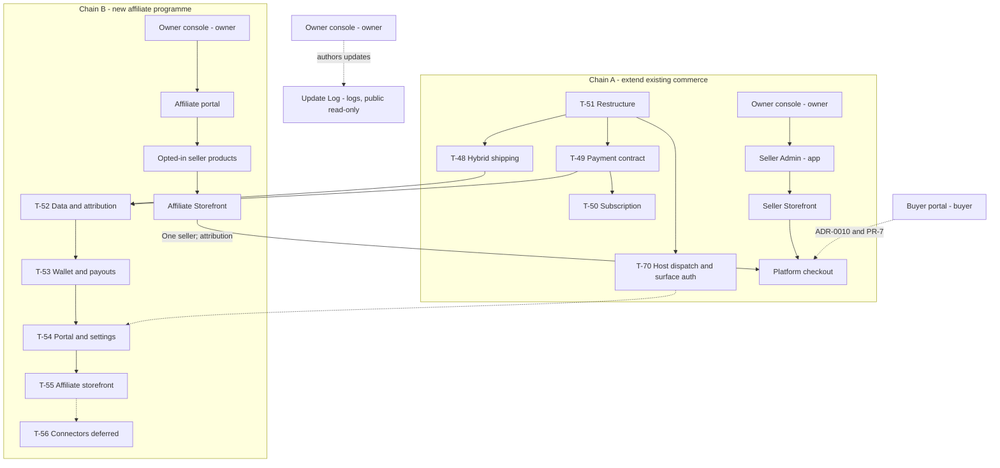

## ADR-0008: One Next.js application with surface routing and bounded database contexts

- **Status:** Accepted (owner, 2026-10-28, DECISIONS D-20; accepted as a decision). Implemented locally so far: T-51 (restructure) and T-70 (host dispatch, per-surface sessions), both uncommitted; the remaining target layout (affiliate, buyer, update-log routes and contexts) is not implemented
- **Date:** 2026-10-27
- **Author:** Architecture planning
- **Deciders:** Bukalaris product + architecture owners
- **Owner:** Bukalaris architecture owner
- **Related:** DECISIONS D-2, D-3, D-4, D-9, D-12; ADR-0005, ADR-0007, ADR-0009, ADR-0010, ADR-0011; PR-7, PR-18, PR-27, PR-28, PR-29; TD-5, TD-7; ARCH-5; DOM-1 through DOM-6; DATA-10, DATA-11; IAM-3, PRIV-2; T-51 through T-56, T-70
- **Refines:** D-2's future split trigger; separate deployments wait for a demonstrated isolation need, not merely a new surface or theme

## Context

Owner direction (2026-10-27): build two product chains in sequence. Chain A is
Owner console → Seller Admin → seller Storefront, adding platform subscriptions,
hybrid shipping accounts and repository restructuring to the M2 baseline. Chain B
is new: Owner console → Affiliate → seller products → Affiliate Storefront.
Affiliate checkout still creates one seller-owned order through the platform
checkout; this is not a multi-seller checkout project (TD-5, BILL-3).

The same day's owner host decision names the operator surface the Owner console
(ADR-0011) at `owner.bukalaris.com` and adds a global Buyer account portal at
`buyer.bukalaris.com`. The earlier operator-surface labels `bos` and `berkah` were
interim names, never deployed, kept reserved so nobody can claim them; they are
retired/reserved-unused, not seller slugs or active admin aliases.
Buyer identity behavior belongs to ADR-0010 and PR-7; this ADR specifies only
its surface, routing, module ownership and isolation boundaries.

A further owner host decision (2026-10-27, "if needed") adds `logs.bukalaris.com`
as the public product **Update Log**: release notes, "what's new" and platform
update information. It is a product changelog. It is **not** the internal Log
System (`/admin/logs`, `system_log`, PR-11), which is operational telemetry
behind operator authorization; the two share no data, route or capability.
Authoring happens only in the Owner console on `owner.bukalaris.com`. Precedent
(Tokophi, not Bukalaris code): a Super Admin `/update-log` page.

Observed repository baseline on 2026-10-27 (source inspection, not runtime proof):

- One Next.js App Router application, `apps/web`; its manifest pins Next.js
  16.3.8 and React/React DOM 19.2.8. `src/proxy.ts` is the host-rewrite entry point.
- 64 route entry points under `apps/web/src/app`: 47 `page.tsx` and 17 `route.ts`
  files. ARCH-5 retains the implemented route/page IDs and historical evidence.
- `packages/db/src` has 54 TypeScript files, including its existing `mengantar/`
  and `demo/` children. Most services and schema modules are flat at the root.
  There are 42 tables: 15 in `schema.ts`, 27 in 15 `schema-*.ts` modules.
- Current host parsing accepts a single store label under `STORE_ROOT_DOMAIN`;
  nested subdomains are not accepted. The proxy rewrites store-host requests to
  `/s/<slug>/…`, passes `/checkout*` and `/api/…` through, and strips a matching
  `/s/<slug>` prefix from same-store host links. It also overwrites the internal
  store header and applies request/security headers. It does not implement the
  proposed exact-platform-host dispatch below or reserved-label validation.
- D-3 makes the store the seller tenancy root. D-4's application scoping and
  compound foreign keys remain relevant; its original RLS deferral was already
  superseded by the implemented three-role design in ADR-0005.
- No subscription or affiliate implementation exists in this baseline. New hosts,
  origin isolation, and the folder tree below are proposals, not deployment facts.

**Decision drivers:** retain one commerce implementation and existing URLs;
separate trust/layout boundaries without multiplying deploys; make data ownership
and privileged cross-store access explicit; permit a later deployment split.

**Non-goals:** splitting into several apps, adding Astro, per-seller deployments,
changing business behavior during moves, building new affiliate/billing/buyer
behavior inside T-51, changing seller RLS to support discovery, external product connectors
(T-56), or a multi-seller cart/settlement (BILL-3 remains open).

## Decision

### 1. Keep one application; separate surfaces inside it

Keep `apps/web` and `packages/db`. Route groups organize layouts and ownership;
they are not URL segments or authorization boundaries. Hosts identify a surface,
not a trusted actor. Each server read/action/handler still authenticates and
checks its own scope. First-party server components call domain services directly;
external consumers use authorized HTTP adapters. Browser modules never import
DB pools, credentials or provider clients.

This refines the old split recommendation in D-2 and the historical multi-app/
Astro proposal in ARCH-4 and the stack tables. The current target is one Next.js
app even when separate origins become available. Separate origins, host-only
cookies and session audiences do not require separate Next.js deployments.
An app split is reconsidered only for measured deploy, security, scaling or
runtime isolation needs; it must preserve the same domain contracts.

The Owner console, Seller Admin, Affiliate portal and Buyer account portal have
separate host-only cookie scopes and session audiences; none shares a session
with another surface. Never set their session cookie on `.bukalaris.com`: session,
CSRF and capability cookies use the `__Host-` prefix with per-surface names
(08 DOM-6), which also defeats cookie tossing from storefront subdomains.
A buyer session never grants any admin capability, and changing the host or
route group cannot upgrade it. Buyer identity rules remain with ADR-0010 and
PR-7; store membership and operator authorization remain independent.

The Update Log host is the exception: it is public and read-only, with no login,
no session and no session audience. It sets no session or other authentication
cookie and carries no personal data. It is not a fifth session-bearing surface,
and nothing authored there is trusted from the browser. Authoring stays behind
the operator boundary on `owner.bukalaris.com`.

### 2. Proposed host and path map

All hosts below describe routing intent. DNS, TLS (including the nested affiliate
wildcard), origin provisioning and production cookie behavior are **UNVERIFIED**.
Do not publish hostnames as live service links before those gates are satisfied.

| Surface | Proposed public host and path | Internal path / ownership |
|---|---|---|
| Platform front door | `bukalaris.com/…` | Existing apex routes; referral links `/r/<token>` (HTTP-27), public report intake and provider callbacks (HTTP-17, HTTP-26), no session surface; future discovery is a separate feature |
| Owner console (formerly Super Admin / Bos) | `owner.bukalaris.com/…` | `/admin/…`; verified platform operator, TOTP and operation grants; `berkah` and `bos` are retired/reserved-unused |
| Seller Admin | `app.bukalaris.com/…` | `/seller/…`; authenticated seller membership and selected store scope |
| Seller Storefront | `<store-slug>.bukalaris.com/…`, later verified seller custom host | `/s/<store>/…`; resolve one active store, retain independent LP and media branches |
| Checkout | Configured platform checkout origin, recommended `checkout.bukalaris.com/checkout/…` | `/checkout/…`; cart/handoff derives one seller store; no storefront shell |
| Affiliate portal | `affiliate.bukalaris.com/…` | `/affiliate/…`; separate affiliate account type, login surface and role |
| Buyer account portal | `buyer.bukalaris.com/…` | `/buyer/…`; platform-level buyer identity context; ADR-0010 and PR-7 |
| Update Log (public) | `logs.bukalaris.com/…` | `/updates/…`; read-only public product changelog; platform-owned, no store or seller tenancy; not the Log System |
| Affiliate Storefront | `<handle>.affiliate.bukalaris.com/…` | `/a/<handle>/…`; public platform-owned affiliate projection, not a seller tenant |

Existing `/admin`, `/seller`, `/s/<store>`, `/checkout`, auth, status-link, feed
and API paths remain valid during the move-only restructure (T-51). Once T-70
activates host dispatch, the host × path matrix in 08 DOM-5 decides what each
host serves: path mode is retired in production and a surface's prefix is 404
on every other host, the apex included. A host's already qualified internal
prefix is not prefixed twice. Proposed new affiliate paths
are introduced by T-54/T-55, not as empty routes in T-51. The new buyer subtree
is introduced by the feature implementing ADR-0010 and PR-7, not as an empty
route in T-51. Affiliate storefront product actions hand off to the selected
seller's checkout at the configured platform origin with attribution carried;
the referral selector grants no login or order-read authority. No affiliate-host
checkout or cross-seller cart exists.

### 3. Proxy dispatch and reserved namespaces

Retain a single `apps/web/src/proxy.ts`, not a competing middleware file.
The target dispatch order is:

1. Normalize the trusted incoming host (case, port and trailing dot); accept
   forwarded host information only from the configured trusted proxy chain.
   Delete inbound internal surface/store/affiliate headers before deriving them.
   Preserve existing request-ID, CSP/nonce, media-CSP exclusion and HSTS behavior.
2. Keep static/framework exclusions. Never surface-prefix `/api` or `/api/…`,
   `/checkout` or `/checkout/…` (including handoff and confirmation), regardless
   of host. During move-only T-51 keep the current broader `/checkout*` bypass on
   every host; narrowing it is T-70. From T-70 on, whether a bypassed path is
   served at all is decided per host by the 08 DOM-5 matrix: checkout only on the
   checkout host, `/api` by a per-host allowlist (health and readiness probes on
   every host), 404 otherwise. The host guard may reject an invalid origin, but
   must not send checkout or API writes to a storefront.
3. Match exact platform hosts before wildcard resolution: apex, `owner`, `app`,
   `checkout`, `affiliate`, `buyer`, `logs`, then other reserved infrastructure
   hosts. Dispatch the Owner console → `/admin`, Seller Admin → `/seller`, affiliate
   portal → `/affiliate`, buyer portal → `/buyer`, Update Log → `/updates`;
   checkout keeps its path. The `logs` host serves `GET`/`HEAD` only (other
   methods are refused, not rewritten) and serves no `/checkout*` or `/api/…`
   path except the health and readiness probes (404), so it can neither reach
   checkout/API handlers nor accept writes; framework static assets are excepted.
   `berkah` and `bos` are retired/reserved-unused and never dispatch as an admin or store.
   Platform auth and link routes (`/login`, `/account/*`, `/invite/*`, `/o/*`,
   `/feeds/*`, `/dev/*`) are not surface-prefixed and stay with the host DOM-5
   assigns (for example `/o/*` on the checkout host, `/feeds/*` and `/invite/*` on
   the Seller Admin host). Buyer, affiliate, seller and operator login/session
   surfaces remain separate. Do not double-prefix requests already carrying
   their surface's internal path.
4. Match exactly one valid `<handle>.affiliate.bukalaris.com` label and rewrite
   public affiliate paths to `/a/<handle>/…`; no fallback into store lookup.
5. Match exactly one valid `<store-slug>.bukalaris.com` label, or an active
   verified custom-domain binding, and rewrite storefront paths to `/s/<store>/…`.
   A custom-domain lookup uses the narrow cached resolver of 08 DOM-2 (no
   privileged pool in the host parser, invalidation on every domain mutation,
   fail closed on error). Keep the existing same-store path-prefix
   canonicalization. Apply DOM-3
   primary-origin redirects only to safe storefront requests, never API,
   checkout, or unsafe methods. Reject conflicting path/host store identities.
6. Unknown hosts, inactive/missing bindings and malformed/nested labels fail
   closed; they never select a default seller or an affiliate by resemblance.

Reserve `owner`, `app`, `checkout`, `affiliate`, `buyer`, `logs`, `www`,
`api`, `mail`, `status`, `docs`, `assets`, `cdn`, `cname` and the retired `berkah` and `bos`
before allocation. `owner` is the active Owner console host label and is not claimable as a
store slug or affiliate handle; `berkah` and `bos` are retired/reserved-unused. `logs` is
reserved for the Update Log and is not claimable as a store slug or affiliate handle. Apply
the same reserved-label policy
to new seller slugs and affiliate handles. Normalize handles/slugs to
lowercase ASCII DNS labels (letters/digits with internal hyphens; no dots,
leading/trailing hyphen or empty label), at most 63 characters. Enforce
case-insensitive uniqueness atomically within each namespace, and check existing
claims before activation; an existing conflicting claim blocks rollout until
an owner-approved migration, never a silent reassignment.

Store slugs and affiliate handles are **separate namespaces**: `sample.bukalaris.com`
and `sample.affiliate.bukalaris.com` may coexist. An affiliate cannot claim a
store hostname, platform hostname or verified seller custom host. Custom-domain
claims cannot bind a reserved platform host or the platform-controlled affiliate
subtree. Affiliate custom domains are not specified. Route roots `admin`,
`seller`, `s`, `checkout`, `api`, `affiliate`, `buyer`, `updates`, `a`, `login`,
`account`, `invite`, `o`, `feeds`, `r` and `report` remain platform-controlled, not claimable paths. Host selection
never changes ownership of underlying seller products or orders.

**Host activation and per-surface auth (T-70).** T-51 only moves files. A
separate task, T-70, sits between T-51 and T-62, T-54, T-55, T-58 and T-69 and
activates what sections 1 and 3 describe: (a) exact-host dispatch in `proxy.ts`
for apex, `owner`, `app`, `checkout`, `affiliate`, `buyer`, `logs` and the two
wildcard subtrees, with reserved-label enforcement in host parsing and at slug
and handle creation (existing claims checked first); (b) the DOM-5 host × path
matrix, apex path-mode retirement and the `/checkout*` and `/api` narrowing;
(c) one auth instance per surface (own origin, secret, audience claim and
`__Host-` cookie name) selected from the dispatched surface, with the auth tables
reached through the auth adapter role of T-59, and per-surface origin settings
that replace `BETTER_AUTH_URL`; (d) the narrow custom-domain resolver (DOM-2);
(e) the golden proxy table, the `*.localhost` Playwright project and the
negative cases of section 7. The affiliate and buyer features only add their
own instance configuration and pages (T-54, T-58). T-70 changes behaviour on
purpose, which is why it is not part of the move-only T-51.

### 4. Proposed application tree

```text
apps/web/src/app/
  (platform)/                  # apex/front door, existing page.tsx
  (operator)/admin/            # existing admin subtree and its auth/layout checks
  (seller)/seller/             # existing seller subtree
  (storefront)/s/[store]/
    (shop)/                    # existing themed pages and layout
    lp/                        # existing independent LP layout/styling
    media/                     # existing media handler
  (checkout)/checkout/         # existing checkout, confirmation and handoff
  (affiliate-portal)/affiliate/ # new only with T-54
  (affiliate-storefront)/a/[handle]/ # new only with T-55
  (buyer-portal)/buyer/        # new buyer surface; ADR-0010 and PR-7
  (update-log)/updates/        # new read-only public Update Log; see section 7 and T-51
  (identity)/                  # existing login, account and invite paths
  (public-services)/           # existing o/, feeds/ and dev/ paths
  (public)/                    # new: /report (SF-13, T-64, dormant) and /r/[token] (HTTP-27, T-52), platform origin
  api/                         # existing API paths; no host surface prefix
  error.tsx, global-error.tsx, not-found.tsx, globals.css
```

Group names and proposed affiliate/buyer/update-log/public folders are target locators, not current
files. Preserve the current root-layout topology and surface-owned layouts
when moving entries; do not introduce extra roots, theme wrapping, or duplicate
URL paths across groups. The LP stays outside `(shop)`; checkout stays outside
both seller and affiliate storefront shells. A route group alone cannot render
different `/` pages for different hosts: real prefixes plus proxy rewrites do
that. Marketing, admin, affiliate, buyer and storefront bundles must not import one
another's editors or privileged server modules merely to share a shell.

### 5. Proposed database context tree and ownership

Keep migrations in `packages/db/drizzle/`; reorganize TypeScript under `src/`.
Folders are modules, not new workspace packages or independent databases.

| Target context | Existing material to move / proposed responsibility |
|---|---|
| `platform/` | `accounts.ts`, `membership.ts`, `platform.ts`, `scoped.ts`, `tenant.ts`, `host.ts`, `schema-accounts.ts`; identity, stores, membership, scope constructors and host resolution. Also hosts the future Update Log sub-module `platform/updates` (entries, publication state): platform-owned, not store-scoped, authored by operators and tiny, so a top-level context or package would add ceremony; extract only if it grows its own lifecycle |
| `buyer/` | New platform-level buyer identity tables and authorized buyer services; ownership and identity behavior follow ADR-0010 and PR-7, not seller tenancy |
| `billing/` | New subscription/invoice services and schema from T-50 (DATA-10, BILL-7); platform invoices distinct from buyer orders and seller proceeds |
| `seller/commerce/` | `catalog.ts`, `checkout.ts`, `orders.ts`, `dashboard.ts`, `privacy.ts`, `schema-catalog.ts`, `schema-orders.ts`, `schema-abuse.ts`, `schema-privacy.ts`; seller-owned catalog, inventory, carts, orders and privacy operations |
| `storefront/` | `storefront.ts`, `content.ts`, `landing.ts`, `channels.ts`, `feeds.ts`, `signals.ts` and matching schema modules; published reads/content, channel and signal boundaries retain store ownership |
| `shipping/` | `shipping.ts`, `fulfillment.ts`, `schema-shipping.ts`, `schema-fulfillment.ts`, existing `mengantar/`; T-48 hybrid accounts and consent later follow DATA-9 |
| `payments/` | `providers.ts` payment adapter material; order payment attempts and T-49 AutoLaris adapter, separate from billing invoice orchestration; seller-proceeds allocation/ledger service ownership follows BILL-4/BILL-5 |
| `tax/` | New platform-owned tax modules: policy versions, earnings statements, voluntary identities and the dormant withholding, liability, remittance, document, filing and period modules (DATA-15, ADR-0012; startup subset T-65, dormant remainder T-67); reached only through `tax.*` capabilities and platform-class tables with explicit grants, never from seller or affiliate pools |
| `affiliate/` | New platform-owned account/catalog/attribution/commission/wallet/payout modules from T-52/T-53; seller opt-in configuration remains store-scoped even if its service boundary lives here (DATA-11, BILL-8) |
| `ops/` and `ops/jobs/` | `ops.ts`, `schema-ops.ts`; `jobs.ts`, `notify.ts`, `schema-jobs.ts`, `schema-notify.ts` under jobs; durable execution, periodic enqueuer, logs and notification delivery, not ownership of each domain's business rules |
| Root infrastructure | `client.ts`, a minimal explicit package entry, migration/seed/local-role commands, `demo/`, and `worker.ts` and `cleanup.ts` as thin root entry points that import `ops/jobs` so the worker and cleanup command paths used by DEPLOY-COOLIFY and RUNBOOK do not move; commands stay thin root entry points rather than gain compatibility wrappers |

Move schema declarations beside their owning context. `schema.ts` currently mixes
contexts: first move the file intact with its existing commerce consumers,
then extract platform/commerce/payment declarations in separate mechanical
steps. Update every import and Drizzle schema-discovery input together. Keep
SQL table/column names, constraints, policy expressions, relation definitions
and exported declaration identities unchanged. Do not duplicate declarations
or use wildcard discovery that loads the same table twice.

Use explicit server-only context exports for application callers and retain only
needed package entry points. Move callers, tests, scripts, Docker tracing paths
and package export targets in the same step; remove obsolete flat paths and
broad privileged re-exports instead of adding compatibility shims. Contexts can
call narrow domain operations; no universal repository, provider factory, event
bus or extra package is required. A public host parser must not pull a privileged
DB pool into its import graph. DEPLOY-COOLIFY and RUNBOOK are update targets of
the same step for every command path that does change (migrate, seed, local
roles, image tracing); the worker and cleanup paths are unchanged by design.

### 6. RLS and role implications

- `bukalaris_owner` remains schema/migration-only (including authorized backfills).
  Never connect a web request as owner. No fourth broad-privilege runtime role
  is introduced by restructuring.
- `bukalaris_app` remains the non-owner, NOBYPASSRLS runtime for store-scoped
  commerce. Preserve `inStore` transaction-local `app.store_id`, forced RLS,
  compound store foreign keys and missing-context fail-closed behavior.
  Seller product opt-ins, per-product commission overrides and seller affiliate
  block records retain explicit store ownership and policies.
- `bukalaris_platform` remains the tightly bounded privileged runtime for verified
  operator operations, worker/cleanup and authorized cross-store resolvers.
  Affiliate and billing platform services use this boundary only after checking
  the appropriate actor/capability; an affiliate is not an `OperatorScope` and
  never receives generic platform-pool access.
- Affiliate accounts, links, clicks, attribution, commissions, wallet ledger and
  payouts are owned by the platform, not a selected seller. They must not be
  hidden behind an arbitrary `store_id` tenancy claim. Store/order references
  express provenance, not ownership of the affiliate account. New table grants
  and any provenance-row policies are explicit and reviewed; table creation
  must not implicitly grant the app role all affiliate/tax/bank records.
- Cross-store affiliate discovery reads only `affiliate_catalog`, a platform-owned
  outbox-fed projection of opted-in seller products, not raw seller catalog
  tables under a bypass pool. Phase 1 has `source = bukalaris` only. Restricted
  affiliate services scope private reads to the authenticated affiliate; public
  reads return approved catalog/profile data only. Role-based bank/phone masking
  is performed in the data layer; affiliate outcomes contain aggregates, never
  buyer PII (IAM-3, PRIV-2). Checkout returns to the seller-scoped transaction
  after any narrowly authorized attribution resolution.
- The `buyer/` context owns platform-level buyer identity, separate from seller
  store data and affiliate identity. Buyer services authorize their own audience
  and access through the established role boundaries; no generic platform pool
  or operator scope is exposed to a buyer. Store-owned orders retain store RLS.
  Detailed identity and order-linking behavior is specified only by ADR-0010
  and PR-7.
- The Update Log (`platform/updates`) is platform-owned content with no `store_id`
  and no seller RLS. Public reads return published entries only through one narrow
  read function; drafts and authoring metadata are never exposed to the public
  host. Writes run only through the operator boundary and capability defined by
  the Owner console contract, not through the seller or buyer pools. Table grants
  are explicit (ADR-0005: tables without `store_id` are reachable only through
  authorized code paths). It is separate from `system_log` (Log System, PR-11).
  Cacheability is constrained by existing `proxy.ts` behavior: the per-request
  nonce CSP and the request-id cookie it sets on every response both defeat
  shared caching. Serving this host as cacheable needs a host-specific proxy
  profile: a static CSP without a nonce, no per-request cookie and stable
  validators. T-69 owns that change; T-51 leaves `proxy.ts` unchanged. Freshness
  after publish or unpublish comes from time-based staleness only, or from one
  authenticated internal handler, HTTP-30 (`POST /api/internal/updates/revalidate`),
  that is served only on the internal service host, is authenticated by a
  purpose-separated secret and is 404 on every public host. The worker cannot
  trigger Next.js revalidation itself because revalidation runs inside the web
  process. UNVERIFIED until implemented.

- One unified Bukalaris money system (ADR-0006, ADR-0007, D-15): all stores ship
  through Bukalaris-provisioned Partner Mengantar accounts (`partner_managed`,
  with `platform_master` fallback) and collect prepaid payments through our
  AutoLaris gateway. There is no `own_key` external seller account and no
  "System A vs System B" split (`SA-54` is retired into `SA-07`). All seller
  proceeds (`sale`), shipping cashback (`cashback`), shipping debits, COD
  reconciliation batches (`SA-53`, `JOB-33`, `HTTP-31`), and affiliate
  commissions run through the single Bukalaris ledger and operator boundary.

### 7. Move-only migration and feature sequence

1. Record the current file/route inventory and ARCH-5 page/handler/job IDs.
   Record every public URL, host/path rewrite, layout, export, CLI entry,
   schema-discovery path and privileged import boundary before moving files.
2. Move one existing database context at a time, rewriting all consumers and
   configuration in the same change. Start with leaf modules; move shared scope
   and schema declarations only after their consumers are mapped. Keep exported
   behavior, SQL definitions, transaction boundaries and job payloads unchanged.
3. Move existing route subtrees into non-URL route groups. Preserve all 64 current
   route entry points, effective paths, auth checks, action/handler behavior,
   layout inheritance, proxy results and security headers. Regenerate ARCH-5
   locators while retaining its stable IDs. Do not activate new host dispatch,
   create empty affiliate/billing/buyer/update-log routes, or mix behavior changes into these moves.
4. At each mechanical step, the implementation owner runs the narrow affected
   checks; after the complete move runs lint, typecheck, tests, build and e2e.
   Previously green checks must remain green before the next step. The existing
   gates cannot show "unchanged proxy results" by themselves (the e2e project
   runs path mode on `localhost`, and host mode has a single test), so T-51
   captures before/after artefacts: (a) a golden table of `proxy()` results for
   host × path × method over a fixed list of hosts and paths, byte-comparable
   before and after; (b) a Playwright project on `*.localhost` hosts that
   exercises store host mode, the `/checkout` and `/api` bypass and reserved
   paths; (c) a route-manifest diff of every effective route path and method
   (no loss, no duplicate); (d) an empty result from `drizzle-kit generate`
   (no schema-change SQL attributable to a folder move). T-70 extends the golden
   table with the DOM-5 matrix and keeps the same Playwright project.
5. Preserve all existing SQL migrations and Drizzle history. D-9 remains
   append-only; never regenerate deployed history to accommodate folder moves.
   Later billing/affiliate/account changes get new migrations and use expand →
   backfill → contract where populated data requires it.
6. Add actual billing, shipping, affiliate, buyer, update-log and host behavior only in its owning
   feature change after T-51. Host activation (T-70) includes negative host/header,
   cookie/audience and checkout/API bypass evidence plus DNS/TLS review; it is
   not established by moving a folder or by writing this ADR.
7. Behaviour changes that earlier reviews attached to T-51 are not move-only and
   are owned elsewhere: CRUXR-02 (storefront URL preview built from
   `BETTER_AUTH_URL`) by the quick-fix pass, or failing that T-70 (per-surface
   origins, `storeBaseUrl`); CRSEC-01 (reserved labels) by the quick-fix pass,
   completed by T-70; CRSEC-05 (seller pixels sharing the admin origin) by T-70
   (host split), with the Meta `autoConfig` setting in the T-38 follow-up;
   CRUXR-03 (UI brand "Bos") by T-62 under the PR-30 naming rule; CRSEC-02
   (one auth instance, one cookie) by T-70, with the affiliate and buyer
   instances added by T-54 and T-58; CRSEC-03 (RLS framework for platform-owned
   tables) by T-59.
8. Tasks that edit files T-51 moves (T-37, T-48, T-49, T-50, T-61 and any
   quick fix) depend on T-51 or work inside a declared freeze window; otherwise
   they collide with the move.



The task arrows are illustrative; the authoritative build order is the TASKS.md
header and each task's `Dependencies:` line, which this ADR does not restate.
T-70 follows T-51 and precedes T-62, T-54, T-55, T-58 and T-69. The surface
arrows express the product chain, not service-to-service network calls. T-37
seller-proceeds work is planned separately and is not folded into T-51. Chain B
follows Chain A; T-56 and multi-seller settlement remain deferred.

## Alternatives considered

- **Several apps now (Owner console, seller, storefront, checkout, affiliate, buyer):** independent
  release and runtime isolation, but duplicated deployment/auth configuration,
  more cross-origin integration and no demonstrated isolation requirement yet.
  Deferred; the explicit contexts and routes leave this extraction possible.
- **Keep the current flat service and route layout unchanged:** least immediate
  movement, but new billing and platform-owned affiliate domains would obscure
  ownership and make privileged imports harder to review. Not selected.
- **Reuse seller tenancy for affiliates:** superficially reuses seller RLS, but
  incorrectly makes one seller own a cross-store affiliate account and creates
  pressure to bypass seller policies for discovery. Rejected.
- **Give affiliates the seller wildcard (`<handle>.bukalaris.com`):** shorter
  names, but requires a shared store/affiliate claim registry and changes the
  meaning of the existing store namespace. Distinct affiliate subtree selected.

## Consequences

- **Positive:** one deployable web application and shared business rules; stable
  store URLs; explicit surface layouts and data ownership; a reviewable privileged
  boundary; later app extraction without changing checkout semantics.
- **Negative:** all web surfaces still share deployment/blast radius; folders are
  not security isolation. Nested affiliate wildcard TLS/routing, origin-specific
  authentication and platform projection freshness need implementation evidence.
- **Neutral:** worker/maintenance remain separate processes using the same package;
  no new broker or database is required. Proposed does not mean implemented.

## Confirmation

T-51 records a one-to-one before/after mapping for all 47 pages and 17 handlers
(or explains independently approved intervening additions), all ARCH-5 background
entries and their stable IDs. Public route/method/host behavior and layouts are
unchanged by moves; no duplicate effective App Router path exists. All import,
export, Drizzle, command and image-tracing references use the new locations with
no obsolete flat compatibility paths. No schema-change migration is generated
for move-only work; D-9 history is unchanged. The implementation owner records
`pnpm lint`, `pnpm typecheck`, `pnpm test`, `pnpm build` and `pnpm e2e` results,
including store-isolation and proxy/checkout/API behavior, attaches the four
artefacts of section 7 step 4 (golden proxy table, `*.localhost` Playwright
result, route-manifest diff, empty `drizzle-kit generate`), then regenerates
ARCH-5 against the resulting revision. This documentation change runs none of
those gates.

T-70 confirms host activation with: the golden host × path × method table equal
to 08 DOM-5; a negative case for every privileged or checkout `404` cell
(apex `/admin`, `/seller`, `/s/<store>`, `/checkout` and a surface prefix on a
foreign host); a session of one surface rejected on every other surface; the
reserved-label and conflicting-claim tests; the logs host serving no cookie and
no write; and, as always, DNS/TLS and deployed cookie behaviour **UNVERIFIED**
until observed.

## More information

- [Technical design TD-7](03-TECHNICAL-DESIGN.md#td-7--surface-and-package-structure)
- [Implemented route map ARCH-5](04-SYSTEM-ARCHITECTURE.md#arch-5--canonical-system-and-page-map)
- [Domain routing](08-DOMAIN-ROUTING.md#platform-domain-map)
- [Host × path matrix and link origins (DOM-5)](08-DOMAIN-ROUTING.md#dom-5--host--path-matrix-and-link-origins) and [cookie and origin rules (DOM-6)](08-DOMAIN-ROUTING.md#dom-6--cookie-and-origin-rules)
- [Three-role RLS decision](ADR-0005-database-tenant-isolation-rls.md)
- [Hybrid shipping](ADR-0007-hybrid-mengantar-shipping-accounts.md)
- [Affiliate ownership](ADR-0009-platform-owned-affiliate-programme.md)
- Local Next.js 16.3.8 bundled references inspected: `next/dist/docs/01-app/03-api-reference/03-file-conventions/{route-groups,proxy}.md`; published equivalents: [route groups](https://nextjs.org/docs/app/api-reference/file-conventions/route-groups), [proxy](https://nextjs.org/docs/app/api-reference/file-conventions/proxy).

**Open / UNVERIFIED:** live DNS/TLS and nested wildcard support; deployed origin,
cookie/audience and proxy trust-chain configuration; exact activation sequencing
for reserved labels with any existing claims. Subscription commercial open points
and affiliate hold/attribution/tax policy remain with BILL-7/BILL-8, ADR-0009 and ADR-0012,
not defaults invented by this routing decision.

**Open (recommended, not decided):** whether seller and affiliate storefronts move
to a separate registrable domain (08 DOM-6; recommended default: decide before
public launch, keep `STORE_ROOT_DOMAIN` a deployment value).

## Change history

- 2026-10-27 — documentation audit pass: added T-70 (host activation and
  per-surface auth), the DOM-5/DOM-6 references, the `tax/` context and the
  `(public)` group, the T-51 evidence artefacts, ownership of the behaviour changes
  attached to T-51, the logs-host proxy profile and the worker/cleanup entry-point
  rule (audit TRC-1, TRC-7, OPS-01, OPS-02, OPS-11, OPS-15, OPS-16, OPS-23, OPS-25).
